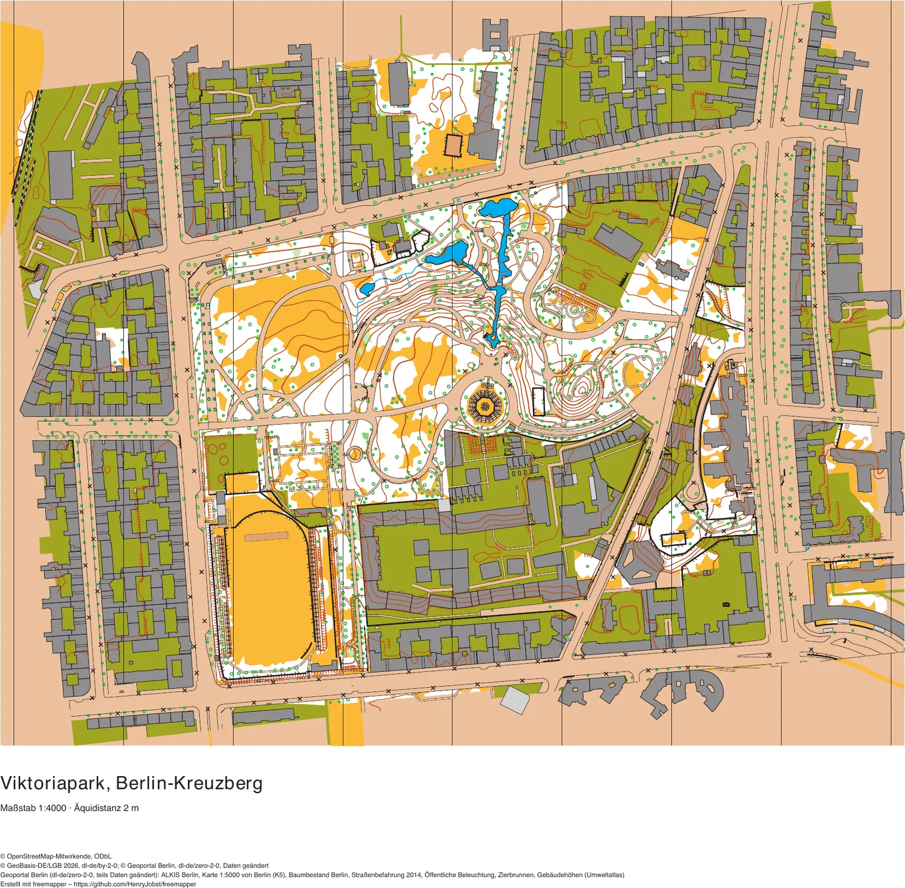
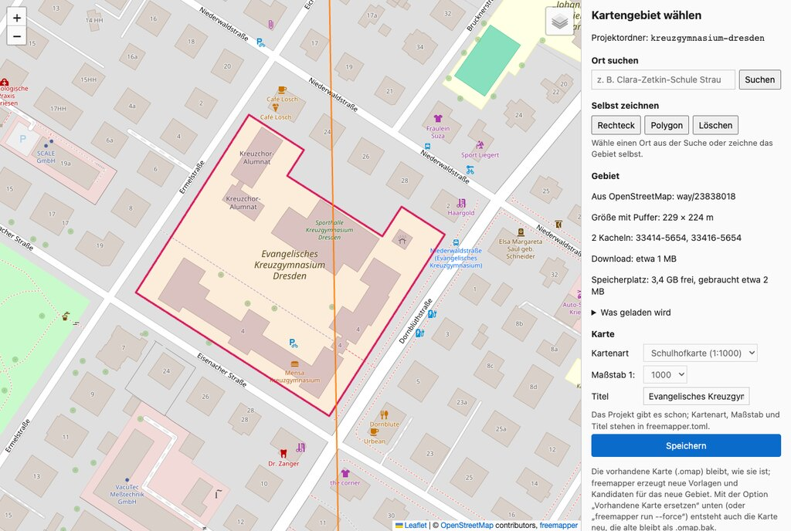

# freemapper

[Deutsche Version](README.md) · [User manual](docs/manual/en.md) · [Glossary](docs/glossary.md) · [Changes](CHANGELOG.en.md)

<!-- claude-cost:start -->
[](docs/ai-cost/history.csv)
<!-- claude-cost:end -->

<p align="center"><a href="examples/berlin-viktoriapark/berlin-viktoriapark-candidates.pdf"></a><br><sub>Viktoriapark, Berlin-Kreuzberg (sprint 1:4000), made by freemapper from open data. Click to open the PDF; more under <a href="examples/README.en.md">examples</a>.</sub></p>

freemapper turns official geodata (terrain model, nDSM, orthophoto, ALKIS cadastre) and OpenStreetMap
into a **starter project for OpenOrienteering Mapper (OOM) and, on request, for OCAD**: a
georeferenced map with the reliable map objects already symbolized, plus templates for everything
the mapper has to judge. Drawing and field checking stay in OOM or OCAD.

- **Output:**
  - always an OOM map (`.omap`);
  - with `--ocad`, also an OCAD map (`.ocd`, OCAD 12 and newer), see
    [Starting point for OCAD](#starting-point-for-ocad);
  - with `--pdf`, the print-ready map as a PDF, and with `--pdf-candidates` also the training map with every candidate, see [Map as PDF](#map-as-pdf).
- A single program for Linux, macOS and Windows, no GIS installation needed.
- Use it from the command line, through a page in the browser where you choose the map area and create the
  map with all options (see [Choosing the area in the browser](#choosing-the-area-in-the-browser)), or
  through AI agents (MCP server).
- Regions: Brandenburg, Berlin, Saxony, Saxony-Anhalt, Hamburg, Hesse, Schleswig-Holstein, Mecklenburg-Vorpommern, North Rhine-Westphalia, Lower Saxony, Rhineland-Palatinate, Saarland and Baden-Württemberg (open data from LGB,
  Geoportal Berlin, GeoSN, LVermGeo, LGV, HVBG, LVermGeo SH, LAiV M-V, Geobasis NRW, LGLN, LVermGeo RP, LVGL and LGL);
  schoolyard maps 1:1000, sprint maps 1:4000 and forest maps 1:15 000, 1:10 000 or 1:7500.
- Examples: one finished project per state with the OOM map, the OCAD starting point and the PDF, see
  [Examples](#examples).

## The freemapper suite

freemapper is the first step of a tool chain for orienteering maps. Two follow-up projects are under
development:

- freemapper makes the starting point of the map,
- the map is drawn in OOM,
- [freemapper-courseplan](https://github.com/HenryJobst/freemapper-courseplan) sets the courses in an
  editor in the browser and checks them against the competition rules,
- [freemapper-print](https://github.com/HenryJobst/freemapper-print) prints the map sheets, one sheet per
  course, with the course overprint and control descriptions.

Code that several of these programs need lives in a shared library:
[freemapper-core](https://github.com/HenryJobst/freemapper-core). It is a set of small Rust crates, for
example `freemapper-fs` for file access that never leaves the project. The programs move to these crates
step by step, each pinned to a fixed version, instead of copying the code.

## Status

The current version is [v0.17.0](https://github.com/HenryJobst/freemapper/releases/tag/v0.17.0) of
13 November 2026 (see the [changes](CHANGELOG.en.md) for what is new).

freemapper makes schoolyard and
sprint maps for thirteen states: Brandenburg, Berlin, Saxony, Saxony-Anhalt, Hamburg, Hesse,
Schleswig-Holstein, Mecklenburg-Vorpommern, North Rhine-Westphalia, Lower Saxony,
Rhineland-Palatinate, Saarland and Baden-Württemberg (new since v0.17.0, not released yet). All maps show water, and the colours follow the IOF printing definitions of
2024. On request freemapper also makes an OCAD starting point (`--ocad`) and a PDF map
(`--pdf`, with candidates `--pdf-candidates`). Before downloading, freemapper
checks the free disk space. Berlin maps get canopies, stairs, walls, fences, hedges, trees and the
1:5000 map as a template from further Geoportal Berlin data. They also use the street survey of 2014
to 2016: the surveyed green strips are cut out of the street areas,
curbs, railings, furniture, lamps and fountains come as candidates, and buildings carry their
footprint date.

In all states: canopies and carports from ALKIS are map objects in every state except
Saxony and Saxony-Anhalt, and building passages are candidates there. Brandenburg maps get walls, fences,
hedges, monuments, embankment tops and bridges from the full ALKIS as candidates, and around Potsdam the trees
of the city map; the two edges of a wall become one line in the middle. Point symbols keep the gap the norm
asks for, and dense tree groups become areas that show. Parks are yellow, and the walkable area in brown lies under the sprint map. Where walls, fences and hedges overlap on
paper, the stronger line stays.

freemapper is still under development. A further state whose services are
standard ones can be added as a folder with a manifest, without Rust; the
[guide for contributors](docs/adapters/en.md) describes the way. Next come more detailed sprint maps for
further states,
first Saxony (water axes, hedges and tree rows from the Basis-DLM, the trees of Leipzig and Dresden), then
Saxony-Anhalt and Hamburg. Later come gym maps for indoor orienteering, the last English remains in the German program texts (`--lang de`),
and the remaining states with open geodata (Bremen, Bavaria). Thuringia follows once its height-data server is
back. Forest maps and the neighbouring countries come later. Design:
[`docs/superpowers/specs/2026-11-07-freemapper-design.md`](https://github.com/HenryJobst/freemapper/blob/main/docs/superpowers/specs/2026-11-07-freemapper-design.md).

On request freemapper writes permit notes next to the map, into the file `permits.md` (`freemapper permits`, `run --permits`, on the area page or through the AI assistant). For the map area it names the state, Kreis, Amt and Gemeinde from the BKG's VG250, the protected areas of the BfN and operators from OpenStreetMap, each with its share, source and data date, and says whom one usually asks. It is a hint, not legal advice. The details are in the [user manual, chapter 12](docs/manual/en.md#12-permit-notes). In Berlin the Bezirk, green spaces, land of the state and the Bund, monuments and natural monuments come from the Geoportal Berlin as well. Still planned are the forest administrations for forest maps; the research is in [`docs/research`](https://github.com/HenryJobst/freemapper/blob/main/docs/research/wald-und-sprint-behoerden/waldschutz-forstbehoerden-recherche.md).

## User manual

The [user manual](docs/manual/en.md) goes step by step from an area to a finished map, with no command-line
experience needed. The chapters people use most:

- [Installation](docs/manual/en.md#3-installation)
- [With an AI assistant](docs/manual/en.md#4-route-a-with-an-ai-assistant) or
  [without one](docs/manual/en.md#5-route-b-without-an-assistant)
- [Choosing the map area in the browser](docs/manual/en.md#6-choosing-the-map-area-in-the-browser)
- [What to check in the terrain](docs/manual/en.md#9-what-to-check-in-the-terrain)
- [Messages and what to do](docs/manual/en.md#15-messages-and-what-to-do)

## Examples

The repository holds a finished sprint map project for every supported state, with the OOM map, the OCAD
file and the PDF. Two of them here; clicking a picture opens the PDF:

| State | Area | Preview |
|---|---|---|
| Berlin | [Viktoriapark, Kreuzberg](https://github.com/HenryJobst/freemapper/tree/main/examples/berlin-viktoriapark/) | <a href="examples/berlin-viktoriapark/berlin-viktoriapark-candidates.pdf"></a> |
| Rhineland-Palatinate | [Reichsburg and Cochem old town](https://github.com/HenryJobst/freemapper/tree/main/examples/rheinland-pfalz-cochem/) | <a href="examples/rheinland-pfalz-cochem/rheinland-pfalz-cochem-candidates.pdf"></a> |

All examples with previews, how the areas were chosen and how many objects each map has are in the
[examples overview](https://github.com/HenryJobst/freemapper/blob/main/examples/README.en.md), with a forest map too (Dammheide in Berlin, 1:10 000). The same area in the three content profiles
`safe`, `balanced` and `full` is on the [comparison page](https://github.com/HenryJobst/freemapper/blob/main/examples/compare.en.md).

## Choosing the area in the browser

The easiest way is to draw the map area in the browser:

```sh
freemapper select my-schoolyard --kind schoolyard
```



On the page you search a place or draw a rectangle or polygon. The background is OpenStreetMap or the
orthophoto of the state. The page shows the size with buffer and the estimated download. "Save" creates the
project. Below it, "Create map" makes the map with the options OCAD, PDF, training PDF, scale bar, source
lines and "cache only", shows the progress, can be cancelled and opens the folder at the end. No terminal is
needed for that. The page runs on this computer only (127.0.0.1). More in the
[user manual, chapter 6](docs/manual/en.md#create-the-map-in-the-browser).

## Installation

freemapper is a single program without an installer. You do not need to build it yourself:

1. Download the archive for your system from the
   [release page](https://github.com/HenryJobst/freemapper/releases/latest):
   - Windows: `freemapper-…-windows-x86_64.zip`
   - macOS with Apple chip (M1 and newer): `freemapper-…-macos-arm64.tar.gz`
   - macOS with Intel processor: `freemapper-…-macos-x86_64.tar.gz`
   - Linux: `freemapper-…-linux-x86_64.tar.gz` (ARM computers: `linux-arm64`)

   The `.gz` files and `freemapper-update.json` on that page are for `freemapper update`.
2. Unpack the archive (double-click). The folder contains `freemapper` or `freemapper.exe`.
3. On the first start the system warns because the program is not signed:
   - **Windows:** "Windows protected your PC" → *More info* → *Run anyway*.
   - **macOS:** "cannot be opened because the developer cannot be verified" → *System Settings ›
     Privacy & Security* → *Open Anyway*; or in Terminal in the unpacked folder
     `xattr -d com.apple.quarantine freemapper`.
   - **Linux:** no warning; if needed `chmod +x freemapper`.
4. Check in a terminal (Windows: PowerShell) in the unpacked folder: `./freemapper --version`
   (Windows: `.\freemapper.exe --version`).

`freemapper update` asks, then downloads the newest release and puts it in place of the program, at
the same path. It checks the release's signature first, and the old program stays for
`freemapper update --rollback`. After `find`, `init`, `select`, `fetch`, `run` and `permits` freemapper looks at most once a
day for a newer release and reports it in one line; `freemapper update --mode off` switches that off. Versions 0.11.0 and
older cannot update themselves yet; replace them once by hand as above. Details are in the
[user manual](docs/manual/en.md#updating).

It is more convenient with an AI assistant (see [With an AI agent](#with-an-ai-agent-mcp)): register
freemapper once with its full path, and the assistant does the rest. An assistant that can run commands
(Claude Code, Codex) also does the download and the registration with [`AGENTS.md`](AGENTS.md).

## Build it yourself (for developers)

```sh
cargo build --release --locked
./target/release/freemapper --version
```

A tag `v<version>` (matching the version in `Cargo.toml`) builds the archives for all systems and
the GitHub release through `.github/workflows/release.yml`, together with the bare executables as `.gz` and the
update manifest signed with the release key. Started by hand with `dry_run`, the workflow builds and signs the
current branch and keeps the result as a workflow artifact without publishing anything.

Development: `cargo fmt`, `cargo clippy --workspace --all-targets -- -D warnings`, `cargo test --workspace`.
Git hooks: `lefthook install`.

Shared code of the suite comes step by step from
[freemapper-core](https://github.com/HenryJobst/freemapper-core). `Cargo.toml` pins it to a release tag
through git, so the first build fetches it from GitHub. To change it alongside freemapper, check
freemapper-core out next to freemapper and use it during development through a local `[patch]`, which comes
out again before the merge. The freemapper-core README and
[ADR 0067](https://github.com/HenryJobst/freemapper/blob/main/docs/adr/0067-shared-crates-from-freemapper-core.md) have the details.

## Usage

```sh
freemapper init clara-zetkin-schule --geojson tests/fixtures/clara-zetkin-schule.geojson --kind schoolyard \
  --title "Clara-Zetkin-Schule Strausberg"
freemapper run clara-zetkin-schule
```

Instead of a GeoJSON file, give the OSM object (`--osm way/992423119`, with `--part <n>` for an area of
several separate parts) or the name
(`--place "Clara-Zetkin-Schule Strausberg"`; the best match with an area is used, searched with
OpenStreetMap's Nominatim).

Or choose the area in the browser, see [Choosing the area in the browser](#choosing-the-area-in-the-browser).

`run` performs three steps that are also available on their own:

- `freemapper fetch <dir>` – downloads, for map area plus buffer, the orthophoto, terrain model and nDSM
  of the responsible state, the ALKIS buildings and land use, and Geofabrik's OSM extract of the state
  (180–300 MB the first time, afterwards only when it is more than 7 days old) into the cache. Only
  what was republished is downloaded again; `--offline` uses data fetched before. Where each state's
  data comes from is listed under [Regions](#regions).
- `freemapper derive <dir>` – computes orthophoto, hillshade, slope, local relief and nDSM (height above
  ground: hedges, walls, trees, playground equipment) templates from them, and contour lines (schoolyard
  1 m, sprint 2 m; every fifth an index contour), small knolls, depressions, earth banks and cliffs as
  candidates; with `--content-set vegetation=candidates` in Brandenburg, Berlin, North Rhine-Westphalia,
  Rhineland-Palatinate and Saarland also the vegetation from laser point clouds.
- `freemapper export <dir>` – writes the OOM map with the buildings as finished map objects (symbol 521,
  with provenance: ALKIS object id and data currency). Buildings up to the buffer around the map area
  are included; underground parts, structures such as chimneys and very small buildings are left out,
  and outlines are slightly simplified. `--force` replaces an existing map and keeps the old one as
  `.omap.bak`; `run` leaves an existing map untouched without `--force`.

Result in the project folder:

- `freemapper.toml` – map area, map kind, scale, declination date, tiles used with their data currency
- `clara-zetkin-schule.omap` – georeferenced OOM map (EPSG:25833, 1:1000, IOF school symbol set 2019)
- `clara-zetkin-schule-preview.webp` – an image of the map objects, written with the map; the area page
  shows it
- `templates/orthophoto.jpg`, `hillshade.png`, `slope.png`, `relief.png`, `ndsm.png` – templates behind
  the map, each with a world file (`.jgw`/`.pgw`); hillshade, slope, local relief and nDSM can be
  switched on in OOM. nDSM colours: yellow 0.3–1 m, orange 1–2.5 m, light green 2.5–8 m, dark green above 8 m
- `templates/candidates.omap` – template map with the outline of the map area and candidates from
  OpenStreetMap to check and copy: hydrants, benches, tables, lamps, poles, playground equipment,
  trees, hedges, walls, fences, cliffs, sports pitches (rules in `assets/rules/osm-candidates.toml`),
  contours, and out-of-bounds areas (520) from the ALKIS land use: on the schoolyard map everything but
  the school's own parcel, on the sprint map private land (residential, commercial, mixed-use and
  railway land)
- magnetic north lines over the map content, as map objects in the map part "default part"
- peripheral information below the map content (map part "peripheral information"): the title
  (`--title`, else the folder name), scale and contour interval, a bar scale, the attribution of the
  data sources and the freemapper credit line
- `data/osm-candidates.geojson` – the OSM features of the map area the candidates come from
- `data/contours.geojson` – the contour lines from `derive`
- `data/landforms.geojson`, `data/vegetation.geojson` – landforms and, when chosen, vegetation from
  `derive`
- `data/alkis-land-use.geojson` – the fetched ALKIS land use per parcel part
- `data/alkis-buildings.geojson` – the fetched ALKIS buildings (for `--offline` and later reconciliation)
- `ATTRIBUTION.txt` – attribution of the data sources

The cache lives in the system cache folder (macOS `~/Library/Caches/freemapper`, Linux
`~/.cache/freemapper`, Windows `%LOCALAPPDATA%\freemapper`) and is shared by all projects;
`--cache-dir` picks another folder.

Map kinds: `schoolyard` (schoolyard map, 1:1000), `sprint` (sprint map, ISSprOM 2019, 1:4000) and `forest`
(forest map, ISOM 2017-2, 1:15 000, 1:10 000 or 1:7500). The [manual](docs/manual/en.md#forest-maps) says what a
forest map draws.

The sprint map also contains, as finished map objects:

- the walkable area (990), one area in the lower brown of 501.5 under the whole sheet. It fills every gap
  that nothing else shows.
- parks, green spaces and grassland from the ALKIS land use as open land (401), woods and copses as forest
  (405). Cemeteries, other farmland and OSM parks are candidates.
- paved areas (501.5) from the ALKIS land use: carriageways with sidewalks and parking lanes
  (`Straßenverkehr`) and squares, car parks, market squares and pedestrian zones (`Platz`). Verges
  (green strips, tree rows) are not drawn. Candidates only: ALKIS `Weg` (sidewalks and lanes in town,
  unpaved tracks in the woods), other squares (e.g. fairgrounds) and street parcels on which OSM knows
  an unpaved street (sand roads). Check street areas under tree canopies against the orthophoto.
- unpaved ways from OSM that state their surface (`surface=dirt`, `gravel`, `compacted` …): tracks
  505.2, footpaths and paths 505.1, narrow (`width` below 1.5 m) or faint paths 506. Candidates (505.1)
  are ways without `surface` or with an unusual one, passages through buildings, covered ways and
  pedestrian areas; unpaved streets are candidates 505.2. Paved ways (asphalt, paving stones,
  concrete …) become 501.6 to 501.9 with a black border, like gravel paths; where a paved area lies,
  the way is left out. freemapper leaves out sidewalks, which the ALKIS areas and the orthophoto show. All lines end at the buffer around the map
  area.

Example Strausberg Vorstadt:

```sh
freemapper init vorstadt --geojson tests/fixtures/strausberg-vorstadt-sprint.geojson --kind sprint \
  --title "Strausberg Vorstadt"
freemapper run vorstadt
```

## Regions

| State | Data | nDSM template | Notes |
|---|---|---|---|
| Brandenburg | LGB, also the full ALKIS; Potsdam city trees | laser nDSM, 0.2 m | walls, fences, hedges and bridges from the full ALKIS and the Potsdam trees as candidates |
| Berlin | LGB, ALKIS, tree cadastre, K5, street survey and registers from Geoportal Berlin | from the image-based surface model, 0.2 m | squares only as candidates; surveyed green strips cut out of the street areas; canopies as map objects; stairs, walls, fences, hedges, trees, curbs, railings, furniture, lamps and fountains as candidates; the 1:5000 map (K5) as a template |
| Saxony | GeoSN | DOM1 − DGM1, 1 m | squares only as candidates; street areas include verges; no position below ground |
| Saxony-Anhalt | LVermGeo | DOM1 − DGM1, 1 m | map in UTM zone 32 (EPSG:25832); squares only as candidates; street areas include verges |
| Hamburg | LGV | bDOM − DGM1, 1 m (2022) | map in UTM zone 32 (EPSG:25832); height models older than the orthophoto (2026) |
| Hesse | HVBG | DOM1 − DGM1, 1 m (laser scan) | map in UTM zone 32 (EPSG:25832); orthophoto flown in summer; squares only as candidates; street areas include verges |
| Schleswig-Holstein | LVermGeo SH | bDOM − DGM1, 1 m (image-based) | map in UTM zone 32 (EPSG:25832); orthophoto leaf-off or leaf-on depending on the area; surface model in whole tiles (105 MB per km²) |
| Mecklenburg-Vorpommern | LAiV M-V | DOM1 − DGM1, 1 m | orthophoto as a colour palette (256 colours); height models only inside the state tiles |
| North Rhine-Westphalia | Geobasis NRW | DOM1 − DGM1, 1 m (laser scan) | map in UTM zone 32 (EPSG:25832); OSM from the extracts of the Regierungsbezirke |
| Lower Saxony | LGLN | DOM1 − DGM1, 1 m (laser scan) | map in UTM zone 32 (EPSG:25832); surface model often years older than the orthophoto; Bremen not included yet |
| Rhineland-Palatinate | LVermGeo RP | DOM1 − DGM1, 1 m (laser scan) | map in UTM zone 32 (EPSG:25832); orthophoto flown in summer, its date of creation counts as the flight date; orthophoto white beyond the state border |
| Saarland | LVGL | DOM1 − DGM1, 1 m (laser scan of 2025) | map in UTM zone 32 (EPSG:25832); height models as 1 km tiles out of the district archives; templates empty beyond the state border |
| Baden-Württemberg | LGL | nDOM1, 1 m (from the aerial images of a summer flight) | map in UTM zone 32 (EPSG:25832); height models as 1 km tiles out of the 2 km archives; orthophoto white beyond the state border; the cadastre has no canopies |

In every state except Saxony and Saxony-Anhalt, the ALKIS canopies are map objects and the building passages
candidates. At a state border freemapper queries the cadastre of both states and reads both OSM extracts; the
orthophoto and terrain come from the state holding the centre of the map area. More in the
[user manual, chapter 13](docs/manual/en.md#13-regions-and-border-areas). One example project per state is in
[`examples/`](https://github.com/HenryJobst/freemapper/blob/main/examples/README.en.md).

## Map as PDF

```sh
freemapper export clara-zetkin-schule --pdf                 # or: freemapper run clara-zetkin-schule --pdf
freemapper export clara-zetkin-schule --pdf-candidates      # training map with every candidate
```

`--pdf` writes `<name>.pdf`: the map ready to print (A4 or A3, CMYK) with exactly the objects of the OOM map, so
without candidates, plus the peripheral information with the data credits and the freemapper credit line. The
orthophoto is not part of it. It is drawn with the project's symbol set the way OOM draws it (dashes, symbols along
lines, colour order).

The scale bar is off by default (German orienteering maps usually have none); `--pdf-scale-bar` draws it, and the
scale number is always in the title block. `--pdf-sources` chooses the source lines: `auto` (default) shortens a long
list, `full` never does, `credit-only` prints only the freemapper line; the freemapper line is always there.

`--pdf-candidates` writes `<name>-candidates.pdf`, the training map: here **every candidate becomes a map object**:
furniture, barriers, paths without a surface tag, contours, out-of-bounds areas and ALKIS ways. Points inside
out-of-bounds candidates are left out. Because uncertain data is drawn too, check this map in the terrain before
training. With both switches you get both files side by side.

What goes straight onto the map and what stays a candidate is set by `--content`: `safe` keeps buildings, the ALKIS areas (traffic, water, parks) and paths of a known surface, `balanced` (default) also puts streets with kerbs and stairs from ALKIS, the registers and the street survey, and walls, fences, hedges, water, trees, paths, railways, banks, passages, monuments, towers and above-ground pipelines also from OSM, and the contours and the areas that shall not be entered along railway tracks, onto the map, `full` puts everything there. `--content-set` sets single groups, for example `--content-set fences=candidates`; the choice is stored in `freemapper.toml` and holds in the browser and through MCP.

## Starting point for OCAD

```sh
freemapper export clara-zetkin-schule --ocad      # or: freemapper run clara-zetkin-schule --ocad
```

also writes the folder `ocad/`:

- `<name>.ocd`: the map in OCAD 12 format (expected to open in OCAD 12 and newer), with georeferencing
  (ETRS89/UTM 33), colours, the map objects and the templates as background maps.
- `<name>-candidates.ocd`: the candidates as a separate OCAD map.
- Orthophoto, hillshade, slope, local relief and nDSM with world files, right next to the `.ocd`.

The symbols in the `.ocd` are placeholders: right number, name and main colour, but simple graphics.
In OCAD, load the official set (*Symbol › Load Colors and Symbols From…*: ISSprOM 2019 for sprint, the
IOF school symbol set 2019 for schoolyards); it replaces the placeholders by number.
- The numbers follow OCAD's official sets, e.g. 501.001 for paved area and 505.000/505.001 for paths.
- An existing `.ocd` is only replaced with `--force` (the old one is kept as `.ocd.bak`); with `--ocad`
  an existing OOM map stays as it is unless `--force` is given.

The files have not been checked in OCAD yet. What to check is listed in
[`docs/ocad/test-checklist.md`](https://github.com/HenryJobst/freemapper/blob/main/docs/ocad/test-checklist.md), e.g. whether "Replace" when loading the
symbol set keeps the sheet symbols (991–994) and whether OCAD shows the candidates map aligned (else
open it as a background map by hand). Folder names with umlauts are written in ASCII for the OCAD
files ("Straußberg" → "Straussberg").

## With an AI agent (MCP)

`freemapper mcp` is an MCP server on stdin/stdout. An AI agent can use it to make the map for someone
who would rather not use a command line: tell the agent the school, it does the rest.
[`AGENTS.md`](AGENTS.md), also in the release archive, tells the agent itself how to install and use freemapper.
Saying "Read AGENTS.md from github.com/HenryJobst/freemapper and set up freemapper" is enough.

Register it in Claude Code (with the path where you unpacked freemapper):

```sh
claude mcp add freemapper -- /path/to/freemapper mcp
```

Other MCP clients (generic configuration; `--cache-dir <folder>` is optional):

```json
{
  "mcpServers": {
    "freemapper": { "command": "/path/to/freemapper", "args": ["mcp"] }
  }
}
```

The workflow the agent follows:

1. `find_place` – searches the school by name and lists the matches; a match with an area becomes the
   map area.
2. `create_project` – creates the project folder (absolute path or `~/…`), map kind and scale optional.
3. `estimate_download` – tells how much will be downloaded (about 300 MB OSM extract the first time).
4. `start_pipeline` – starts downloading, computing and writing in the background and returns a job id
   (with `ocad: true` also the OCAD starting point, with `pdf: true` the map PDF, with `pdf_candidates: true` the PDF with candidates).
5. `project_status` – polls the progress until the job has finished or failed.
6. `list_layers` and `preview_layer` – show the layers and preview images (PNG) of the map and the templates.

When no search result fits or the user wants to draw the area, `open_area_selector` opens the area
selection in the browser and returns its address; after saving, continue with step 3.

`permits_for_area` writes the permit notes in the background and returns a job id; once the job is finished,
`project_status` carries the text of `permits.md`. `start_pipeline` and `open_area_selector` take
`permits: true` for them.

`check_update` tells whether a newer freemapper exists. `install_update` installs it, only with `confirm: true`
after the user agreed; the assistant then restarts the server.

Then open the `.omap` file in the project folder with OpenOrienteering Mapper.

## Licence and attribution

GPL-3.0-or-later, see [LICENSE](LICENSE). Generated maps carry the required attribution of the data
sources, e.g. `© GeoBasis-DE/LGB <year>, dl-de/by-2-0, Daten geändert` and
`© OpenStreetMap contributors, ODbL`. In Berlin the LGB line reads, as LGB requires,
`© GeoBasis-DE/LGB <year>, dl-de/by-2-0; © Geoportal Berlin, dl-de/zero-2-0, Daten geändert`; when
Berlin ALKIS data was fetched, `© Geoportal Berlin / ALKIS Berlin, dl-de/zero-2-0, Daten geändert` is added,
and the K5 and the tree cadastre get a line each. The Potsdam trees add `Landeshauptstadt Potsdam / Bäume der
Stadtkarte, dl-de/zero-2-0` (see the [user manual, chapter 16](docs/manual/en.md#16-attribution)).
In Saxony the line is `Quelle: GeoSN, dl-de/by-2-0, Daten geändert`.
