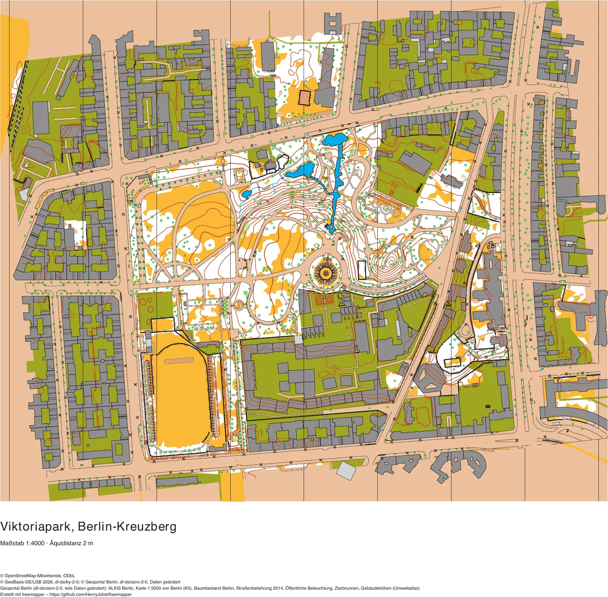
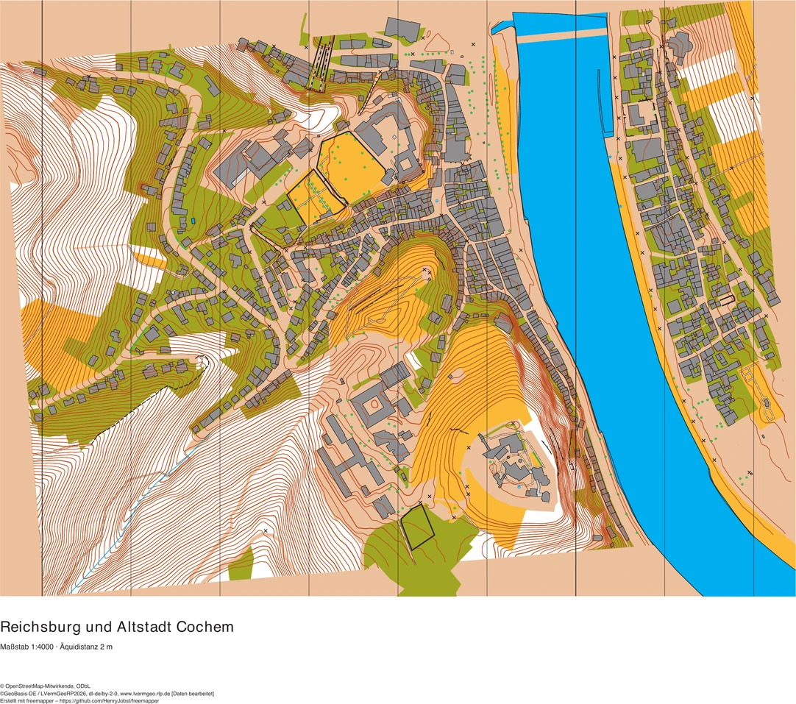
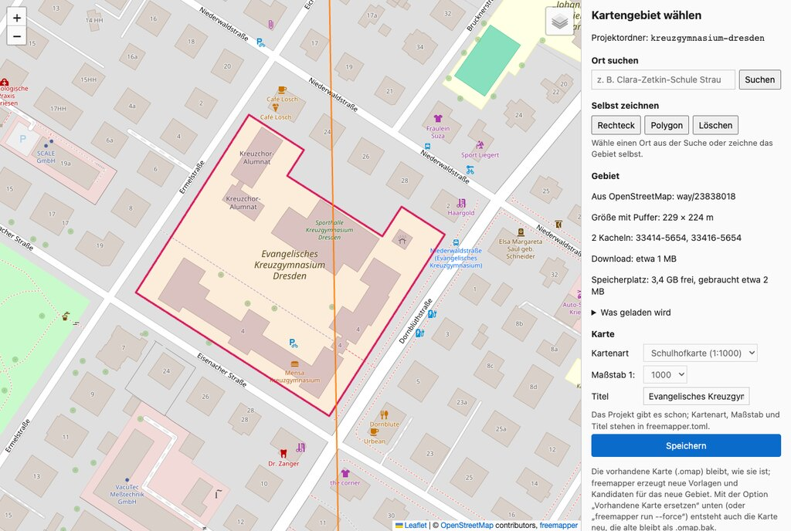

# freemapper

[English version](README.en.md) · [Handbuch](docs/manual/de.md) · [Glossar](docs/glossary.md) · [Änderungen](CHANGELOG.md)

<!-- claude-cost:start -->
[](docs/ai-cost/history.csv)
<!-- claude-cost:end -->

<p align="center"><a href="examples/berlin-viktoriapark/berlin-viktoriapark-candidates.pdf"></a><br><sub>Viktoriapark, Berlin-Kreuzberg (Sprint 1:4000), von freemapper aus offenen Daten erzeugt. Ein Klick öffnet das PDF; mehr unter <a href="examples/README.md">Beispiele</a>.</sub></p>

freemapper erzeugt aus amtlichen Geodaten (Geländemodell, nDOM, Luftbild, ALKIS) und OpenStreetMap
ein **Startprojekt für OpenOrienteering Mapper (OOM) und auf Wunsch auch für OCAD**: eine
georeferenzierte Karte, in der verlässliche Kartenobjekte schon symbolisiert sind, plus Kartenvorlagen
für alles, was der Kartierer selbst beurteilen muss. Gezeichnet und im Gelände geprüft wird weiterhin
in OOM oder OCAD.

- **Ausgabe:**
  - immer eine OOM-Karte (`.omap`);
  - mit `--ocad` zusätzlich eine OCAD-Karte (`.ocd`, OCAD 12 und neuer), siehe
    [Ausgangsstand für OCAD](#ausgangsstand-für-ocad);
  - mit `--pdf` die druckfertige Karte als PDF, mit `--pdf-candidates` zusätzlich die Trainingskarte mit allen Kandidaten, siehe
    [Karte als PDF](#karte-als-pdf).
- Läuft als ein einzelnes Programm unter Linux, macOS und Windows, ohne GIS-Installation.
- Bedienung per Kommandozeile, über eine Seite im Browser zum Wählen des Kartengebiets (siehe
  [Gebiet im Browser wählen](#gebiet-im-browser-wählen)) oder über KI-Agenten (MCP-Server).
- Regionen: Brandenburg, Berlin, Sachsen, Sachsen-Anhalt, Hamburg, Hessen, Schleswig-Holstein, Mecklenburg-Vorpommern, Nordrhein-Westfalen, Niedersachsen und Rheinland-Pfalz (Open Data von LGB,
  Geoportal Berlin, GeoSN, LVermGeo, LGV, HVBG, LVermGeo SH, LAiV M-V, Geobasis NRW, LGLN und LVermGeo RP);
  Schulhofkarten 1:1000 und Sprintkarten 1:4000.
- Beispiele: je Bundesland ein fertiges Projekt mit OOM-Karte, OCAD-Ausgangsstand und PDF, siehe
  [Beispiele](#beispiele).

## Die freemapper-Suite

freemapper ist der erste Schritt einer Werkzeugkette für Orientierungslauf-Karten. Zwei Folgeprojekte
sind in Entwicklung:

- freemapper liefert den Ausgangsstand der Karte,
- die Karte zeichnet man in OOM,
- [freemapper-courseplan](https://github.com/HenryJobst/freemapper-courseplan) legt die Bahnen in einem
  Editor im Browser und prüft sie gegen die Wettkampfbestimmungen,
- [freemapper-print](https://github.com/HenryJobst/freemapper-print) druckt die Kartenblätter, ein Blatt je
  Bahn, mit Bahnaufdruck und Postenbeschreibung.

Code, den mehrere dieser Programme brauchen, liegt in einer gemeinsamen Bibliothek:
[freemapper-core](https://github.com/HenryJobst/freemapper-core). Das sind kleine Rust-Crates, zum Beispiel
`freemapper-fs` für Dateizugriffe, die das Projekt nie verlassen. Die Programme binden sie nach und
nach in einer festen Version ein, statt den Code zu kopieren.

## Status

Aktuelle Version ist [v0.9.2](https://github.com/HenryJobst/freemapper/releases/tag/v0.9.2) vom
10. November 2026 (was sich geändert hat, steht in den [Änderungen](CHANGELOG.md)). freemapper erzeugt
Schulhof- und Sprintkarten für elf Bundesländer: Brandenburg, Berlin, Sachsen, Sachsen-Anhalt, Hamburg,
Hessen, Schleswig-Holstein, Mecklenburg-Vorpommern, Nordrhein-Westfalen, Niedersachsen und
Rheinland-Pfalz. Gewässer stehen auf allen Karten, die Farben folgen den IOF-Druckvorgaben von 2024.
Auf Wunsch erzeugt freemapper dazu einen Ausgangsstand für OCAD (`--ocad`) und eine
PDF-Karte (`--pdf`, mit Kandidaten `--pdf-candidates`). Vor dem Laden prüft
freemapper den freien Speicherplatz. Berliner Karten bekommen aus weiteren Daten des Geoportals Berlin
Überdachungen, Treppen, Mauern, Zäune, Hecken, Bäume und die Karte 1:5000 als Vorlage. Außerdem
nutzen sie die Straßenbefahrung 2014 bis 2016: Die vermessenen
Grünstreifen sind aus den Straßenflächen ausgeschnitten, Bordsteine, Geländer, Möblierung, Laternen und
Brunnen kommen als Kandidaten, und die Gebäude tragen ihre Grundrissaktualität.

In allen Bundesländern: Überdachungen und Carports aus ALKIS sind in jedem Bundesland außer Sachsen und
Sachsen-Anhalt Kartenobjekte, Durchfahrten dort Kandidaten. Brandenburger Karten bekommen Mauern, Zäune,
Hecken, Denkmäler, Böschungsoberkanten und Brücken aus dem vollständigen ALKIS als Kandidaten, rund um Potsdam
auch die Bäume der Stadtkarte; die zwei Kanten einer Mauer werden dabei eine Linie in der Mitte. Punktsymbole
halten den Abstand der Norm ein, und dichte Baumgruppen werden zu Flächen, die man sieht. Parks sind gelb, und unter der Sprintkarte liegt die belaufbare Fläche in Braun. Überlappen
Mauern, Zäune und Hecken auf dem Papier, bleibt die stärkere Linie.

Das Programm ist noch in Entwicklung. Als Nächstes werden die Regionsadapter so umgebaut, dass andere
Entwickler eigene Adapter für ihr Land beitragen können. Danach folgen genauere Sprintkarten für weitere
Bundesländer, zuerst Sachsen (Gewässerachsen, Hecken und Baumreihen aus dem Basis-DLM, die Bäume von Leipzig
und Dresden), dann Sachsen-Anhalt und Hamburg. Später kommen Hallenkarten für Hallen-OL, vollständig deutsche
Programmtexte (die erste Stufe ist da: `--lang de`) und die übrigen Bundesländer mit offenen Geodaten (Baden-Württemberg, Bremen, Bayern,
Saarland). Thüringen folgt, sobald sein Server für die
Höhendaten wieder erreichbar ist. Waldkarten und die Nachbarländer kommen später. Design:
[`docs/superpowers/specs/2026-11-07-freemapper-design.md`](docs/superpowers/specs/2026-11-07-freemapper-design.md).

Geplant: Genehmigungen und Ansprechpartner. Zu jedem Kartenbereich soll freemapper künftig auch zeigen, wer gefragt werden muss: bei Waldkarten die berührten Schutzgebiete (Naturschutz, Landschaftsschutz, FFH, Nationalpark) und die zuständige Forstverwaltung, bei Sprintkarten Gemeinde oder Bezirk, Straßenverkehrs- und Grünflächenamt, Denkmal- und Schlösserverwaltungen und, wo offene Daten es hergeben, die Grundstückseigentümer der öffentlichen Hand. Das Ergebnis wäre ein Bericht `permits.md` neben der Karte, jeweils mit Quelle und Datenstand. Er ist ein Hinweis und keine Rechtsauskunft, und Eigentümer privater Flächen stehen nicht in offenen Daten. Die Recherche dazu steht in [`docs/research`](docs/research/wald-und-sprint-behoerden/waldschutz-forstbehoerden-recherche.md).

## Handbuch

Das [Handbuch](docs/manual/de.md) führt Schritt für Schritt vom Gebiet zur fertigen Karte, auch ohne Erfahrung
mit der Kommandozeile. Die meistgebrauchten Kapitel:

- [Installation](docs/manual/de.md#3-installation)
- [Mit einem KI-Assistenten](docs/manual/de.md#4-weg-a-mit-einem-ki-assistenten) oder
  [ohne Assistent](docs/manual/de.md#5-weg-b-ohne-assistent)
- [Das Kartengebiet im Browser wählen](docs/manual/de.md#6-das-kartengebiet-im-browser-wählen)
- [Was im Gelände zu prüfen ist](docs/manual/de.md#9-was-im-gelände-zu-prüfen-ist)
- [Meldungen und was zu tun ist](docs/manual/de.md#14-meldungen-und-was-zu-tun-ist)

## Beispiele

Für jedes unterstützte Bundesland liegt ein fertiges Sprintkarten-Projekt im Repository, mit OOM-Karte,
OCAD-Datei und PDF. Zwei Beispiele vorab, ein Klick auf das Bild öffnet das PDF:

| Bundesland | Gebiet | Vorschau |
|---|---|---|
| Berlin | [Viktoriapark, Kreuzberg](examples/berlin-viktoriapark/) | <a href="examples/berlin-viktoriapark/berlin-viktoriapark-candidates.pdf"></a> |
| Rheinland-Pfalz | [Reichsburg und Altstadt Cochem](examples/rheinland-pfalz-cochem/) | <a href="examples/rheinland-pfalz-cochem/rheinland-pfalz-cochem-candidates.pdf"></a> |

Alle Beispiele mit Vorschau, wie die Gebiete ausgewählt wurden und wie viele Objekte jede Karte hat, stehen in
der [Beispielübersicht](examples/README.md). Wie die Karte mit und ohne Kandidaten aussieht, zeigt die
[Gegenüberstellung](examples/vergleich.md).

## Gebiet im Browser wählen

Am einfachsten zeichnet man das Kartengebiet im Browser:

```sh
freemapper select mein-schulhof --kind schoolyard
```



Auf der Seite sucht man einen Ort oder zeichnet ein Rechteck oder Polygon. Der Hintergrund ist
OpenStreetMap oder das Luftbild des Bundeslandes. Die Seite zeigt die Größe mit Puffer und den
geschätzten Download. „Speichern“ legt das Projekt an, danach erzeugt
`freemapper run mein-schulhof --pdf --ocad` die Karten. Die Seite läuft nur auf diesem Rechner
(127.0.0.1). Mehr im [Handbuch, Kapitel 6](docs/manual/de.md#6-das-kartengebiet-im-browser-wählen).

## Installation

freemapper ist ein einzelnes Programm ohne Installer. Es muss nicht selbst gebaut werden:

1. Auf der [Release-Seite](https://github.com/HenryJobst/freemapper/releases/latest) das Archiv für
   das eigene System herunterladen:
   - Windows: `freemapper-…-windows-x86_64.zip`
   - macOS mit Apple-Chip (M1 und neuer): `freemapper-…-macos-arm64.tar.gz`
   - macOS mit Intel-Prozessor: `freemapper-…-macos-x86_64.tar.gz`
   - Linux: `freemapper-…-linux-x86_64.tar.gz` (ARM-Rechner: `linux-arm64`)
2. Das Archiv entpacken (Doppelklick). Der Ordner enthält `freemapper` bzw. `freemapper.exe`.
3. Beim ersten Start warnt das System, weil das Programm nicht signiert ist:
   - **Windows:** „Der Computer wurde durch Windows geschützt“ → *Weitere Informationen* →
     *Trotzdem ausführen*.
   - **macOS:** „kann nicht geöffnet werden, da der Entwickler nicht verifiziert werden kann“ →
     *Systemeinstellungen › Datenschutz & Sicherheit* → *Trotzdem öffnen*; oder im Terminal im
     entpackten Ordner `xattr -d com.apple.quarantine freemapper`.
   - **Linux:** keine Warnung; ggf. `chmod +x freemapper`.
4. Prüfen im Terminal (Windows: PowerShell) im entpackten Ordner: `./freemapper --version`
   (Windows: `.\freemapper.exe --version`).

Bequemer geht es mit einem KI-Assistenten (siehe [Mit einem KI-Agenten](#mit-einem-ki-agenten-mcp)):
dort wird freemapper einmal mit seinem vollständigen Pfad angemeldet, danach erledigt der Assistent
den Rest.

## Selbst bauen (für Entwickler)

```sh
cargo build --release --locked
./target/release/freemapper --version
```

Ein Tag `v<Version>` (passend zur Version in `Cargo.toml`) erzeugt über
`.github/workflows/release.yml` die Archive für alle Systeme und das GitHub-Release.

Entwicklung: `cargo fmt`, `cargo clippy --workspace --all-targets -- -D warnings`, `cargo test --workspace`.
Git-Hooks: `lefthook install`.

Gemeinsamer Code der Suite kommt nach und nach aus
[freemapper-core](https://github.com/HenryJobst/freemapper-core). Die `Cargo.toml` bindet ihn über Git mit
einem festen Release-Tag ein, deshalb lädt der erste Build ihn von GitHub. Wer dort mitändert, legt
freemapper-core neben freemapper ab und bindet es während der Entwicklung über einen lokalen `[patch]` ein,
der vor dem Merge wieder herauskommt. Die Einzelheiten stehen in der README von freemapper-core und in
[ADR 0067](docs/adr/0067-shared-crates-from-freemapper-core.md).

## Benutzung

```sh
freemapper init clara-zetkin-schule --geojson tests/fixtures/clara-zetkin-schule.geojson --kind schoolyard \
  --title "Clara-Zetkin-Schule Strausberg"
freemapper run clara-zetkin-schule
```

Statt einer GeoJSON-Datei geht auch das OSM-Objekt (`--osm way/992423119`, bei mehreren getrennten Flächen
mit `--part <n>`) oder der Name
(`--place "Clara-Zetkin-Schule Strausberg"`; genommen wird der beste Treffer mit Fläche, gesucht über
Nominatim von OpenStreetMap).

Oder das Gebiet im Browser wählen, siehe [Gebiet im Browser wählen](#gebiet-im-browser-wählen).

`run` führt drei Schritte nacheinander aus, die es auch einzeln gibt:

- `freemapper fetch <ordner>` – lädt für Kartengebiet plus Puffer Luftbild, Geländemodell und nDOM des
  zuständigen Bundeslandes, die ALKIS-Gebäude und -Nutzung sowie den OSM-Auszug des Bundeslandes von Geofabrik
  (beim ersten Mal 180–300 MB, danach nur, wenn er mehr als 7 Tage alt ist) in den Zwischenspeicher.
  Neu geladen wird nur, was neu veröffentlicht wurde; `--offline` nutzt nur bereits geladene Daten.
  Woher die Daten je Bundesland kommen, steht unter [Regionen](#regionen).
- `freemapper derive <ordner>` – berechnet daraus Luftbild, Schummerung, Hangneigung und das nDOM
  (Höhe über Grund: Hecken, Mauern, Bäume, Spielgeräte) als Vorlagen sowie Höhenlinien
  (Schulhof 1 m, Sprint 2 m; jede fünfte als Zählkurve) als Kandidaten.
- `freemapper export <ordner>` – schreibt die OOM-Karte mit den Gebäuden als fertigen Kartenobjekten
  (Symbol 521, mit Herkunft: ALKIS-Objekt-ID und Datenstand). Übernommen werden Gebäude bis zum Puffer
  um das Kartengebiet; unterirdische Bauteile und Bauwerke wie Schornsteine entfallen, sehr kleine
  Gebäude ebenso, Umrisse werden leicht vereinfacht. `--force` ersetzt eine vorhandene Karte und legt
  die alte als `.omap.bak` ab; `run` lässt eine vorhandene Karte ohne `--force` unverändert.

Ergebnis im Projektordner:

- `freemapper.toml` – Kartengebiet, Kartenart, Maßstab, Datum der Missweisung, verwendete Kacheln mit
  Datenstand
- `clara-zetkin-schule.omap` – georeferenzierte OOM-Karte (EPSG:25833, 1:1000, IOF-Schulsymbolsatz 2019)
- `templates/orthophoto.jpg`, `hillshade.png`, `slope.png`, `ndsm.png` – Vorlagen hinter der Karte,
  jeweils mit Weltdatei (`.jgw`/`.pgw`); Schummerung, Hangneigung und nDOM lassen sich in OOM
  einblenden. nDOM-Farben: gelb 0,3–1 m, orange 1–2,5 m, hellgrün 2,5–8 m, dunkelgrün über 8 m
- `templates/candidates.omap` – Vorlagenkarte mit dem Umriss des Kartengebiets und Kandidaten aus
  OpenStreetMap zum Prüfen und Übernehmen: Hydranten, Bänke, Tische, Laternen, Masten, Spielgeräte,
  Bäume, Hecken, Mauern, Zäune, Felskanten, Sportplätze (Regeln in `assets/rules/osm-candidates.toml`),
  Höhenlinien und verbotenes Gebiet (520) aus der ALKIS-Nutzung: auf der Schulhofkarte alles außer
  dem Schulgrundstück, auf der Sprintkarte Privatgelände (Wohn-, Gewerbe-, Mischnutzungs- und
  Bahnflächen)
- Nordlinien über dem Kartenbild, als Kartenobjekte im Kartenteil „default part“
- Randangaben unter dem Kartenbild (Kartenteil „peripheral information“): Titel (`--title`, sonst der
  Ordnername), Maßstab und Äquidistanz, Maßstabsleiste, Namensnennung der Datenquellen und der Hinweis
  auf freemapper
- `data/osm-candidates.geojson` – die OSM-Objekte des Kartengebiets, aus denen die Kandidaten entstehen
- `data/contours.geojson` – die Höhenlinien aus `derive`
- `data/alkis-land-use.geojson` – die geladene ALKIS-Nutzung der Flurstücke
- `data/alkis-buildings.geojson` – die geladenen ALKIS-Gebäude (für `--offline` und spätere Abgleiche)
- `ATTRIBUTION.txt` – Namensnennung der Datenquellen

Der Zwischenspeicher liegt im Cache-Ordner des Systems (macOS `~/Library/Caches/freemapper`, Linux
`~/.cache/freemapper`, Windows `%LOCALAPPDATA%\freemapper`) und wird von allen Projekten geteilt;
`--cache-dir` wählt einen anderen Ordner.

Kartenarten: `schoolyard` (Schulhofkarte, 1:1000) und `sprint` (Sprintkarte, ISSprOM 2019, 1:4000).

Die Sprintkarte enthält zusätzlich, als fertige Kartenobjekte:

- die belaufbare Fläche (990), eine Fläche im unteren Braun von 501.5 unter dem ganzen Blatt. Sie füllt
  jede Lücke, die nichts anderes zeigt.
- Parks, Grünanlagen und Grünland aus der ALKIS-Nutzung als offenes Gelände (401), Wald und Gehölz als
  Wald (405). Friedhöfe, anderes Landwirtschaftsland und OSM-Parks sind Kandidaten.
- befestigte Flächen (501.5) aus der ALKIS-Nutzung: Fahrbahnen mit Gehwegen und Parkstreifen
  (`Straßenverkehr`) sowie Plätze, Parkplätze, Marktplätze und Fußgängerzonen (`Platz`). Begleitflächen
  (Grünstreifen, Baumreihen) werden nicht gezeichnet. Nur als Kandidat kommen: ALKIS-`Weg` (in der Stadt
  Gehwege und Gassen, im Wald unbefestigte Wege), andere Plätze (z. B. Festplätze) und Straßenflurstücke,
  auf denen OSM eine unbefestigte Straße kennt (Sandstraßen). Straßenflächen unter Baumkronen am
  Luftbild prüfen.
- unbefestigte Wege aus OSM mit Angabe zur Oberfläche (`surface=dirt`, `gravel`, `compacted` …):
  Wirtschaftswege 505.2, Fußwege und Pfade 505.1, schmale (`width` unter 1,5 m) oder schwer
  erkennbare Pfade 506. Kandidaten (505.1) sind Wege ohne `surface` oder mit ungewöhnlicher Oberfläche
  sowie Durchgänge durch Gebäude, überdachte Wege und Fußgängerflächen; unbefestigte Straßen sind
  Kandidaten 505.2. Befestigte Wege und Gehwege an Straßen übernimmt freemapper nicht, die zeigen
  ALKIS-Flächen und Luftbild. Alle Linien enden am Puffer um das Kartengebiet.

Beispiel Strausberg Vorstadt:

```sh
freemapper init vorstadt --geojson tests/fixtures/strausberg-vorstadt-sprint.geojson --kind sprint \
  --title "Strausberg Vorstadt"
freemapper run vorstadt
```

## Regionen

| Bundesland | Daten | nDOM-Vorlage | Hinweise |
|---|---|---|---|
| Brandenburg | LGB, auch das vollständige ALKIS; Potsdamer Stadtbäume | Laser-nDOM, 0,2 m | Mauern, Zäune, Hecken und Brücken aus dem vollständigen ALKIS und die Potsdamer Bäume als Kandidaten |
| Berlin | LGB, ALKIS, Baumkataster, K5, Straßenbefahrung und Register vom Geoportal Berlin | aus dem bildbasierten Oberflächenmodell, 0,2 m | Plätze nur als Kandidaten; vermessene Grünstreifen aus den Straßenflächen ausgeschnitten; Überdachungen als Kartenobjekte; Treppen, Mauern, Zäune, Hecken, Bäume, Bordsteine, Geländer, Möblierung, Laternen und Brunnen als Kandidaten; Karte 1:5000 (K5) als Vorlage |
| Sachsen | GeoSN | DOM1 − DGM1, 1 m | Plätze nur als Kandidaten; Straßenflächen mit Grünstreifen; keine Lage unter der Erdoberfläche |
| Sachsen-Anhalt | LVermGeo | DOM1 − DGM1, 1 m | Karte in UTM-Zone 32 (EPSG:25832); Plätze nur als Kandidaten; Straßenflächen mit Grünstreifen |
| Hamburg | LGV | bDOM − DGM1, 1 m (Stand 2022) | Karte in UTM-Zone 32 (EPSG:25832); Höhenmodelle älter als das Luftbild (2026) |
| Hessen | HVBG | DOM1 − DGM1, 1 m (Laserscan) | Karte in UTM-Zone 32 (EPSG:25832); Luftbild im Sommer beflogen; Plätze nur als Kandidaten; Straßenflächen mit Grünstreifen |
| Schleswig-Holstein | LVermGeo SH | bDOM − DGM1, 1 m (bildbasiert) | Karte in UTM-Zone 32 (EPSG:25832); Luftbild je nach Gebiet unbelaubt oder belaubt; Oberflächenmodell als ganze Kacheln (105 MB je km²) |
| Mecklenburg-Vorpommern | LAiV M-V | DOM1 − DGM1, 1 m | Luftbild als Farbpalette (256 Farben); Höhenmodelle nur innerhalb der Landeskacheln |
| Nordrhein-Westfalen | Geobasis NRW | DOM1 − DGM1, 1 m (Laserscan) | Karte in UTM-Zone 32 (EPSG:25832); OSM aus den Auszügen der Regierungsbezirke |
| Niedersachsen | LGLN | DOM1 − DGM1, 1 m (Laserscan) | Karte in UTM-Zone 32 (EPSG:25832); Oberflächenmodell oft Jahre älter als das Luftbild; Bremen noch nicht dabei |
| Rheinland-Pfalz | LVermGeo RP | DOM1 − DGM1, 1 m (Laserscan) | Karte in UTM-Zone 32 (EPSG:25832); Luftbild im Sommer beflogen, als Flugdatum gilt das Erstellungsdatum; Luftbild jenseits der Landesgrenze weiß |

In jedem Bundesland außer Sachsen und Sachsen-Anhalt sind die ALKIS-Überdachungen Kartenobjekte und die
Durchfahrten Kandidaten. An einer Grenze zwischen Bundesländern fragt freemapper das Kataster beider Bundesländer ab und liest beide
OSM-Auszüge; Luftbild und Gelände kommen aus dem Bundesland, in dem die Mitte des Kartengebiets liegt. Mehr dazu im
[Handbuch, Kapitel 12](docs/manual/de.md#12-regionen-und-grenzgebiete). Ein Beispielprojekt je Bundesland liegt unter
[`examples/`](examples/).

## Karte als PDF

```sh
freemapper export clara-zetkin-schule --pdf                    # oder: freemapper run clara-zetkin-schule --pdf
freemapper export clara-zetkin-schule --pdf-candidates         # Trainingskarte mit allen Kandidaten
```

`--pdf` schreibt `<name>.pdf`: die druckfertige Karte (A4 oder A3, CMYK) mit genau den Objekten der OOM-Karte, also
ohne Kandidaten, dazu die Randangaben mit der Namensnennung und dem Hinweis auf freemapper. Das Luftbild gehört nicht
dazu. Gezeichnet wird mit dem Symbolsatz des Projekts so, wie OOM ihn zeichnet (Strichelungen, Zeichen auf Linien,
Farbreihenfolge).

Die Maßstabsleiste fehlt standardmäßig (deutsche OL-Karten haben meist keine); `--pdf-scale-bar` zeichnet sie, die
Maßstabszahl steht immer im Titelblock. `--pdf-sources` wählt die Quellenzeilen: `auto` (Standard) kürzt eine lange
Liste, `full` kürzt nie, `credit-only` druckt nur die freemapper-Zeile; die freemapper-Zeile steht immer da.

`--pdf-candidates` schreibt `<name>-candidates.pdf`, die Trainingskarte: Hier werden **alle Kandidaten zu
Kartenobjekten**: Möblierung, Barrieren, Wege ohne Oberflächenangabe, Höhenlinien, Sperrgebiete und ALKIS-Wege.
Punkte in Sperrgebiet-Kandidaten fehlen. Weil auch unsichere Daten eingezeichnet sind, ist diese Karte vor dem Training
im Gelände zu prüfen. Mit beiden Schaltern entstehen beide Dateien nebeneinander.

## Ausgangsstand für OCAD

```sh
freemapper export clara-zetkin-schule --ocad      # oder: freemapper run clara-zetkin-schule --ocad
```

schreibt zusätzlich den Ordner `ocad/`:

- `<name>.ocd`: Karte im OCAD-12-Format (sollte sich in OCAD 12 und neuer öffnen), mit Georeferenz
  (ETRS89/UTM 33), Farben, den Kartenobjekten und den Vorlagen als Hintergrundkarten.
- `<name>-candidates.ocd`: die Kandidaten als eigene OCAD-Karte.
- Luftbild, Schummerung, Hangneigung und nDOM mit Weltdateien, direkt neben der `.ocd`.

Die Symbole in der `.ocd` sind Platzhalter: richtige Nummer, Name und Hauptfarbe, aber einfache
Grafik. In OCAD lädt man den offiziellen Satz (*Symbol › Farben und Symbole laden aus…*, ISSprOM 2019
für Sprint, IOF-Schulsatz 2019 für Schulhof), der die Platzhalter nach Nummer ersetzt.
- Die Nummern folgen OCADs offiziellen Sätzen, z. B. 501.001 für befestigte Fläche und 505.000/505.001
  für Wege.
- Eine vorhandene `.ocd` wird nur mit `--force` ersetzt (die alte bleibt als `.ocd.bak`); eine
  vorhandene OOM-Karte bleibt bei `--ocad` ohne `--force` unverändert.

Die Dateien sind noch nicht in OCAD geprüft. Was zu prüfen ist, steht in
[`docs/ocad/test-checklist.md`](docs/ocad/test-checklist.md), z. B. ob „Ersetzen“ beim Laden des
Symbolsatzes die Randangaben-Symbole (991–994) behält und ob OCAD die Kandidaten-Karte deckungsgleich
einblendet (sonst als Hintergrundkarte von Hand öffnen). Ordnernamen mit Umlauten werden für die
OCAD-Dateien in ASCII geschrieben („Straußberg“ → „Straussberg“).

## Mit einem KI-Agenten (MCP)

`freemapper mcp` ist ein MCP-Server auf stdin/stdout. Ein KI-Agent kann damit die Karte für jemanden
erstellen, der keine Kommandozeile benutzen möchte: Man nennt dem Agenten die Schule, er erledigt den Rest.

In Claude Code anmelden (mit dem Pfad, unter dem freemapper entpackt wurde):

```sh
claude mcp add freemapper -- /Pfad/zu/freemapper mcp
```

Andere MCP-Clients (allgemeine Konfiguration; `--cache-dir <ordner>` ist optional):

```json
{
  "mcpServers": {
    "freemapper": { "command": "/Pfad/zu/freemapper", "args": ["mcp"] }
  }
}
```

Ablauf, wie der Agent ihn geht:

1. `find_place` – sucht die Schule per Name und zeigt die Treffer; ein Treffer mit Fläche wird das
   Kartengebiet.
2. `create_project` – legt den Projektordner an (absoluter Pfad oder `~/…`), Kartenart und Maßstab
   wählbar.
3. `estimate_download` – sagt, wie viel geladen werden muss (beim ersten Mal etwa 300 MB OSM-Auszug).
4. `start_pipeline` – startet Laden, Berechnen und Schreiben im Hintergrund und gibt eine Job-ID zurück
   (mit `ocad: true` auch den OCAD-Ausgangsstand, mit `pdf: true` das PDF der Karte, mit `pdf_candidates: true` das PDF mit Kandidaten).
5. `project_status` – fragt den Fortschritt ab, bis der Job fertig oder fehlgeschlagen ist.
6. `list_layers` und `preview_layer` – zeigen die Ebenen und Vorschaubilder (PNG) der Vorlagen.

Passt kein Suchtreffer oder will man das Gebiet selbst zeichnen, öffnet `open_area_selector` die
Gebietsauswahl im Browser und gibt die Adresse zurück; nach dem Speichern geht es mit Schritt 3 weiter.

Danach öffnet man die `.omap`-Datei im Projektordner mit OpenOrienteering Mapper.

## Lizenz und Namensnennung

GPL-3.0-or-later, siehe [LICENSE](LICENSE). Erzeugte Karten enthalten die Pflichtvermerke der
Datenquellen, z. B. `© GeoBasis-DE/LGB <Jahr>, dl-de/by-2-0, Daten geändert` und
`© OpenStreetMap contributors, ODbL`. In Berlin lautet der LGB-Vermerk, wie vom LGB verlangt,
`© GeoBasis-DE/LGB <Jahr>, dl-de/by-2-0; © Geoportal Berlin, dl-de/zero-2-0, Daten geändert`; wurden
Berliner ALKIS-Daten geladen, kommt `© Geoportal Berlin / ALKIS Berlin, dl-de/zero-2-0, Daten geändert` hinzu,
für K5 und Baumkataster je eine eigene Zeile. Die Potsdamer Bäume ergänzen `Landeshauptstadt Potsdam / Bäume
der Stadtkarte, dl-de/zero-2-0` (siehe [Handbuch, Kapitel 15](docs/manual/de.md#15-namensnennung)).
In Sachsen lautet der Vermerk `Quelle: GeoSN, dl-de/by-2-0, Daten geändert`.
