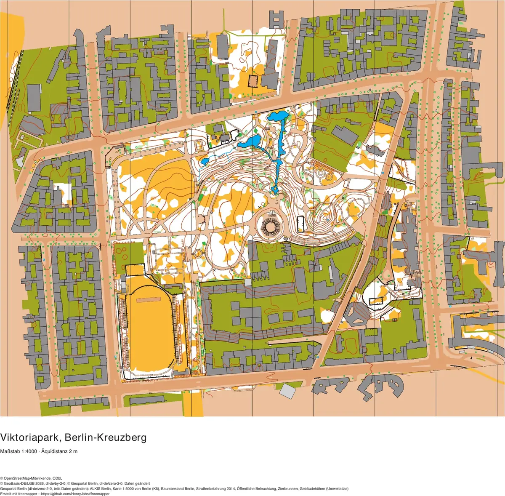
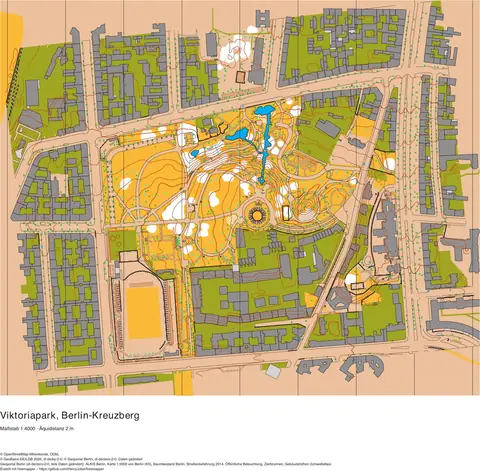
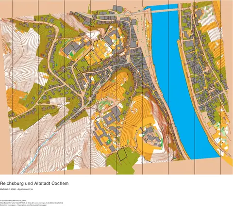
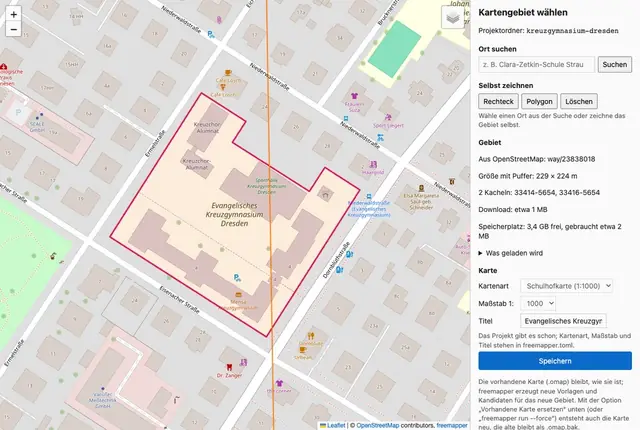

# freemapper

[Website](https://freemapper.de/en/) · [Deutsche Version](README.md) · [English version](README.en.md) · [Wersja polska](README.pl.md) · [User manual](docs/manual/en.md) · [Glossary](docs/glossary.md) · [Changes](CHANGELOG.en.md) · [Examples](examples/README.en.md)


<!-- badges:start -->
[](docs/tests.json) [](docs/tests.json) [](docs/coverage.json) [](Cargo.toml) [](docs/adr/README.md) [](scripts/check.sh) [](LICENSE)
<!-- badges:end -->

<!-- claude-cost:start -->
[](docs/ai-cost/history.csv)
<!-- claude-cost:end -->

<p align="center"><a href="examples/berlin-viktoriapark/preview.webp"></a><br><sub>Viktoriapark, Berlin-Kreuzberg (sprint 1:4000), wykonany przez freemapper z otwartych danych. Obraz przedstawia mapę treningową, gotową do wydruku i biegu; kliknięcie otwiera pełny rozmiar, a <a href="examples/berlin-viktoriapark/berlin-viktoriapark-training.pdf">PDF</a> służy do wydruku. <a href="examples/berlin-viktoriapark/berlin-viktoriapark-candidates.pdf">Wydruk kontrolny</a> pokazuje każdego kandydata w jego rzeczywistym położeniu; więcej w <a href="examples/README.en.md">przykładach</a>.</sub></p>

freemapper zamienia oficjalne dane geodezyjne (numeryczny model terenu, nMPT, ortofotomapa, ewidencja ALKIS) oraz
OpenStreetMap w **projekt początkowy dla OpenOrienteering Mapper (OOM) i, na życzenie, dla OCAD**:
georeferencjonowaną mapę z niezawodnymi obiektami mapy już narysowanymi znakami, a do tego podkłady dla wszystkiego,
co kartograf musi ocenić samodzielnie. Rysowanie i sprawdzanie w terenie pozostają w OOM lub OCAD.

- **Wynik:**
  - zawsze mapa OOM (`.omap`);
  - z `--ocad` także mapa OCAD (`.ocd`, OCAD 12 i nowsze), zob.
    [Punkt wyjścia dla OCAD](#punkt-wyjścia-dla-ocad);
  - z `--pdf` mapa gotowa do druku jako PDF, z `--pdf-candidates` wydruk kontrolny ze wszystkimi kandydatami, a z
    `--training` mapa treningowa, drukowana i używana w biegu bez zmian (mapa OOM i PDF), zob. [Mapa jako PDF](#mapa-jako-pdf).
- Jeden program dla Linuksa, macOS i Windows, bez instalowania oprogramowania GIS.
- Można go używać z wiersza poleceń, przez stronę w przeglądarce, na której wybiera się obszar mapy i tworzy
  mapę ze wszystkimi opcjami (zob. [Wybór obszaru w przeglądarce](#wybór-obszaru-w-przeglądarce)), albo
  przez agentów AI (serwer MCP).
- Regiony: Brandenburgia, Berlin, Saksonia, Saksonia-Anhalt, Hamburg, Hesja, Szlezwik-Holsztyn, Meklemburgia-Pomorze Przednie, Nadrenia Północna-Westfalia, Dolna Saksonia, Nadrenia-Palatynat, Saara, Badenia-Wirtembergia, Brema i Bawaria (otwarte dane od LGB,
  Geoportal Berlin, GeoSN, LVermGeo, LGV, HVBG, LVermGeo SH, LAiV M-V, Geobasis NRW, LGLN, LVermGeo RP, LVGL, LGL,
  Landesamt GeoInformation Bremen i Bayerische Vermessungsverwaltung);
  mapy dziedzińców szkolnych 1:1000, mapy sprintowe 1:4000 i mapy leśne 1:15 000, 1:10 000 lub 1:7500.
  Polska jest wersją zapoznawczą (zob. [Status](#status)).
- Przykłady: po jednym gotowym projekcie dla każdego kraju związkowego z mapą OOM, punktem wyjścia dla OCAD i PDF, zob.
  [Przykłady](#przykłady).

## Zestaw freemapper

freemapper jest pierwszym krokiem łańcucha narzędzi do map do biegu na orientację. Dwa kolejne projekty są
w przygotowaniu:

- freemapper tworzy punkt wyjścia mapy,
- mapę rysuje się w OOM,
- [freemapper-courseplan](https://github.com/HenryJobst/freemapper-courseplan) służy do wyznaczania tras
  w edytorze w przeglądarce i sprawdza je pod kątem przepisów zawodów,
- [freemapper-print](https://github.com/HenryJobst/freemapper-print) drukuje arkusze map, po jednym arkuszu na
  trasę, z nadrukiem trasy i opisami punktów kontrolnych.

Kod potrzebny kilku z tych programów mieszka we wspólnej bibliotece:
[freemapper-core](https://github.com/HenryJobst/freemapper-core). To zbiór małych crate'ów Rusta, na
przykład `freemapper-fs` do dostępu do plików, który nigdy nie wychodzi poza projekt. Programy przechodzą na te crate'y
krok po kroku, każdy przypięty do stałej wersji, zamiast kopiować kod.

## Status

Aktualna wersja to [v0.24.0](https://github.com/HenryJobst/freemapper/releases/tag/v0.24.0) z
16 listopada 2026 (zob. [zmiany](CHANGELOG.en.md), co nowego).

freemapper tworzy mapy dziedzińców szkolnych i
mapy sprintowe dla piętnastu krajów związkowych: Brandenburgii, Berlina, Saksonii, Saksonii-Anhalt, Hamburga, Hesji,
Szlezwika-Holsztynu, Meklemburgii-Pomorza Przedniego, Nadrenii Północnej-Westfalii, Dolnej Saksonii,
Nadrenii-Palatynatu, Saary, Badenii-Wirtembergii, Bremy i Bawarii. Wszystkie mapy pokazują wodę, a kolory
odpowiadają definicjom druku IOF z 2024 roku. Na życzenie freemapper tworzy też punkt wyjścia dla OCAD (`--ocad`),
mapę PDF (`--pdf`, z kandydatami `--pdf-candidates`) i mapę treningową (`--training`). Przed pobraniem freemapper
sprawdza wolne miejsce na dysku. Mapy Berlina dostają korony drzew, schody, mury, ogrodzenia, żywopłoty, drzewa i
mapę 1:5000 jako podkład z dalszych danych Geoportal Berlin. Korzystają też z pomiaru ulic z lat 2014
do 2016: zmierzone pasy zieleni są wycinane z powierzchni ulic,
krawężniki, balustrady, wyposażenie, latarnie i fontanny trafiają jako kandydaci, a budynki mają
datę obrysu.

We wszystkich krajach związkowych: zadaszenia i wiaty z ALKIS są obiektami mapy w każdym kraju związkowym poza
Saksonią i Saksonią-Anhalt, a przejścia przez budynki są tam kandydatami. Mapy Brandenburgii dostają mury, ogrodzenia,
żywopłoty, zabytki, krawędzie nasypów i mosty z pełnego ALKIS jako kandydatów, a wokół Poczdamu drzewa
z mapy miasta; dwie krawędzie muru stają się jedną linią pośrodku. Znaki punktowe zachowują odstęp wymagany
przez normę, a gęste grupy drzew stają się widocznymi powierzchniami. Parki są żółte, a pole przejścia w kolorze brązowym leży pod mapą sprintową. Tam, gdzie mury, ogrodzenia i żywopłoty nakładają się na
papierze, zostaje mocniejsza linia.

**Polska jest wersją zapoznawczą (preview).** Dane pochodzą na razie wyłącznie z OpenStreetMap: bez warstwic i bez
ortofotomapy. Obszar mapy musi leżeć w całości w Polsce. Mapa z takimi danymi to punkt wyjścia do dalszej pracy,
a nie porównywalny odpowiednik map z krajów związkowych wymienionych wyżej. Dane urzędowe (GUGiK) są w przygotowaniu,
ale nie są jeszcze częścią gotowego wyniku. Komunikaty programu i tekst tego pliku mogą w polskiej wersji różnić się
od niemieckiej i angielskiej.

freemapper jest nadal w rozwoju. Kolejny kraj związkowy, którego usługi są
standardowe, można dodać jako folder z manifestem, bez Rusta;
[przewodnik dla współtwórców](docs/adapters/en.md) opisuje tę drogę. Dalej w kolejce są bardziej szczegółowe mapy sprintowe dla
kolejnych krajów związkowych,
najpierw Saksonii (osie wód, żywopłoty i rzędy drzew z Basis-DLM, drzewa Lipska i Drezna), potem
Saksonii-Anhalt i Hamburga. Później pojawią się mapy sal gimnastycznych do biegu na orientację w halach, a ostatnie angielskie teksty znikną z niemieckich komunikatów programu (`--lang de`).
Turyngia, ostatni brakujący kraj związkowy, dojdzie, gdy wróci jej serwer danych wysokościowych.
Sąsiednie kraje dojdą później. Projekt:
[`docs/superpowers/specs/2026-11-07-freemapper-design.md`](https://github.com/HenryJobst/freemapper/blob/main/docs/superpowers/specs/2026-11-07-freemapper-design.md).

Na życzenie freemapper zapisuje obok mapy wskazówki dotyczące zgód w pliku `permits.md` (`freemapper permits`, `run --permits`, na stronie obszaru lub przez asystenta AI). Dla obszaru mapy podaje kraj związkowy, Kreis, Amt i gminę z VG250 BKG, obszary chronione z BfN i zarządców z OpenStreetMap, każdego z udziałem, źródłem i datą danych, oraz mówi, o zgodę kogo zwykle się prosi. To wskazówka, nie porada prawna. Szczegóły są w [podręczniku użytkownika, rozdział 12](docs/manual/en.md#12-permit-notes). W Berlinie dzielnica (Bezirk), tereny zieleni, grunty kraju związkowego i Federacji, zabytki i pomniki przyrody pochodzą również z Geoportal Berlin. W Hamburgu dzielnica (Bezirk), tereny zieleni, zabytki, Stadtwald i strefy ochrony wód pochodzą z Geoportal Hamburg. W Brandenburgii, Berlinie, Hamburgu, Nadrenii Północnej-Westfalii, Saarze, Saksonii i Szlezwiku-Holsztynie wskazówki podają także urząd leśny. Strefy ochrony wód podają w każdym kraju związkowym, zabytki w jedenastu, pomniki przyrody i chronione biotopy w trzynastu, funkcje lasu w kilku.

## Podręcznik użytkownika

[Podręcznik użytkownika](docs/manual/en.md) prowadzi krok po kroku od obszaru do gotowej mapy, bez
doświadczenia z wierszem poleceń. Rozdziały, z których korzysta się najczęściej:

- [Instalacja](docs/manual/en.md#3-installation)
- [Z asystentem AI](docs/manual/en.md#4-route-a-with-an-ai-assistant) lub
  [bez niego](docs/manual/en.md#5-route-b-without-an-assistant)
- [Wybór obszaru mapy w przeglądarce](docs/manual/en.md#6-choosing-the-map-area-in-the-browser)
- [Co sprawdzić w terenie](docs/manual/en.md#9-what-to-check-in-the-terrain)
- [Komunikaty i co robić](docs/manual/en.md#15-messages-and-what-to-do)

## Przykłady

Repozytorium zawiera gotowy projekt mapy sprintowej dla każdego obsługiwanego kraju związkowego, z mapą OOM, plikiem
OCAD, mapą treningową i wydrukiem kontrolnym. Tu dwa z nich. Obrazy pokazują mapę treningową; kliknięcie
otwiera ją w pełnym rozmiarze, link pod spodem otwiera PDF, a obok jest wydruk kontrolny:

| Kraj związkowy | Obszar | Podgląd |
|---|---|---|
| Berlin | [Viktoriapark, Kreuzberg](https://github.com/HenryJobst/freemapper/tree/main/examples/berlin-viktoriapark/) | <a href="examples/berlin-viktoriapark/preview.webp"></a><br><a href="examples/berlin-viktoriapark/berlin-viktoriapark-training.pdf">PDF</a> · <a href="examples/berlin-viktoriapark/berlin-viktoriapark-candidates.pdf">wydruk kontrolny</a> |
| Nadrenia-Palatynat | [Reichsburg i stare miasto Cochem](https://github.com/HenryJobst/freemapper/tree/main/examples/rheinland-pfalz-cochem/) | <a href="examples/rheinland-pfalz-cochem/preview.webp"></a><br><a href="examples/rheinland-pfalz-cochem/rheinland-pfalz-cochem-training.pdf">PDF</a> · <a href="examples/rheinland-pfalz-cochem/rheinland-pfalz-cochem-candidates.pdf">wydruk kontrolny</a> |

Wszystkie przykłady z podglądami, sposób wyboru obszarów i liczba obiektów każdej mapy znajdują się w
[przeglądzie przykładów](https://github.com/HenryJobst/freemapper/blob/main/examples/README.en.md), z mapą leśną dla każdego kraju związkowego (1:10 000). Ten sam obszar w trzech profilach zawartości
`safe`, `balanced` i `full` jest na [stronie porównania](https://github.com/HenryJobst/freemapper/blob/main/examples/compare.en.md).

## Wybór obszaru w przeglądarce

Najłatwiej jest narysować obszar mapy w przeglądarce:

```sh
freemapper select my-schoolyard --kind schoolyard
```

[](docs/manual/images/area-selector.jpg)

Na stronie wyszukuje się miejsce albo rysuje prostokąt lub wielokąt. Tłem jest OpenStreetMap lub
ortofotomapa kraju związkowego. Strona pokazuje rozmiar z buforem i szacowane pobieranie. „Zapisz” tworzy
projekt. Poniżej „Utwórz mapę” tworzy mapę z opcjami OCAD, PDF, wydruk kontrolny, mapa treningowa, podziałka liniowa, wiersze
źródeł i „tylko pamięć podręczna”, pokazuje postęp, można ją przerwać i na końcu otwiera folder. Terminal
nie jest do tego potrzebny. Strona działa tylko na tym komputerze (127.0.0.1). Więcej w
[podręczniku użytkownika, rozdział 6](docs/manual/en.md#create-the-map-in-the-browser).

## Instalacja

freemapper jest pojedynczym programem bez instalatora. Nie trzeba go budować samodzielnie:

1. Pobierz archiwum dla swojego systemu ze
   [strony wydań](https://github.com/HenryJobst/freemapper/releases/latest):
   - Windows: `freemapper-…-windows-x86_64.zip`
   - macOS z procesorem Apple (M1 i nowsze): `freemapper-…-macos-arm64.tar.gz`
   - macOS z procesorem Intel: `freemapper-…-macos-x86_64.tar.gz`
   - Linux: `freemapper-…-linux-x86_64.tar.gz` (komputery ARM: `linux-arm64`)

   Pliki `.gz` i `freemapper-update.json` na tej stronie służą do `freemapper update`.
2. Rozpakuj archiwum (dwukrotne kliknięcie). Folder zawiera `freemapper` lub `freemapper.exe`.
3. Przy pierwszym uruchomieniu system ostrzega, ponieważ program nie jest podpisany:
   - **Windows:** „Windows protected your PC” → *More info* → *Run anyway*.
   - **macOS:** „cannot be opened because the developer cannot be verified” → *System Settings ›
     Privacy & Security* → *Open Anyway*; albo w Terminalu w rozpakowanym folderze
     `xattr -d com.apple.quarantine freemapper`.
   - **Linux:** bez ostrzeżenia; w razie potrzeby `chmod +x freemapper`.
4. Sprawdź w terminalu (Windows: PowerShell) w rozpakowanym folderze: `./freemapper --version`
   (Windows: `.\freemapper.exe --version`).

`freemapper update` pyta o zgodę, potem pobiera najnowsze wydanie i wstawia je w miejsce programu, pod
tą samą ścieżką. Najpierw sprawdza podpis wydania, a stary program zostaje dla
`freemapper update --rollback`. Po `find`, `init`, `select`, `fetch`, `run` i `permits` freemapper najwyżej raz na
dobę szuka nowszego wydania i zgłasza je w jednym wierszu; `freemapper update --mode off` to wyłącza. Wersje 0.11.0 i
starsze nie potrafią jeszcze same się aktualizować; zastąp je jednorazowo ręcznie, jak wyżej. Szczegóły w
[podręczniku użytkownika](docs/manual/en.md#updating).

Wygodniej jest z asystentem AI (zob. [Z agentem AI](#z-agentem-ai-mcp)): zarejestruj
freemapper raz z pełną ścieżką, a asystent zrobi resztę. Asystent, który potrafi uruchamiać polecenia
(Claude Code, Codex), wykona też pobranie i rejestrację według [`AGENTS.md`](AGENTS.md).

## Budowanie samodzielne (dla programistów)

```sh
cargo build --release --locked
./target/release/freemapper --version
```

Tag `v<version>` (zgodny z wersją w `Cargo.toml`) buduje archiwa dla wszystkich systemów i
wydanie GitHub przez `.github/workflows/release.yml`, razem z samymi plikami wykonywalnymi jako `.gz` i
manifestem aktualizacji podpisanym kluczem wydania. Uruchomiony ręcznie z `dry_run`, workflow buduje i podpisuje
bieżącą gałąź i zachowuje wynik jako artefakt workflow, niczego nie publikując.

Rozwój: `cargo fmt`, `cargo clippy --workspace --all-targets -- -D warnings`, `cargo test --workspace`.
Hooki Gita: `lefthook install`.

Wspólny kod zestawu pochodzi krok po kroku z
[freemapper-core](https://github.com/HenryJobst/freemapper-core). `Cargo.toml` przypina go do tagu wydania
przez git, więc pierwsza budowa pobiera go z GitHuba. Aby zmieniać go razem z freemapperem, wyciągnij
freemapper-core obok freemappera i używaj go w trakcie rozwoju przez lokalny `[patch]`, który
przed scaleniem znika. README freemapper-core i
[ADR 0067](https://github.com/HenryJobst/freemapper/blob/main/docs/adr/0067-shared-crates-from-freemapper-core.md) zawierają szczegóły.

## Użycie

```sh
freemapper init clara-zetkin-schule --geojson tests/fixtures/clara-zetkin-schule.geojson --kind schoolyard \
  --title "Clara-Zetkin-Schule Strausberg"
freemapper run clara-zetkin-schule
```

Zamiast pliku GeoJSON można podać obiekt OSM (`--osm way/992423119`, z `--part <n>` dla obszaru
złożonego z kilku oddzielnych części) lub nazwę
(`--place "Clara-Zetkin-Schule Strausberg"`; używane jest najlepsze dopasowanie z obszarem, wyszukiwane przez
Nominatim OpenStreetMap).

Można też wybrać obszar w przeglądarce, zob. [Wybór obszaru w przeglądarce](#wybór-obszaru-w-przeglądarce).

`run` wykonuje trzy kroki, które są dostępne również osobno:

- `freemapper fetch <dir>` pobiera do pamięci podręcznej, dla obszaru mapy z buforem, ortofotomapę, model terenu i nMPT
  właściwego kraju związkowego, budynki i użytkowanie gruntów z ALKIS oraz wyciąg OSM kraju związkowego z Geofabrik
  (za pierwszym razem 180–300 MB, potem tylko gdy jest starszy niż 7 dni). Pobierane jest tylko to,
  co zostało opublikowane ponownie; `--offline` używa wcześniej pobranych danych. Skąd pochodzą dane każdego kraju związkowego,
  wymienia sekcja [Regiony](#regiony).
- `freemapper derive <dir>` oblicza z nich podkłady: ortofotomapę, cieniowanie rzeźby, spadki, rzeźbę lokalną i nMPT (wysokość nad
  gruntem: żywopłoty, mury, drzewa, urządzenia na placach zabaw) oraz warstwice (dziedziniec szkolny
  1 m, sprint 2 m; co piąta jest warstwicą główną), a jako kandydatów małe pagórki, zagłębienia, skarpy i
  urwiska; z `--content-set vegetation=candidates` w Brandenburgii, Berlinie, Nadrenii Północnej-Westfalii,
  Nadrenii-Palatynacie, Saarze i Bawarii także roślinność z laserowych chmur punktów.
- `freemapper export <dir>` zapisuje mapę OOM z budynkami jako gotowymi obiektami mapy (znak 521,
  z pochodzeniem: identyfikator obiektu ALKIS i aktualność danych). Uwzględniane są budynki aż do bufora wokół obszaru mapy;
  części podziemne, budowle takie jak kominy i bardzo małe budynki są pomijane,
  a obrysy są lekko uproszczone. `--force` zastępuje istniejącą mapę i zachowuje starą jako
  `.omap.bak`; `run` bez `--force` zostawia istniejącą mapę nietkniętą.

Wynik w folderze projektu:

- `freemapper.toml`: obszar mapy, rodzaj mapy, skala, data zboczenia magnetycznego, użyte kafelki z aktualnością ich danych
- `clara-zetkin-schule.omap`: georeferencjonowana mapa OOM (EPSG:25833, 1:1000, zestaw znaków szkolnych IOF 2019)
- `clara-zetkin-schule-preview.webp`: obraz obiektów mapy, zapisywany razem z mapą; strona obszaru
  go pokazuje
- `templates/orthophoto.jpg`, `hillshade.png`, `slope.png`, `relief.png`, `ndsm.png`: podkłady pod
  mapą, każdy z plikiem georeferencji (`.jgw`/`.pgw`); cieniowanie rzeźby, spadki, rzeźbę lokalną i nMPT można
  włączyć w OOM. Kolory nMPT: żółty 0,3–1 m, pomarańczowy 1–2,5 m, jasnozielony 2,5–8 m, ciemnozielony powyżej 8 m
- `templates/candidates-<layer>.omap`: siedem map podkładowych (teren, woda, roślinność, ścieżki, bariery,
  elementy, zakazy wstępu), ukrytych po otwarciu mapy, każda z obrysem obszaru mapy i
  kandydatami swojego rodzaju do sprawdzenia i skopiowania: hydranty, ławki, stoły, latarnie, słupy,
  urządzenia placów zabaw, drzewa, żywopłoty, mury, ogrodzenia, urwiska, boiska (reguły w `assets/rules/osm-candidates.toml`),
  warstwice oraz obszary zakazu wstępu (520) z użytkowania gruntów ALKIS: na mapie dziedzińca szkolnego wszystko poza
  własną działką szkoły, na mapie sprintowej grunty prywatne (mieszkaniowe, handlowe, mieszane i
  kolejowe)
- linie północy magnetycznej nad treścią mapy, jako obiekty mapy w części mapy „default part”
- informacje obrzeżne pod treścią mapy (część mapy „peripheral information”): tytuł
  (`--title`, w przeciwnym razie nazwa folderu), skala i cięcie warstwic, podziałka liniowa, informacja o
  źródłach danych i informacja o źródle freemapper
- `data/osm-candidates.geojson`: obiekty OSM obszaru mapy, z których pochodzą kandydaci
- `data/contours.geojson`: warstwice z `derive`
- `data/landforms.geojson`, `data/vegetation.geojson`: formy terenu i, jeśli wybrano, roślinność z
  `derive`
- `data/alkis-land-use.geojson`: pobrane użytkowanie gruntów ALKIS według części działek
- `data/alkis-buildings.geojson`: pobrane budynki ALKIS (dla `--offline` i późniejszego uzgadniania)
- `ATTRIBUTION.txt`: informacja o źródłach danych

Pamięć podręczna znajduje się w systemowym folderze pamięci podręcznej (macOS `~/Library/Caches/freemapper`, Linux
`~/.cache/freemapper`, Windows `%LOCALAPPDATA%\freemapper`) i jest wspólna dla wszystkich projektów;
`--cache-dir` wskazuje inny folder.

Rodzaje map: `schoolyard` (mapa dziedzińca szkolnego, 1:1000), `sprint` (mapa sprintowa, ISSprOM 2019, 1:4000) i `forest`
(mapa leśna, ISOM 2017-2, 1:15 000, 1:10 000 lub 1:7500). [Podręcznik](docs/manual/en.md#forest-maps) mówi, co
rysuje mapa leśna.

Mapa sprintowa zawiera też jako gotowe obiekty mapy:

- pole przejścia (990), jedną powierzchnię w dolnym brązie 501.5 pod całym arkuszem. Wypełnia każdą lukę,
  której nic innego nie pokazuje.
- parki, tereny zieleni i trawniki z użytkowania gruntów ALKIS jako teren otwarty (401), lasy i zagajniki jako
  las (405). Cmentarze, inne grunty rolne i parki OSM są kandydatami.
- powierzchnie utwardzone (501.5) z użytkowania gruntów ALKIS: jezdnie z chodnikami i pasami parkingowymi
  (`Straßenverkehr`) oraz place, parkingi, place targowe i strefy dla pieszych (`Platz`). Pasy przydrożne
  (pasy zieleni, rzędy drzew) nie są rysowane. Tylko jako kandydaci: ALKIS `Weg` (chodniki i ścieżki w mieście,
  nieutwardzone drogi w lasach), inne place (np. tereny targowe) i działki drogowe, na których OSM zna
  drogę nieutwardzoną (drogi piaszczyste). Obszary ulic pod koronami drzew sprawdź na ortofotomapie.
- nieutwardzone drogi z OSM, które podają nawierzchnię (`surface=dirt`, `gravel`, `compacted` …): drogi gruntowe
  505.2, ścieżki piesze i ścieżki 505.1, wąskie (`width` poniżej 1,5 m) lub słabo widoczne ścieżki 506. Kandydatami (505.1)
  są drogi bez `surface` lub z nietypową nawierzchnią, przejścia przez budynki, przejścia zadaszone i
  strefy dla pieszych; nieutwardzone ulice są kandydatami 505.2. Drogi utwardzone (asfalt, kostka,
  beton …) stają się 501.6 do 501.9 z czarnym obramowaniem, jak ścieżki żwirowe; tam, gdzie leży powierzchnia utwardzona,
  droga jest pomijana. freemapper pomija chodniki, które pokazują powierzchnie ALKIS i ortofotomapa. Wszystkie linie kończą się na buforze wokół obszaru
  mapy.

Przykład Strausberg Vorstadt:

```sh
freemapper init vorstadt --geojson tests/fixtures/strausberg-vorstadt-sprint.geojson --kind sprint \
  --title "Strausberg Vorstadt"
freemapper run vorstadt
```

## Regiony

| Kraj związkowy | Dane | Podkład nMPT | Uwagi |
|---|---|---|---|
| Brandenburgia | LGB, także pełny ALKIS; drzewa miejskie Poczdamu i Frankfurtu nad Odrą | laserowy nMPT, 0,2 m | mury, ogrodzenia, żywopłoty i mosty z pełnego ALKIS oraz drzewa Poczdamu i Frankfurtu nad Odrą |
| Berlin | LGB, ALKIS, kataster drzew, K5, pomiar ulic i rejestry z Geoportal Berlin | z modelu powierzchni z obrazów, 0,2 m | place tylko jako kandydaci; zmierzone pasy zieleni wycięte z powierzchni ulic; zadaszenia jako obiekty mapy; schody, mury, ogrodzenia, żywopłoty, drzewa, krawężniki, balustrady, wyposażenie, latarnie i fontanny jako kandydaci; mapa 1:5000 (K5) jako podkład |
| Saksonia | GeoSN | DOM1 − DGM1, 1 m | place tylko jako kandydaci; obszary ulic obejmują pasy przydrożne; brak położenia pod ziemią; drzewa z katastru drzew Lipska |
| Saksonia-Anhalt | LVermGeo | DOM1 − DGM1, 1 m | mapa w strefie UTM 32 (EPSG:25832); place tylko jako kandydaci; obszary ulic obejmują pasy przydrożne; urwiska, skały, źródła, tamy, zabytki, małe cieki i, na mapach leśnych, brakujące drogi jako kandydaci z modelu krajobrazu (ATKIS Basis-DLM) |
| Hamburg | LGV | bDOM − DGM1, 1 m (2022) | mapa w strefie UTM 32 (EPSG:25832); modele wysokościowe starsze niż ortofotomapa (2026); drzewa przyuliczne ze średnicą korony z katastru drzew przyulicznych; balustrady, ogrodzenia, mury, krawężniki i schody z Feinkartierung |
| Hesja | HVBG (także pełny ALKIS i model krajobrazu) | DOM1 − DGM1, 1 m (skaning laserowy) | mapa w strefie UTM 32 (EPSG:25832); ortofotomapa wykonana latem; place tylko jako kandydaci; obszary ulic obejmują pasy przydrożne; zmierzone schody z pełnego ALKIS; źródła, skały, wieże, zabytki, małe cieki i, na mapach leśnych, brakujące drogi jako kandydaci z modelu krajobrazu (ATKIS Basis-DLM); drzewa z katastru drzew Frankfurtu nad Menem |
| Szlezwik-Holsztyn | LVermGeo SH | bDOM − DGM1, 1 m (z obrazów) | mapa w strefie UTM 32 (EPSG:25832); ortofotomapa bez liści lub z liśćmi zależnie od obszaru; model powierzchni w całych kafelkach (105 MB na km²); wały ziemne, małe cieki i, na mapach leśnych, brakujące drogi gruntowe jako kandydaci z modelu krajobrazu (ATKIS Basis-DLM); drzewa z katastrów drzew Lubeki, Kilonii i Norderstedt |
| Meklemburgia-Pomorze Przednie | LAiV M-V (także pełny ALKIS i model krajobrazu) | DOM1 − DGM1, 1 m | ortofotomapa jako paleta kolorów (256 kolorów); modele wysokościowe tylko wewnątrz kafelków kraju związkowego; schody, mury i mosty z pełnego ALKIS |
| Nadrenia Północna-Westfalia | Geobasis NRW (także pełny ALKIS) | DOM1 − DGM1, 1 m (skaning laserowy) | mapa w strefie UTM 32 (EPSG:25832); OSM z wyciągów okręgów rejencyjnych; mury, mury oporowe, schody, krawędzie nasypów, mosty i pojedyncze drzewa z pełnego ALKIS; drzewa z katastrów drzew Kolonii i Dortmundu |
| Dolna Saksonia | LGLN (także pełny ALKIS) | DOM1 − DGM1, 1 m (skaning laserowy) | mapa w strefie UTM 32 (EPSG:25832); model powierzchni często o lata starszy niż ortofotomapa; mosty, fontanny i mury z pełnego ALKIS |
| Nadrenia-Palatynat | LVermGeo RP (także model krajobrazu) | DOM1 − DGM1, 1 m (skaning laserowy) | mapa w strefie UTM 32 (EPSG:25832); ortofotomapa wykonana latem, data jej utworzenia liczy się jako data nalotu; ortofotomapa biała poza granicą kraju związkowego; zabytki, cieki i drogi leśne jako kandydaci z modelu krajobrazu |
| Saara | LVGL | DOM1 − DGM1, 1 m (skaning laserowy z 2025) | mapa w strefie UTM 32 (EPSG:25832); modele wysokościowe jako kafelki 1 km z archiwów powiatowych; podkłady puste poza granicą kraju związkowego |
| Badenia-Wirtembergia | LGL | nDOM1, 1 m (z obrazów lotniczych lotu letniego) | mapa w strefie UTM 32 (EPSG:25832); modele wysokościowe jako kafelki 1 km z archiwów 2 km; ortofotomapa biała poza granicą kraju związkowego; kataster nie ma zadaszeń |
| Brema | Landesamt GeoInformation Bremen, także pełny ALKIS | DOM1 − DGM1, 1 m (skaning laserowy z 2017, Bremerhaven 2015) | mapa w strefie UTM 32 (EPSG:25832); modele wysokościowe starsze o osiem do dziesięciu lat niż ortofotomapa; ortofotomapa biała i podkłady puste poza granicą kraju związkowego; schody, mury oporowe, skarpy i mosty z pełnego ALKIS |
| Bawaria | Bayerische Vermessungsverwaltung; budynki z kafelków LoD2, użytkowanie gruntów z plików powiatów (Kreis) | DOM20 − DGM1, zredukowany do 1 m (ze zdjęć lotniczych nalotu ortofotomapy) | mapa w strefie UTM 32 (EPSG:25832), także na wschód od 12° E; kataster nie ma usługi, więc freemapper pobiera pliki: 3 do 160 MB na kafelek budynków 2 km, 2 do 13 MB użytkowania gruntów na powiat (Kreis); model powierzchni około 45 MB na km² obszaru mapy; brak schodów, murów i skarp z katastru; źródła, jaskinie, wieże, fontanny, zabytki i, na mapach leśnych, brakujące drogi jako kandydaci z modelu krajobrazu (ATKIS Basis-DLM) |

W każdym kraju związkowym poza Saksonią i Saksonią-Anhalt zadaszenia z ALKIS są obiektami mapy, a przejścia przez budynki
kandydatami. Na granicy kraju związkowego freemapper odpytuje kataster obu krajów i czyta oba wyciągi OSM;
ortofotomapa i teren pochodzą z kraju związkowego, w którym leży środek obszaru mapy. Więcej w
[podręczniku użytkownika, rozdział 13](docs/manual/en.md#13-regions-and-border-areas). Po jednym przykładowym projekcie dla każdego kraju związkowego jest w
[`examples/`](https://github.com/HenryJobst/freemapper/blob/main/examples/README.en.md).

Polska nie ma tu wiersza, bo jest wersją zapoznawczą: dane tylko z OpenStreetMap, bez warstwic i bez ortofotomapy
(zob. [Status](#status)).

## Mapa jako PDF

```sh
freemapper export clara-zetkin-schule --pdf                 # or: freemapper run clara-zetkin-schule --pdf
freemapper export clara-zetkin-schule --pdf-candidates      # check print with every candidate
freemapper export clara-zetkin-schule --training            # training map, OOM map and PDF
```

`--pdf` zapisuje `<name>.pdf`: mapę gotową do druku (A4 lub A3, CMYK) dokładnie z obiektami mapy OOM, czyli
bez kandydatów, oraz z informacjami obrzeżnymi z informacją o źródłach danych i o źródle freemapper. Ortofotomapa
nie jest jej częścią. Jest rysowana zestawem znaków projektu tak, jak rysuje ją OOM (kreski, znaki wzdłuż
linii, kolejność kolorów).

Podziałka liniowa jest domyślnie wyłączona (niemieckie mapy do biegu na orientację zwykle jej nie mają); `--pdf-scale-bar` ją rysuje, a
liczba skali jest zawsze w bloku tytułowym. `--pdf-sources` wybiera wiersze źródeł: `auto` (domyślnie) skraca długą
listę, `full` nigdy tego nie robi, `credit-only` drukuje tylko wiersz freemapper; wiersz freemapper jest zawsze obecny.

`--pdf-candidates` zapisuje `<name>-candidates.pdf`, wydruk kontrolny: tu **każdy kandydat staje się obiektem mapy**:
wyposażenie, bariery, drogi bez znacznika nawierzchni, warstwice, obszary zakazu wstępu i drogi ALKIS. Punkty wewnątrz
kandydatów zakazu wstępu są pomijane. Wszystko leży tam, gdzie ma to źródło, także gdy znaki się przykrywają;
wydruk służy do sprawdzania w terenie. Z oboma przełącznikami dostaje się oba pliki obok siebie.

`--training` zapisuje mapę treningową `<name>-training.omap` i `<name>-training.pdf` (z `--ocad` także
`ocad/<name>-training.ocd`). Bierze mapę i kandydatów razem i porządkuje je tak, aby można było ją wydrukować
i biec z nią bez zmian: linie są łączone, tam gdzie dwa znaki są zbyt blisko, słabszy ustępuje, to, co za małe,
znika, wewnątrz oliwkowozielonych powierzchni zostają tylko budynki, woda, warstwice i drogi prowadzące przez nie, a drzewa odsuwają się
od dróg. Linie jednego rodzaju biegnące obok siebie, takie jak dwie jezdnie, stają się jedną, a linia zbyt blisko
czegoś przesuwa się o najwyżej 0,5 mm, zanim zostanie przecięta. Kartowanie i sprawdzanie nadal odbywają się w
mapie i u kandydatów ([podręcznik, rozdział 10](docs/manual/en.md#the-training-map)).

To, co trafia od razu na mapę, a co zostaje kandydatem, ustawia `--content`: `safe` zostawia budynki, powierzchnie ALKIS (ruch, woda, parki) i drogi o znanej nawierzchni, `balanced` (domyślnie) dodaje na mapę ulice z krawężnikami i schody z ALKIS, rejestry i pomiar ulic, a z OSM także mury, ogrodzenia, żywopłoty, wodę, drzewa, drogi, koleje, skarpy, przejścia, zabytki, wieże i rurociągi nadziemne, oraz warstwice i obszary, na które nie wolno wchodzić, wzdłuż torów kolejowych, `full` kładzie na mapę wszystko. `--content-set` ustawia pojedyncze grupy, na przykład `--content-set fences=candidates`; wybór jest zapisywany w `freemapper.toml` i obowiązuje w przeglądarce oraz przez MCP.

## Punkt wyjścia dla OCAD

```sh
freemapper export clara-zetkin-schule --ocad      # or: freemapper run clara-zetkin-schule --ocad
```

zapisuje także folder `ocad/`:

- `<name>.ocd`: mapa w formacie OCAD 12 (powinna otwierać się w OCAD 12 i nowszych), z georeferencją
  (ETRS89/UTM 33), kolorami, obiektami mapy i podkładami jako mapami tła.
- `<name>-candidates-<layer>.ocd`: kandydaci, jedna mapa OCAD na warstwę, jako ukryte mapy tła.
- Ortofotomapa, cieniowanie rzeźby, spadki, rzeźba lokalna i nMPT z plikami georeferencji, tuż obok `.ocd`.

Znaki w `.ocd` są zastępcze: właściwy numer, nazwa i kolor główny, ale prosta grafika.
W OCAD wczytaj oficjalny zestaw (*Symbol › Load Colors and Symbols From…*: ISSprOM 2019 dla sprintu, zestaw
znaków szkolnych IOF 2019 dla dziedzińców, ISOM 2017-2 dla map leśnych); zastępuje on zastępcze znaki według numeru.
- Numery odpowiadają oficjalnym zestawom OCAD, np. 501.001 dla powierzchni utwardzonej i 505.000/505.001 dla dróg.
- Istniejący `.ocd` jest zastępowany tylko z `--force` (stary zostaje jako `.ocd.bak`); z `--ocad`
  istniejąca mapa OOM zostaje, jaka jest, o ile nie podano `--force`.

Pliki nie zostały jeszcze sprawdzone w OCAD. Co sprawdzić, wymienia
[`docs/ocad/test-checklist.md`](https://github.com/HenryJobst/freemapper/blob/main/docs/ocad/test-checklist.md), np. czy „Replace” przy wczytywaniu
zestawu znaków zachowuje znaki arkusza (991–994) i czy OCAD wymienia siedem warstw kandydatów
(`<name>-candidates-<layer>.ocd`) jako ukryte mapy tła i pokazuje je w zgodzie po włączeniu (w przeciwnym razie
otwórz je ręcznie jako mapy tła). Nazwy folderów z umlautami są w plikach OCAD zapisywane w ASCII
(„Straußberg” → „Straussberg”).

## Z agentem AI (MCP)

`freemapper mcp` jest serwerem MCP na stdin/stdout. Agent AI może go użyć do wykonania mapy dla kogoś,
kto woli nie używać wiersza poleceń: wystarczy podać agentowi szkołę, resztę zrobi sam.
[`AGENTS.md`](AGENTS.md), dołączony także do archiwum wydania, mówi samemu agentowi, jak zainstalować i używać freemappera.
Wystarczy powiedzieć: „Read AGENTS.md from github.com/HenryJobst/freemapper and set up freemapper”.

Zarejestruj go w Claude Code (ze ścieżką, do której rozpakowano freemapper):

```sh
claude mcp add freemapper -- /path/to/freemapper mcp
```

Inni klienci MCP (konfiguracja ogólna; `--cache-dir <folder>` jest opcjonalne):

```json
{
  "mcpServers": {
    "freemapper": { "command": "/path/to/freemapper", "args": ["mcp"] }
  }
}
```

Przebieg pracy agenta:

1. `find_place`: wyszukuje szkołę po nazwie i wymienia dopasowania; dopasowanie z obszarem staje się
   obszarem mapy.
2. `create_project`: tworzy folder projektu (ścieżka bezwzględna lub `~/…`), rodzaj mapy i skala opcjonalnie.
3. `estimate_download`: podaje, ile zostanie pobrane (za pierwszym razem około 300 MB wyciągu OSM).
4. `start_pipeline`: uruchamia w tle pobieranie, obliczanie i zapisywanie i zwraca identyfikator zadania
   (z `ocad: true` także punkt wyjścia dla OCAD, z `pdf: true` PDF mapy, z `pdf_candidates: true` PDF z kandydatami, z `training: true` mapa treningowa).
5. `project_status`: sprawdza postęp, aż zadanie się zakończy lub nie powiedzie.
6. `list_layers` i `preview_layer`: pokazują warstwy i obrazy podglądu (PNG) mapy i podkładów.

Gdy żaden wynik wyszukiwania nie pasuje albo użytkownik chce narysować obszar, `open_area_selector` otwiera wybór
obszaru w przeglądarce i zwraca jego adres; po zapisaniu kontynuuje się od kroku 3.

`permits_for_area` zapisuje wskazówki dotyczące zgód w tle i zwraca identyfikator zadania; po zakończeniu zadania
`project_status` zawiera tekst `permits.md`. `start_pipeline` i `open_area_selector` przyjmują dla nich
`permits: true`.

`check_update` mówi, czy istnieje nowszy freemapper. `install_update` go instaluje, tylko z `confirm: true`
po zgodzie użytkownika; potem asystent restartuje serwer.

Następnie otwórz plik `.omap` z folderu projektu w OpenOrienteering Mapper.

## Licencja i informacja o źródłach

AGPL-3.0-or-later, zob. [LICENSE](LICENSE). Zestawy znaków OpenOrienteering Mapper zachowują własną licencję, GPL-3.0 (zob. `assets/symbol-sets/README.md`). Wygenerowane mapy zawierają wymaganą informację o źródłach
danych, np. `© GeoBasis-DE/LGB <year>, dl-de/by-2-0, Daten geändert` i
`© OpenStreetMap contributors, ODbL`. W Berlinie wiersz LGB brzmi, jak wymaga LGB,
`© GeoBasis-DE/LGB <year>, dl-de/by-2-0; © Geoportal Berlin, dl-de/zero-2-0, Daten geändert`; gdy
pobrano dane ALKIS Berlina, dodawany jest `© Geoportal Berlin / ALKIS Berlin, dl-de/zero-2-0, Daten geändert`,
a K5 i kataster drzew dostają po jednym wierszu. Drzewa Poczdamu dodają `Landeshauptstadt Potsdam / Bäume der
Stadtkarte, dl-de/zero-2-0` (zob. [podręcznik użytkownika, rozdział 16](docs/manual/en.md#16-attribution)).
W Saksonii wiersz brzmi `Quelle: GeoSN, dl-de/by-2-0, Daten geändert`.
