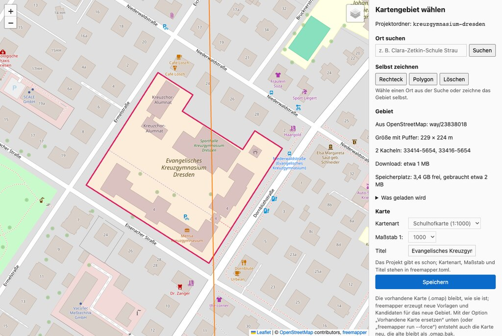
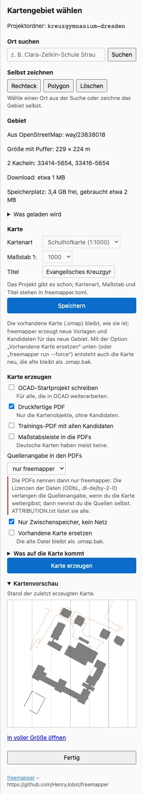
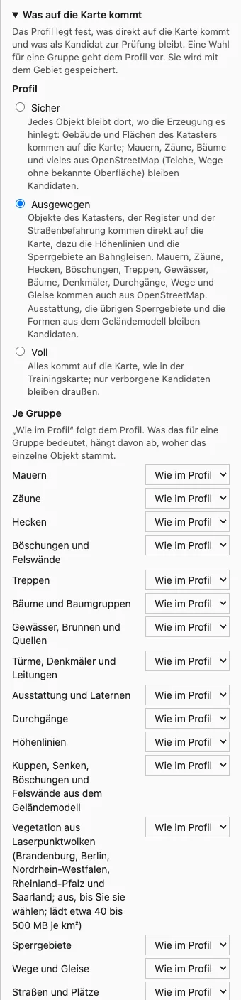
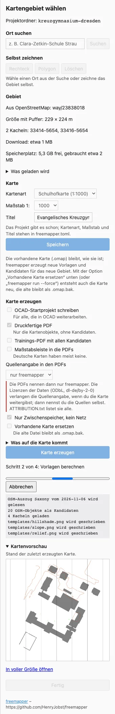
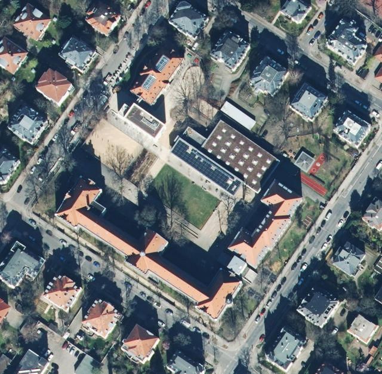
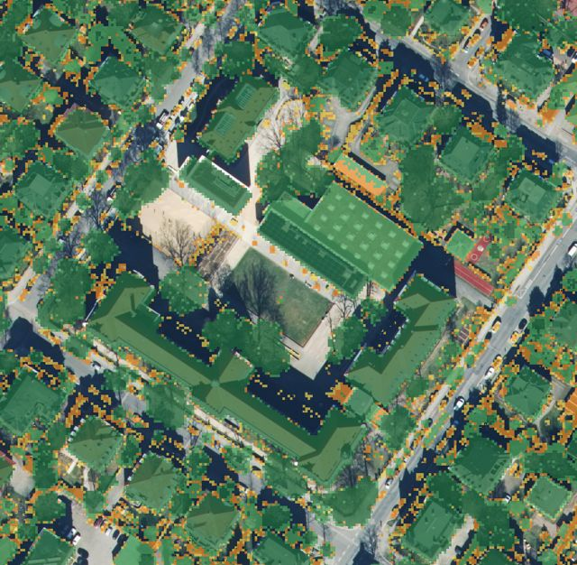
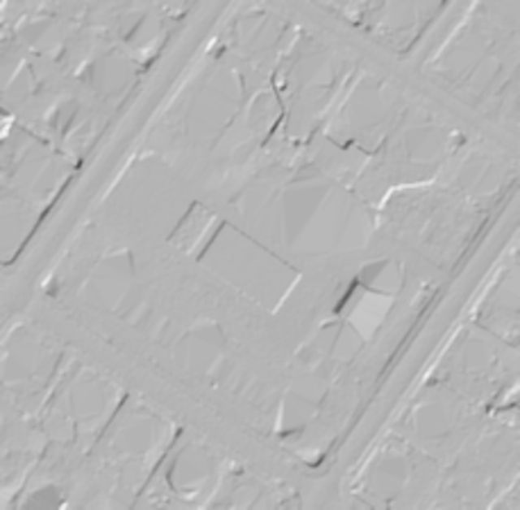
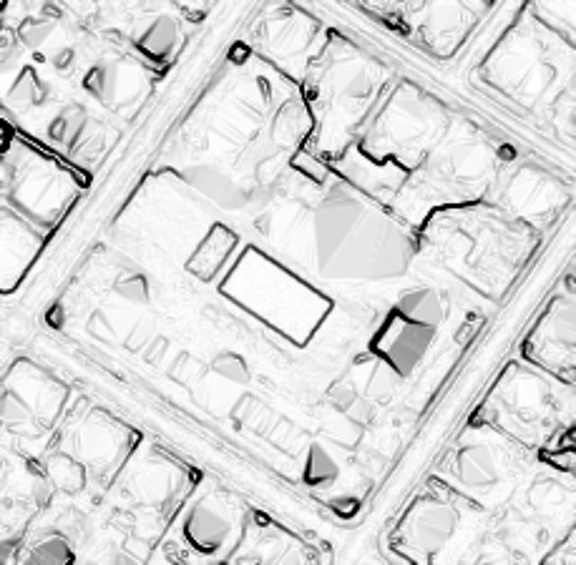
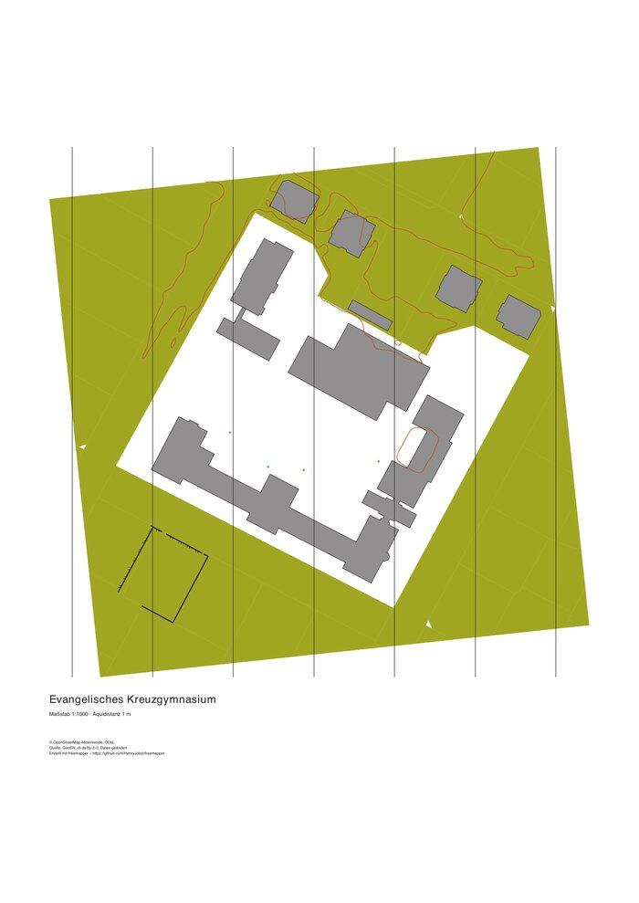

# freemapper – Handbuch

[English version](en.md) · [Glossar](../glossary.md) · [README](../../README.md)

Dieses Handbuch ist für Kartierer und Übungsleiter gedacht, die eine Orientierungslaufkarte erstellen
wollen, ohne sich mit Geodaten oder der Kommandozeile zu beschäftigen. Es beschreibt den aktuellen
Stand mit Brandenburg, Berlin und Sachsen.

## Inhalt

1. [Was freemapper macht](#1-was-freemapper-macht)
2. [Was Sie brauchen](#2-was-sie-brauchen)
3. [Installation](#3-installation)
4. [Weg A: mit einem KI-Assistenten](#4-weg-a-mit-einem-ki-assistenten)
5. [Weg B: ohne Assistent](#5-weg-b-ohne-assistent)
6. [Das Kartengebiet im Browser wählen](#6-das-kartengebiet-im-browser-wählen)
7. [Das Ergebnis](#7-das-ergebnis)
8. [Was die Vorlagen zeigen](#8-was-die-vorlagen-zeigen)
9. [Was im Gelände zu prüfen ist](#9-was-im-gelände-zu-prüfen-ist)
10. [Karte als PDF](#10-karte-als-pdf)
11. [OCAD](#11-ocad)
12. [Hinweise zu Genehmigungen](#12-hinweise-zu-genehmigungen)
13. [Regionen und Grenzgebiete](#13-regionen-und-grenzgebiete)
14. [Später weiterarbeiten](#14-später-weiterarbeiten)
15. [Meldungen und was zu tun ist](#15-meldungen-und-was-zu-tun-ist)
16. [Namensnennung](#16-namensnennung)
17. [Hilfe und Fehler melden](#17-hilfe-und-fehler-melden)

## 1. Was freemapper macht

freemapper holt die amtlichen Geodaten eines Gebiets und baut daraus den **Ausgangsstand** für eine
Schulhofkarte (1:1000), Sprintkarte (1:4000) oder Waldkarte (1:15 000 bis 1:7500). Zu den Geodaten gehören Luftbild, Geländemodell,
Gebäude und Flächennutzung aus dem Liegenschaftskataster (ALKIS). Dazu kommen Daten aus
OpenStreetMap (OSM).

- **Fertig gezeichnet** wird nur, was verlässlich ist: Gebäude, Gewässer aus dem Kataster, auf
  Sprintkarten auch befestigte Flächen (Straßen, Plätze) und unbefestigte Wege mit bekannter Oberfläche.
- **Als Vorlage** kommt alles, was Sie selbst beurteilen müssen: Luftbild, Höhenschummerung, Hangneigung,
  lokales Relief, Höhe über Grund (nDOM), Höhenlinien, Kuppen und Böschungen aus dem Gelände, Zäune, Hecken, Bänke, Spielgeräte, Sperrgebiete, Teiche, Bäche,
  Brunnen und Brücken.
- Gezeichnet und im Gelände geprüft wird weiterhin von Ihnen, in **OpenOrienteering Mapper (OOM)** oder
  **OCAD**.

Auf Wunsch erzeugt freemapper zusätzlich die **druckfertige Karte als PDF** und eine **Trainingskarte mit allen Kandidaten** (Kapitel 10).

## 2. Was Sie brauchen

- Einen Rechner mit Windows, macOS oder Linux. Ein GIS oder andere Programme brauchen Sie nicht.
- [OpenOrienteering Mapper](https://www.openorienteering.org/apps/mapper/) (kostenlos) oder OCAD 12
  bzw. neuer.
- Internet für das erste Laden.
- Freien Speicherplatz:
  - Beim ersten Mal lädt freemapper den OSM-Auszug des Bundeslandes, für Brandenburg und Berlin etwa 300 MB,
    für Sachsen etwa 270 MB, für Sachsen-Anhalt etwa 180 MB, für Hamburg etwa 55 MB, für Hessen etwa 350 MB, für Schleswig-Holstein etwa 160 MB (ohne Hamburg), für Mecklenburg-Vorpommern etwa 130 MB, für Niedersachsen etwa 510 MB (mit Bremen), für Rheinland-Pfalz etwa 275 MB, für das Saarland etwa 55 MB, für Bremen etwa 20 MB. In Nordrhein-Westfalen und Baden-Württemberg sind es die Auszüge der Regierungsbezirke mit je 130 bis 225 MB, bei einem Gebiet an einer Bezirksgrenze zwei davon. Der Auszug wird für
    alle Projekte wiederverwendet.
  - Dazu kommen je Karte meist 10–100 MB.
  - Vor jedem Laden prüft freemapper den freien Platz im Zwischenspeicher und im Projektordner. Liegen
    beide auf verschiedenen Laufwerken, prüft es jedes für sich. Auf jedem Laufwerk lässt es 1 GB frei.
    Reicht der Platz nicht für alles, lässt freemapper das Oberflächenmodell (die nDOM-Vorlage) aus und,
    wenn schon ein älterer OSM-Auszug da ist, auch dessen Aktualisierung. Für jeden ausgelassenen Teil
    warnt es. Kartendaten, Geländemodell und Luftbild braucht jede Karte. Passen sie nicht, bricht
    freemapper ab, bevor es etwas lädt.
- Ein Gebiet in **Brandenburg, Berlin, Sachsen, Sachsen-Anhalt, Hamburg, Hessen, Schleswig-Holstein, Mecklenburg-Vorpommern, Nordrhein-Westfalen, Niedersachsen, Rheinland-Pfalz, dem Saarland, Baden-Württemberg, Bremen oder Bayern**. Thüringen fehlt noch.
- Optional einen KI-Assistenten, z. B. Claude. Dann müssen Sie keine Befehle tippen.

## 3. Installation

freemapper ist ein einzelnes Programm ohne Installer.

1. Laden Sie auf der [Release-Seite](https://github.com/HenryJobst/freemapper/releases/latest) das Archiv
   für Ihr System herunter:
   - **Windows:** `freemapper-…-windows-x86_64.zip`
   - **Mac mit Apple-Chip** (M1 und neuer): `freemapper-…-macos-arm64.tar.gz`
   - **Mac mit Intel-Prozessor:** `freemapper-…-macos-x86_64.tar.gz`
   - **Linux:** `freemapper-…-linux-x86_64.tar.gz`

   Die `.gz`-Dateien und `freemapper-update.json` auf der Seite sind für `freemapper update`; Sie brauchen sie nicht.
2. Entpacken Sie das Archiv mit einem Doppelklick. Legen Sie den Ordner an einen festen Ort,
   z. B. `Dokumente/freemapper`.
3. Beim ersten Start warnt das System, weil das Programm nicht signiert ist:
   - **Windows:** „Der Computer wurde durch Windows geschützt“ → *Weitere Informationen* →
     *Trotzdem ausführen*.
   - **macOS:** „kann nicht geöffnet werden …“ → *Systemeinstellungen › Datenschutz & Sicherheit* →
     *Trotzdem öffnen*.

Merken Sie sich den **vollständigen Pfad** zum Programm, z. B. `C:\Users\Anna\Documents\freemapper\freemapper.exe`
oder `/Users/anna/Documents/freemapper/freemapper`. Der Assistent braucht ihn.

Im Ordner liegen außer dem Programm die READMEs, die Lizenz, dieses Handbuch und `AGENTS.md`, eine Anleitung
für KI-Assistenten (Kapitel 4).

### Aktualisieren

`freemapper update` setzt die neueste Version an die Stelle des Programms. Der Pfad bleibt gleich, deshalb
arbeitet ein Assistent, der freemapper über seinen Pfad kennt, ohne Änderung weiter. Die Versionen bis 0.11.0
können sich noch nicht selbst aktualisieren. Laden Sie dafür einmal wie in Schritt 1 das neueste Archiv herunter
und ersetzen Sie das Programm in Ihrem Ordner durch das aus dem Archiv. Danach übernimmt der Befehl das.

```sh
./freemapper update
```

Der Befehl zeigt die neue Version, ihr Erscheinungsdatum, den Link zu den Versionshinweisen und die
Downloadgröße und fragt `Jetzt installieren? [j/N]`. Nur `j` oder `ja` installiert (auch `y` und `yes`). Diese
Schalter ändern, was er tut:

| Aufruf | Was er tut |
|---|---|
| `freemapper update --check` | Prüft nur. Exit-Code 10 heißt, es gibt eine neuere Version, 0 heißt, diese ist aktuell. |
| `freemapper update --yes` | Installiert ohne Rückfrage. Ein Skript oder jeder Aufruf ohne Terminal braucht das, denn dort kann freemapper nicht fragen. |
| `freemapper update --version 0.12.0` | Installiert diese Version, auch eine ältere. Das geht nur mit Versionen, die sich selbst aktualisieren können. |
| `freemapper update --rollback` | Kehrt zu der Version zurück, die die letzte Aktualisierung ersetzt hat. |
| `freemapper update --mode notify` | Legt fest, was die tägliche Prüfung tut: `notify`, `install` oder `off` (siehe unten). |

**Prüfung vor dem Austausch.** Jede Version bringt eine Liste ihrer Programmdateien mit Größe und
SHA-256-Prüfsumme mit, signiert mit dem minisign-Schlüssel des Projekts. Den öffentlichen Teil dieses Schlüssels
hat freemapper eingebaut. Es installiert nur, wenn Signatur und Prüfsummen stimmen; sonst meldet es den Fehler,
und das alte Programm bleibt. Danach startet es das neue Programm einmal mit `--version`. Erst wenn das die
erwartete Version nennt, nimmt das neue Programm den Platz des alten ein.

**Die vorherige Version.** Das ersetzte Programm bleibt neben dem neuen als `freemapper.previous` liegen
(Windows: `freemapper.previous.exe`). `--rollback` tauscht die beiden zurück, ein zweites `--rollback` kehrt zur
neueren zurück.

**Programmordner.** freemapper muss in seinen eigenen Ordner schreiben dürfen. Nach Administratorrechten fragt es
nicht. Ist der Ordner schreibgeschützt, nennt die Meldung ihn; entpacken Sie die neue Version dann von Hand dort
oder verschieben Sie freemapper in einen Ordner, in den Sie schreiben dürfen. Starten Sie freemapper über einen
Link wie `~/.local/bin/freemapper`, ersetzt die Aktualisierung die Datei, auf die der Link zeigt.

**Selbst gebaut.** Ein freemapper, das Sie selbst mit cargo gebaut haben, aktualisiert sich nicht selbst.
`freemapper update` sagt dann nur, dass es mit `git pull` und `cargo build --release --locked` aktualisiert wird,
und die tägliche Prüfung entfällt.

#### Die tägliche Prüfung

Nach `find`, `init`, `select`, `fetch`, `run` und `permits`, die ohnehin ins Netz gehen, prüft freemapper höchstens einmal am
Tag, ob es eine neuere Version gibt. `derive` und `export` arbeiten ohne Netz und prüfen nicht. Die Prüfung läuft,
während der Befehl arbeitet. Findet sie eine neuere Version, folgt nach der Ausgabe des Befehls eine Zeile auf der
Fehlerausgabe (stderr):

```text
freemapper 0.12.0 ist verfügbar (Sie haben 0.11.0). Aktualisieren mit: freemapper update
```

Die Zeile kann auch nach einer Fehlermeldung kommen; selbst im Modus `install` installiert freemapper dann nichts.
Die Prüfung hat 3 Sekunden ab dem Start des Befehls, ein sehr schneller Befehl kann also bis zu 3 s länger dauern.
Braucht die Prüfung länger, bricht freemapper sie ab. Eine abgebrochene oder fehlgeschlagene Prüfung zeigt nichts und zählt trotzdem für den
Tag; ein Rechner ohne Internet fragt also einmal am Tag und nicht bei jedem Befehl. Zeit und Ergebnis der letzten
Prüfung stehen in `update-check.json` im Zwischenspeicher.

Keine tägliche Prüfung gibt es mit `--offline`, wenn die Umgebungsvariable `CI` gesetzt ist (wie auf
Build-Servern), im Modus `off` und in einem selbst gebauten freemapper.

#### Aktualisierungsmodus

| Modus | Was geschieht, wenn die tägliche Prüfung eine neuere Version findet |
|---|---|
| `notify` (Standard) | Die Zeile oben. |
| `install` | freemapper installiert sie nach dem Befehl, aber nur, wenn der Befehl gelungen ist; nach einem fehlgeschlagenen Befehl zeigt es stattdessen die Zeile. Die neue Version gilt ab dem nächsten Start. Scheitert die Installation, gibt freemapper eine Zeile mit `Warnung:` aus, und der Befehl behält seinen Exit-Code. |
| `off` | Keine tägliche Prüfung. `freemapper update` funktioniert weiter. |

`freemapper update --mode install` speichert den Modus in der Datei `settings.toml`:

- Windows: `%APPDATA%\freemapper\settings.toml`, z. B. `C:\Users\Anna\AppData\Roaming\freemapper\settings.toml`
- macOS: `~/Library/Application Support/freemapper/settings.toml`
- Linux: `~/.config/freemapper/settings.toml`, oder `$XDG_CONFIG_HOME/freemapper/settings.toml`, wenn diese
  Variable gesetzt ist

Die Datei enthält dann `mode = "install"` unter `[update]`. Die Umgebungsvariable `FREEMAPPER_UPDATE` mit `off`,
`notify` oder `install` hat Vorrang vor der Datei, solange sie gesetzt ist; `--mode` sagt es dann.
`FREEMAPPER_CONFIG_DIR` nennt einen anderen Ordner für die Datei. `--mode` geht auch in einem selbst gebauten
freemapper, denn es schreibt nur die Datei.

Dauerhaft ausschalten lässt sich die Prüfung mit `freemapper update --mode off`, für eine Terminal-Sitzung mit
`FREEMAPPER_UPDATE=off`.

#### Was freemapper sendet

Die Prüfung fragt bei github.com zwei kleine Dateien der neuesten Version ab: das Aktualisierungsmanifest
`freemapper-update.json` und seine Signatur. GitHub leitet die Anfrage an seine Download-Server weiter, und
freemapper folgt nur zu `release-assets.githubusercontent.com` und `objects.githubusercontent.com`. Eine
Installation lädt dann von dort die Programmdatei für Ihr System. Jede Anfrage trägt nur den festen `User-Agent`
`freemapper/<Version> (+https://github.com/HenryJobst/freemapper)`, denselben wie bei den Geodaten. freemapper
sendet keine Kennung, keine Projektdaten und nichts über Sie.

#### Mit einem Assistenten

Auch der MCP-Server prüft einmal am Tag, und er installiert nie von sich aus. Kennt er eine neuere Version, endet
seine nächste Antwort an den Assistenten mit einem Hinweis für Sie. Der Assistent soll Sie dann fragen und erst
nach Ihrer Zustimmung das Werkzeug `install_update` aufrufen. Das Werkzeug `check_update` prüft nur. Ein
laufender MCP-Server behält die alte Version, bis der Assistent ihn neu startet; in Claude Desktop beenden Sie die
App und öffnen sie wieder. `AGENTS.md` gibt dem Assistenten diese Regeln.

Die Gebietsseite im Browser zeigt eine Zeile mit dem Befehl, wenn die letzte tägliche Prüfung eine neuere Version
gefunden hat. Die Seite selbst installiert nichts.

## 4. Weg A: mit einem KI-Assistenten

Der Assistent bedient freemapper für Sie. freemapper ist dafür ein „MCP-Server“, ein Werkzeug, das
KI-Assistenten nutzen können.

### Einmal einrichten

- **Claude Desktop:**
  1. *Einstellungen › Entwickler › Konfiguration bearbeiten* öffnen.
  2. In die Datei `claude_desktop_config.json` eintragen (Pfad anpassen, unter Windows mit doppelten
     Backslashes `\\`):

     ```json
     {
       "mcpServers": {
         "freemapper": { "command": "/Users/anna/Documents/freemapper/freemapper", "args": ["mcp"] }
       }
     }
     ```

  3. Claude Desktop neu starten.
- **Claude Code:** im Terminal `claude mcp add freemapper -- /Pfad/zu/freemapper mcp` eingeben.
- **Andere Assistenten:** Bei jedem MCP-fähigen Assistenten tragen Sie dasselbe ein: das Programm mit
  dem Argument `mcp`.

**Einrichten lassen:** Ein Assistent, der Befehle auf Ihrem Rechner ausführen kann (etwa Claude Code oder
Codex), übernimmt auch die Installation aus Kapitel 3 und die Anmeldung. Sagen Sie ihm:

> Lies AGENTS.md von github.com/HenryJobst/freemapper und richte freemapper ein.

In der Datei steht für den Assistenten, welches Archiv er für Ihr System lädt, wie er es prüft und entpackt und
wie er freemapper anmeldet. Auf dem Mac entfernt er dabei die Sperre für nicht signierte Programme und sagt
Ihnen das. Je nach seinen Einstellungen fragt er vor jedem Befehl um Erlaubnis. Claude Desktop führt keine
Befehle aus; dort richten Sie freemapper wie oben beschrieben ein.

### Eine Karte bestellen

Schreiben Sie dem Assistenten einfach, was Sie brauchen, zum Beispiel:

> Erstelle mit freemapper eine Schulhofkarte für das Evangelische Kreuzgymnasium in Dresden.
> Speichere das Projekt unter Dokumente/OL-Karten/kreuzgymnasium.

> Mach mir eine Sprintkarte für die Altstadt von Strausberg, mit OCAD-Datei und PDF.

Der Assistent geht dann so vor:

1. Er sucht den Ort und zeigt Ihnen die Treffer.
2. Er legt das Projekt an.
3. Er sagt Ihnen, wie viel heruntergeladen wird und ob es auf den Datenträger passt.
4. Er startet das Laden und Berechnen. Das dauert beim ersten Mal einige Minuten, später meist weniger
   als eine Minute.
5. Er zeigt Ihnen Vorschaubilder der Vorlagen.

Passt kein Suchtreffer, zum Beispiel weil das Schulgelände in OSM aus zwei Teilen besteht, bitten Sie
den Assistenten, **die Gebietsauswahl im Browser zu öffnen**. Dort zeichnen Sie das Gebiet selbst
(Kapitel 6).

## 5. Weg B: ohne Assistent

Ganz ohne Kommandozeile geht es nicht, aber zwei Befehle genügen. Öffnen Sie ein Terminal, unter
Windows die PowerShell, im Ordner mit freemapper.

1. Das Gebiet im Browser wählen. Der Projektordner wird dabei angelegt:

   ```sh
   ./freemapper select kreuzgymnasium
   ```

   Unter Windows: `.\freemapper.exe select kreuzgymnasium`.
2. Alles laden, berechnen und die Karte schreiben:

   ```sh
   ./freemapper run kreuzgymnasium
   ```

   Mit `--ocad` entsteht zusätzlich die OCAD-Datei, mit `--pdf` das PDF der Karte, mit `--pdf-candidates` die Trainingskarte mit Kandidaten.

Kennen Sie den OSM-Eintrag des Geländes, geht es auch ohne Browser:

```sh
./freemapper init kreuzgymnasium --osm way/23838018 --title "Evangelisches Kreuzgymnasium"
./freemapper run kreuzgymnasium
```

Die Kennung findet `find` über den Namen. Der Befehl listet bis zu fünf Treffer aus OpenStreetMap auf, die mit
Fläche zuerst, und nennt den `init`-Befehl für die erste Fläche:

```sh
./freemapper find "Clara-Zetkin-Schule Strausberg"
```

```text
way/992423119  Clara-Zetkin-Schule (amenity=school): 1, Am Sportpark, Strausberg Vorstadt, Strausberg, Märkisch-Oderland, Brandenburg, 15344, Deutschland
Projekt anlegen mit: freemapper init <ordner> --osm way/992423119
```

Eine Zeile mit „keine Fläche, kann kein Kartengebiet sein“ ist in OSM ein Punkt, zum Beispiel eine Haltestelle
oder Ladesäule, die nach der Schule heißt. Sie taugt nicht als Kartengebiet. Steht der gesuchte Ort nicht in der
Liste, versuchen Sie einen längeren Namen mit dem Ort dazu, oder zeichnen Sie das Gebiet mit `select`. Ist der
Name eindeutig, überspringt `init --place "<Name>"` die Liste und nimmt den ersten Treffer mit Fläche.

Besteht das Gelände in OSM aus mehreren getrennten Flächen (eine Multipolygon-Relation mit mehreren äußeren
Ringen), nennt freemapper die Teile mit ihrer Größe. Mit `--part 1` nehmen Sie die größte, mit `--part 2` die
nächste. Die äußeren Wege einer solchen Relation tragen oft keine Tags. Nominatim kennt sie dann nicht, und
`--osm way/…` findet nichts. Nehmen Sie dann die Relation (`--osm relation/…`) oder speichern Sie den Umriss
als GeoJSON und nutzen Sie `--geojson`.

**Maßstab.** `--scale` nimmt nur Werte an, die freemapper-print druckt: bei Schulhofkarten 1000, bei
Sprintkarten 4000 (Standard) oder 5000, bei Waldkarten 15000 (Standard), 10000 oder 7500. Mit 5000 warnt freemapper-print, weil der Maßstab nicht in der Norm steht; die
Symbole bleiben bei 100 %. Einen Sprintkarten-Maßstab 3000 lehnt `init` ab. Zeichnen Sie bei 1:4000, freemapper-print
vergrößert beim Drucken auf 1:3000. Ein Projekt, dessen `freemapper.toml` einen anderen Maßstab nennt, lässt sich
weiter laden; freemapper warnt, und freemapper-print druckt die Karte nicht.

**Titel.** `init` schreibt immer einen `title` in die `freemapper.toml`. Ohne `--title` ist es der Ordnername mit
großen Anfangsbuchstaben (`clara-zetkin-schule` wird zu „Clara-Zetkin-Schule“). PDF, freemapper-print und
freemapper-courseplan zeigen so denselben Titel. Ändern Sie ihn bei Bedarf in der Datei.

## 6. Das Kartengebiet im Browser wählen



*Die Gebietsauswahl mit dem Kreuzgymnasium Dresden. Kartendaten © OpenStreetMap-Mitwirkende.*

- **Ort suchen:** Namen eingeben, z. B. „Kreuzgymnasium Dresden“, und einen Treffer mit Fläche wählen.
- **Selbst zeichnen:**
  - *Rechteck:* zwei Ecken anklicken.
  - *Polygon:* Ecken nacheinander anklicken. Zum Schließen die erste Ecke anklicken oder doppelklicken.
  - Esc bricht ab, die Rücktaste nimmt die letzte Ecke zurück.
- **Hintergrund:** Oben rechts wählen Sie OpenStreetMap oder das Luftbild eines Bundeslands. Die
  Liste nennt jedes unterstützte Bundesland mit seiner Behörde, zum Beispiel „Luftbild
  Brandenburg/Berlin (LGB)“ oder „Luftbild Sachsen (GeoSN)“.
- **Rechts** sehen Sie:
  - die Größe mit Puffer;
  - die Datenkacheln, die geladen werden (dünne Linien in der Karte);
  - den geschätzten Download;
  - den freien Speicherplatz und wie viel davon der Download braucht. Was nicht auf den Datenträger
    passt, trägt in der Liste „Was geladen wird“ den Vermerk „passt nicht auf den Datenträger“.
    Darüber stehen die Meldungen aus Kapitel 15 und ob freemapper den Teil auslässt oder abbricht.
- **Kartenart, Maßstab und Titel** einstellen, dann *Speichern*. Danach können Sie die Karte gleich auf
  der Seite erzeugen (nächster Abschnitt) oder mit *Fertig* schließen und `freemapper run` im Terminal
  starten.

Die Seite läuft nur auf Ihrem Rechner. Ein Gebiet darf mit Puffer höchstens 4 km × 4 km groß sein.

### Karte im Browser erzeugen

Unter den Einstellungen steht der Block „Karte erzeugen“. Er braucht kein Terminal.



*Die Optionen mit den Voreinstellungen des Beispiels (PDF, nur Zwischenspeicher, Quellenangabe „nur freemapper“).*

1. **Gebiet wählen** wie oben. Der Knopf „Karte erzeugen“ bleibt aus, solange kein Gebiet gewählt ist, die
   Vorschau noch rechnet, das Gebiet zu groß ist oder außerhalb der unterstützten Bundesländer liegt oder
   der Speicherplatz nicht reicht (ohne „Nur Zwischenspeicher“). Die Zeile über dem Knopf nennt den Grund.
2. **Optionen setzen.** Sie entsprechen den Schaltern von `freemapper run`:

   | Option auf der Seite | Schalter im Terminal |
   |---|---|
   | OCAD-Startprojekt schreiben | `--ocad` |
   | Druckfertige PDF | `--pdf` |
   | Trainings-PDF mit allen Kandidaten | `--pdf-candidates` |
   | Maßstabsleiste in die PDFs | `--pdf-scale-bar` |
   | Quellenangabe in den PDFs: automatisch, vollständig, nur freemapper | `--pdf-sources auto`, `full`, `credit-only` |
   | Hinweise zu Genehmigungen | `--permits` (Kapitel 12) |
   | Nur Zwischenspeicher, kein Netz | `--offline` |
   | Vorhandene Karte ersetzen | `--force` |

   Maßstabsleiste und Quellenangabe gelten nur, wenn eine PDF entsteht; ohne PDF sind sie ausgegraut.
   „Nur freemapper“ nennt in den PDFs nur freemapper. Die Lizenzen der Daten (ODbL, dl-de/by-2-0) verlangen
   die Quellenangabe, wenn Sie die Karte weitergeben; dann nennen Sie die Quellen selbst. Die Seite zeigt
   diesen Hinweis, sobald Sie die Wahl treffen. Kartenart, Maßstab und Titel stellen Sie weiter oben ein;
   bei einem vorhandenen Projekt sind sie schreibgeschützt (sie stehen in `freemapper.toml`).

   Der Abschnitt „Was auf die Karte kommt“ (eingeklappt) stellt das Inhaltsprofil und die Ausnahmen je Gruppe
   ein, wie `--content` und `--content-set`. Eine Gruppe auf „Wie im Profil“ folgt dem Profil. Wechseln Sie das
   Profil, bleiben Ihre Ausnahmen stehen, und Sie können sie einzeln zurücknehmen. Die Seite speichert die Wahl
   mit dem Gebiet; was die Profile tun, steht in [Abschnitt 8](#8-was-die-vorlagen-zeigen).

   

   *Das Profil und die Gruppen. Die Vegetation aus Laserpunktwolken ist aus, bis Sie sie wählen.*
3. **„Karte erzeugen“ drücken.** Haben sich das Gebiet oder die Inhaltseinstellungen seit dem letzten Speichern geändert, speichert die Seite sie
   zuerst. „Vorhandene Karte ersetzen“ erscheint nur, wenn es schon eine Karte gibt, und ist nie vorgewählt.
   Ist sie angehakt, fragt ein Dialog nach; „Abbrechen“ ist dort vorgewählt. Die alte Karte bleibt als
   `.omap.bak` im Projektordner.
4. **Fortschritt:** Die Seite zeigt „Schritt 2 von 4: Vorlagen berechnen“, einen Balken ohne Prozentangabe
   (freemapper kennt die Dauer nicht), die letzten acht Zeilen des Protokolls und die Warnungen, etwa zu einem
   zweiten Bundesland im Gebiet. Die Warnungen bleiben nach dem Lauf stehen. Solange der Lauf geht, sind
   Gebiet, Einstellungen, „Speichern“ und „Fertig“ gesperrt. Laden Sie die Seite neu, zeigt sie den laufenden
   Lauf weiter an.

   

   *Der Fortschritt mitten im Lauf (für die Abbildung mit einer gestellten Serverantwort).*
5. **Abbrechen:** „Abbrechen“ hält den Lauf an der nächsten Stelle an. Was schon geschrieben oder geladen
   ist, bleibt ganz erhalten (keine halben Dateien); ein neuer Lauf macht dort weiter.
6. **Kartenvorschau:** Unter dem Laufstatus zeigt der Abschnitt „Kartenvorschau“ die Kartenobjekte als Bild. Nach
   einem Lauf und beim Öffnen der Seite für ein Projekt mit Karte ist es die zuletzt erzeugte Karte. Ändern Sie
   unter „Was auf die Karte kommt“ das Profil oder eine Gruppe, zeigt die Seite die Wirkung nach einer kurzen
   Pause, ohne Lauf und ohne Speichern. Das alte Bild verblasst, während das neue berechnet wird (beim ersten
   Mal auf einem großen Gebiet einige Sekunden, danach etwa eine Sekunde). Die Zeile über dem Bild sagt, was es
   zeigt: „Stand der zuletzt erzeugten Karte.“ oder „Mit den Einstellungen auf dieser Seite, noch nicht
   gespeichert.“ „In voller Größe öffnen“ öffnet das Bild in einem neuen Tab. Das Bild zeigt nur die
   Kartenobjekte, keine Kandidaten, kein Luftbild, keine Legende und keinen Text. Haben Sie Gebiet, Kartenart
   oder Maßstab geändert, seit die Karte erzeugt wurde, zeigt die Seite weiter das letzte Bild und sagt, dass
   eine neue Vorschau einen Lauf mit „Vorhandene Karte ersetzen“ braucht: Ein Lauf, der die Karte behält,
   schreibt keine Vorschau. Ein gezeichnetes Gebiet, das noch nicht gespeichert ist, bekommt ebenfalls kein neues
   Bild, und die Zeile sagt das. Während eines Laufs zeigt die Seite das letzte Bild und aktualisiert es, wenn
   der Lauf endet. Ein späteres Laden allein macht das Bild nicht veraltet. Vor dem ersten Lauf gibt es kein Bild
   („Noch keine Karte erzeugt.“). Eine Karte aus einem älteren freemapper hat auch keins; die Seite sagt das, und
   der nächste Lauf mit „Vorhandene Karte ersetzen“ erzeugt eins.
7. **Ergebnis:** Die Seite sagt, ob der Lauf fertig, fehlgeschlagen oder abgebrochen ist, listet die Dateien
   mit Größe und nennt den Projektordner. „Ordner öffnen“ öffnet ihn im Dateimanager; geht das nicht, steht
   der Pfad als Text da. Gab es schon eine Karte und war „Vorhandene Karte ersetzen“ aus, bleibt sie
   unverändert, und die Seite sagt das. Bei einem Fehler steht die Meldung des Programms da; „Nochmal
   erzeugen“ startet einen neuen Lauf.

**Ein Ordner, ein Lauf.** Im Projektordner liegt während eines Laufs die Datei `.freemapper-run.lock`. Ein
zweiter Lauf, vom Terminal, von einem KI-Assistenten oder aus einem zweiten Browserfenster, hört mit der
Meldung „Ein anderer freemapper-Lauf verwendet diesen Ordner (seit …, gestartet von …)“ auf. Warten Sie, bis
der erste fertig ist, oder brechen Sie ihn ab. Nach einem Absturz gilt die Sperre nach 60 Sekunden als
verwaist. Läuft ein Lauf eines anderen Projekts, startet der neue nicht, denn die Projekte teilen sich den
Zwischenspeicher.

**Voreinstellungen** setzen Sie beim Start der Seite: `freemapper select mein-schulhof --pdf --ocad` hakt
die beiden Optionen schon an. Es gibt `--ocad`, `--pdf`, `--pdf-candidates`, `--pdf-scale-bar`,
`--pdf-sources auto|full|credit-only` und `--offline`; der KI-Assistent kann dieselben Felder an
`open_area_selector` übergeben. „Hinweise zu Genehmigungen“ wählt nur der KI-Assistent vor (`permits`);
`select` hat dafür keinen Schalter. „Vorhandene Karte ersetzen“ hat keine Voreinstellung.

Die Seite spricht Deutsch oder Englisch: in der Sprache des Programms (Kapitel 15), sonst in der des Browsers. Sie ruft keine Adresse außerhalb Ihres
Rechners auf, außer den Kartenkacheln im Hintergrund (über den lokalen Server) und den Luftbild-Diensten,
wenn Sie sie einschalten.

## 7. Das Ergebnis

Im Projektordner liegen danach unter anderem:

| Datei | Was sie ist |
|---|---|
| `<name>.omap` | die Karte für OpenOrienteering Mapper, georeferenziert, mit Gebäuden, Überdachungen, Gewässern und Randangaben |
| `templates/` | die Vorlagen: Luftbild, Schummerung, Hangneigung, lokales Relief, nDOM und die Kandidaten-Karte, in Berlin auch die K5 (Kapitel 13) |
| `ocad/` | mit `--ocad`: die OCAD-Karte und ihre Vorlagen |
| `<name>.pdf` | mit `--pdf`: die druckfertige Karte ohne Kandidaten |
| `<name>-candidates.pdf` | mit `--pdf-candidates`: die Trainingskarte mit allen Kandidaten |
| `<name>-preview.webp` | ein Bild der Kartenobjekte (ohne Kandidaten, ohne Blattrand), zusammen mit der `.omap` geschrieben; die Gebietsseite zeigt es |
| `ATTRIBUTION.txt` | die Namensnennung der Datenquellen |
| `freemapper.toml` | die Einstellungen und der Datenstand des Projekts |
| `permits.md`, `permits.json` | mit `--permits` oder `freemapper permits`: die Hinweise zu Genehmigungen (Kapitel 12) |

Öffnen Sie die `.omap`-Datei in OOM. Die Vorlagen sind schon eingebunden; im Menü *Vorlagen* blenden Sie
sie ein und aus. Die **Kandidaten** (`templates/candidates.omap`) liegen als eigene Karte darüber. Dort
stehen Zäune, Hecken, Bänke, Höhenlinien, Sperrgebiete, Gewässer aus OSM und Brücken. Prüfen Sie sie
und übernehmen Sie, was stimmt: abzeichnen, oder die Kandidaten-Karte öffnen und die Objekte kopieren
und einfügen. Beide Karten haben dieselbe Georeferenz.

Auf der Sprintkarte liegt unter allem die **belaufbare Fläche**: eine Fläche im unteren Braun (dem Ton von
501.5) über das ganze Kartenblatt, im eigenen Kartenteil `base`. Sie füllt alles, was sonst nichts zeigt.
Gebäude, Straßen, Sperrgebiete, Parks, Wald, Wege, Gewässer und Höhenlinien liegen darüber. Eine
Sprintkarte ohne diese Fläche ist unvollständig, denn wo nichts kartiert ist, bliebe sie weiß und sähe aus wie
Wald. Sie können die Fläche in OOM löschen, das ist aber nicht vorgesehen. Das untere Braun liegt im
Graustufendruck nahe an den Wegflächen und am Papierweiß; drucken Sie Sprintkarten deshalb farbig. Die
Schulhofkarte hat keine belaufbare Fläche.

**Parks** sind gelb. Grünanlagen, Parks, Siedlungsgrün und Grünland aus dem Kataster werden zu offenem
Gelände (401) in der Karte, Wald und Gehölz zu Wald (405), Heide zu 403. Friedhöfe und anderes
Landwirtschaftsland, Moor und Sumpf sind Kandidaten, ebenso Parks und Rasen aus OSM, soweit dort kein
Kataster-Park liegt.

Punktsymbole wie Bäume, Brunnen oder Poller halten den Abstand ein, den die ISSprOM verlangt. Würden sich
zwei auf dem Papier berühren, behält freemapper das größere. Eine dichte Baumgruppe wird zu einer Fläche:
befestigte Fläche mit verstreuten Bäumen, offenes Gelände mit verstreuten Bäumen oder Wald. Wege und
Pflaster bleiben frei. Was Sie dort prüfen, steht in Kapitel 9.

**Gewässer** zeichnet freemapper auf beiden Kartenarten. Flüsse, Kanäle, Seen, Teiche, Hafenbecken und
Meer aus dem Kataster werden zu unpassierbarem Gewässer: einer blauen Fläche (301.1) mit schwarzer
Uferlinie (301.6). Ein Fluss liegt im Kataster oft in vielen einzelnen Flächen. freemapper löst sie zu einer
Fläche auf, damit keine Linien quer über das Wasser laufen. Wo das Wasser über Kartengebiet und Puffer
hinausreicht, bekommt es an dieser Kante keine Uferlinie; Inseln behalten ihre. Gewässer, die im Mittel
schmaler als 2 m sind, kommen nur in die Kandidaten. Die Höhenlinien enden am Ufer dieses Gewässers, in den
Kandidaten wie auf der Trainingskarte.

Aus OSM kommen weitere Kandidaten:

- Teiche, Becken, Schwimmbecken im Freien und Brunnenbecken als Fläche (301). Liegt eine solche Fläche mindestens zur
  Hälfte im Gewässer aus dem Kataster, lässt freemapper sie weg.
- Bäche und Abzugsgräben (`drain`) als Linie: 305, wenn sie ganzjährig Wasser führen, sonst 306. Gräben
  (`ditch`) sind immer 306. Verrohrte Abschnitte fehlen.
- Brunnen (311) und Quellen (312) als Punkt, auf Schulhofkarten auch Trinkbrunnen (313). Brunnenpunkte, die
  im Wasser stehen, lässt freemapper weg, denn meist sind es die Fontänen in einem Becken.
- Brücken als befestigte Fläche (501.5), nur auf Sprintkarten. Sie liegen über dem Wasser.

OSM-Flächen, die Multipolygon-Relationen sind, zählen wie Wege: ein See mit Inseln, ein Park mit einer Straße
durch die Mitte oder ein Gebäude mit Innenhof. Die Löcher bleiben im Kartenobjekt leer, der Innenhof liegt also
nicht im Gebäude. Entscheidend sind die Tags der Relation selbst; ihre Wege brauchen keine. Eine früher erstellte
Karte bekommt diese Flächen erst mit `run --force`.

Meer, das nicht im Kataster steht, bleibt weiß. freemapper liest die Küstenlinie aus OSM nicht.

**OSM-Daten auf Sprintkarten.** Neben dem Wasser liefert OSM diese Kandidaten (Regeln in
`assets/rules/osm-candidates.toml`; bestehende Karten bekommen sie mit `run --force`):

- Durchgänge durch Gebäude und Arkaden (`tunnel=building_passage`, `covered=yes`) als Streifen entlang des
  Weges (522), 3 m breit oder so breit, wie das Tag `width` angibt. Das Gebäude bleibt ganz. Kennen ALKIS
  oder die Berliner Gebäudeteile den Durchgang auch, behält freemapper den aus dem Kataster und nennt den
  OSM-Weg in `freemapper:also` (siehe „Doppel“ unten). Prüfen Sie vor Ort, ob der Durchgang im Rennen
  benutzt werden kann (ISSprOM 2.3 erlaubt zwei Laufebenen).
- Private und gesperrte Wege und Flächen als Flächen, die nicht betreten werden dürfen (520). Ein Fußweg, Pfad,
  eine Fußgängerzone oder Treppe mit `access=private|no` oder `foot=private|no` und eine Zufahrt, ein
  Wirtschaftsweg oder Radweg mit `access=private|no` werden ein Streifen von 2 m (Straßen 3 m) Breite, die
  Wegelinie entfällt. `foot=yes`, `permissive` oder `designated` lässt den Weg, wie er war, ebenso
  `access=destination` oder `customers`. Flächen mit `access=private|no` (Landnutzung, Garten, Platz, Parkplatz,
  Schulgelände) sind 520 in ihrer eigenen Form; ein privates Becken bleibt Wasser. Prüfen Sie die 520 vor Ort
  an Schildern und Zäunen und halten Sie die Eingänge frei (ISSprOM 520).
- Wege nach Oberfläche. Verdichteter Kies und Feinkies ist fest („hard gravel“ in ISSprOM 501), ein solcher Weg
  ist daher eine befestigte Linie in der Karte (501.6 bis 501.9 nach `width`: 1,4, 2, 3, 4 m) und kein
  unbefestigter Weg. Liegt dort schon ALKIS- oder Befahrungs-Pflaster (501.5) als Kartenobjekt, zeichnet freemapper den Weg
  nicht doppelt: Der Teil im Pflaster und Stücke unter 1 mm auf dem Papier entfallen. Ein Weg in einem ALKIS-Flurstück `Weg`
  (nur ein Kandidat 501.5) bleibt ganz. Loser Kies, Sand, Erde und Gras bleiben unbefestigt in der Karte: 506
  unter 1,5 m Breite, 505.1 und ab 3 m 505.2. Ein Wirtschaftsweg ohne `surface` folgt `tracktype`: grade1 ist
  befestigt, grade2 fest (501.7, Karte), grade3 bis grade5 unbefestigt (505.2, Kandidat).
- Bahngleise (Sprintkarte, Kartenobjekt). Gleise aus OSM (`railway=rail`, `light_rail`, `narrow_gauge`, auch
  Brücken und Nebengleise) sind Kartenobjekte mit 509.1, einer Linie von mindestens 4 mm Länge auf dem Papier;
  jedes Gleis ist eine eigene Linie. Tunnel, stillgelegte, abgebaute und geplante Gleise und Überleitungen
  zeichnet freemapper nicht. U-Bahn-Gleise ohne Tunnel sind Kandidaten, auf einer Hochbahnbrücke
  (`bridge=yes`) Kartenobjekte. Straßenbahngleise (`railway=tram`) sind Kandidaten 509.2, weil die Norm sie nur
  zeichnet, wenn sie der Orientierung dienen. Ein Wald wird an einem Gleis geschnitten. Das Bahngelände aus ALKIS
  bleibt ein Kandidat 520 (Sperrfläche), die Gleise darin bleiben stehen. Schulhofkarten haben kein Gleis.
- Kontrollstandorte für Bahnleger: Poller, Straßenlaternen, Papierkörbe, Fahrradständer und Bänke als Punkte
  (531, auffälliges künstliches Objekt) unter den Kandidaten, nie in der Karte selbst. In Berlin kommen aus der
  Straßenbefahrung und dem Beleuchtungskataster Poller, Masten, Fahnenmasten, Bänke, Laternen und Werbesäulen
  dazu. Jedes trägt das Tag `freemapper:control` mit seiner Art; alle Objekte des Symbols 531 finden Sie in OOM
  mit „Alle Objekte mit gleichem Symbol auswählen“. Ein Objekt, das ein gleichartiges innerhalb von 25 m hat,
  fehlt, gleich aus welcher Quelle es stammt: Einen Poller in einer Reihe, eine Bank in einem Paar oder eine
  Laterne in einer Folge erkennt man nicht von ihrem Nachbarn. Ein Kontrollstandort weicht außerdem jedem
  anderen Symbol. Prüfen Sie vor der Nutzung vor Ort, ob der
  Standort noch da ist, und schreiben Sie die Definition von 531 in die Legende der Karte, wie ISSprOM es
  verlangt.
- Freileitungen, Rohrleitungen, Türme und Masten (Sprint, nur Kandidaten). Oberirdische Leitungen sind 510, die ab
  110 kV 511 (Doppellinie). Die Norm lässt eine Leitung weg, die an einer Straße oder einem Weg entlangläuft und für
  die Orientierung nichts bringt; freemapper vergleicht das nicht, das tun Sie. Rohrleitungen über der Erde sind 528
  (niedrig) oder 529 (hoch, nicht überquerbar); die Norm verlangt für beide eine Definition in der Legende, und eine
  Rohrleitung ohne `location` in OSM gilt als vergraben und fehlt. Türme, Masten, Schornsteine, Wassertürme,
  Leuchttürme und Strommasten sind Punkte: 524 (hoch) oder 525 (unter 20 m), jeder mit `freemapper:control`
  (`pylon`, `mast`, `tower`, `chimney`, `water_tower`, `lighthouse`); einer gleicher Art innerhalb von 25 m nimmt
  beide heraus. Steht ein Strommast an einer 510-Linie, zeigen ihn schon die Querstriche: löschen Sie einen. Linien
  unter der Mindestlänge der Norm fehlen (3,75 mm bei 510 und 511, 2,2 mm bei 528, 3 mm bei 529).
- Denkmäler und Grenzsteine (`historic=memorial`, `monument`, `wayside_cross`, `boundary_stone`) als Punkte (526)
  unter den Kandidaten. Stolpersteine, Gedenktafeln und Gedenkstücke, die eine Bank, ein Baum oder ein Wandbild
  sind, fehlen, denn 526 gilt für Objekte, die im Gelände auffallen (ISSprOM 526). Kennt auch das Kataster das
  Denkmal, sehen Sie zwei Punkte; behalten Sie einen.
- Durchgänge (522), die kein Läufer erreichen kann, sind verborgen. Ein Durchgang, der nur an Gebäude, Flächen,
  die nicht betreten werden dürfen, oder Wasser grenzt oder zwei umbaute Höfe verbindet, fehlt in der
  Trainingskarte, bleibt aber mit dem Tag `freemapper:hidden=unreachable` unter den Kandidaten. Schauen Sie ihn
  an, wenn Sie wissen, dass der Hof ein Tor hat. Ein Kandidatenpunkt (Denkmal, Laterne, Papierkorb), der in einem
  Gebäudegrundriss liegt, entfällt.
- Doppel. Geben zwei Quellen dasselbe Objekt, behält freemapper eines: das Register vor ALKIS, ALKIS vor der
  Berliner Straßenbefahrung, diese vor OSM. Bei Flächen misst freemapper, wie viel der schwächeren unter den
  stärkeren mit gleichem Symbol liegt, aufgeweitet um 0,25 mm auf dem Papier (1 m bei 1:4000). Ein Durchgang
  (522) oder eine Überdachung fällt weg, wenn die Hälfte bedeckt ist, ein privater Streifen (520) in einer
  ALKIS-Fläche, die nicht betreten werden darf, ab 80 %, eine OSM-Brücke über einer Berliner Brückenfläche
  ab der Hälfte. Auch ein OSM-Denkmal bis 5 m neben einem Katasterdenkmal und OSM-Bordsteine entlang vermessener
  fallen weg. Das bleibende Objekt nennt das weggelassene in `freemapper:also` (z. B. `osm/way/123`). Ein
  OSM-Streifen, der viel größer ist als das Katasterpolygon, das er bedeckt, bleibt, denn er liefert Ausdehnung.

Unter der Karte stehen die **Randangaben**: Titel, Maßstab, Äquidistanz, Maßstabsleiste und die
Namensnennung. Lassen Sie die Namensnennung auf der gedruckten Karte stehen (Kapitel 16). Die **Nordlinien**
gehören zur Karte und liegen im Kartenteil „default part“. Unterbrechen Sie sie in OOM, wo sie kleine Objekte
verdecken, etwa Steine, Wegenden oder Mauerecken.

Wie das Ergebnis aussieht, zeigen die Beispielprojekte im Repository, eines je Bundesland:
[`examples/`](https://github.com/HenryJobst/freemapper/blob/main/examples/README.md). Dort liegen OOM-Karte, OCAD-Ausgangsstand und PDF.

### Waldkarten

Eine Waldkarte (`--kind forest`) folgt ISOM 2017-2. Sie ist für kleine Waldstücke gedacht, für die Sie schnell
eine Trainingskarte brauchen. Der Maßstab ist 1:15 000 (Standard), 1:10 000 oder 1:7500. Bei 1:10 000 zeichnet
freemapper die Symbole auf 150 %, bei 1:7500 auf 200 %, so wie die Norm vergrößerte Karten vorsieht.

```sh
freemapper init dammheide --osm relation/4513841 --kind forest --scale 10000
freemapper run dammheide --pdf-candidates
```

- **Wege** kommen aus OSM und stehen gleich in der Karte: Hauptstraßen als 502, andere Straßen als 503,
  Wirtschaftswege der Güte 1 und 2 oder ab 3 m Breite als 504, die übrigen Wirtschaftswege, Radwege und breite
  oder befestigte Fußwege als 505, schmale Pfade als 506, undeutliche Pfade (`trail_visibility=bad` oder
  `informal=yes`) als 507 und Treppen als 532. Private Wege bleiben Wege. Gehwege an Straßen, Überwege, Zufahrten
  und Gassen auf Parkplätzen fehlen. freemapper verschiebt und verbindet nichts. Was in OSM ungenau ist,
  korrigieren Sie in OOM.
- **Wald** ist das weiße Papier. Wo OSM oder ALKIS Wald angeben, zeichnet freemapper kein offenes Gelände,
  auch wenn ALKIS die Fläche als Park oder Erholungsfläche führt.
- **Grün** gibt es nur, wo OSM es angibt: Gebüsch (`natural=scrub`) wird Kandidat 406, dichtes Gebüsch 408.
  Wiesen und Grasland werden Kandidaten 401, Heide und Lichtungen 403. Aus dem nDOM leitet freemapper kein Grün
  ab. Die Vegetation aus Laserpunktwolken (Gruppe `vegetation`) können Sie wie bei Sprintkarten einschalten; in
  Berlin wurde ohne Laub beflogen, dort findet sie wenig.
- **Höhenlinien** liegen alle 5 m, in flachem Gelände alle 2,5 m und in steilem alle 10 m. Flach ist ein Gebiet,
  wenn zwischen dem 5. und dem 95. Perzentil seiner Geländehöhen weniger als 15 m liegen. Steil ist es, wenn
  Linien im Abstand von 5 m auf mehr als einem Zehntel der Fläche enger als 0,35 mm auf der Karte lägen (vergrößert
  wie die Symbole) und zu einer braunen Fläche zusammenliefen, wie im Bodetal oder an der Bastei. Die ISOM 2017-2
  kennt nur 5 m und 2,5 m; `derive` nennt die 10 m in einer Zeile, und `--contour-interval 5` behält 5 m. Den Abstand legen Sie selbst fest
  mit `--contour-interval 2.5` bei `init`, `derive` oder `run`, auf der Gebietsseite im Feld „Äquidistanz“ oder
  als `contour_interval_m = 2.5` in der `freemapper.toml`; `auto` (auf der Seite „automatisch“) gibt die Wahl
  zurück. Bei einer fertigen Karte danach `freemapper run <ordner> --force` (oder `derive` und `export --force`). Der Kartenrand nennt den Abstand („Äquidistanz 2,5 m“). Weicht er vom Standard ab, steht er
  nach `derive` auch als `[contours] interval_m` in der `freemapper.toml`; freemapper-print liest ihn dort.
- Gebäude, Gewässer, Mauern, Zäune, Stromleitungen, Bahnlinien und Sperrgebiete (520) kommen wie bei der
  Sprintkarte. Bänke, Poller, Laternen und anderes Stadtmobiliar fehlen, ebenso Bäume aus Baumkatastern und
  einzelne OSM-Bäume. Nur ein Baum mit
  `denotation=natural_monument` wird Kandidat 417.

Für ein schnelles Training reicht das Kandidaten-PDF (`--pdf-candidates`): Es zeigt Karte und Kandidaten im
gewählten Maßstab. Zum Kartieren nehmen Sie die `.omap` wie bei den anderen Kartenarten.

## 8. Was die Vorlagen zeigen

Die Beispiele zeigen das Kreuzgymnasium Dresden. Luftbild, Gelände- und Oberflächenmodell:
Quelle: GeoSN, dl-de/by-2-0, Daten geändert.

| Vorlage | Bild |
|---|---|
| **Luftbild:** Draufsicht, 20 cm je Bildpunkt. Gut für Wege, Plätze und Bewuchs, aber Bäume verdecken den Boden. |  |
| **nDOM (Höhe über Grund):** gelb 0,3–1 m (Mauern, Bänke, Autos), orange 1–2,5 m (Hecken, Zäune, Spielgeräte), hellgrün 2,5–8 m (Büsche, Schuppen), dunkelgrün über 8 m (Bäume, Häuser). Zeigt, was steht, auch unter Bäumen. |  |
| **Schummerung:** das Gelände wie von Nordwesten beleuchtet. Zeigt Böschungen, Mulden und Wälle. |  |
| **Hangneigung:** je dunkler, desto steiler. Hilft bei Böschungen und Treppen. |  |
| **Lokales Relief:** das Gelände minus sein geglättetes Mittel (über etwa 5 m auf Sprintkarten, 3 m auf Schulhofkarten, 8 m auf Waldkarten). Hell ist höher als die Umgebung, dunkel tiefer; das allgemeine Gefälle ist weg. Zeigt Hügel, Mulden, Böschungen und Gräben, die die Schummerung am Hang verschluckt. | – |

Dazu kommen die **Höhenlinien** in der Kandidaten-Karte: auf Schulhofkarten alle 1 m, auf Sprintkarten
alle 2 m, auf Waldkarten alle 5 m, in flachem Gelände alle 2,5 m oder in steilem alle 10 m ([Waldkarten](#waldkarten)), jede fünfte als
Zählkurve. Sie sind aus dem Geländemodell berechnet und geglättet. Für die
Karte sind sie ein Entwurf, kein fertiges Ergebnis.

Aus dem Geländemodell kommen weitere Kandidaten, die die Höhenlinien nicht zeigen:

- **Kleine Kuppen** (109) und **längliche Kuppen** (110): ein Hügel, auf Sprintkarten mindestens 1 m hoch
  (auf Schulhofkarten 0,5 m), schmaler als 5 mm auf dem Papier und mindestens 10 m, der sich deutlich aus
  seinem Fuß hebt. Eine längliche Kuppe ist in ihre Längsrichtung gedreht.
- **Kleine Senken** (111): dasselbe als Mulde.
- **Erdböschungen** (104) und ab 3 m Höhe **nicht begehbare Felswände** (201): ein schmaler, steiler
  Streifen, der den größten Teil seines Höhenunterschieds auf wenigen Metern abbaut. Ein gleichmäßiger Hang
  zählt nicht. Die Striche zeigen bergab.

An Gebäuden, im Wasser und neben schon gezeichneten Mauern, Zäunen und Böschungen entstehen keine; eine
Böschung entfällt nur, wenn sie überwiegend an einem Gebäude liegt. Kuppen und
Senken entstehen nicht auf Wohn-, Misch-, Gewerbe- und Verkehrsflächen und in Kleingärten, denn dort sind es
meist Schüttgut, Gartenhügel, Höfe oder Rampen; Senken auch nicht näher als 8 m an Gebäuden. Eine Felswand
entlang einer Straße oder eines Gebäudes ist meist eine Stützmauer und wird als nicht passierbare Mauer
(515) angeboten. Eine gebogene oder geknickte Geländestufe wird in Stücke geteilt, die ihr folgen. Das
Geländemodell hat einen Höhenwert je Meter. Mauern, die schmaler als etwa einen Meter sind, übersieht es,
und Straßendämme erscheinen als Böschung. Prüfen Sie jeden Kandidaten im Gelände. Eine Böschung kann sich als
Mauer herausstellen, eine Felswand als Treppe. Alles aus dem Geländemodell gehört zur Gruppe `landforms`
(siehe unten), auch Böschungen, Felswände und Stützmauern: Mit `full` oder `--content-set landforms=map`
kommen sie direkt auf die Karte. `slopes=map` holt nur die Böschungen aus ALKIS und OpenStreetMap.

### Vegetation aus Laserpunktwolken

In Brandenburg, Berlin, Nordrhein-Westfalen, Rheinland-Pfalz, im Saarland und in Bayern kann freemapper die
Vegetation aus den klassifizierten Laserpunktwolken der LGB, des Geoportals Berlin, von Geobasis NRW, vom LVermGeo
RP, vom LVGL bzw. der Bayerischen Vermessungsverwaltung ableiten:
offenes Gelände (401), gut belaufbaren Wald (405), die Grünabstufungen 406, 408 und 410 sowie Unterwuchs (407,
409). Gemessen wird, wie viele Laserpunkte in jeder 3-m-Zelle in Bodennähe ankommen und wie viele in den
Höhen hängen bleiben, die einen Läufer bremsen. Das zeigt mehr als das nDOM, das nur die Kronen sieht.

Die Gruppe `vegetation` ist in jedem Profil aus, auch in `full`, denn die Punktwolken sind groß. Je
Quadratkilometer-Kachel lädt freemapper etwa 160 MB in Brandenburg, etwa 240 MB in Berlin (als LAZ im
Zwischenspeicher etwa 100 MB), meist 50 bis 165 MB in Nordrhein-Westfalen, meist 110 bis 500 MB in
Rheinland-Pfalz, etwa 40 MB im Saarland und meist 100 bis 600 MB in Bayern; ein Park braucht meist zwei bis vier
Kacheln. Erst `--content-set vegetation=candidates`
(oder auf der Gebietsseite) lädt sie beim nächsten `fetch` in den gemeinsamen Zwischenspeicher. `derive`
schreibt daraus `data/vegetation.geojson`, und der Export legt die Flächen in die Kandidatenkarte. An Gebäuden,
im Wasser und auf gepflasterten Flächen gibt es keine; auch Dächer, die das ALKIS nicht mehr kennt, erkennt
freemapper an ihren Laserechos. Wo die Karte schon einen Park oder Wald aus dem ALKIS hat, zeigt der Kandidat
nur den Teil mit anderer Klasse.

Geprüft ist das an Sanssouci, am Kölner Volksgarten, am Mainzer Stadtpark, am Berliner Viktoriapark und an der
Altstadt von Saarlouis. Schilf und
Gebüsch am Ufer erscheinen als 410. Die Berliner Befliegung von 2021 war ohne Laub; dort erkennt freemapper
dichtes Gebüsch schlechter, und ändert das Geoportal ein Archiv, lädt freemapper dessen Kacheln neu. Auch die
Saarländer Befliegung (Februar 2025) war ohne Laub, und das LVGL hat die Punktwolke auf einen Punkt je 0,5 m
ausgedünnt; die Kronen erkennt freemapper dort trotzdem. In Bayern ist es am Schmausenbuck im Nürnberger
Reichswald geprüft. Die drei bayerischen Flüge, deren Tag bekannt ist, lagen zwischen November und Februar. Ohne
Laub geben Gebüsch und Jungwuchs wenige Echos. Am Schmausenbuck erscheint der 2 bis 5 m hohe Jungwuchs unter
einer Stromtrasse deshalb überwiegend als gut belaufbarer Wald (405). Das Datum an den bayerischen Kandidaten ist der
Flugtag, den freemapper aus den Laserpunkten liest (am Schmausenbuck der 20.12.2021). Ältere Befliegungen nennen
ihn nicht; dort steht der Tag, an dem die Datei erzeugt wurde. Liegen Kacheln mit verschiedenem Datum unter einer
Karte, tragen die Kandidaten in jedem Bundesland das älteste. Die
Punktwolke kann einige Jahre älter sein als das Luftbild. Prüfen Sie die Flächen am Luftbild und im Gelände. Ist
der Platz knapp, entfallen die Punktwolken als Erstes. Die anderen Bundesländer haben noch keine
Punktwolken-Quelle. Sachsen hat seine Punktwolken im November 2026 aus dem Downloadbereich genommen.

### Was direkt auf die Karte kommt

Nicht alles, was freemapper findet, ist gleich verlässlich. Was amtlich vermessen ist (ALKIS, die Berliner
Register), kommt direkt auf die Karte. Was aus OpenStreetMap, der Straßenbefahrung oder dem Gelände geschätzt
ist, bleibt Kandidat und steht nur in der Vorlage. Wie das verteilt wird, stellen Sie vor der Erzeugung ein:

| Profil | Wirkung |
|---|---|
| `safe` (sicher) | Jedes Objekt bleibt, wo die Erzeugung es hinlegt: Gebäude, ALKIS-Flächen (Verkehr, Gewässer, Parks) und OSM-Wege mit bekannter Oberfläche kommen auf die Karte. Mauern, Zäune, Bäume, OSM-Teiche, Wege ohne bekannte Oberfläche und alles andere Unsichere bleiben Kandidat. |
| `balanced` (ausgewogen, Standard) | Die Objekte des Katasters, der Register und der Straßenbefahrung kommen auf die Karte: Straßen und Plätze mit Bordsteinen und Grünstreifen. Mauern, Zäune, Hecken, Wasser, Bäume, Baumgruppen, Treppen, Wege, Gleise, Böschungen, Durchgänge sowie Denkmäler, Türme und oberirdische Rohrleitungen kommen auch aus OpenStreetMap auf die Karte, denn dort ist es oft die einzige Quelle. Auch die Höhenlinien kommen auf die Karte. Die Sperrgebiete entlang von Bahngleisen kommen auf die Karte (und die Punkte darin entfallen); andere Sperrgebiete, die auf einer Schätzung beruhen, Ausstattung und Laternen, OSM-Parkflächen sowie die Kuppen, Senken, Böschungen und Felswände aus dem Geländemodell bleiben Kandidat. Für Rohrleitungen (528, 529) verlangt die Norm eine Erklärung des Symbols in der Legende; sie zu schreiben ist Sache des Kartierers. |
| `full` (voll) | Alles kommt auf die Karte, wie in der Trainingskarte. |

Einzelne Gruppen lassen sich abweichend einstellen: `walls`, `fences`, `hedges`, `slopes`, `stairs`, `trees`,
`water-features`, `monuments`, `furniture`, `passages`, `contours`, `landforms`, `vegetation`, `out-of-bounds`,
`paths`, `streets`, je nach `map` (Karte), `candidates` (Kandidat) oder `off` (weglassen). `vegetation` ist
ohne eigene Wahl immer aus (siehe oben).

```sh
freemapper run <Ordner> --content balanced --content-set fences=candidates --content-set contours=map
```

Die Wahl steht danach im Projekt, in `freemapper.toml`:

```toml
[content]
profile = "balanced"
fences = "candidates"
contours = "map"
```

`init`, `export` und `run` nehmen `--content` und `--content-set`; ein Assistent über MCP setzt `content` und
`content_set` bei `create_project` und `start_pipeline`. Ein neues `--content` ersetzt frühere Ausnahmen,
`--content-set` allein ergänzt sie. Das Ergebnis sehen Sie nach `export --force`.

## 9. Was im Gelände zu prüfen ist

freemapper spart das Zeichnen der Grundlage, nicht den Gang ins Gelände. Prüfen Sie vor allem:

- **Gebäude:**
  - Stimmen Umriss und Durchgänge?
  - Fehlen Neubauten, gibt es abgerissene Gebäude noch?
  - Der Datenstand steht bei jedem Gebäude in den Objekt-Tags.
- **Befestigte Flächen** (Sprint): In Sachsen enthalten Straßenflächen auch Grün- und Baumstreifen am Rand.
  In Berlin schneidet freemapper die vermessenen Grünstreifen aus (Kapitel 13); Baumscheiben und Grün, das
  die Straßenbefahrung nicht kennt, bleiben darin. In beiden Bundesländern sind Plätze nur Kandidaten.
- **Überdachungen und Durchfahrten:** In jedem Bundesland außer Sachsen und Sachsen-Anhalt sind Überdachungen und
  Carports aus ALKIS Kartenobjekte (522), Durchfahrten und Arkaden Kandidaten (Kapitel 13). Gibt es die
  Überdachungen noch? Ist eine Durchfahrt offen, oder hat sie ein Tor?
- **Zäune, Mauern, Hecken:** Sie stammen aus OSM und dem nDOM, in Berlin auch aus ALKIS und der
  Straßenbefahrung, in Brandenburg und Bremen auch aus dem vollständigen ALKIS. Sind sie passierbar? Gibt es Tore?
- **Sperrgebiete:** Privatgrundstücke, Kleingärten, Bahngelände, auf Schulhofkarten alles außerhalb des
  Schulgeländes.
- **Berlin** (Kapitel 13):
  - Überdachungen und Carports aus ALKIS sind Kartenobjekte (522). Gibt es sie noch? Wo eine Überdachung an
    ein Gebäude stößt, schneidet freemapper sie an der Wand ab. Dabei können schmale Reste bleiben.
  - Durchfahrten und Arkaden sind nur Kandidaten. Ist der Durchgang offen, oder hat er ein Tor?
  - Treppen: Die Laufrichtung kommt aus dem Geländemodell. Steigt eine Treppe darin um weniger als 0,3 m,
    rät freemapper. Liegt sie an einem Gebäude oder Denkmal, führt sie darauf zu, sonst läuft sie über ihre
    kurze Seite. Solche Treppen tragen den Tag `freemapper:direction=guessed`. Prüfen Sie sie zuerst. Kurze
    Treppen unter etwa 2 m Länge wirken im Geländemodell mit 1 m Auflösung oft flach.
  - Breite Treppen wie Tribünen zeichnet freemapper als mehrere parallele Linien 532.9 im Abstand einer
    Symbolbreite plus 0,15 mm (Mindestabstand der Norm), mit dem Tag `freemapper:size=wide`. Behalten Sie einige oder zeichnen Sie eine Fläche.
  - Mauern: Hat ALKIS für eine Mauer die Kanten und die Mittellinie, stehen in den Kandidaten zwei oder drei
    parallele Linien 515. Übernehmen Sie eine und löschen Sie die anderen. ALKIS kennt keine Höhe. Ob eine
    Mauer passierbar ist, entscheiden Sie im Gelände.
  - Bäume: Art und Krone stehen im Tag `freemapper:baum`, z. B. `Tilia cordata, Krone 12 m`. Das
    Baumkataster kann älter sein als der Bestand. Bäume auf Schulgeländen und Privatgrund stehen meist nicht
    darin.
  - Straßenbefahrung: Sie wurde 2014 bis 2016 aufgenommen und ist damit rund zehn Jahre alt. Straßen, die
    seither umgebaut wurden, stehen im alten Zustand darin. Prüfen Sie Bordsteine, Geländer, Mauern,
    Möblierung und Grünstreifen im Gelände. Ist ein ausgeschnittener Grünstreifen inzwischen gepflastert,
    bleibt in der befestigten Fläche ein weißer Fleck. Füllen Sie ihn nach dem Luftbild.
  - Geschätzte Aufnahmedaten: Kandidaten mit `freemapper:currency_guessed=yes` und befestigte Flächen mit
    `freemapper:cut_currency_guessed=yes` haben kein lesbares Aufnahmedatum. freemapper setzt dann
    2014-01-01. Prüfen Sie diese Stellen zuerst.
  - Geländer, Verkehrsschutzgitter und Leitplanken sind Kandidaten 518 (unpassierbar). Wo man sie
    übersteigen kann, nehmen Sie 516.
  - Gebäude: Der Datenstand eines Berliner Gebäudes ist seine Grundrissaktualität aus den Gebäudehöhen
    2022, oft Jahre vor dem Laden. Gebäude, die seit 2022 dazugekommen sind, haben kein Datum.
- **Ufer und Brücken:**
  - Die Katasterfläche eines Gewässers kann die Uferböschung einschließen. Legen Sie die Uferlinie
    nach dem Luftbild an die Wasserkante.
  - Die Uferlinie läuft quer über Brücken. Schneiden Sie sie dort von Hand auf.
  - Oft führt das Kataster eine Straßenbrücke als Straßenfläche. Dann endet das Wasser an der Brücke, und
    eine Uferlinie läuft quer über den Fluss. Löschen Sie diese Linie in OOM und ziehen Sie die Fläche unter
    der Brücke durch.
  - Stoßen zwei Gewässerflächen fast aneinander, etwa die zweier Bundesländer an der Grenze mitten im Rhein,
    schließt freemapper Lücken unter 0,5 m. Eine Uferlinie mitten im Fluss steht also für eine breitere
    Lücke im Kataster. Prüfen Sie im Luftbild, ob dort Land ist.
  - Gewässer aus dem Kataster sind immer unpassierbar (301), denn das Kataster kennt keine Tiefe.
    Flaches Wasser, das man durchqueren kann, wird passierbares Gewässer (302).
  - Gewässer aus OSM sind nur Kandidaten. Gibt es den Teich und den Brunnen noch? Führt der Graben
    Wasser?
- **Brandenburg** (Kapitel 13):
  - Das vollständige ALKIS führt eine Mauer oft als ihre zwei Kanten (`Mauerkante, links` und `Mauerkante,
    rechts`). Wo beide Kanten einander zugewandt sind, fast parallel laufen und auf dem Papier näher als
    0,55 mm liegen (2,2 m bei 1:4000), zeichnet freemapper eine Linie 515 in der Mitte. Sie trägt
    `freemapper:alkis=Mauer (Mauerkanten gepaart)` und nennt die andere Kante in `freemapper:also`. Dickere
    Mauern bleiben zwei Linien: Behalten Sie eine oder zeichnen Sie die Mauer als Fläche. Ein Tor in nur
    einer Kante unterbricht auch die Mittellinie, prüfen Sie Lücken also im Luftbild.
  - Der Datenstand dieser Kandidaten ist das Datum, seit dem die Objektversion im Kataster steht, kein
    Vermessungsdatum. Ein Zaun kann sich seitdem geändert haben.
  - Die Potsdamer Bäume sind alle 418, denn die Daten der Stadt kennen keine Krone. Große Bäume machen Sie
    selbst zu 417. Jeder Baum trägt sein eigenes Aufnahmedatum, manche von 1993.
- **Ausgedünnte Punkte:** Kämen sich zwei Punktsymbole auf dem Papier näher, als die Norm erlaubt, behält
  freemapper das größere. Der bleibende Punkt nennt die anderen in `freemapper:generalized`. Straßenbäume in
  einer Reihe bleiben einzelne Baumsymbole. Stehen sie enger, als die Symbole erlauben, fallen einige weg.
  Prüfen Sie die Lücken im Gelände und rücken Sie Symbole auseinander, wo beide Objekte wichtig sind.
- **Baumgruppen als Flächen:** Drei oder mehr Bäume bilden eine Gruppe, wenn sie auf dem Papier näher als
  2,5 mm beieinander stehen (10 m bei 1:4000) oder sich ihre Kronen bis auf 0,5 mm nähern. Eine Reihe bleibt
  Punkte, etwa die Bäume einer Allee oder einer Straße, auch mit Bäumen auf beiden Seiten. Jeder Baum der
  Gruppe beansprucht einen Kreis von 5 m Halbmesser oder seine Krone, wenn sie größer ist. Liegt die Hälfte
  davon auf Pflaster, wird die Gruppe befestigte Fläche mit verstreuten Bäumen (501.3), wenn sie mindestens
  9 Bäume aufnimmt. Sonst wird sie Wald (405), wenn die Kronen mindestens die Hälfte der Fläche decken, und
  sonst offenes Gelände mit verstreuten Bäumen (402). Auf der Sprintkarte zeigt sich der weiße Wald auf dem
  Gelb des Parks oder dem Braun der belaufbaren Fläche ohne Umriss. Auf der Schulhofkarte, deren Grund weiß
  ist, bekommt ein Wald, der nicht zur Hälfte auf offenem Gelände (401 bis 404) liegt, eine deutliche
  Vegetationsgrenze (416) als punktierten Umriss. Wo die Fläche an einem Gebäude, Gewässer, Sperrgebiet,
  Pflaster oder Weg endet, fehlt diese Grenze. Straßen, Plätze, befestigte Kandidaten und Wege (505, 506,
  507 in ihrer Breite auf dem Papier) schneidet freemapper aus Wald und 402 heraus, damit keine Fläche einen
  Weg verdeckt. Liegt ein Rest danach unter der Mindestgröße, bleiben seine Bäume Punkte. Ein Streifen, der nur eine Baumreihe breit ist, fällt aus der Fläche
  und bleibt Punkte. Die Fläche und ihre Grenze tragen `freemapper:source=generalization` und nennen die
  Bäume in `freemapper:source_id`. Ihr Tag `freemapper:generalized` gibt die Zahl der Bäume und die
  Kronendeckung an. Große Bäume (417) bleiben auf einer 402-Fläche Punkte. Ohne gemessene Krone nimmt
  freemapper 12 m für 417 und 5 m für 418 an, bei Parkbäumen meist zu wenig. Vergleichen Sie den Umriss mit
  dem Luftbild. Im Kataster ist ein Park ganz Park: Waldstücke darin ohne Baumdaten bleiben gelb, die
  zeichnen Sie selbst als 405.
- **Überlappende Mauern, Zäune und Hecken:** Laufen zwei dieser Linien auf einem Stück parallel und näher, als
  ihre Symbole auf dem Papier kommen dürfen (halbe Breiten plus 0,15 mm zwischen zwei schwarzen Linien, bei
  zwei Quellen mindestens 1,5 m), verliert die schwächere Linie dieses Stück. Die bessere Quelle gewinnt
  (Register vor ALKIS vor Straßenbefahrung vor OSM), bei gleicher Quelle das stärkere Symbol: Mauer 515 vor
  Zaun 518 vor Hecke 410.1 vor Stützmauer 513.2. Zwei Linien derselben Quelle mit demselben Symbol bleiben,
  denn das sind zwei Objekte. Eine Mauer, die höchstens 0,5 m neben einem Gebäudeumriss parallel läuft, fällt
  dort weg, denn der Umriss zeichnet sie schon. Reststücke unter 1 mm fallen weg, eine Linie, die an einer
  anderen endet, bleibt ganz. Die gewinnende Linie nennt die gekürzte in `freemapper:also`. Ein Baum bis 1 m
  neben einer dieser Linien fällt weg, und die Linie nennt ihn in `freemapper:generalized`: In der Hecke gehört
  er zur Hecke, an Mauer oder Zaun verdeckt sein Symbol die Linie. Im Park Sanssouci weichen so die
  OSM-Stützmauern der Terrassen den ALKIS-Mauern. Prüfen Sie vor Ort, über welche Mauer man springen kann
  (513.2), und rücken Sie einen echten Zaun neben einer Mauer ab, statt ihn wegzulassen.
- **Verborgene Punkte in Sperrgebieten:** Die ISSprOM erlaubt in verbotenem Gebiet (520) nur sehr markante
  Objekte. Ein Punktkandidat in einem 520-Kandidaten bleibt in den Kandidaten, mit dem Tag
  `freemapper:hidden=520`, aber die Trainingskarte lässt ihn weg. Auf Schulhofkarten verbirgt das jeden Punkt
  außerhalb des Schulgeländes. Ist das Gebiet doch kein Sperrgebiet oder steht dort ein sehr großer Baum,
  übernehmen Sie den Punkt aus den Kandidaten.
- **Möblierung und Spielgeräte:** Sie stammen aus OSM, in Berlin auf Schulhofkarten auch aus der
  Straßenbefahrung und dem Beleuchtungskataster. Sie sind oft unvollständig.
- **Höhenlinien:** Kleine Böschungen und Stufen zeigen eher Schummerung, Hangneigung oder lokales Relief;
  die Kuppen- und Böschungs-Kandidaten weisen auf sie hin.

## 10. Karte als PDF

Zwei Schalter schreiben ein PDF in A4 oder A3, druckfertig, zwei weitere stellen Maßstabsleiste und Quellenangabe ein:

| Schalter | Datei | Inhalt |
|---|---|---|
| `--pdf` (oder „mit PDF“ beim Assistenten) | `<name>.pdf` | die Karte: genau die Objekte der OOM-Datei, also ohne Kandidaten |
| `--pdf-candidates` | `<name>-candidates.pdf` | die Trainingskarte: die Karte plus alle Kandidaten |
| `--pdf-scale-bar` | | zeichnet auf den PDFs die Maßstabsleiste |
| `--pdf-sources auto\|full\|credit-only` | | wählt die Quellenangabe auf den PDFs (Standard `auto`) |

Beide PDF-Schalter lassen sich verbinden; dann liegen beide Dateien nebeneinander im Projektordner. `export` und `run`
kennen alle vier, der MCP-Server als `pdf`, `pdf_candidates`, `pdf_scale_bar` und `pdf_sources`. freemapper merkt sich die Wahl nicht
im Projekt: Sie gilt für den Aufruf.



*Die Trainingskarte des Kreuzgymnasiums. Quelle: GeoSN, dl-de/by-2-0, Daten geändert; © OpenStreetMap-Mitwirkende.*

Das PDF der Karte enthält nur, was auch in der OOM-Karte steht: Gebäude, Flächen, Gewässer, die Grundfläche unter
Sprintkarten und die Nordlinien, dazu Titel, Maßstabszahl, Äquidistanz, Namensnennung und den Hinweis auf freemapper.
Die Maßstabsleiste fehlt, weil deutsche Orientierungslaufkarten meist keine haben. Wer sie braucht, setzt
`--pdf-scale-bar`; die Zahl „Maßstab 1:4000“ steht immer im Titelblock.

**Quellenangabe auf dem PDF.** Unter dem Titelblock stehen die Quellen mit Lizenz. Bis zu fünf Zeilen druckt freemapper
unverändert (`--pdf-sources auto`, der Standard). Ist die Liste länger, etwa in Berlin mit neun Zeilen, kürzt es sie
Schritt für Schritt: Quellen mit `dl-de/zero-2-0` desselben Anbieters werden eine Zeile, lange Namen werden kurz
(„K5“ statt „Karte 1:5000 von Berlin (K5)“), Zeilen werden mit „ · “ verbunden, und zuletzt steht dort „Vollständige
Quellen: ATTRIBUTION.txt im Projektordner“. Die Zeilen für OpenStreetMap, für jede andere Lizenz (`dl-de/by-2-0`,
CC BY) und für freemapper bleiben dabei wörtlich. `--pdf-sources full` kürzt nie, `--pdf-sources credit-only` druckt
nur die freemapper-Zeile. Rechtlich gilt: ODbL und `dl-de/by-2-0` verlangen die Nennung der Quelle, wenn Sie
die Karte weitergeben. Mit `credit-only` nennen Sie sie selbst; freemapper erinnert Sie daran. Die freemapper-Zeile
mit der Adresse des Projekts steht in jedem Modus und lässt sich nicht abschalten. `ATTRIBUTION.txt` im Projektordner
und die OOM- und OCAD-Karte führen immer alle Quellen.

In der Trainingskarte werden alle Kandidaten zu Kartenobjekten, auch die unsicheren. Nur Punkte in einem
Sperrgebiet-Kandidaten und nicht erreichbare Durchgänge fehlen (Kapitel 9). Die Trainingskarte ist gut für ein
schnelles Training. Prüfen Sie sie trotzdem vorher im Gelände.

> Hinweis zur Umstellung: Bis Version 0.8.0 schrieb `--pdf` die Trainingskarte mit Kandidaten und Maßstabsleiste.
> Das ist jetzt `--pdf-candidates --pdf-scale-bar`.

Die Farben sind CMYK-Werte nach den IOF-Druck- und Farbdefinitionen Rev. 4 (gültig ab 1.12.2024), dieselben
wie in der OOM- und der OCAD-Datei. Druckt Ihr Drucker Braun oder Grün deutlich anders, vergleichen Sie mit dem
IOF Print Test Sheet und passen Sie die Farben an.

## 11. OCAD

Mit `--ocad` (oder „mit OCAD-Datei“) entsteht der Ordner `ocad/`:

- `<name>.ocd`: die Karte im OCAD-12-Format, mit Georeferenz, Gebäuden und den Vorlagen als
  Hintergrundkarten;
- `<name>-candidates.ocd`: die Kandidaten als eigene Karte;
- die Vorlagenbilder mit Weltdateien.

Die Symbole in der OCAD-Datei sind Platzhalter mit richtiger Nummer und Farbe, aber einfacher Grafik.
Laden Sie in OCAD den offiziellen Symbolsatz:

1. *Symbol › Farben und Symbole laden aus …* wählen.
2. Den Satz wählen: ISSprOM 2019 für Sprint, den IOF-Schulsatz 2019 für Schulhofkarten, ISOM 2017-2 für
   Waldkarten.

OCAD ersetzt die Platzhalter dann nach Nummer. Die OCAD-Ausgabe ist noch nicht in jeder OCAD-Version
geprüft. Rückmeldungen sind willkommen (Kapitel 17).

## 12. Hinweise zu Genehmigungen

Wer auf einer Karte einen Lauf oder ein Training plant, fragt vorher um Erlaubnis: die Gemeinde für Straßen
und Plätze, die untere Naturschutzbehörde in einem Schutzgebiet, den Betreiber einer Schule, eines Parks oder
eines Schlossgartens. Auf Wunsch schreibt freemapper dafür die Datei `permits.md`. Sie nennt für das
Kartengebiet die Verwaltungseinheiten, die Schutzgebiete und die bekannten Betreiber, und wen man dann meist
fragt.

Die Datei ist ein Hinweis und keine Rechtsauskunft. Maßgeblich sind die zuständigen Behörden. Die Genehmigung
brauchen Sie weiter, und fragen müssen Sie auch.

### Hinweise erstellen

Die Hinweise entstehen nur auf Ihren Wunsch, und nur dann fragt freemapper das BfN und das BKG, für ein
Kartengebiet in Berlin auch das Geoportal Berlin, in Hamburg das Geoportal Hamburg, in Brandenburg und
Nordrhein-Westfalen die Forstverwaltung.

- Im Terminal, nachdem die Karte einmal geladen wurde:

  ```sh
  ./freemapper permits kreuzgymnasium
  ```

  Oder gleich mit der Karte: `./freemapper run kreuzgymnasium --permits`. Scheitert dabei etwas an den
  Hinweisen, gibt `run` eine Warnung aus, und die Karte bleibt.
- Auf der Gebietsseite haken Sie unter den Optionen „Hinweise zu Genehmigungen“ an (Kapitel 6).
- Dem KI-Assistenten sagen Sie zum Beispiel: „Erstelle für das Projekt auch die Hinweise zu Genehmigungen.“
  Er zeigt Ihnen den Text, sobald er fertig ist.

`permits` fragt die beiden Dienste des Bundes, in Berlin auch das Geoportal Berlin, in Hamburg das Geoportal
Hamburg, in Brandenburg den Landesbetrieb Forst, und liest den OSM-Auszug, der schon im Zwischenspeicher liegt. In Nordrhein-Westfalen lädt
es zwei Dateien von Wald und Holz NRW für das ganze Bundesland, zusammen etwa 17 MB, bei jedem Abruf neu.
Einen Auszug lädt der Befehl nicht. Fehlt er, lassen die Hinweise OpenStreetMap aus und sagen das;
`freemapper fetch` lädt ihn. Das Ganze dauert etwa eine halbe Minute, den größten Teil davon braucht das Lesen
des OSM-Auszugs.

Mit `--offline` liest `permits` nur die Daten, die ein früherer Lauf im Projekt gespeichert hat, und schreibt
denselben Text. freemapper speichert das Kartengebiet mit den Daten. Ist das Gebiet nicht mehr genau dasselbe
Polygon, auch wenn es nur kleiner wurde, bricht der Befehl ab: Die Daten gehören dann zu einem anderen
Kartengebiet. `permits` hört mit einem Fehler auf (Exit-Code 1), wenn sich keine einzige Quelle lesen ließ. Fehlt
nur eine Quelle, entsteht die Datei trotzdem, und eine Warnung nennt die fehlende Quelle.

Im Projektordner liegen danach:

| Datei | Was sie ist |
|---|---|
| `permits.md` | die Hinweise zum Lesen, in der Sprache des Programms |
| `permits.json` | derselbe Inhalt für Programme |
| `data/permits/` | die Antworten der Dienste und die Funde aus OSM, für `--offline` |

Ein neuer Abruf ersetzt die Dateien. Liest er keine einzige Quelle, bleiben sie, wie sie waren. `freemapper.toml`
und `ATTRIBUTION.txt` ändern sich nicht, und auf der Karte, in den Kandidaten und in den PDFs erscheint nichts
davon.

### Was in der Datei steht

Am Anfang steht der Hinweis, dass es keine Rechtsauskunft ist. Dann folgen sechs Abschnitte:

- „Verwaltung“ nennt Bundesland, Kreis oder kreisfreie Stadt, Amt oder Verwaltungsgemeinschaft, wo es eine
  gibt, und Gemeinde, jeweils mit ihrem Anteil am Kartengebiet in Prozent. Eine Einheit, die weniger als 0,5 %
  des Gebiets berührt, steht in einer eigenen Liste „Am Rand berührt“.
- „Schutzgebiete (BfN)“ nennt Nationalparke, Nationale Naturmonumente, Naturschutzgebiete, FFH-Gebiete,
  Vogelschutzgebiete, Biosphärenreservate mit ihren Zonen, Landschaftsschutzgebiete und Naturparke. Zu jedem
  stehen der Anteil, das Datum der Festsetzung, die Rechtsgrundlage, der Link zum Rechtstext, wo das BfN einen
  hat, bei FFH- und Vogelschutzgebieten der Link zu ihrer Natura-2000-Gebietsseite, und der Datenstand.
- „Weitere Schutzgebiete aus OpenStreetMap“ nennt Schutzgebiete, die das BfN nicht führt, etwa einen
  geschützten Landschaftsbestandteil.
- „Betreiber und Eigentümer laut OpenStreetMap“ nennt, wer Parks, Gärten, Sportanlagen, Schulen, Kirchen,
  Friedhöfe, Wald, Bahnflächen, Sehenswürdigkeiten und historische Orte betreibt oder besitzt. Wohngrundstücke
  und Häuser liest freemapper nicht, auch denkmalgeschützte Häuser nicht, und keine Gärten, die zu einem
  Wohnhaus gehören oder nicht öffentlich sind (`garden:type=residential` oder `private`, `access=private` oder
  `no`). Telefonnummern und E-Mail-Adressen liest es auch nicht.
- In Berlin folgen nach „Verwaltung“ bis zu fünf Abschnitte aus dem Geoportal Berlin (siehe unten, „Berlin“).
- In Hamburg folgen bis zu fünf Abschnitte aus dem Geoportal Hamburg (siehe unten, „Hamburg“).
- In Brandenburg, Berlin, Hamburg und Nordrhein-Westfalen folgt „Forstverwaltung“, in Nordrhein-Westfalen auch
  „Staatswald“ (siehe unten, „Forstverwaltung“).
- „Hinweise“ sagt, wen ein Fund meist betrifft, zum Beispiel: „Schutzgebiete betreffen die untere
  Naturschutzbehörde (meist der Landkreis Märkisch-Oderland).“ oder „Im Naturschutzgebiet gilt meist ein
  Wegegebot.“ Die Hinweise nennen die Art der Stelle und die Einheit, nie eine Person oder eine Adresse.
- „Quellen und Datenstand“ sagt je Quelle, ob und wann sie gelesen wurde, mit ihrem Quellenvermerk und ihrer
  Lizenz.

Ein Abschnitt, dessen Quelle nicht gelesen wurde, sagt das.

### Berlin

Liegt das Kartengebiet in Berlin, fragt freemapper zusätzlich sechs Dienste des Geoportals Berlin
(`gdi.berlin.de`), einen davon für die Forstverwaltung (siehe unten). Die Abschnitte stehen nach „Verwaltung“:

- „Bezirke“ nennt jeden Bezirk mit seinem Anteil am Kartengebiet.
- „Grünanlagen“ nennt die öffentlichen Grünanlagen mit Bezirk, Widmung und Anteil. Die Teile eines Parks
  zählen zum Park („Viktoriapark, Rosengarten“ zählt als „Viktoriapark“). Öffentliche Spielplätze werden nur
  gezählt.
- „Eigentum des Bundeslandes und des Bundes“ nennt aus dem Liegenschaftsplan, welcher Anteil des Kartengebiets
  dem Bundesland Berlin (in den Daten „Land Berlin“) und welcher dem Bund („Bundesrepublik Deutschland“)
  gehört. Es gibt eine Zeile je Eigentümer, nie eine Liste der Flurstücke. Andere Eigentümer, die in den Daten
  stehen könnten, nennt freemapper nicht: Ihre Flurstücke teilen sich eine Zeile „Andere öffentliche
  Eigentümer“.
- „Denkmale“ zählt die Denkmale je Art (Baudenkmal, Gesamtanlage, Ensemble, Gartendenkmal) und verlinkt bis zu
  20 Einträge der Denkmaldatenbank Berlin. Seltene Arten bekommen ihre Links zuerst, die übrigen Einträge
  werden gezählt.
- „Naturdenkmale und andere Schutzobjekte“ nennt Naturdenkmale (Bäume und Findlinge als Punkte, auch
  flächige), geschützte Landschaftsbestandteile und Flächen mit besonderer Regelung, mit der Verordnung, wo die
  Daten sie nennen. Ein Baum zählt, wenn er im Kartengebiet steht.

Die Hinweise nennen dann das Bezirksamt, für jeden Bezirk, der mehr als den Rand des Gebiets berührt (0,5 % oder
mehr): Ordnungsamt sowie Straßen- und Grünflächenamt, die untere Denkmalschutzbehörde, wenn ein Denkmal des
Gebiets in diesem Bezirk liegt, und die untere Naturschutzbehörde, wenn dort ein Naturdenkmal oder geschützter
Landschaftsbestandteil liegt. Nur ein Objekt, das allein in Bezirken am Rand liegt, nennt seinen Bezirk am Rand.
Der Hinweis zu den Eigentümern nennt die Anteile des Bundeslandes und des Bundes; für den Rest bleibt es beim
Grundbuchauszug.

Fällt ein Dienst aus, fehlt nur sein Abschnitt, und die Tabelle der Quellen nennt ihn „nicht erreichbar“. Fehlen
die Bezirke, steht wieder der allgemeine Hinweis für Berlin und Hamburg da. Die NSG, LSG, FFH-Gebiete,
Vogelschutzgebiete und den Naturpark nimmt freemapper weiter vom BfN, nicht aus dem Geoportal.

### Hamburg

Liegt das Kartengebiet in Hamburg, fragt freemapper sechs Dienste auf `geodienste.hamburg.de`:

- „Bezirke“ nennt jeden der sieben Bezirke mit seinem Anteil.
- „Grünanlagen“ nennt die öffentlichen Grünanlagen aus dem Grünplan mit Bezirk und Anteil. Eine Fläche ohne
  eigenen Namen steht mit ihrer Art da, etwa „Parkanlagen“.
- „Denkmale“ zählt Gartendenkmale, Ensembles und Baudenkmale. Die Liste nennt zu den Gebäuden auch ihre
  Architekten; freemapper übernimmt davon nichts, auch nicht in `data/permits/`.
- „Forstverwaltung“ nennt die Revierförsterei des Stadtwalds mit ihrem Bezirksamt, „Waldfunktionen und
  Schutzwald“ den Bannwald und den Erholungswald mit seiner Bedeutung.
- „Wasserschutzgebiete“ nennt jedes Wasserschutzgebiet mit seiner Schutzzone.

Die Hinweise nennen für jeden Bezirk, der mehr als den Rand berührt, das Bezirksamt mit seinem Fachamt
Management des öffentlichen Raumes und, wenn ein Denkmal im Gebiet liegt, das Denkmalschutzamt Hamburg. Fehlen
die Bezirke, steht der allgemeine Hinweis für Berlin und Hamburg da.

### Wasserschutzgebiete und Waldfunktionen

In Hamburg kommen beide aus offenen Diensten des Bundeslandes; weitere Bundesländer folgen. Ein
Wasserschutzgebiet bekommt einen Hinweis mit seiner Schutzzone: In den Zonen I und II sind Veranstaltungen
meist ausgeschlossen, in Zone III meist möglich, und die untere Wasserbehörde sagt, was die Verordnung erlaubt.
Sagen die Daten keine Zone, nennt der Hinweis beide Fälle. Erholungswald, Bannwald oder Schutzwald, Naturwald
und gesperrte Waldflächen bekommen je einen Hinweis, wen man fragt oder was man meidet.

### Forstverwaltung

Für eine Veranstaltung im Wald brauchen Sie die Zustimmung der Waldbesitzer. In mehreren Bundesländern ist eine
organisierte Veranstaltung im Wald außerdem der Forstbehörde anzuzeigen oder von ihr zu genehmigen. Drei
Bundesländer veröffentlichen die Bereiche ihrer Forstdienststellen offen:

| Bundesland | Dienststelle und Einheit | Quelle |
|---|---|---|
| Brandenburg | Oberförsterei und Revier des Landesbetriebs Forst Brandenburg | WFS des Landesbetriebs (`www.brandenburg-forst.de`) |
| Berlin | Forstamt und Revier der Berliner Forsten | Geoportal Berlin (`gdi.berlin.de`) |
| Nordrhein-Westfalen | Regionalforstamt und Forstbetriebsbezirk des Landesbetriebs Wald und Holz NRW, dazu der Staatswald | zwei Dateien auf `www.opengeodata.nrw.de` |

Der Abschnitt „Forstverwaltung“ nennt jede Dienststelle mit ihrer Einheit und ihrem Anteil am Kartengebiet. Der
Bereich einer Dienststelle kann auch Siedlungen und Felder umfassen; in Brandenburg liegt jedes Kartengebiet in
einem Revier. „Staatswald“ (nur Nordrhein-Westfalen) nennt den Anteil des Kartengebiets, der dem Bundesland
Nordrhein-Westfalen gehört, mit dem Forstamt, das ihn betreut.

Die Hinweise zum Wald und der Abschnitt „Forstverwaltung“ kommen, wenn im Kartengebiet Wald liegt: bei jeder
Waldkarte, bei jeder anderen Karte, sobald OpenStreetMap im Gebiet Wald oder Gehölz (`landuse=forest`,
`natural=wood`) verzeichnet, auch ein kleines Stück, und ebenso, wenn kein OSM-Auszug vorliegt und sich das
nicht sagen lässt. Eine Schulhof- oder Sprintkarte mitten in der Stadt bekommt sie nicht, auch wenn das Gebiet
in einem Revier liegt. Die Hinweise nennen dann die Dienststelle jedes Bereichs, der mehr als den Rand des
Gebiets berührt, mit ihren Revieren oder Bezirken, und sagen, dass die Waldbesitzer zustimmen müssen. In den
anderen Bundesländern, oder wenn der Dienst nicht erreichbar war, bleibt nur der Hinweis auf die Zustimmung der
Waldbesitzer und die Forstbehörde, ohne Dienststelle. Der Staatswald steht bei jeder Kartenart unter den
Hinweisen zu den Eigentümern, sobald er im Gebiet liegt.

In Nordrhein-Westfalen nennt jede Zeile der Bezirksdatei auch Namen, E-Mail-Adresse und Telefonnummern der
Försterin oder des Försters. freemapper übernimmt davon nichts: Es behält nur die Namen des Forstamts und des
Bezirks, auch in `data/permits/`.

### Grenzen

- Das BfN führt die Schutzgebiete der Bundesländer einmal im Jahr zusammen und weist die Daten als „Nicht für
  Planungszwecke geeignet.“ aus. Ein neues oder geändertes Schutzgebiet kann deshalb fehlen. Maßgeblich sind
  die Landesbehörden.
- VG250 ist auf den Maßstab 1:250 000 generalisiert. Eine Gemeinde oder ein Kreis am Rand eines kleinen Gebiets
  kann nur deshalb auftauchen.
- Eine OSM-Fläche, die das ganze Kartengebiet umschließt und keine Ecke darin hat, etwa ein großer Wald, kann
  fehlen. Das gilt auch für ein OSM-Schutzgebiet, das als Relation vom Typ `boundary` erfasst ist. Die Angaben
  von BfN und VG250 betrifft das nicht.
- Berlin und Hamburg sind in VG250 je eine Einheit. Den Bezirk nennen die Hinweise aus dem Geoportal Berlin und
  dem Geoportal Hamburg.
- Laut Geoportal Berlin sind bei den Schutzobjekten nur die amtlichen analogen Karten rechtsverbindlich. Die
  Hinweise geben diesen Satz unter der Tabelle der Quellen wörtlich wieder.
- Eigentümer von Grundstücken stehen nicht in offenen Daten, außer in Berlin für das Bundesland und den Bund. Die Hinweise
  sagen, wie man einen Grundbuchauszug bekommt.
- Forstdienststellen nennen die Hinweise nur in Brandenburg, Berlin und Nordrhein-Westfalen. Sachsen,
  Sachsen-Anhalt und Mecklenburg-Vorpommern zeigen ihre Forstämter nur als Kartenbild, ohne Flächen, die
  freemapper lesen könnte. Der Dienst von Rheinland-Pfalz weist freemapper ab. Für die übrigen Bundesländer
  fand sich kein offener Dienst.
- Wem ein Privat- oder Körperschaftswald gehört, steht in keinen offenen Daten.
- Wasserschutzgebiete und Denkmale außerhalb Berlins fehlen noch. Sie kommen in späteren Versionen.

### Datenquellen und Lizenzen

| Quelle | Dienst | Quellenvermerk in den Hinweisen |
|---|---|---|
| Verwaltungsgebiete 1:250 000 (VG250) des Bundesamts für Kartographie und Geodäsie (BKG) | `sgx.geodatenzentrum.de` | `© BKG (<Jahr>) dl-de/by-2-0, Datenquellen: https://sg.geodatenzentrum.de/web_public/gdz/datenquellen/datenquellen_vg_nuts.pdf` |
| Schutzgebiete in Deutschland des Bundesamts für Naturschutz (BfN) | `geodienste.bfn.de` | `© Bundesamt für Naturschutz (BfN) (<Jahr>), Schutzgebiete in Deutschland; Nutzungsbestimmungen für die Bereitstellung von Geodaten des Bundes (GeoNutzV). Nicht für Planungszwecke geeignet.` |
| OpenStreetMap | Auszug im Zwischenspeicher | `© OpenStreetMap contributors, ODbL` |
| Geoportal Berlin: Bezirksgrenzen, Grünanlagenbestand, Liegenschaftsplan, Denkmale, Schutzobjekte nach Naturschutzrecht, Forstverwaltung (nur in Berlin) | `gdi.berlin.de` | `Für die Nutzung der Daten ist die Datenlizenz Deutschland - Zero - Version 2.0 anzuwenden. Die Lizenz ist über https://www.govdata.de/dl-de/zero-2-0 abrufbar.` |
| Geoportal Hamburg: Bezirksgrenzen, Grünplan, Denkmalschutz, Wald in Hamburg, Waldfunktionen, Wasserschutzgebiete (nur in Hamburg) | `geodienste.hamburg.de` | je Dienst `Datenlizenz Deutschland Namensnennung 2.0, Quellenvermerk: Freie und Hansestadt Hamburg, <Behörde>` mit der Behörde, die der Dienst nennt |
| Landesbetrieb Forst Brandenburg: Forstreviere mit ihrer Oberförsterei (nur in Brandenburg) | `www.brandenburg-forst.de` | `Landesbetrieb Forst Brandenburg, Datenlizenz Deutschland – Namensnennung – Version 2.0 (https://www.govdata.de/dl-de/by-2-0)` |
| Wald und Holz NRW: Forstbetriebsbezirke mit ihrem Regionalforstamt, Staatswald (nur in Nordrhein-Westfalen) | `www.opengeodata.nrw.de` | `Landesbetrieb Wald und Holz Nordrhein-Westfalen, Datenlizenz Deutschland – Namensnennung – Version 2.0 (https://www.govdata.de/dl-de/by-2-0)` |

`<Jahr>` ist das Jahr des Abrufs. Das BfN gibt keinen eigenen Quellenvermerk vor; diese Zeile hat freemapper
aus dem Namen des Dienstes, seinen Nutzungsbestimmungen und seinem Zugriffshinweis gebildet. Lassen Sie die
Zeilen stehen, wenn Sie `permits.md` weitergeben.

An die Dienste des Bundes, an die Geoportale Berlin und Hamburg und an den Landesbetrieb Forst Brandenburg sendet
freemapper nur das Rechteck um das Kartengebiet und seine feste Kennung (User-Agent). Von Wald und Holz NRW lädt
es die Dateien für das ganze Bundesland und schneidet sie selbst zu; dorthin geht nur die Kennung. Andere Server
fragt es für die Hinweise nicht. Die Dienste eines Bundeslandes fragt es nur für ein Kartengebiet, das dort
liegt, und nur über die Hosts, die der Adapter dieses Bundeslandes nennt. `adapters
allow-host` gilt für die Dienste des Bundes nicht.

## 13. Regionen und Grenzgebiete

| Bundesland | Daten von | Besonderheiten |
|---|---|---|
| Brandenburg | LGB (auch das vollständige ALKIS), Landeshauptstadt Potsdam (Bäume) | Luftbild, Gelände und nDOM in 1-km-Kacheln; das nDOM ist ein Laser-nDOM mit 20 cm Auflösung; Überdachungen als Kartenobjekte; Zäune, Mauerkanten, Hecken, Denkmäler, Brunnen und Gräben als Kandidaten, auf Sprintkarten auch Böschungsoberkanten und Brücken; in Potsdam die Bäume der Stadtkarte (siehe unten) |
| Berlin | LGB (Raster), Geoportal Berlin (ALKIS, Baumkataster, K5, Straßenbefahrung, Beleuchtung, Brunnen, Gebäudehöhen) | das nDOM wird aus dem Luftbild-Oberflächenmodell berechnet: etwas weicher, ohne dünne Objekte wie Laternen, dafür mit parkenden Autos; dazu Überdachungen als Kartenobjekte, Treppen, Mauern, Zäune, Hecken und Bäume als Kandidaten und die K5 als Vorlage; die vermessenen Grünstreifen sind aus den Straßenflächen ausgeschnitten, Bordsteine, Geländer, Möblierung, Laternen und Brunnen kommen als Kandidaten, Gebäude tragen ihre Grundrissaktualität (siehe unten) |
| Sachsen | GeoSN | Luftbild aus dem Kartendienst; das nDOM hat nur 1 m Auflösung, Hecken und schmale Mauern sind oft nur angedeutet; unterirdische Bauwerke sind nicht ausfilterbar |
| Sachsen-Anhalt | LVermGeo | Die Karte liegt in UTM-Zone 32 (EPSG:25832), wie alle Daten des Bundeslandes; Luftbild aus dem Kartendienst, Gelände- und Oberflächenmodell mit 1 m; das nDOM ist wie in Sachsen grob |
| Hamburg | LGV | Zone 32 wie Sachsen-Anhalt; Luftbild von 2026, Gelände- und Oberflächenmodell aber von 2022: Neubauten der letzten Jahre fehlen im nDOM |
| Hessen | HVBG | Zone 32; Luftbild im Sommer beflogen (2023 Südwesten, 2024 Norden, 2025 Süden); nDOM = DOM1 − DGM1 mit 1 m aus dem Laserscan (2019 bis 2025 je nach Gegend). In vielen Gegenden wurde der Scan im Winter ohne Laub geflogen, daher können die Kronen von Laubbäumen niedriger erscheinen als im Sommer. Der Scan kann aus einem anderen Jahr stammen als das Luftbild (Frankfurt: Scan 28.02.2023, Luftbild 19.08.2025). Die Höhenmodelle kommen aus dem Downloadcenter, eine Zip-Datei je Gemeinde; freemapper liest nur die nötigen 1-km-Kacheln. Plätze ohne `bez` nur als Kandidaten; Straßenflächen mit Grünstreifen (keine Trennung); Schulflächen heißen „Öffentliche Zwecke“ |
| Schleswig-Holstein | LVermGeo SH | Zone 32; das Bundesland wurde in zwei Hälften beflogen: 2024 (Mai/September, belaubt) und 2025 (März bis Juni: März/April unbelaubt, Mai/Juni belaubt); Norderstedt z. B. am 17.03.2025 unbelaubt. Der Kartendienst bietet keine Zeitwahl. Gelände: DGM1 mit 1 m aus dem Laserscan (Stand je nach Kachel 2005 bis 2025; Norderstedt 10.03.2022). Oberflächenmodell: bildbasiertes bDOM mit 0,2 m (nur Stände 2023 und 2024); das nDOM ist bDOM − DGM1. freemapper lädt dafür ganze Kacheln von je 105 MB (etwa 90 s je Kachel, Teilladen geht nicht), rechnet sie auf 1 m herunter und behält nur diese Kopie. In der Hälfte von 2025 ist das bDOM zwei Jahre älter als das Luftbild: Neubauten können im nDOM fehlen (freemapper warnt). Das Downloadportal schickt eine unvollständige Zertifikatskette; freemapper bringt das fehlende D-TRUST-Zertifikat mit und verwendet es nur für diesen einen Server. Plätze ohne `bez` nur als Kandidaten; Straßenflächen teils ohne Trennung des Grünstreifens; Schulflächen heißen „Öffentliche Zwecke“; die ALKIS-Schreibweisen der LGB gelten. An der Hamburger Grenze liest freemapper ALKIS und OSM-Auszug beider Seiten; die Rasterdaten kommen aus dem Bundesland, in dem die Mitte des Kartengebiets liegt, und die Kacheln aus Schleswig-Holstein reichen bis nach Hamburg hinein |
| Mecklenburg-Vorpommern | LAiV M-V | Zone 33 (EPSG:25833) wie Brandenburg. Das Luftbild kommt aus dem WCS-Dienst „DOP“ (der Kartendienst trägt ein Wasserzeichen) als JPEG und ist eine Farbpalette mit 256 Farben: leicht körnig, aber zum Abzeichnen geeignet. Beflogen 2021 bis 2025, von März bis Oktober, meist belaubt (etwa 23 % im März/April, dann unbelaubt); Rostock z. B. am 14.08.2024. Gelände und Oberfläche: DGM1 und DOM1 mit 1 m aus dem WCS; das nDOM ist DOM1 − DGM1. Die beiden Modelle können aus verschiedenen Jahren stammen (Rostock: DGM1 März 2024, DOM1 August 2024). Die Höhenmodelle haben keine NoData-Werte: freemapper behält nur die Zellen der 2-km-Kacheln des Bundeslandes. Flächen außerhalb (Brandenburg südlich der Kachelkante, offene See außerhalb der Kacheln) bleiben leer; Meer und Bodden innerhalb der Kacheln haben 0 m. ALKIS kommt aus der OGC-API der LGB (wie in Brandenburg), mit WFS als Ersatz; die ALKIS-Schreibweisen der LGB gelten, Schulflächen heißen „Bildung und Wissenschaft“. An der Grenze zu Brandenburg liest freemapper ALKIS und OSM-Auszug beider Seiten; die Rasterdaten kommen aus dem Bundesland, in dem die Mitte des Kartengebiets liegt |
| Nordrhein-Westfalen | Geobasis NRW (Bezirksregierung Köln) | Zone 32 (EPSG:25832) für das ganze Bundesland; das Bundesland reicht weit nach Westen, aber die Karte nutzt nie Zone 33. Das Luftbild kommt aus dem WMS-Dienst, weil die Kacheln nur als JPEG 2000 vorliegen. Beflogen 2022 und 2024 bis 2026, teils unbelaubt, teils belaubt; das Flugdatum gilt je Kachel. Gelände und Oberfläche: DGM1 und DOM1 mit 1 m aus Laserkacheln von 1 km, beide vom selben Flug; Namen und Daten kommen aus der Kachelliste, nicht aus dem Verzeichnis. Der Laserscan pausiert bis Winter 2026/27, der neueste Stand ist Februar 2025; das nDOM ist DOM1 − DGM1. ALKIS aus dem WFS mit den Schreibweisen der LGB und genauerer Nutzungsangabe, Schulgebäude heißen „Allgemein bildende Schule“. OSM aus den Auszügen der fünf Regierungsbezirke (Arnsberg, Detmold, Düsseldorf, Köln, Münster) statt des 917 MB großen Landesauszugs; ein Gebiet an einer Bezirksgrenze liest beide. An der Grenze zu Hessen liest freemapper ALKIS beider Bundesländer; die Rasterdaten kommen aus dem Bundesland, in dem die Mitte des Kartengebiets liegt |
| Niedersachsen | LGLN | Zone 32 (EPSG:25832) für das ganze Bundesland. Das Luftbild kommt aus dem Kartendienst (WMS), Gelände und Oberfläche (DGM1 und DOM1 mit 1 m) kommen aus dem WCS-Dienst. Der WCS-Dienst liefert die Höhenmodelle in Stücken von 2 km. Ein Gebiet von 4 km braucht damit vier Anfragen je Modell und lädt mit dem Luftbild zusammen einige Minuten. Den Datenstand nennt die STAC-Suche des LGLN: das Flugdatum des neuesten Luftbilds und das Datum des neuesten Höhenmodells in der Mitte des Kartengebiets. Beflogen 2024 bis 2026, zu drei Vierteln im Frühjahr (Februar bis April, unbelaubt), sonst von Mai bis Oktober (belaubt). freemapper meldet mit dem Flugdatum, ob die Bäume belaubt waren; Hannover-Südstadt z. B. wurde am 06.03.2025 unbelaubt beflogen. Das nDOM ist DOM1 − DGM1 aus dem Laserscan, beide Modelle vom selben Flug. Der Scan stammt meist von 2016 oder 2017 (an der Küste, an Elbe und Weser von 2025) und ist damit oft 5 bis 9 Jahre älter als das Luftbild (Hannover-Südstadt: Scan 18.04.2016). Ist das DOM1 mehr als zwei Jahre älter, warnt freemapper mit beiden Daten, denn Neubauten und junge Bäume können im nDOM fehlen. ALKIS aus dem WFS mit den Schreibweisen der LGB; Tiefgaragen erkennt freemapper an ihrer Lage unter der Erdoberfläche; Plätze ohne `bez` nur als Kandidaten; Schulgebäude heißen „Allgemein bildende Schule“, Schulflächen „Bildung und Wissenschaft“. Bremen und Bremerhaven sind ein eigenes Bundesland (unten). Reicht ein Gebiet aus Niedersachsen nach Bremen hinein, ist das Luftbild dort weiß; Gebäude und Nutzung kommen dort aus dem Bremer Kataster. An der Bremer und der Hamburger Grenze liest freemapper ALKIS und OSM-Auszug beider Seiten; die Rasterdaten kommen aus dem Bundesland, in dem die Mitte des Kartengebiets liegt |
| Rheinland-Pfalz | LVermGeo RP | Zone 32 (EPSG:25832) für das ganze Bundesland. Das Luftbild kommt aus dem Kartendienst (WMS), denn die Kacheln gibt es nur als JPEG 2000 mit 105 bis 155 MB je 2-km-Block. Der Dienst endet an der Grenze des Bundeslandes, dahinter ist das Luftbild weiß. Ein Bildflugdatum nennt der Dienst nicht, nur je Block ein Erstellungsdatum. freemapper nimmt es als Flugdatum, denn alle diese Daten liegen zwischen Mai und September, gehäuft an aufeinanderfolgenden Tagen, und die Bilder zeigen belaubte Bäume. Im Projekteintrag steht deshalb „Aktualität (Erstellung)“ beim Datum, in den Meldungen `date of creation`. Beflogen 2022 bis 2025, alle zwei Jahre, immer im Sommer und damit belaubt; das Görres-Gymnasium in Koblenz z. B. am 25.08.2025. Gelände und Oberfläche: DGM1 und DOM1 mit 1 m aus Laserkacheln von 1 km, beide vom selben Flug. Gescannt wurde 2022 bis 2025, jeweils von Februar bis April ohne Laub. Der Dateiname jeder Kachel enthält das Jahr des Scans. freemapper liest es aus der Befliegungsübersicht `Laserbefliegung` des LVermGeo RP, die je Kachel die Flugtage nennt; der letzte Flugtag ist das Datum im Projekteintrag (Koblenz: 06.04.2024). 14 Kacheln nördlich von Trier haben dort kein Flugjahr (Stand November 2026). Für sie liest freemapper die Metalink-Datei des Bundeslandes (etwa 11 MB je Modell), aber nur, wenn das Gebiet eine solche Kachel enthält. freemapper behält die Datei und nutzt sie online 30 Tage lang weiter; danach lädt es sie neu. Offline nutzt es die gespeicherte Datei in jedem Alter. Bleibt eine Kachel ohne Namen, bleibt sie leer, und freemapper sagt, warum. Antwortet der Server für eine Kachel der Übersicht mit 404, meldet freemapper sie als fehlend und fragt erst nach 30 Tagen wieder. Die Größenschätzung rechnet mit 1,5 MB je DGM1- und 3 MB je DOM1-Kachel und zählt die Metalink-Datei mit, wenn sie nötig ist. Das nDOM ist DOM1 − DGM1. Scan und Luftbild liegen höchstens drei Jahre auseinander, in einem Viertel der Kacheln ist der Scan sogar neuer. Weil der Scan ohne Laub geflogen wurde, können die Kronen von Laubbäumen im nDOM niedriger erscheinen als im Luftbild. ALKIS aus dem WFS mit den Schreibweisen der LGB; die Nutzung hat genauere Unterarten, z. B. Wohnbaufläche „Offen“ und „Geschlossen“. Tiefgaragen erkennt freemapper an ihrer Lage unter der Erdoberfläche; Plätze ohne `bez` nur als Kandidaten; hat ein Gebäude mehrere Namen, stehen sie mit `;` verbunden in einem Feld. Schulgebäude heißen „Allgemein bildende Schule“, Schulflächen „Bildung und Wissenschaft“. An der Grenze zu Hessen (Mainz und Wiesbaden) liest freemapper ALKIS und OSM-Auszug beider Bundesländer; Wiesbaden und Mainz-Kastel gehören zu Hessen und fehlen im OSM-Auszug Rheinland-Pfalz. Die Rasterdaten kommen aus dem Bundesland, in dem die Mitte des Kartengebiets liegt. Liegt sie in Mainz, ist das Luftbild jenseits des Rheins weiß, die Höhenmodelle reichen aber hinüber |
| Saarland | LVGL | Zone 32 (EPSG:25832) für das ganze Bundesland. Das Luftbild (Befliegung 2025) kommt aus dem Kartendienst (WMS); als Flugdatum gilt das Datum, das der Dienst je 2-km-Block als „Aktualisierung“ nennt. Gelände und Oberfläche: DGM1 und DOM1 mit 1 m aus dem Laserscan von 2025. Das LVGL stellt sie als sechs Archive je Landkreis bereit (0,6 bis 1,3 GB); freemapper liest daraus nur die 1-km-Kacheln des Gebiets, je etwa 2 MB, und hebt sie im Cache auf. Jenseits der Landesgrenze bleiben die Vorlagen leer. Das Kataster kommt aus dem Dienst „ALKIS Vereinfacht“ des Geoportals Saarland. Die kostenpflichtigen Produkte des LVGL (bDOM20, DOM025, ältere Luftbilder) verwendet freemapper nicht. |
| Baden-Württemberg | LGL | Zone 32 (EPSG:25832) für das ganze Bundesland. Das Luftbild kommt aus dem Kartendienst (WMS); das Flugdatum nennt ein zweiter Dienst je 1-km-Kachel, und es gilt das der Kachel in der Mitte des Gebiets. Der Kartendienst endet an der Landesgrenze, dahinter ist das Luftbild weiß. Gelände: DGM1 mit 1 m aus dem Laserscan. Oberfläche: das nDOM1 des LGL, die Höhe über dem Gelände, berechnet aus den Luftbildern eines Sommerflugs. Es zeigt die Bäume belaubt und stammt meist vom selben Flug wie das Luftbild oder vom Flug davor. Das LGL stellt beide Modelle als Archive je 2-km-Block bereit; freemapper liest daraus nur die 1-km-Kacheln des Gebiets, je etwa 3,5 MB, und hebt sie im Cache auf. Fehlt dem nDOM1 eine Kachel, bleibt die nDOM-Vorlage dort leer, und freemapper nennt die Kachel. Das Kataster kommt aus dem ALKIS-Dienst des LGL. Er kennt nur ganze Gebäude, also keine Überdachungen und Durchfahrten aus dem Kataster, und keine eigene Klasse für das Grün neben der Straße: Straßenflächen schließen es ein. OSM kommt aus den Auszügen der vier Regierungsbezirke. |
| Bremen | Landesamt GeoInformation Bremen (auch das vollständige ALKIS) | Zone 32 (EPSG:25832) für das ganze Bundesland, also für Bremen und Bremerhaven. Das Luftbild kommt aus dem Kartendienst (WMS), der je Bildflug und Stadt eine Ebene hat; freemapper nimmt für jede Stadt den neuesten Farbflug (2025 in beiden Städten, 10 cm). Der Dienst nennt nur das Jahr des Flugs; im Projekteintrag steht deshalb „Bildflugjahr“ beim Datum. Gelände und Oberfläche: DGM1 und DOM1 mit 1 m aus den Laserscans von 2017 (Bremen) und 2015 (Bremerhaven), ohne Laub geflogen. Sie sind acht bis zehn Jahre älter als das Luftbild, und freemapper warnt bei jedem Laden: Neubauten und junge Bäume fehlen im nDOM, abgerissene Gebäude stehen noch darin. Das Landesamt stellt die Modelle als ein Archiv je Stadt bereit (0,3 bis 1,2 GB); freemapper liest daraus nur die 1-km-Kacheln des Gebiets, je etwa 3,5 MB, und hebt sie im Cache auf. Drei der vier Archive schreiben die Höhen auf ganze Meter statt auf die Zellmitten; die Modelle liegen dadurch einen halben Meter nach Nordosten versetzt. Die Archive enthalten keine Kacheln aus Niedersachsen: Reicht die Karte über die Landesgrenze, etwa von Huchting nach Stuhr, ist das Luftbild dort weiß, und die Vorlagen bleiben leer. freemapper warnt beim Laden. Bremen hat kein vereinfachtes ALKIS. freemapper liest das vollständige ALKIS, das das LGLN in Niedersachsen für Bremen betreibt, und formt daraus Gebäude, Bauteile, Überdachungen und Nutzung mit denselben Bezeichnungen wie in den anderen Bundesländern. Das sind eine Anfrage je Nutzungsart und damit etwa 30 Anfragen je Karte. Plätze ohne Funktion nur als Kandidaten. Aus demselben Dienst kommen die vermessenen Linien des vollständigen ALKIS wie in Brandenburg (unten), in Bremen vor allem Treppen, Rampen, Stützmauern, Denkmäler, Böschungsoberkanten und Brücken. Die Gebietsseite zeigt das Luftbild nur für die Stadt Bremen, nicht für Bremerhaven; die Karte bekommt es in beiden Städten. |
| Bayern | Bayerische Vermessungsverwaltung (LDBV) | Zone 32 (EPSG:25832) für das ganze Bundesland, auch östlich von 12° O (Regensburg, Passau). Das Luftbild kommt aus dem Kartendienst (WMS, DOP20) mit dem Datum des Bildflugs. Gelände: DGM1 mit 1 m als 1-km-Kacheln, je etwa 2,8 MB; die Kacheln tragen kein Datum. Oberfläche: Ein Oberflächenmodell mit 1 m gibt es nicht. freemapper nimmt das DOM20 (20 cm, berechnet aus den Luftbildern des Bildflugs, 32 bis 56 MB je km²), verkleinert jede Kachel auf 1 m und hebt nur die verkleinerte Kachel auf; ihr Datum ist das des Bildflugs. Bayern hat für sein Kataster keinen Dienst, nur Dateien. Die Gebäude liest freemapper aus den LoD2-Kacheln, einer Datei je 2-km-Quadrat: auf dem Land etwa 3 MB, in der Regensburger Altstadt 60 bis 110 MB, im Zentrum von München 160 MB. Daraus kommen Gebäude und Überdachungen; Brücken und Mauern in LoD2 lässt freemapper weg. Die Daten nennen keine Lage zur Erdoberfläche. Was LoD2 von einer Tiefgarage führt, steht über dem Boden, und freemapper zeichnet es als Gebäude. Die Nutzung kommt aus der Datei des Landkreises oder der kreisfreien Stadt (2 bis 13 MB); liegt das Gebiet näher als 500 m an einer Kreisgrenze, lädt freemapper beide Dateien. Alle Dateien liegen danach im Cache. Bei jedem Laden fragt freemapper den Server, ob eine Datei neuer ist, und lädt sie nur dann erneut. Treppen, Stützmauern und Böschungen aus dem Kataster gibt es in Bayern nicht, Bewuchs aus Punktwolken noch nicht. OSM kommt aus den Auszügen der sieben Regierungsbezirke. |

**Überdachungen und Durchfahrten in jedem Bundesland.** ALKIS führt Überdachungen und Carports als Bauwerke neben
den Gebäuden, Durchfahrten und Arkaden als Bauteile. freemapper liest sie aus den Gebäuden, die es ohnehin
lädt, ohne zusätzlichen Download. Überdachungen und Carports werden Kartenobjekte (522) auf beiden
Kartenarten, an den Gebäuden abgeschnitten wie in Berlin. Durchfahrten und Arkaden werden Kandidaten 522, das
Gebäude bleibt ganz. Unterirdische lässt freemapper weg. Datenstand ist das Datum des ALKIS-Objekts. Sachsen
und Sachsen-Anhalt führen in diesen Daten keine Überdachungen und Durchfahrten, Karten dort bekommen also
keine. Berlin nimmt sie aus seinen eigenen Ebenen (unten). Eine vorhandene Karte bekommt die Überdachungen
erst mit `run --force`.

**Brandenburg und Bremen: vollständiges ALKIS; Potsdamer Bäume.** In Brandenburg liest freemapper zusätzlich das
vollständige ALKIS aus dem NAS-Dienst der LGB (dl-de/by-2-0), in Bremen aus dem Dienst, aus dem dort auch
Gebäude und Nutzung kommen (CC BY 4.0). Es enthält, was dem vereinfachten ALKIS fehlt:
vermessene Mauern und Mauerkanten, Zäune, Hecken, Denkmäler, Brunnen, Gräben und Bäche, auf Sprintkarten auch
Böschungsoberkanten und Brücken. Daraus werden Mauern 515, Zäune 518, Hecken 410.1, Denkmäler 526,
Brunnen 311, Gräben 306, Bäche 305, Böschungsoberkanten 104 und Brücken 501.5; ob sie in die Karte kommen oder
Kandidaten bleiben, entscheidet das Inhaltsprofil (Kapitel 8). Das Symbol wählt der Code im Kataster, nie die Höhe. Die Ebenen liegen in `data/alkis-nas/`, etwa 1 MB je km². Im Park Sanssouci (0,74 km²
mit Puffer) enthalten die sechs Ebenen 780, 146, 315, 4, 1 und 0 Objekte in 0,6 MB.
Jedes dieser Objekte trägt `freemapper:source=alkis-nas/<Ebene>` und `freemapper:alkis` mit der Bezeichnung des
Katasters, z. B. `Mauerkante, rechts`. Sein Datenstand ist das Datum, seit dem die Objektversion im Kataster
steht (`beginnt`). Zwei Kanten einer Mauer, die auf dem Papier näher als 0,55 mm liegen, werden eine Linie 515
in der Mitte (Kapitel 9). Überdachungen und Bauteile nimmt freemapper nur aus dem vereinfachten ALKIS, damit sie
nicht doppelt erscheinen. Treppen, Stützmauern und Einzelbäume führt Brandenburg im vollständigen ALKIS
nicht. Bremen führt Treppen mit ihren Unterkanten und Stützmauern, in der Innenstadt aber weder Hecken noch
Einzelbäume; in der Bremer Altstadt (0,7 km² mit Puffer) kommen 64 Treppen, 13 Stützmauern, 13 Denkmäler,
16 Böschungsoberkanten und 4 Brücken daraus. Schickt der Dienst mehr Objekte, als er in einer Antwort erlaubt, teilt freemapper das Gebiet in
Viertel, höchstens vier Stufen tief.

Liegt eine OSM-Linie (Zaun, Mauer, Hecke, Bach oder Graben) zu mindestens 80 % ihrer Länge höchstens 1,5 m
neben einer Linie des vollständigen ALKIS mit demselben Symbol, lässt freemapper die OSM-Linie weg, wie in
Berlin. Die Reihenfolge ist in jedem Bundesland dieselbe: Register vor ALKIS vor Straßenbefahrung vor OSM.

In und um Potsdam lädt freemapper die Bäume der Stadtkarte (dl-de/zero-2-0). Sie liegen in `data/trees/`; die
Größenschätzung rechnet 1 MB je km². Die Daten kennen keine Krone, deshalb wird jeder Baum ein Punkt 418; mit `safe` bleibt er Kandidat, mit
`balanced` kommt er in die Karte.
Baumstümpfe fallen weg. Jeder Baum trägt sein eigenes Aufnahmedatum als Datenstand, von 1993 bis 2026, und
seine Art in `freemapper:baum`, z. B. `Laubbaum`. Ein OSM-Baum weniger als 2 m neben einem Potsdamer Baum fällt
weg. Ein Berliner Gebiet fragt dort nichts ab, auch innerhalb der Ausdehnung der Potsdamer Daten. Im Park
Sanssouci lädt freemapper 1964 Bäume; 1646 davon liegen im Kartengebiet mit Puffer. Im Beispiel bleiben 773 als
Punkte, die übrigen liegen in Baumgruppenflächen oder fallen beim Ausdünnen weg. Reicht der Platz auf dem Datenträger nicht, lässt freemapper das vollständige ALKIS und die
Bäume zusammen weg. Die gespeicherten bleiben dann. Eine Antwort über 256 MB bricht freemapper beim Lesen ab.

**Berlin: Bauwerke, Bäume und die K5.** Berührt ein Kartengebiet Berlin, lädt freemapper sechs weitere
Ebenen des Geoportals Berlin (dl-de/zero-2-0): die ALKIS-Bauwerke als Flächen und als Linien, die
Böschungskanten (nur für Sprintkarten), die Hecken und die Straßen- und Anlagenbäume. Sie liegen in
`data/berlin/`. Daraus entstehen:

- Überdachungen und Carports als Kartenobjekte (522) auf beiden Kartenarten. Liegt eine Überdachung zu 90 %
  oder mehr in einem Gebäude, lässt freemapper sie weg. Eine vorhandene Karte bekommt die Überdachungen erst
  mit `run --force`.
- Kandidaten: Treppen (532.6 bis 532.9) mit der Laufrichtung aus dem Geländemodell, Mauern (515),
  Stützmauern (513.2), Zäune (518), Hecken (410.1), Durchfahrten und Arkaden (522) und Denkmäler (526); auf
  Sprintkarten auch Brücken (501.5) und Böschungsoberkanten (104). Das Symbol hängt allein von der
  ALKIS-Bezeichnung ab.
- Bäume aus dem Baumkataster: 417 ab 10 m Kronendurchmesser, sonst 418. Steht ein OSM-Baum weniger als 2 m
  neben einem Katasterbaum, lässt freemapper den OSM-Baum weg.
- Zäune, Mauern, Stützmauern und Hecken stehen oft in ALKIS und in OSM. Liegt eine OSM-Linie zu mindestens 80 %
  ihrer Länge höchstens 1,5 m neben einer ALKIS-Linie mit demselben Symbol, lässt freemapper die OSM-Linie weg.
  Die ALKIS-Linie nennt sie im Tag `freemapper:also`, z. B. `osm/way/123`. Linien mit verschiedenen Symbolen
  für dasselbe Objekt kürzt freemapper danach (Kapitel 9, überlappende Mauern, Zäune und Hecken).

Das Treppensymbol wählt freemapper nach der Breite der Treppe auf dem Papier. Auf Sprintkarten wird eine Treppe ab
3,5 m Breite 532.9, auf Schulhofkarten schon ab etwa 1,1 m. Fast jede Schulhoftreppe ist also 532.9. Ist eine
Treppe breiter als dreimal 532.9 (auf Sprintkarten 12 m), werden daraus parallele Linien 532.9.

Die `Freitreppe`-Linien der ALKIS-Bauwerke sind Stufenkanten. freemapper fasst parallele Kanten mit höchstens 2 m
Abstand, die sich der Länge nach überlappen, zu einer Treppe zusammen. Doppelte Kanten zählen einmal. Die Treppe
läuft quer zu den Kanten, ist so breit, wie die Kanten lang sind, und so lang wie die ganze Folge. Eine einzelne
Kante ergibt keine Treppe.

Jeder Kandidat nennt seine Herkunft in den Objekt-Tags: `freemapper:source=geoportal-berlin/<Ebene>`,
`freemapper:alkis` mit der ALKIS-Bezeichnung (z. B. `Mauerkante, rechts`), bei Bäumen `freemapper:baum` mit
Art und Krone. Die Ebenen haben kein eigenes Datum. Als Datenstand (`freemapper:currency`) steht deshalb das
Datum des Ladens da. Bordsteine aus ALKIS übernimmt freemapper nicht, die der Straßenbefahrung schon.

**Berlin: Straßenbefahrung, Register und Gebäudedaten.** Dazu lädt freemapper die Straßenbefahrung, das
Beleuchtungskataster, die Register der Zier- und der Trinkwasserbrunnen und die Gebäudehöhen 2022 aus
dem Umweltatlas, alle unter dl-de/zero-2-0. Zusammen sind das im Stadtzentrum etwa 6,5 MB je km² mehr (am
Viktoriapark 6,4 MB). Die Straßenbefahrung hat den öffentlichen Straßenraum Berlins 2014 bis 2016 vermessen.
Eine neuere gibt es nicht, die Daten sind also rund zehn Jahre alt. Deshalb ersetzt sie ALKIS nie. Bis auf den
Grünausschnitt liefert sie nur Kandidaten. Aus diesen Ebenen entstehen:

- Auf Sprintkarten: freemapper schneidet die vermessenen Grünstreifen aus den befestigten Flächen (501.5)
  aus, wenn die Überlappung mindestens 1 mm auf dem Papier breit ist, höchstens aber 2 m im Gelände.
  Baumscheiben bleiben. Jeder Grünstreifen ist außerdem Kandidat 401, nur nicht dort, wo er auf einer nicht
  beschnittenen befestigten Fläche liegt. Vermessene Gehwege, Fahrbahnen,
  Radwege, Parkflächen und Plätze außerhalb der gezeichneten ALKIS-Flächen werden Kandidaten 501.5, etwa
  Parkwege und Vorplätze. Auch hier bleiben schmale Stücke ab 2 m Breite. Bordsteine werden Kandidaten
  501.1, Werbesäulen 531. Ein Bordstein, der um eine Baumscheibe läuft, wird begradigt: Ein Umweg unter 1,5 mm²
  auf dem Papier (24 m² bei 1:4000) wird zur Geraden, ein einzelner Ring dieser Größe entfällt.
- Auf beiden Kartenarten: Treppen (532.6 bis 532.9, wie die ALKIS-Treppen; das Feld `trs`, vermutlich die
  Stufenzahl, steht als `berlin:trs` dabei), Mauern (515), Geländer, Verkehrsschutzgitter und Leitplanken
  (518, wie Zäune), Fahrgastunterstände (522), Brunnen (311) und Trinkbrunnen (313) aus der Straßenbefahrung und
  den Brunnen-Registern.
- Auf Schulhofkarten: Bänke (543), Hydranten (321), Poller, Masten und Fahnenmasten (544), Spielgeräte
  (541) und die Laternen des Beleuchtungskatasters (545), nur die in Betrieb.
- Auf Sprintkarten als Kontrollstandorte (531, nur Kandidaten): Poller, Masten, Fahnenmasten, Bänke (die Mitte
  der vermessenen Linie), die Laternen des Beleuchtungskatasters (nur die in Betrieb) und Werbesäulen. Ein
  Standort, der ein gleichartiges innerhalb von 25 m hat, fehlt: Von den 1 077 Pollern am Viktoriapark bleiben
  3. Hydranten und Spielgeräte nimmt freemapper nicht: ISSprOM nennt Hydranten als nicht zu kartieren.
- Gebäude: Jedes ALKIS-Gebäude, das die Gebäudehöhen 2022 kennen, bekommt dessen Grundrissaktualität als
  Datenstand (`freemapper:currency`). Das ist der Stand des Grundrisses in diesen Daten, kein
  Vermessungsdatum. Ein Gebäude ohne Treffer bleibt ohne Datum.

Gibt es ein Objekt mehrfach, gewinnt das Register vor ALKIS, ALKIS vor der Straßenbefahrung und diese vor
OSM. Eine Laterne aus dem Beleuchtungskataster ersetzt OSM-Laternen bis 5 m Abstand und vermessene Masten
bis 2 m. Weiter entfernte vermessene Masten tragen meist Schilder oder Ampeln. Ein Brunnen aus einem Register
ersetzt die OSM- und die vermessenen Brunnen bis 3 m. Auf Schulhofkarten ersetzt ein vermessener Hydrant, eine
Bank, ein Mast, ein Fahnenmast oder ein Spielgerät das OSM-Gegenstück bis 2 m. freemapper lässt eine
vermessene Linie weg, die zu mindestens 80 % ihrer Länge höchstens 1,5 m neben einer ALKIS-Linie mit demselben
Symbol liegt, ebenso eine vermessene Treppe, die sich mindestens zur Hälfte mit einer ALKIS-Treppe deckt.
Auch ein vermessener Fahrgastunterstand, der mindestens zur Hälfte unter einer ALKIS-Überdachung liegt, fällt
weg, denn die Überdachung steht schon in der Karte. Eine
vermessene Mauer neben einer ALKIS-Stützmauer bleibt, denn die Symbole sind verschieden. Das bleibende Objekt
nennt die weggelassenen in `freemapper:also`, ein vermessenes etwa als
`geoportal-berlin/sb-gelaender/Li_2015-05-02_1`. Liegt ein Brunnen aus einem Register oder der
Straßenbefahrung in einem gezeichneten Gewässer, lässt freemapper ihn weg, wie die OSM-Brunnen.

ALKIS und die Straßenbefahrung zerlegen eine Mauer oder ein Geländer oft in kurze Stücke. Stoßen Stücke mit
demselben Symbol Ende an Ende aneinander, fügt freemapper sie zu einer Linie zusammen. Erst danach lässt es
Linien unter 1 mm auf dem Papier weg (bei 1:4000 sind das 4 m). Die zusammengefügte Linie nennt die übrigen
Stücke in `freemapper:also`. Eine vermessene trägt das älteste Aufnahmedatum ihrer Stücke.

Jeder Berliner Kandidat trägt `berlin:layer`. Bei der Straßenbefahrung und den Registern steht dort der
Objekttyp (z. B. `bd_bordstein`, `beleuchtung`), sonst der Name der Ebene (z. B. `bauwerke-linien`). Die
Codes der Straßenbefahrung (`material`, `hms`, `pot`, `bor`, `gws`, `sre`, `hdt`, `trs`) stehen als
`berlin:<Code>` dabei. Was sie bedeuten, ist nicht veröffentlicht. Ein vermessener Kandidat hat als
Datenstand sein Aufnahmedatum aus der `gis_id`. Ist es nicht lesbar, steht dort 2014-01-01 mit
`freemapper:currency_guessed=yes`. Eine beschnittene befestigte Fläche behält ihre ALKIS-Herkunft und nennt
die Grünstreifen an ihrem Rand: `freemapper:cut=geoportal-berlin/sb-gruenflaeche`, `freemapper:cut_ids` und
`freemapper:cut_currency`. Letzteres ist das älteste echte Aufnahmedatum. Gibt es nur geschätzte, kommt
`freemapper:cut_currency_guessed=yes` dazu. Eine vorhandene Karte bekommt Grünausschnitt und Gebäudedaten
erst mit `run --force`.

Brunnen, Pumpen und Trinkbrunnen liefern in Berlin das Register, die Straßenbefahrung, ALKIS und OSM. Liegen zwei
Punkte aus verschiedenen Quellen höchstens 0,75 mm auf dem Papier auseinander, im Gelände aber mindestens 3 m (bei
1:4000 sind es 3 m), behält freemapper den der stärkeren Quelle: Register vor ALKIS vor Straßenbefahrung vor OSM. Den
anderen nennt er in `freemapper:also`. Ein Brunnenpunkt im OSM-Brunnenbecken oder bis 1 m daneben entfällt, das Becken
nennt ihn. Zwei Brunnen aus derselben Quelle bleiben beide, auch wenn sie nah beieinanderliegen.

Die **K5** (Karte von Berlin 1:5000, farbig, Stand 02.01.2026) liegt als Vorlage `templates/k5.png` mit Weltdatei
bei, mit 0,25 m je Bildpunkt. Ist das Gebiet mit Puffer länger als 1,5 km, wird sie gröber. Sie zeigt Parkwege,
Treppen, Mauern, Zäune, Böschungen und Denkmäler und eignet sich zum Vergleichen. In OOM ist sie eingebunden,
aber ausgeblendet; in OCAD ist sie eine Hintergrundkarte. Reicht der Platz auf dem Datenträger nicht, lässt
freemapper sie weg, wie das Oberflächenmodell. Das gilt auch für die Berliner Ebenen; dann bleiben die
gespeicherten.

Für die Laufrichtung der Treppen braucht der Export das Geländemodell. Enthalten die Berliner Ebenen eine
Treppe, speichert `derive` das Geländemosaik deshalb als `data/terrain.tif` im Projekt (etwa 4 MB je
km²), sonst löscht es die Datei. Die Platzprüfung vor dem Laden rechnet die Datei mit den Berliner Ebenen. So arbeitet `export` ohne Internet und ohne Zwischenspeicher.

**Kleingärten** sind in jedem Bundesland Kandidaten für verbotenes Gebiet (520): die ALKIS-Nutzung „Sport-, Freizeit-
und Erholungsfläche“ mit `bez` „Kleingarten“. Parks, Sportanlagen und Spielplätze derselben Nutzung bleiben
offen.

**Koordinatensystem:** Brandenburg, Berlin, Sachsen und Mecklenburg-Vorpommern liefern in UTM-Zone 33, Sachsen-Anhalt, Hamburg, Hessen, Schleswig-Holstein, Nordrhein-Westfalen, Niedersachsen, Rheinland-Pfalz, das Saarland, Baden-Württemberg, Bremen und Bayern in Zone 32. Bayern bleibt auch östlich von 12° O in Zone 32, wie die Daten des Bundeslands.
Jede Karte bekommt die Zone des Bundeslandes, in dem ihre Mitte liegt; OOM und OCAD zeigen sie in der
Georeferenz an. Verschieben Sie ein Kartengebiet über die Zonengrenze oder in ein anderes Bundesland, lädt freemapper alles
neu.

**An einer Bundeslandgrenze** fragt freemapper das Kataster beider Bundesländer ab und liest beide OSM-Auszüge.
Luftbild und Gelände kommen aus dem Bundesland, in dem die Mitte des Kartengebiets liegt. Reicht das Gebiet
weit über die Grenze, bleiben die Vorlagen jenseits davon leer, soweit Luftbild und Höhenmodelle dieses
Bundeslandes dort enden. Manche Dienste reichen weiter: Luftbild und Höhenmodelle des LGLN decken auch die
Hamburger Ecke bei Harburg ab, und die Höhenmodelle des LVermGeo RP reichen bei Mainz über den Rhein. freemapper meldet, wenn ein Gebiet über eine Grenze reicht.

### Eigene Adapter

Die Bundesländer oben sind ins Programm eingebaut. Ein weiteres Bundesland oder Land lässt sich als Ordner
ergänzen, wenn seine Dienste Standarddienste sind: ein WFS oder ein Dienst nach OGC API Features für das
Kataster, ein WMS und ein WCS für Luftbild und Höhenmodelle. Der Ordner heißt wie die Kennung des Adapters und
enthält eine `manifest.toml` und eine Grenzdatei. freemapper liest solche Ordner aus Ihrem Adapterordner:

| System | Adapterordner |
|---|---|
| macOS | `~/Library/Application Support/freemapper/adapters` |
| Linux | `~/.config/freemapper/adapters` |
| Windows | `%APPDATA%\freemapper\adapters` |

Die Variable `FREEMAPPER_ADAPTER_DIR` nennt einen anderen Ordner, mit absolutem Pfad; ein relativer Pfad wird
mit einer Warnung ignoriert. `freemapper adapters list` zeigt jeden Adapter mit Herkunft, dem Tag der letzten
Prüfung und den Servern, die er anfragt, und nennt in der letzten Zeile Ihren Adapterordner. Ein Ordner mit
einem Fehler wird ausgelassen, mit einer Warnung, die Datei und Zeile nennt; die anderen Adapter laden
trotzdem. Was am Manifest nicht stimmt, steht in der Warnung auf Englisch, mit einem festen Code in eckigen
Klammern. Ein Adapter aus einem Ordner kann keinen eingebauten ersetzen. Liegt er auf dem Gebiet eines anderen
Adapters, nennt die Liste diesen: Eine Karte dort bekommt die Objekte beider.

Die Gebietsseite und der KI-Assistent lesen den Adapterordner beim Start. Läuft eines von beiden schon, wenn
Sie einen Adapter ergänzen oder ändern, schließen Sie es und starten Sie es neu; bis dahin kennt es den Adapter
nicht.

Ein Adapter lässt freemapper die Server anfragen, die er nennt, und keine anderen. Lesen Sie ein Manifest
trotzdem, bevor Sie es in Ihren Adapterordner kopieren: `[net] hosts` zählt jeden Server auf.

Ein Projektordner kann Adapter in seinem Ordner `adapters` mitbringen. freemapper lädt sie nur, wenn Sie es
sagen, mit `--adapters-from-project` bei `init`, `fetch`, `derive`, `export` oder `run`, und nennt dann jeden in
einer Warnung mit den Servern, die er anfragen darf. Die Gebietsseite und der KI-Assistent laden sie nie. Nutzen
Sie den Schalter für ein eigenes Projekt.

`freemapper adapters check <Ordner>` prüft den Ordner eines Adapters, ohne einen Server anzufragen: ob er laden
würde und was sein Autor wissen sollte. Mit `--live --bbox minLon,minLat,maxLon,maxLat` fragt der Befehl
zusätzlich die Dienste des Adapters für ein kleines Rechteck innerhalb seiner Grenze an (150 m mal 150 m
genügen) und sagt je Fähigkeit, was ankam:

```sh
freemapper adapters check ~/meine-adapter/elbaue
freemapper adapters check ~/meine-adapter/elbaue --live --bbox 12.2430,51.8350,12.2452,51.8364
```

Der Exit-Code ist 0, wenn der Adapter besteht, 1 bei Befunden und 2, wenn die Prüfung nicht laufen konnte.

Wie man einen Adapter schreibt, steht in der [Anleitung für Beitragende](../adapters/de.md), mit einem
[Tutorial](../adapters/tutorial.de.md), das einen Schritt für Schritt baut, und einer
[Referenz](../adapters/manifest-v1.de.md) aller Schlüssel des Manifests. Die Manifeste der eingebauten
Bundesländer in `crates/adapters/de/manifests/` sind Beispiele.

### Wenn ein Dienst umzieht

Für ein eingebautes Bundesland fragt freemapper nur die Server an, die dessen Adapter nennt. Zieht ein Amt einen
Dienst auf einen anderen Server um, scheitert der Abruf mit einer Meldung, die mit der abgelehnten Adresse
beginnt, das Bundesland nennt und mit einem Kommando endet. Mit diesem Kommando geben Sie dem Bundesland den
einen Host frei, bis eine neue Version von freemapper ihn selbst kennt:

```sh
freemapper adapters allow-host hessen neuer-server.hessen.de
```

Die Gebietsseite und der KI-Assistent lesen die freigegebenen Hosts beim Start. Ist der Abruf dort
gescheitert, schließen Sie die Seite (oder beenden Sie den Assistenten) und starten Sie sie nach dem Befehl neu;
bis dahin lehnt sie den Host weiter ab.

Nehmen Sie den Host aus der Meldung und prüfen Sie, dass er zum Amt des Bundeslands gehört. Melden Sie den Umzug
(Kapitel 17), damit die nächste Version den Host mitbringt. Bringt eine neue Version den Host
mit, sagt das nächste `find`, `init`, `fetch`, `derive`, `export` oder `run` in einer Warnung, dass Ihr Eintrag
überflüssig ist, und entfernt ihn. Die Gebietsseite und der KI-Assistent über MCP ändern die Datei nie.

Die freigegebenen Hosts stehen in `allowed-hosts.toml` in Ihrem Konfigurationsordner (`freemapper` unter
`~/Library/Application Support`, `~/.config` oder `%APPDATA%`), und nur dort: Ein Projektordner, eine
Umgebungsvariable von freemapper, ein Schalter eines Laufs oder der KI-Assistent über MCP können keinen Host
hinzufügen. Wo der Konfigurationsordner liegt, bestimmt das System, unter Linux und macOS über `HOME` und
`XDG_CONFIG_HOME`; wer diese Variablen für freemapper setzt, etwa die Konfiguration eines MCP-Clients, wählt
damit die Datei. Ein Host muss ein DNS-Name sein; eine IP-Adresse, `localhost`, ein Name des lokalen Netzes, ein
Platzhalter oder ein Port werden abgelehnt. Auch für einen freigegebenen Host gilt: freemapper verbindet sich
nur mit Servern im Internet. `freemapper adapters list` zeigt die freigegebenen Hosts je Bundesland, `freemapper
adapters disallow-host hessen neuer-server.hessen.de` nimmt einen zurück.

## 14. Später weiterarbeiten

- **Ihre Karte ist sicher:** Ein erneutes `run` (oder „bitte neu laden“) ändert eine vorhandene Karte
  nicht. Es aktualisiert nur die Vorlagen und die Kandidaten. Fehlen in der Karte Gebäude oder
  Überdachungen, weist freemapper darauf hin.
- **Neu schreiben:** `--force` ersetzt die Karte. Die alte bleibt als `.omap.bak` erhalten.
- **Gewässer in einer älteren Karte:** Eine Karte, die vor dieser Version entstanden ist, enthält noch
  keine Gewässer. Ein erneutes `run` trägt sie nicht nach. Erst `run --force` schreibt die Karte neu,
  mit Gewässern, wie bei allen anderen Kartenobjekten. Die alte Karte bleibt als `.omap.bak` erhalten,
  die OCAD-Karte als `.ocd.bak`. Jedes `run` erneuert die Kandidaten und die Trainingskarte (`--pdf-candidates`).
  Die Trainingskarte zeigt die Gewässer deshalb auch ohne `--force`, die Kandidaten die Gewässer aus
  OSM und die schmalen aus dem Kataster.
- **Gebiet ändern:** `select` auf den vorhandenen Ordner und dann erneut `run`.
- **Ohne Internet:** `--offline` arbeitet mit den bereits geladenen Daten.
- **Datenstand:** freemapper lädt nur neu, was neu veröffentlicht wurde. Ändert sich eine Kachel beim
  Anbieter, gibt es eine Warnung „changed upstream“.

## 15. Meldungen und was zu tun ist

freemapper kennt Deutsch und Englisch. Die Sprache kommt aus `--lang de` oder `--lang en`, sonst aus der
Umgebungsvariable `FREEMAPPER_LANG`, sonst aus der Sprache des Systems (`LANG`), sonst ist sie Englisch. Unter
Windows ist `LANG` meist nicht gesetzt; dort hilft `--lang de`.

Übersetzt sind die Zeilen, die das Programm am Ende eines Schritts ausgibt, etwa „… geschrieben“ und die Hinweise
nach `run` und `export`, und die Fehlermeldungen. Eine Fehlermeldung beginnt mit `Fehler:` (englisch `error:`),
das Programm endet dann mit dem Exit-Code 1. Auch der MCP-Server und die Gebietsseite melden Fehler in der
Sprache des Programms. Englisch bleibt in einer deutschen Fehlermeldung, was ein Server, das Betriebssystem oder
ein Parser dazu sagt.

Auch die Fortschrittszeilen und die Warnungen kommen in der Sprache des Programms; eine Warnung beginnt mit
`Warnung:` (englisch `warning:`). Auch die Hilfe (`--help`, `freemapper help <Befehl>`) und die Meldungen zu falschen Aufrufen sind übersetzt; nur die Platzhalter der Aufrufzeile wie `[OPTIONS]` und `<DIR>` bleiben. Der MCP-Server beschreibt dem Assistenten seine Werkzeuge in der Sprache des Programms und antwortet in ihr; mit `--lang en` hinter `mcp` bleibt er englisch. Die Gebietsseite nimmt die Sprache
des Programms, wenn `--lang`, `FREEMAPPER_LANG` oder das System eine nennt; sonst richtet sie sich nach der
Sprache des Browsers. Die Tabelle nennt die Meldungen im deutschen Wortlaut und in Klammern im englischen, wie
freemapper sie mit `--lang en` zeigt. Steht nur der englische Wortlaut da, meldet freemapper die Zeile in beiden
Sprachen so: Das sind Einzelheiten zu Servern und Dateiformaten. Die wichtigsten Meldungen:

| Meldung (Anfang) | Bedeutung | Was tun |
|---|---|---|
| `Das Kartengebiet liegt außerhalb der unterstützten Bundesländer` (englisch: `the map area lies outside the supported states`) | Das Gebiet liegt nicht in Brandenburg, Berlin, Sachsen, Sachsen-Anhalt, Hamburg, Hessen, Schleswig-Holstein, Mecklenburg-Vorpommern, Nordrhein-Westfalen, Niedersachsen, Rheinland-Pfalz, dem Saarland, Baden-Württemberg oder Bremen. | Ein anderes Gebiet wählen; weitere Bundesländer folgen. |
| `Ein anderer freemapper-Lauf verwendet diesen Ordner (seit …` (englisch: `another freemapper run is using this folder`) | Ein zweites freemapper (ein Terminal, ein KI-Assistent oder die Gebietsseite) arbeitet in diesem Projektordner. Die Datei `.freemapper-run.lock` im Ordner zeigt es an. | Warten Sie, bis der andere Lauf fertig ist, oder beenden Sie ihn. Ein abgebrochener Lauf lässt die Datei zurück; nach einer Minute ohne Lebenszeichen wird sie von selbst ersetzt. |
| `Das Kartengebiet mit Puffer misst … m, mehr als 4000 m je Seite` (englisch: `map area plus buffer is … more than 4000 m per side`) | Das Gebiet ist zu groß. | Kleiner zeichnen oder in mehrere Karten teilen. |
| `Zu „…“ gibt es kein Gebiet` (englisch: `no area found for …`) | Der Ort wurde nicht gefunden, oder das Gelände besteht in OSM aus mehreren Teilen. | Anders schreiben, das Gebiet im Browser zeichnen, oder mit `--osm <id> --part <n>` einen Teil wählen. |
| `… ist eine Fläche aus … getrennten Teilen (…)` (englisch: `… is an area of … separate parts (…)`) | Das OSM-Objekt besteht aus mehreren getrennten Flächen. In Klammern stehen ihre Größen, die größte zuerst. | Mit `--part <n>` einen Teil wählen (1 ist der größte), im MCP mit `part`. Oder den Umriss als GeoJSON speichern und `--geojson` nutzen. |
| `… hat … Teile; einen Teil … gibt es nicht` (englisch: `… has … parts; there is no part …`) | Die Nummer bei `--part` ist größer als die Zahl der Teile. | Eine kleinere Nummer wählen. |
| `… nicht gefunden. Nominatim führt nur OSM-Objekte mit Tags …` (englisch: `… not found. Nominatim lists only tagged OSM objects …`) | Nominatim kennt das OSM-Objekt nicht. Oft ist es ein äußerer Weg einer Multipolygon-Relation ohne eigene Tags. | Die Relation nehmen (`--osm relation/…`), oder den Umriss als GeoJSON speichern und `--geojson` nutzen. |
| `--part wählt einen Teil eines OSM-Gebiets und braucht --osm` (englisch: `--part picks a part of an OSM area and needs --osm`) | `--part` gilt nur zusammen mit `--osm`. | Die OSM-Kennung suchen und `--osm <id> --part <n>` angeben. |
| `MultiPolygon mit … Teilen` (englisch: `MultiPolygon with … parts`) | Das gewählte Gelände besteht aus mehreren Teilen. | Im Browser ein zusammenhängendes Gebiet zeichnen. |
| `Warnung: Im Kartengebiet wurden keine ALKIS-Gebäude gefunden` (englisch: `warning: no ALKIS buildings found in the map area`) | Im Gebiet gibt es keine Gebäude, z. B. im Wald. | Nichts, wenn das stimmt. Sonst später erneut laden. |
| `Warnung: Die Karte ist geschrieben, ihre Vorschau fehlt aber: …` (englisch: `warning: the map is written, but its preview is missing: …`) | Die Karte wurde geschrieben, `<name>-preview.webp` aber nicht, etwa weil die Platte voll ist oder ein Ordner dieses Namens im Weg steht. OCAD-Dateien und PDFs entstehen trotzdem. | Platz schaffen oder das Hindernis entfernen, dann noch einmal mit „Vorhandene Karte ersetzen“ (`--force`) laufen lassen. |
| `Das Kartengebiet reicht über die Grenze des Bundeslands hinaus` (englisch: `the map area reaches beyond the state border`) | Ein Teil des Gebiets liegt im Nachbarbundesland. Luftbild und Höhenmodelle kommen aus dem Bundesland der Gebietsmitte, ALKIS und OSM aus beiden Bundesländern. | Die Vorlagen bleiben leer, wo Luftbild und Höhenmodelle dieses Bundeslandes enden. Den Teil von Hand zeichnen. |
| `Warnung: Ein Teil des Kartengebiets liegt außerhalb der unterstützten Bundesländer` (englisch: `warning: part of the map area lies outside the supported states`) | Ein Teil des Gebiets liegt außerhalb aller unterstützten Bundesländer: im Ausland, auf dem Meer oder in einem Bundesland, das freemapper noch nicht unterstützt. Das ist nur noch Thüringen. Zum Meer gehören die Ostsee vor Schleswig-Holstein und Mecklenburg-Vorpommern und das schleswig-holsteinische Wattenmeer, etwa zwischen Föhr und Dagebüll. Die Landesgrenzen dieser beiden Bundesländer lassen dieses Wasser aus. Dort gibt es keine Landesdaten, das Luftbild kann weiß sein, und ALKIS liefert weder Gebäude noch Nutzung. freemapper meldet das beim Laden, nicht schon bei der Größenschätzung. Ein Streifen bis 50 m hinter der Grenze löst die Warnung nicht aus. | Den Teil von Hand zeichnen oder das Gebiet verschieben. |
| `Warnung: Für die Kachel 726_5434 liegt auf dem Server keine Gebäudedatei; der Karte können dort Gebäude fehlen` (englisch: `warning: no building file for tile 726_5434 on the server; the map may lack buildings there`) | Bayern: Für ein 2-km-Quadrat im Bundesland hat der Server keine Gebäudedatei. Für Quadrate ohne Gebäude führt er eine leere Datei; fehlt sie ganz, wurde sie vermutlich verschoben. Die Karte entsteht ohne die Gebäude dieses Quadrats. freemapper fragt bei jedem Laden mit Netzverbindung erneut nach der Datei. | Später erneut laden. Bleibt die Warnung, bitte als Issue melden. |
| `Warnung: Ob <Adresse> noch aktuell ist, ließ sich nicht prüfen (…); freemapper verwendet die Datei aus dem Zwischenspeicher und fragt für die übrigen Dateien dieses Servers nicht mehr nach` (englisch: `warning: could not check whether <address> is still current (…); using the cached file, and the other cached files of this server without asking`) | Bayern: Der Server hat nicht geantwortet, als freemapper fragte, ob eine Datei im Cache noch die aktuelle ist. Die Karte entsteht mit den Dateien aus dem Cache. Die Warnung kommt je Datenart höchstens einmal. | Nichts. Für den neuesten Stand später erneut laden. |
| `Das Herunterladen von … ist gescheitert` / `ungültige ALKIS-Daten` (englisch: `download of … failed` oder `invalid ALKIS data`) | Ein Server war nicht erreichbar oder hat Unsinn geschickt. | Später erneut versuchen. Bereits geladene Daten bleiben erhalten. |
| Gebietsauswahl: „access blocked“ / 403 von OpenStreetMap, oder die Hintergrundkarte bleibt grau | Die Hintergrundkarte kommt von `tile.openstreetmap.org`. Dessen Kachelrichtlinie verlangt eine erkennbare Anwendung (`User-Agent`) oder ein gültiges `Referer`; der Browser schickt hier keinen `Referer`. Bis 0.9.1 lud der Browser die Kacheln selbst und bekam deshalb 403. Seit 0.9.2 holt der lokale Server die Kacheln mit `User-Agent: freemapper/<Version> (+https://github.com/HenryJobst/freemapper)` und gibt sie an den Browser weiter. | freemapper aktualisieren. Der Rechner braucht Internet. Antwortet der Server mit 502, steht der Grund in der Antwort (z. B. HTTP 403 oder keine Verbindung). Die Luftbilder der Bundesländer sind nicht betroffen. |
| `…: Der Server hat die Anfrage abgelehnt (HTTP 400)` (englisch: `… refused the request (HTTP 400)`) | Ein Dienst lehnt die Anfrage ab. | Erneut versuchen. Bleibt es dabei, einen Fehler melden. |
| `…: freemapper sendet keine Anfragen an diese Adresse: Der Adapter für … nennt den Host … nicht` (englisch: `… freemapper does not send requests to this address: the adapter of … does not name the host …`) | freemapper fragt für ein Bundesland nur die Server an, die dessen Adapter nennt. Ein Dienst ist auf einen anderen Server umgezogen, hat dorthin weitergeleitet oder in seiner Antwort dorthin verwiesen. Die Meldung beginnt mit der abgelehnten Adresse und endet mit dem Kommando, das den Host freigibt. | Wenn Sie dem Server vertrauen (er gehört erkennbar zum Amt des Bundeslands): das Kommando aus der Meldung ausführen, `freemapper adapters allow-host <Adapter> <Host>`, den Lauf wiederholen und den Umzug melden (Kapitel 17). Siehe „Wenn ein Dienst umzieht“ in Kapitel 13. Bei einem eigenen Adapter den Host in `[net] hosts` des Manifests eintragen. |
| `…: freemapper sendet keine Anfragen an diese Adresse: …` mit einem anderen Grund (englisch: `… freemapper does not send requests to this address: …`) | freemapper verbindet sich nie mit einer Adresse dieses Rechners oder des lokalen Netzes, folgt höchstens drei Weiterleitungen in Folge und keiner Weiterleitung auf `http`. | Nichts freizugeben. Bei einem eingebauten Bundesland einen Fehler melden. |
| `…: Der Server hat den Bytebereich … nicht beachtet` (englisch: `… ignored the byte range`) | Der Server (Höhenmodelle von Hamburg oder Hessen) schickt das ganze Archiv statt der Kachel; freemapper bricht ab, statt über 1 GB zu laden. | Später erneut versuchen, sonst einen Fehler melden. |
| `Die Datei von … ist größer als … MB; abgebrochen` (englisch: `download of … is larger than … MB; stopped`) | Ein Server (OSM-Auszug, Downloadportal Schleswig-Holstein, vollständiges ALKIS oder Potsdamer Baumkataster) schickt weit mehr, als die Datei groß sein kann; freemapper bricht ab und löscht den Teil-Download. Bei den Bäumen steht die Meldung in den Klammern von `warning: potsdam tree cadastre unavailable`. | Später erneut versuchen, sonst einen Fehler melden. |
| `… gibt es auf dem Server nicht` (englisch: `… not found on the server`) mit der Adresse eines Archivs `Gitternetz_…_ASCII_XYZ.zip` oder `…_2_bw.zip` | Bremen: Das Archiv eines Höhenmodells liegt nicht mehr unter seiner Adresse. Sein Name enthält das Jahr des Laserscans; vermutlich hat das Landesamt einen neueren Scan veröffentlicht. Baden-Württemberg: Das 2-km-Archiv eines Blocks mit einer Kachel im Bundesland liegt nicht unter seiner Adresse; vermutlich hat das LGL es umbenannt oder ersetzt es gerade. | Einen Fehler melden (Kapitel 17). Mit `--offline` arbeitet freemapper mit den Kacheln weiter, die es schon geladen hat. |
| `no tile of the … covers the map area` | Hamburg: Das landesweite Archiv enthält keine Kachel für das Gebiet; vermutlich wurde es umbenannt. Saarland: Keines der Landkreis-Archive enthält eine Kachel für das Gebiet; vermutlich hat das LVGL sie durch eine neuere Befliegung ersetzt. Baden-Württemberg: Keines der 2-km-Archive enthält eine Kachel für das Gebiet; vermutlich hat das LGL die Kacheln darin umbenannt. Bremen: Das Archiv der Stadt enthält keine Kachel für das Gebiet. Hessen: Das Downloadcenter hat sich vermutlich geändert. Schleswig-Holstein und Mecklenburg-Vorpommern: Das Downloadportal hat sich vermutlich geändert. Nordrhein-Westfalen: Die Kachelliste von Geobasis NRW nennt keine Kachel für das Gebiet. Rheinland-Pfalz: Nach dem Doppelpunkt steht für jede Kachel der Grund, z. B. `not on the server (404)`, `not in LVermGeo RP's tile list` oder `no flight year in LVermGeo RP's tile list (Laserbefliegung)`. | Einen Fehler melden. |
| `Warnung: … Ein Archiv ließ sich nicht lesen (…); es wurde übergangen …` / `…; verwendet wird sein Verzeichnis aus einem früheren Lauf …` (englisch: `warning: … an archive could not be read (…); it was passed over …` / `…; its directory kept from an earlier run is used …`) | Saarland: Eines der sechs Landkreis-Archive des Höhenmodells ließ sich nicht lesen; die Adresse in der Klammer nennt es. Im ersten Fall lagen die Kacheln Ihres Gebiets in anderen Archiven, und die Karte ist vollständig. Im zweiten Fall hat freemapper die Kachelliste verwendet, die es von einem früheren Lauf aufgehoben hat; die Kacheln im Zwischenspeicher passen dazu, aber eine Kachel, die das LVGL seither ersetzt hat, fiele nicht auf. | Nichts, wenn es einmal vorkommt. Bleibt es dabei, hat das LVGL das Archiv umbenannt: bitte melden (Kapitel 17). |
| `Warnung: …: In Hamburg fehlt die Kachel …` (englisch: `warning: the … has no tile(s) … inside Hamburg`) | Im Archiv fehlen einzelne Kacheln. | Die Vorlagen bleiben dort leer. |
| `Warnung: …: In Hessen fehlt die Kachel …` (englisch: `warning: the … has no tile(s) … inside Hesse`) | Im Downloadcenter-Archiv der Gemeinde fehlen einzelne Kacheln. | Die Vorlagen bleiben dort leer. |
| `Warnung: Das Downloadcenter hat keine Datei für "…"` (englisch: `warning: the Downloadcenter has no file for "…"`) | Für den Ort (z. B. ein gemeindefreies Gebiet) gibt es im Downloadcenter keine Datei. Die Kacheln, die danach nach einem Semikolon genannt werden (falls vorhanden), blieben leer, weil keine andere Gemeinde sie enthält. | Kacheln aus Nachbargemeinden brauchen nichts; die genannten Kacheln bleiben leer. |
| `Warnung: Die Metadatenliste hat kein lesbares Bildflugdatum für die Kachel …` (englisch: `warning: the metadata list has no readable Bildflugdatum for tile …`) | In der HVBG-Metadatenliste fehlt für diese Kacheln das Befliegungsdatum. | Es fehlt nur das Datum im Projekteintrag. |
| `Warnung: Die neue HVBG-Metadatenliste … ließ sich nicht lesen …` (englisch: `warning: the new HVBG metadata list … could not be read …`) | Die neu veröffentlichte Liste ließ sich nicht lesen; die ältere gespeicherte Liste wird verwendet. | Bei Dauer freemapper aktualisieren. |
| `Warnung: …: In Schleswig-Holstein fehlt die Kachel …` (englisch: `warning: the … has no tile(s) … inside Schleswig-Holstein`) | Im Downloadportal fehlen einzelne Kacheln. | Die Vorlagen bleiben dort leer. |
| `the Downloadportal lists at most … tiles per request` | (Schleswig-Holstein, Mecklenburg-Vorpommern) Das Gebiet braucht mehr Kacheln, als das Downloadportal je Anfrage nennt. | Das Gebiet kleiner wählen. |
| `the Downloadportal answered with an error page` | Das Downloadportal (Schleswig-Holstein) liefert statt der Kachel eine Fehlerseite. | Später erneut versuchen; freemapper lädt die Kachel einmal selbst erneut. |
| `Warnung: Die DGM1-Kachel … liegt nicht im INSPIRE-ATOM-Verzeichnis` / `… lässt sich nicht lesen (…); ihre XYZ-Datei aus dem Downloadportal wurde verwendet` (englisch: `warning: DGM1 tile … is not in the INSPIRE ATOM directory` / `… does not read (…); used its XYZ from the Downloadportal`) | Das GeoTIFF der Geländekachel fehlt im INSPIRE-ATOM-Verzeichnis oder lässt sich nicht lesen (Fehlerseite, anderes Raster, Serverfehler); freemapper hat dieselbe Kachel als XYZ aus dem Downloadportal genommen. Scheitert auch das, nennt der Fehler beide Gründe. | Nichts; die Höhen sind dieselben. |
| `…: Die Kachelliste des Downloadportals ließ sich nicht lesen` (englisch: `the Downloadportal's tile list … could not be read`) | (Schleswig-Holstein, Mecklenburg-Vorpommern) Die Kachelliste ließ sich nicht lesen; die aus einem früheren Lauf wird verwendet. | Nichts, sofern die Daten dieselben sind. |
| `Warnung: Das Oberflächenmodell (bDOM …) ist älter als das Orthophoto (…)` (englisch: `warning: the surface model (bDOM …) is older than the orthophoto (…)`) | Das bDOM ist mindestens ein Jahr älter als das Luftbild (in Schleswig-Holstein ab der 2025er Hälfte). | Neubauten im nDOM ggf. von Hand prüfen. |
| `Warnung: Oberflächenmodell (LVermGeo SH bDOM) nicht verfügbar` (englisch: `warning: surface model (LVermGeo SH bDOM) unavailable`) | Das bDOM ließ sich nicht laden; ein Fehler dabei ist nur eine Warnung. Mit `…; kept the surface model fetched on …` bleibt das Oberflächenmodell eines früheren Abrufs desselben Gebiets erhalten, und das nDOM kommt weiter daraus (auch beim DOM1 der HVBG). | Mit `no nDSM template` fehlt die nDOM-Vorlage; später erneut versuchen. |
| `bDOM-Kachel … wird geladen (105 MB, … von …)` (englisch: `downloading bDOM tile … (105 MB, … of …)`) | Fortschrittsmeldung: freemapper lädt eine ganze Kachel, das dauert etwa 90 s. | Abwarten. |
| `geodaten.schleswig-holstein.de answered with a redirect (HTTP …) to …` | Das Downloadportal leitet auf eine andere Adresse um. freemapper folgt dem nicht, weil es diesen Server nur gegen die eigenen Zertifikate prüft. | Einen Fehler melden. |
| `… certificate …` (Server `geodaten.schleswig-holstein.de`) | Die Zertifikatsprüfung für das Downloadportal schlug fehl, etwa weil dessen Zertifizierungsstelle gewechselt hat. | freemapper aktualisieren, sonst einen Fehler melden. |
| `Warnung: …: In Mecklenburg-Vorpommern fehlt die Kachel …` (englisch: `warning: the … has no tile(s) … inside Mecklenburg-Vorpommern`) | Im Downloadportal der Landesvermessung fehlen einzelne Kacheln (nur innerhalb des Bundeslandes). | Die Vorlagen bleiben dort leer. |
| `… Zellen innerhalb der Kacheln von Mecklenburg-Vorpommern haben keine Höhe` (englisch: `… cells inside the Mecklenburg-Vorpommern tiles have no height`) | Einzelne Zellen innerhalb der Landeskacheln haben im Höhenmodell keinen Wert. | Die Vorlagen bleiben dort leer. |
| `… kein Datum für die mittlere Kachel …` (englisch: `… no date for the centre tile …`) | Für die Kachel in der Mitte des Kartengebiets nennt das Downloadportal kein Datum (Grenzkarte, Mitte außerhalb der Landeskacheln). | Nur das Datum im Projekteintrag fehlt. |
| `no TIFF in the WCS answer: …` | Der WCS-Dienst der Höhenmodelle von Mecklenburg-Vorpommern oder Niedersachsen hat statt des Bildes eine Fehlermeldung geschickt; ihr Text steht dahinter. In Niedersachsen kann das eine HTML-Seite „MapServer Message“ sein. freemapper versucht es dreimal, bevor es aufgibt. | Später erneut versuchen, bei Dauer einen Fehler melden. |
| `the WCS answered with an error: …` / `not a JPEG (…): …` | Der WCS-Dienst des Luftbilds von Mecklenburg-Vorpommern hat statt des Bildes eine Fehlermeldung oder etwas anderes als ein JPEG geschickt; der bereinigte Anfang der Antwort steht dahinter. | Später erneut versuchen, bei Dauer einen Fehler melden. |
| `…; das gespeicherte Modell behält sein vermerktes Datum` (englisch: `…; the stored model keeps its recorded date`) | Offline: Die Kachelliste ließ sich nicht lesen; das gespeicherte Höhenmodell wird verwendet und behält das Datum seines Eintrags. | Einmal online laden. |
| `Für dieses Kartengebiet ist nichts gespeichert (…)` (englisch: `no … stored for this map area`) | Offline (Mecklenburg-Vorpommern, Niedersachsen): Es ist kein Höhenmodell gespeichert, das das ganze Gebiet abdeckt. Die Meldung nennt die Datei, die freemapper gesucht hat. | Einmal online laden. |
| `Warnung: … nicht verfügbar (…); keine nDSM-Vorlage` (englisch: `warning: … unavailable (…); no nDSM template` (DOM1 von LAiV M-V, LGLN und LVermGeo RP)) | Das DOM1 ließ sich nicht laden; ein Fehler dabei ist nur eine Warnung. | Die nDOM-Vorlage fehlt; später erneut versuchen. |
| `Warnung: …: In Nordrhein-Westfalen fehlt die Kachel …` (englisch: `warning: the … has no tile(s) … inside North Rhine-Westphalia`) | Einzelne Kacheln des Gebiets fehlen (nur innerhalb des Bundeslandes): Entweder nennt die Kachelliste von Geobasis NRW sie nicht, oder sie nennt sie und der Server hat keine Datei (HTTP 404). Ein 404 wird vermerkt, sodass spätere Läufe nicht erneut fragen, bis die Liste eine neue Ausgabe hat. | Die Vorlagen bleiben dort leer. |
| `…, Kachel …: … Zellen des Kartengebiets haben keine Höhe` (englisch: `… tile …: … cells of the map area have no height`) | Einzelne Zellen einer Kachel von Geobasis NRW oder LVermGeo RP haben keinen Höhenwert. | Die Vorlagen bleiben dort leer. |
| `Die Kachelliste nennt kein Datum für die Kachel …` / `…: Die Kachel … hat kein Datum: Die Kachelliste von LVermGeo RP (Laserbefliegung) …` / `…: Die Kachelliste nennt die Kachel … in der Mitte des Kartengebiets nicht, deshalb gibt es kein Datum` / `…: Die Kachel … in der Mitte des Kartengebiets fehlt, deshalb gibt es kein Datum` (englisch: `the tile list gives no date for the …` / `the … tile … has no date: LVermGeo RP's tile list (Laserbefliegung) …` / `the tile list names no … tile … at the centre of the map area, so there is no date` / `the … tile … at the centre of the map area is missing, so there is no date`) | Für die Kachel in der Mitte des Kartengebiets steht in der Kachelliste von Geobasis NRW oder in der Befliegungsübersicht des LVermGeo RP kein Datum oder keine Kachel, oder diese Kachel fehlt. | Nur das Datum im Projekteintrag fehlt. |
| `…: … Zeilen der Kachelliste haben keinen brauchbaren Kachelnamen; übersprungen` / `… haben kein lesbares Datum` (englisch: `… rows of the … tile list have no usable tile name; skipped` / `… have no readable date`) | Einzelne Zeilen der Kachelliste von Geobasis NRW ließen sich nicht lesen. | Nichts; die übrigen Zeilen gelten. |
| `…: Die Kachelliste ließ sich nicht lesen (…); die Liste aus einem früheren Lauf wurde verwendet` (englisch: `the tile list of the … could not be read (…); used the one kept from an earlier run`) | Die Kachelliste von Geobasis NRW ließ sich nicht lesen; die aus einem früheren Lauf wird verwendet. | Nichts, sofern die Daten dieselben sind. |
| `…: Die Kachelliste des Servers ist vom … und damit älter als die aufbewahrte` (englisch: `the server's tile list of the … dates from …, older than the kept one`) | Der Server liefert eine ältere Kachelliste als die gespeicherte (ein Spiegel hinter dem Original); freemapper behält die neuere. | Nichts. |
| `Warnung: Kein Kreis-Auszug für Nordrhein-Westfalen liegt näher als 100 m am Gebiet; der nächste wird gelesen, …` (englisch: `warning: no North Rhine-Westphalia district extract within 100 m of the area; reading the nearest, …`) | Das Gebiet liegt mehr als 100 m von allen fünf Regierungsbezirken entfernt, etwa knapp hinter der Bundeslandgrenze. freemapper liest den nächsten Auszug. | Nichts; Objekte jenseits davon kommen nicht aus OSM. |
| `Von … kam kein vollständiger OSM-Auszug: …` (englisch: `download of … is not a complete OSM extract: …`) | Ein OSM-Auszug (etwa der eines Regierungsbezirks) ist unvollständig oder beschädigt. freemapper verwirft ihn. | Erneut versuchen; der Auszug wird neu geladen. |
| `Das Orthophoto wurde am … geflogen, die Bäume waren unbelaubt` / `…, die Bäume waren belaubt; ihre Kronen verdecken, was darunter liegt` (englisch: `the orthophoto was flown on …, with the trees bare` / `…, with the trees in leaf; their crowns hide what lies below them`) | Niedersachsen: Fortschrittsmeldung mit dem Flugdatum des Luftbilds. Von Mai bis Oktober gelten die Bäume als belaubt, sonst als unbelaubt. | Bei belaubtem Luftbild Wege, Zäune und kleine Objekte unter den Kronen im Gelände prüfen. |
| `Warnung: Das Oberflächenmodell (LGLN DOM1) ist vom …, das Orthophoto vom …` (englisch: `warning: the surface model (LGLN DOM1) is from …, the orthophoto from …`) | Das DOM1 ist mehr als 24 Monate älter als das Luftbild, in Niedersachsen meist 5 bis 9 Jahre. Neubauten und junge Bäume können im nDOM fehlen, abgerissene Gebäude noch darin stehen. | Das nDOM mit dem Luftbild vergleichen und Abweichungen im Gelände prüfen. |
| `Warnung: Orthophoto (LGLN WMS): kein Flugdatum, …` / `Warnung: Orthophoto (LGLN WMS): die STAC-Suche …; das gespeicherte Orthophoto und sein Flugdatum … bleiben` (englisch: `warning: orthophoto (LGLN WMS): no flight date, …` / `warning: orthophoto (LGLN WMS): the STAC …; kept the stored orthophoto and its flight date …`) | Die STAC-Suche des LGLN nennt kein Luftbild in der Mitte des Kartengebiets (`the STAC lists no image …`), oder sie schlug fehl (`the STAC search failed (…)`, der Grund steht in Klammern). Ein gespeichertes Luftbild bleibt mit seinem Flugdatum erhalten, sonst lädt freemapper das Luftbild ohne Datum. Ohne Flugdatum entfällt der Vergleich mit dem DOM1. | Später erneut laden. Bleibt es dabei, einen Fehler melden. |
| `Warnung: Geländemodell (LGLN DGM1): kein Datum …` / `Warnung: Oberflächenmodell (LGLN DOM1): kein Datum …` (englisch: `warning: terrain model (LGLN DGM1): no date …` / `warning: surface model (LGLN DOM1): no date …`) | Die STAC-Suche nennt kein Höhenmodell in der Mitte des Kartengebiets, oder sie schlug fehl (der Grund steht in Klammern, z. B. `not a STAC search answer: …`). Das Modell selbst ist geladen. | Nichts; nur das Datum im Projekteintrag fehlt. Ohne Datum des DOM1 entfällt der Vergleich mit dem Luftbild. |
| `the terrain model (LGLN DGM1) has no height in the map area` / `the surface model (LGLN DOM1) has no height …` | Der WCS-Dienst des LGLN lieferte für das ganze Gebiet nur Zellen ohne Höhe. freemapper schreibt keine Datei. Beim DGM1 bricht das Laden ab, beim DOM1 fehlt die nDOM-Vorlage. | Später erneut versuchen. Liegt das Gebiet in Niedersachsen und bleibt es dabei, einen Fehler melden. |
| `Warnung: …: Im Kartengebiet fehlt die Kachel …` (englisch: `warning: the … has no tile(s) … inside the map area`) | Einzelne Kacheln des Gebiets fehlen. Entweder nennt die Befliegungsübersicht `Laserbefliegung` sie nicht (gemeldet nur für Kacheln mit der Mitte im Bundesland), oder sie nennt kein Flugjahr und die Metalink-Datei keine Datei, oder der Server antwortet mit 404. freemapper vermerkt einen 404 und fragt erst nach 30 Tagen wieder. | Die Vorlagen bleiben dort leer. |
| `Warnung: …, Kachel …: Dieses 1-km-Quadrat hat in der Karte keine Höhen` (englisch: `warning: … tile …: this 1 km square has no heights in the map`) | Rheinland-Pfalz: Die Befliegungsübersicht nennt für diese Kachel kein Flugjahr oder keine lesbaren, zueinander passenden Flugtage, daher ist der Dateiname unbekannt. Endet die Meldung mit `and its Metalink names no file for it either`, kennt auch die Metalink-Datei die Kachel nicht. | Die Vorlagen bleiben dort leer. Bleibt es dabei, einen Fehler melden. |
| `Die Kachelliste von LVermGeo RP ließ sich nicht lesen (…); die Liste aus einem früheren Lauf wurde verwendet` (englisch: `the LVermGeo RP tile list could not be read (…); used the one kept from an earlier run`) | Die Befliegungsübersicht ließ sich nicht laden; freemapper nimmt die aus einem früheren Lauf für dasselbe Gebiet. | Nichts, sofern die Daten dieselben sind. |
| `… Einträge der Kachelliste haben keinen brauchbaren Kachelschlüssel; übersprungen` (englisch: `… features of the tile list have no usable tile key; skipped`) | Einzelne Einträge der Befliegungsübersicht ließen sich nicht lesen. | Nichts; die übrigen Einträge gelten. |
| `…: Der Metalink von LVermGeo RP ließ sich nicht lesen (…); der Metalink aus einem früheren Lauf wurde verwendet` / `…; die Kacheln, für die die Kachelliste kein Flugjahr nennt, bleiben deshalb ohne Höhen` (englisch: `the LVermGeo RP Metalink of the … could not be read (…); used the one kept from an earlier run` / `…, so the tiles its tile list gives no flight year for stay without heights`) | Die Metalink-Datei ließ sich nicht laden. Bei der ersten Meldung nimmt freemapper die gespeicherte, bei der zweiten bleiben die Kacheln ohne Flugjahr leer. | Später erneut laden. |
| `… not a tile list (Laserbefliegung): …` / `… not a GeoTIFF: …` / `… not a Metalink: …` / `the tile list holds … of the … tiles it matched` | Ein Server des LVermGeo RP hat statt der Befliegungsübersicht, der Kachel oder der Metalink-Datei etwas anderes geschickt, meist eine HTML-Fehlerseite; der bereinigte Anfang der Antwort steht dahinter. Die letzte Meldung heißt, dass die Übersicht unvollständig ankam. | Später erneut versuchen, bei Dauer einen Fehler melden. |
| `Orthophoto unverändert (date of creation …)` (englisch: `orthophoto unchanged (date of creation …)`) | Rheinland-Pfalz: freemapper verwendet das gespeicherte Luftbild weiter, weil der Kartendienst dasselbe Erstellungsdatum nennt (oder gerade keines und das Bild jünger als 30 Tage ist). Dieses Datum gilt als Flugdatum. | Nichts. |
| `Berliner ALKIS-Bauwerke, Baumkataster, Straßenbefahrung und Punktebenen werden geladen` (englisch: `downloading Berlin ALKIS structures, tree cadastre, street survey and point layers`) | Fortschrittsmeldung: freemapper lädt die Berliner Ebenen, im Stadtzentrum etwa 12 MB je km² (am Viktoriapark 9,8 MB). | Abwarten. |
| `Warnung: Berliner Ebene … nicht verfügbar (…); die gespeicherte Ebene bleibt` / `…; Ebene übersprungen` (englisch: `warning: Berlin … unavailable (…); keeping the stored layer` / `…; layer skipped`) | Eine Ebene des Geoportals Berlin (z. B. `bauwerke-linien` oder `sb-moebel`) ließ sich nicht laden. Fasst eine Ebene mehrere Objekttypen zusammen, wie `sb-moebel` die Bänke, Poller und Hydranten, fehlt sie ganz, wenn einer davon scheitert. Mit `keeping the stored layer` bleibt die gespeicherte Ebene, die das Gebiet noch abdeckt. Mit `layer skipped` fehlen ihre Kandidaten. Das Laden geht weiter. | Später erneut laden. |
| ``Keine Berliner ALKIS-Bauwerke gespeichert; rufen Sie `freemapper fetch` mit Netzverbindung auf …`` (englisch: ``no Berlin ALKIS structures stored; run `freemapper fetch` online …``) | Offline: Für das Berliner Gebiet sind keine Bauwerke, Bäume und Überdachungen gespeichert. | Einmal online laden. |
| `Die gespeicherten Berliner Ebenen werden entfernt: Das Kartengebiet liegt nicht mehr bei Berlin` (englisch: `removing the stored Berlin layers: the map area is no longer near Berlin`) | Das Gebiet liegt nicht mehr an Berlin. freemapper löscht die gespeicherten Berliner Ebenen. | Nichts. |
| `Warnung: freemapper.toml: Eintrag … der Berlin-Ebenen ignoriert` / `… der NAS-Ebenen` / `… der Baumebenen` (englisch: `warning: freemapper.toml: ignored the Berlin layer entry` / `… the NAS layer entry` / `… the tree layer entry`) | Die Projektdatei nennt eine Berliner Ebene, eine Ebene des vollständigen ALKIS oder ein Stadtbaumkataster unter einem Namen, den freemapper nicht kennt, oder unter einem Namen, der auf einen anderen Ordner zeigt (`../`, `/`, `\`, Laufwerksbuchstabe, Steuerzeichen). Jemand hat die Datei von Hand geändert, oder sie stammt von anderswo. freemapper übergeht den Eintrag, löscht keine Datei dafür und lässt ihn beim nächsten Speichern weg. | Nichts. Haben Sie die Datei nicht selbst geändert, prüfen Sie, woher das Projekt stammt. |
| `Warnung: Berliner Ebene … nicht verfügbar (data/berlin leads out of the project folder)` (englisch: `warning: Berlin … unavailable (data/berlin leads out of the project folder)`) | Der Ordner `data/berlin` im Projekt ist ein Link auf einen Ort außerhalb des Projektordners. freemapper schreibt und löscht dort keine Berliner Ebene, also fehlen die Berliner Kandidaten. | Den Link durch einen normalen Ordner ersetzen und erneut laden. |
| `…: a link leads out of the project folder, so freemapper writes nothing there` | Der genannte Ordner (`data`, `templates` oder `ocad`) oder der Ordner der genannten Datei ist ein Link auf einen Ort außerhalb des Projektordners. Das kommt bei Projektordnern von anderen vor. freemapper bricht ab, bevor es dort etwas schreibt. Ist nur eine einzelne Datei im Projekt ein Link, ersetzt freemapper ihn durch eine normale Datei und macht weiter. | Den Link durch einen normalen Ordner ersetzen und den Befehl erneut ausführen. |
| `…: a link or outside the project folder, so freemapper does not copy it` | Eine Datei, die freemapper kopieren würde, ist ein Link oder liegt außerhalb des Projektordners. Als Warnung (`…; the OCAD map gets no background from it`) betrifft es ein Vorlagenbild oder seine World-Datei: Der OCAD-Karte fehlt diese Hintergrundkarte, der Rest wird geschrieben. Als Fehler betrifft es die Kartendatei vor ihrer Sicherung `.omap.bak` oder `.ocd.bak`. | Den Link durch die echte Datei ersetzen und den Befehl erneut ausführen. |
| `Die vollständigen ALKIS-Bauwerke (NAS) werden geladen` (englisch: `downloading the full ALKIS structures (NAS)`) | Fortschrittsmeldung: In Brandenburg und Bremen lädt freemapper das vollständige ALKIS, etwa 1 MB je km². Danach nennt jede Ebene ihre Zahl, z. B. `780 ALKIS NAS sonstiges-bauwerk features` im Park Sanssouci. | Warten. |
| `Warnung: ALKIS-NAS-Ebene … nicht verfügbar (…); die gespeicherte Ebene bleibt` / `…; Ebene übersprungen` (englisch: `warning: ALKIS NAS … unavailable (…); keeping the stored layer` / `…; layer skipped`) | Eine Ebene des vollständigen ALKIS (z. B. `sonstiges-bauwerk`) ließ sich nicht laden. In der Klammer steht der Grund, z. B. `LGB ALKIS (NAS) answered adv:AX_… with an exception report: …`. Mit `keeping the stored layer` bleibt die gespeicherte Ebene, die das Gebiet noch abdeckt. Mit `layer skipped` fehlen ihre Kandidaten. Das Laden geht weiter. | Später erneut laden. |
| `… returned … of … features; choose a smaller area` | Steht in der Klammer der Warnung davor. Das Gebiet enthält mehr Objekte, als der Dienst in einer Antwort schickt, auch nachdem freemapper es vier Stufen tief geviertelt hat. | Das Gebiet kleiner zeichnen oder auf mehrere Karten aufteilen. |
| `… Objekte der ALKIS-NAS-Ebene … übersprungen: …` (englisch: `skipped … ALKIS NAS … features: …`) | Einzelne Objekte einer Ebene des vollständigen ALKIS haben eine Geometrie, die freemapper nicht lesen kann, z. B. `unsupported GML element Clothoid` oder `no geometry`. freemapper nennt sie und lässt sie weg. | Nichts. Fehlen viele, einen Fehler melden. |
| ``Keine vollständigen ALKIS-Bauwerke gespeichert; rufen Sie `freemapper fetch` mit Netzverbindung auf …`` (englisch: ``no full ALKIS structures stored; run `freemapper fetch` online …``) | Offline: Für das Gebiet in Brandenburg oder Bremen sind keine Ebenen des vollständigen ALKIS gespeichert. | Einmal online laden. |
| `Die gespeicherten vollständigen ALKIS-Ebenen werden entfernt: Das Kartengebiet liegt nicht mehr in einem Bundesland mit NAS-Dienst` (englisch: `removing the stored full ALKIS layers: the map area is no longer in a state with a NAS service`) | Das Gebiet liegt nicht mehr in Brandenburg oder Bremen. freemapper löscht die gespeicherten Ebenen des vollständigen ALKIS. | Nichts. |
| `Warnung: Vollständige ALKIS-Ebenen übersprungen (data/alkis-nas führt aus dem Projektordner hinaus)` (englisch: `warning: full ALKIS layers skipped (data/alkis-nas leads out of the project folder)`) | Der Ordner `data/alkis-nas` im Projekt ist ein Link auf einen Ort außerhalb des Projektordners. freemapper schreibt und löscht dort keine Ebene, also fehlen die Kandidaten des vollständigen ALKIS. Derselbe Grund kann in der Klammer von `warning: ALKIS NAS … unavailable` stehen. | Den Link durch einen normalen Ordner ersetzen und erneut laden. |
| `Die städtischen Baumkataster werden geladen` (englisch: `downloading the city tree cadastres`) | Fortschrittsmeldung: freemapper lädt die Potsdamer Bäume. Danach nennt `… potsdam trees` ihre Zahl, z. B. `1964 potsdam trees` im Park Sanssouci. | Warten. |
| `Warnung: Baumkataster potsdam nicht verfügbar (…); das gespeicherte bleibt` / `…; Bäume übersprungen` (englisch: `warning: potsdam tree cadastre unavailable (…); keeping the stored one` / `…; trees skipped`) | Die Potsdamer Bäume ließen sich nicht laden. Es reicht, wenn einer der drei Datensätze fehlschlägt. Mit `keeping the stored one` bleiben die gespeicherten Bäume, die das Gebiet noch abdecken. Mit `trees skipped` fehlen die Baumkandidaten. Steht `data/trees leads out of the project folder` in der Klammer, ist dieser Ordner ein Link auf einen Ort außerhalb des Projekts. | Später erneut laden. Einen verlinkten Ordner vorher durch einen normalen ersetzen. |
| `… Bäume aus potsdam übersprungen: …` (englisch: `skipped … potsdam trees: …`) | Einzelne Bäume ließen sich nicht lesen, z. B. `no point`. freemapper nennt sie und lässt sie weg. | Nichts. |
| ``Kein städtisches Baumkataster gespeichert; rufen Sie `freemapper fetch` mit Netzverbindung auf …`` (englisch: ``no city tree cadastre stored; run `freemapper fetch` online …``) | Offline: Für das Gebiet sind keine Potsdamer Bäume gespeichert. | Einmal online laden. |
| `Die gespeicherten Baumkataster werden entfernt: Das Kartengebiet liegt nicht mehr in einer Stadt mit Baumkataster` (englisch: `removing the stored tree cadastres: the map area is no longer in a city with one`) | Das Gebiet liegt nicht mehr in Potsdam. freemapper löscht die gespeicherten Bäume. | Nichts. |
| `Warnung: Die Kartenvorlage K5 ist nicht verfügbar (…); übersprungen` (englisch: `warning: the K5 map template is unavailable (…); skipped`) | Die K5 ließ sich nicht laden. Die Vorlage fehlt, das Laden geht weiter. | Später erneut laden. |
| `k5 gibt es noch nicht; rufen Sie freemapper fetch oder run auf …` (englisch: `k5 is not made yet; run freemapper fetch or run …`) | Assistent oder Vorschau fragen nach der K5-Vorlage, aber es gibt sie nicht: Das Gebiet liegt nicht in Berlin, es wurde noch nicht geladen, oder das Laden schlug fehl. | In Berlin `fetch` oder `run` ausführen. |
| `Warnung: Das Kartengebiet liegt jetzt in den Daten eines anderen Bundeslands` (englisch: `warning: the map area now lies in another state's data`) | Das Gebiet liegt jetzt bei einem anderen Anbieter. | Nichts; freemapper lädt alles neu. |
| `Ohne Netzverbindung und nicht im Zwischenspeicher` / `Im Zwischenspeicher liegt kein OSM-Auszug` (englisch: `offline and not cached` / `no OSM extract cached`) | Mit `--offline` fehlen Daten. | Einmal mit Internet laden. |
| `Es sind noch keine Kacheln geladen` / `Das Kartengebiet braucht die Kacheln …, die nicht geladen sind` (englisch: `no tiles fetched yet` / `the map area needs tiles … that were not fetched`) | Es wurde noch nicht geladen, oder das Gebiet hat sich geändert. | `run` bzw. `fetch` ausführen. |
| `Die Karte gibt es schon (sie kann Ihre Arbeit enthalten)` (englisch: `map already exists (it may contain your work)`) | Es gibt schon eine Karte. | `--force` nur benutzen, wenn sie ersetzt werden soll. |
| `Der Karte fehlen die ALKIS-Überdachungen und Carports (522), die inzwischen Kartenobjekte sind` (englisch: `The map lacks the ALKIS canopies and carports (522) that are now map objects`) | Die Karte stammt aus der Zeit vor den ALKIS-Überdachungen. freemapper hat die Karte behalten, die Überdachungen fehlen darin. | Mit `run --force` neu schreiben. Die alte Karte bleibt als `.omap.bak`. Oder die Überdachungen aus den Kandidaten von Hand übernehmen. |
| `Warnung: … hat sich beim Anbieter geändert` (englisch: `warning: … changed upstream`) | Der Anbieter hat neue Daten veröffentlicht. | Nichts; die Vorlagen sind jetzt aktuell. |
| `Warnung: Aus Platzmangel lässt freemapper … weg` (englisch: `warning: freemapper skips the … for lack of disk space`) | Für diesen Teil (Oberflächenmodell, Aktualisierung des OSM-Auszugs, die Berliner Ebenen mit Bauwerken, Bäumen, Straßenbefahrung und Registern, die Berliner K5 oder in Brandenburg das vollständige ALKIS und die Stadtbaumkataster) ist auf dem Datenträger kein Platz, wenn 1 GB frei bleiben soll. freemapper lässt ihn aus. Ein gespeichertes Oberflächenmodell desselben Gebiets bleibt, ebenso der ältere OSM-Auszug und die gespeicherten Berliner Ebenen, Ebenen des vollständigen ALKIS und Bäume. Die Meldung nennt, wie viel der Teil braucht und wie viel frei ist. | Platz schaffen und `freemapper fetch` erneut ausführen. |
| `freemapper behält das am … geladene Oberflächenmodell für die nDSM-Vorlage` / `freemapper behält das zwischengespeicherte Oberflächenmodell der Kachel(n) … für die nDSM-Vorlage` (englisch: `freemapper keeps the surface model fetched on … for the nDSM template` / `freemapper keeps the cached surface model of tile(s) … for the nDSM template`) | Folgt auf die Meldung davor: Das Oberflächenmodell eines früheren Abrufs (bzw. die genannten Kacheln aus dem Zwischenspeicher) deckt das Gebiet noch ab, die nDOM-Vorlage kommt weiter daraus. | Nichts. |
| `Der Speicherplatz reicht nicht für …` (englisch: `not enough disk space for the …`) | Für Kartendaten, Geländemodell oder Luftbild ist kein Platz. Ohne sie entsteht keine Karte, deshalb bricht freemapper ab, bevor es etwas lädt. | Platz schaffen oder den Zwischenspeicher mit `--cache-dir` auf ein anderes Laufwerk legen, dann erneut starten. |
| `Der Datenträger ist voll, deshalb konnte freemapper … nicht schreiben` (englisch: `the disk is full, so freemapper could not write …`) | Der Datenträger lief beim Schreiben voll, etwa weil ein anderes Programm gleichzeitig Platz belegt hat. freemapper löscht die halbe Datei, im Zwischenspeicher bleibt nichts Kaputtes. | Platz schaffen und erneut versuchen. |
| `Warnung: Der Datenträger ist voll, deshalb verwendet freemapper den OSM-Auszug vom … aus dem Zwischenspeicher` (englisch: `warning: the disk is full, so freemapper uses the cached OSM extract from …`) | Der neue OSM-Auszug passte nicht mehr auf den Datenträger. freemapper nimmt den älteren. | Platz schaffen und später erneut laden. |
| `Warnung: Der freie Plattenplatz von … lässt sich nicht lesen` (englisch: `warning: cannot read the free disk space of …`) | Das System nennt den freien Platz nicht, etwa bei manchen Netzlaufwerken. freemapper lädt ohne Prüfung. | Nichts. Läuft der Datenträger voll, meldet freemapper `the disk is full`. |
| `freemapper … ist verfügbar (Sie haben …). Aktualisieren mit: freemapper update` (englisch: `freemapper … is available (you have …). Update with: freemapper update`) | Die tägliche Prüfung hat eine neuere Version gefunden (Kapitel 3, „Aktualisieren“). Die Zeile kommt nach der Ausgabe des Befehls, auch nach einem Fehler. | `freemapper update` aufrufen, wenn es passt, oder die Prüfung mit `freemapper update --mode off` ausschalten. |
| `Dieses freemapper wurde aus dem Quellcode gebaut.` (englisch: `This freemapper was built from source.`) | `freemapper update` in einem selbst mit cargo gebauten freemapper. | Mit `git pull` und `cargo build --release --locked` aktualisieren. |
| `Die Eingabe ist kein Terminal, deshalb kann freemapper vor der Installation nicht fragen.` (englisch: `the input is not a terminal, so freemapper cannot ask before installing`) | `freemapper update` lief in einem Skript oder an einer anderen Stelle, an der es nicht fragen kann. | `freemapper update --yes` aufrufen. |
| `In den Programmordner … kann nicht geschrieben werden` (englisch: `cannot write to the program folder …`) | freemapper darf nicht in seinen eigenen Ordner schreiben und fragt nicht nach Administratorrechten. | Die neue Version dort von Hand entpacken oder freemapper in einen Ordner verschieben, in den Sie schreiben dürfen. |
| `Die neue Version ließ sich nicht verifizieren (…). Es wurde nichts installiert.` (englisch: `the release could not be verified (…); nothing was installed`) | Die Signatur der Version passt nicht zum Schlüssel, den freemapper eingebaut hat. Das alte Programm bleibt. | Später erneut versuchen. Bleibt es dabei, einen Fehler melden und das Archiv von Hand laden. |
| `Warnung: Die neueste freemapper-Version ließ sich nicht verifizieren (…). Es wurde nichts installiert.` (englisch: `warning: the newest freemapper release could not be verified (…); nothing was installed`) | Die tägliche Prüfung nach einem Befehl hat eine Version gefunden, deren Signatur nicht passt. Die Zeile kommt nach der Ausgabe des Befehls und höchstens einmal am Tag; der Exit-Code bleibt gleich. | Jetzt nichts tun und nichts auf anderem Weg installieren. Bleibt es dabei, einen Fehler melden. |
| `Die neueste Version kann sich nicht selbst installieren (ihr fehlt das Aktualisierungsmanifest). Laden Sie sie von … herunter.` (englisch: `the newest release cannot install itself (it has no update manifest); download it from …`) | Der neuesten Version fehlt `freemapper-update.json`, deshalb kann `freemapper update` sie nicht installieren. Die tägliche Prüfung meldet in diesem Fall nichts. | Das Archiv von der verlinkten Release-Seite laden und wie in Kapitel 3 entpacken. |
| `Die Version … gibt es nicht, oder sie kann sich nicht selbst installieren (ihr fehlt das Aktualisierungsmanifest)` (englisch: `release … does not exist or cannot install itself (it has no update manifest)`) | `freemapper update --version` nennt eine Version, die es nicht gibt oder der `freemapper-update.json` fehlt. | Die Version auf der verlinkten Seite aller Releases prüfen. |
| `freemapper … lässt sich nicht durch die Selbstaktualisierung von … installieren` (englisch: `freemapper … cannot be installed by the self-update of …`) | Die neue Version braucht eine neuere Ausgangsversion als Ihre. Auch hier endet `update --check` mit 10. | Die genannte Version von Hand von der verlinkten Release-Seite installieren, wie in Kapitel 3. |
| `Die neue Version enthält kein Programm für dieses System (…)` (englisch: `the release has no program for this system (…)`) | Zu Ihrem System gibt es in dieser Version keine Programmdatei. | Einen Fehler melden. |
| `Im Programmordner läuft schon eine Aktualisierung oder ein Zurücksetzen` (englisch: `another update or rollback is running in the program folder`) | Ein zweites `freemapper update` arbeitet im selben Ordner. | Warten, bis es fertig ist, und erneut versuchen. |
| `Es gibt keine vorherige Version, zu der zurückgekehrt werden kann` (englisch: `there is no previous version to go back to`) | `--rollback` findet kein `freemapper.previous`, weil noch keine Aktualisierung lief oder die Datei gelöscht wurde. | Nichts rückgängig zu machen. Eine ältere Version bei Bedarf mit `freemapper update --version <x.y.z>` installieren. |
| `Die Aktualisierung ist fehlgeschlagen: …` (englisch: `the update failed: …`) | Ein anderer Fehler bei der Aktualisierung, etwa ein abgebrochener Download. Das alte Programm bleibt. | Später erneut versuchen. |
| `Warnung: freemapper … wurde nicht installiert: …` (englisch: `warning: freemapper … was not installed: …`) | Im Modus `install` ist die Installation nach dem Befehl gescheitert. Der Befehl selbst lief und behält seinen Exit-Code. | `freemapper update` von Hand versuchen; der Grund steht nach dem Doppelpunkt. |
| `Keine Quelle der Genehmigungshinweise ließ sich lesen (…)` (englisch: `no source of the permit notes could be read (…)`) | `freemapper permits` bekam weder von VG250 noch vom BfN noch aus OSM Daten. Mit `--offline` gibt es noch keine gespeicherten Daten, oder sie gehören zu einem anderen Kartengebiet. | Ohne `--offline` und mit Netz erneut aufrufen. Fehlt der OSM-Auszug, zuerst `freemapper fetch`. |
| `Warnung: … ließ sich nicht lesen, die Genehmigungshinweise lassen die Quelle aus: …` / `Warnung: Die Genehmigungshinweise lassen … aus: …` (englisch: `warning: … could not be read, so the permit notes leave it out: …` / `warning: the permit notes leave out …: …`) | Ein Dienst des Bundes war nicht erreichbar, oder es lag kein OSM-Auszug im Zwischenspeicher. Die Datei ist trotzdem geschrieben und nennt die fehlende Quelle. | Später erneut `freemapper permits` aufrufen. Für OSM zuerst `freemapper fetch`. |
| `Warnung: Die Genehmigungshinweise ließen sich nicht schreiben: …` (englisch: `warning: the permit notes could not be written: …`) | Bei `run --permits` scheiterten die Hinweise. Die Karte ist geschrieben, der Lauf gilt als gelungen. | Den Grund nach dem Doppelpunkt lesen und `freemapper permits` später allein aufrufen. |

## 16. Namensnennung

Die Geodaten stehen unter offenen Lizenzen, verlangen aber eine Namensnennung. freemapper schreibt sie
in die Randangaben, in die Kartennotizen und in `ATTRIBUTION.txt`, z. B.:

- `© OpenStreetMap contributors, ODbL`
- `© GeoBasis-DE/LGB <Jahr>, dl-de/by-2-0, Daten geändert` (Brandenburg; in Berlin mit dem Zusatz
  `© Geoportal Berlin, dl-de/zero-2-0`)
- `© Geoportal Berlin / ALKIS Berlin, dl-de/zero-2-0, Daten geändert` (Berlin, mit ALKIS-Daten); dazu
  `Geoportal Berlin / Karte 1:5000 von Berlin (K5), dl-de/zero-2-0`, wenn die K5 geladen wurde, und
  `Geoportal Berlin / Baumbestand Berlin, dl-de/zero-2-0`, wenn Bäume aus dem Kataster kamen; außerdem
  `Geoportal Berlin / Straßenbefahrung 2014, dl-de/zero-2-0, Daten geändert`, wenn Objekte der
  Straßenbefahrung geladen wurden, `Geoportal Berlin / Öffentliche Beleuchtung, Zierbrunnen,
  Trinkwasserbrunnen, dl-de/zero-2-0` mit nur den Registern, die Objekte in Karte oder Kandidaten geliefert
  haben (auf einer Sprintkarte etwa `Geoportal Berlin / Zierbrunnen, dl-de/zero-2-0`), und
  `Geoportal Berlin / Gebäudehöhen (Umweltatlas), dl-de/zero-2-0`, wenn Gebäudehöhen geladen wurden
- `Landeshauptstadt Potsdam / Bäume der Stadtkarte, dl-de/zero-2-0` (Potsdam, wenn seine Bäume unter den
  Kandidaten oder in einer als Fläche gezeichneten Baumgruppe stehen). Das vollständige ALKIS Brandenburgs
  braucht keine eigene Zeile, die LGB-Zeile deckt es ab.
- `Quelle: GeoSN, dl-de/by-2-0, Daten geändert` (Sachsen)
- `© GeoBasis-DE / LVermGeo ST <Jahr>, dl-de/by-2-0, Daten geändert` (Sachsen-Anhalt)
- `Freie und Hansestadt Hamburg, Landesbetrieb Geoinformation und Vermessung (LGV) <Jahr>, dl-de/by-2-0, Daten geändert` (Hamburg)
- `Geobasisdaten © Hessische Verwaltung für Bodenmanagement und Geoinformation (HVBG) <Jahr>, dl-de/zero-2-0, verändert` (Hessen)
- `© GeoBasis-DE/LVermGeo SH/CC BY 4.0 (Quelle verändert)` und der Lizenzlink https://creativecommons.org/licenses/by/4.0/ (Schleswig-Holstein)
- `©GeoBasis-DE/MV/CC BY 4.0 (Quelle verändert)` und der Lizenzlink https://creativecommons.org/licenses/by/4.0/ (Mecklenburg-Vorpommern)
- `Geobasisdaten © Geobasis NRW (Bezirksregierung Köln) <Jahr>, dl-de/zero-2-0` (Nordrhein-Westfalen; die Lizenz verlangt weder Namensnennung noch Änderungsvermerk, freemapper nennt die Quelle trotzdem)
- `© GeoBasis-DE/LGLN <Jahr>, Daten geändert, CC BY 4.0` und der Lizenzlink https://creativecommons.org/licenses/by/4.0/ (Niedersachsen; `<Jahr>` ist das Jahr des Downloads)
- `©GeoBasis-DE / LVermGeoRP<Jahr>, dl-de/by-2-0, www.lvermgeo.rlp.de [Daten bearbeitet]` und der Lizenzhinweis `Lizenz dl-de/by-2-0 (Datenlizenz Deutschland – Namensnennung – Version 2.0): https://www.govdata.de/dl-de/by-2-0` (Rheinland-Pfalz; `<Jahr>` ist das Jahr des Downloads, der Lizenzhinweis steht nur in den Kartennotizen und in `ATTRIBUTION.txt`)
- `© GeoBasis DE/LVGL-SL (<Jahr>), dl-de/by-2-0, Daten geändert` und derselbe Lizenzhinweis wie bei Rheinland-Pfalz (Saarland; `<Jahr>` ist das Jahr des Downloads, der Lizenzhinweis steht nur in `ATTRIBUTION.txt` und in den Kartennotizen)
- `Datenquelle: LGL, www.lgl-bw.de, dl-de/by-2-0 (Daten geändert, <Jahr>)` und derselbe Lizenzhinweis wie bei Rheinland-Pfalz (Baden-Württemberg; `<Jahr>` ist das Jahr des Downloads, der Lizenzhinweis steht nur in `ATTRIBUTION.txt` und in den Kartennotizen)
- `© GeoBasis-DE / Landesamt GeoInformation Bremen (<Jahr>), CC BY 4.0, Daten geändert` und derselbe Lizenzlink wie bei Niedersachsen (Bremen; `<Jahr>` ist das Jahr des Downloads)
- `Geobasisdaten: Bayerische Vermessungsverwaltung – www.geodaten.bayern.de (Daten verändert), Lizenz: CC BY 4.0` und derselbe Lizenzlink wie bei Niedersachsen (Bayern; die Vermessungsverwaltung nennt kein Jahr)
- `Erstellt mit freemapper – https://github.com/HenryJobst/freemapper`

Lassen Sie diese Zeilen auf gedruckten und veröffentlichten Karten stehen.

Die Hinweise zu Genehmigungen nennen ihre Quellen in `permits.md` selbst (Kapitel 12). `ATTRIBUTION.txt` führt
BfN und BKG nicht, denn auf die Karte kommt nichts von ihnen.

## 17. Hilfe und Fehler melden

Fragen, Fehler und Wünsche bitte als [Issue auf GitHub](https://github.com/HenryJobst/freemapper/issues).
Hilfreich sind:

- die Meldung;
- der Ort (Name oder Koordinaten);
- die Datei `freemapper.toml` des Projekts.
