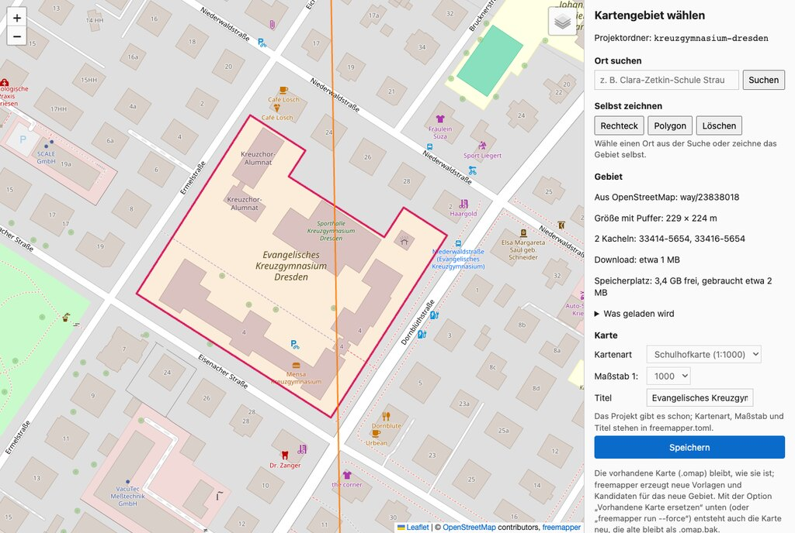
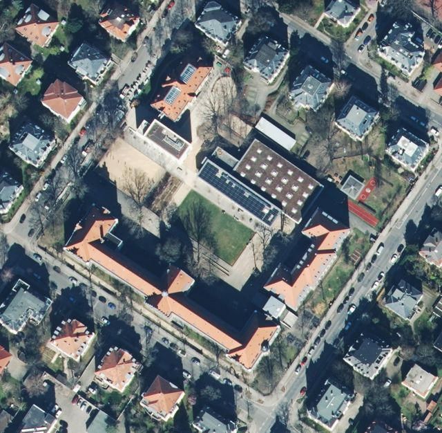
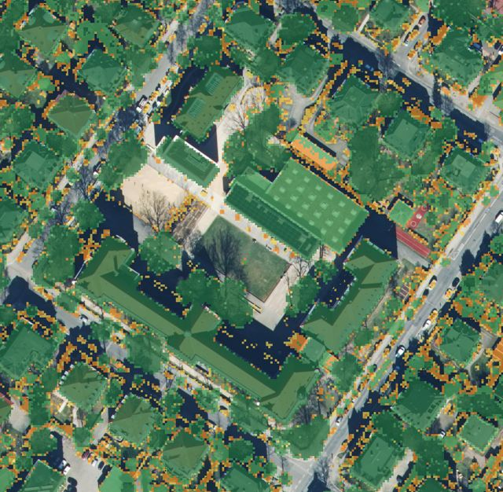
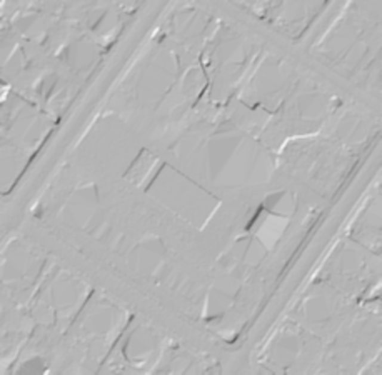
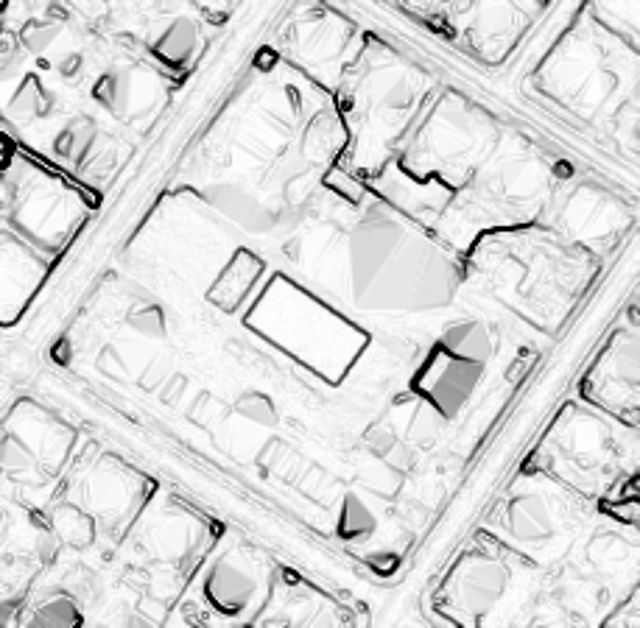
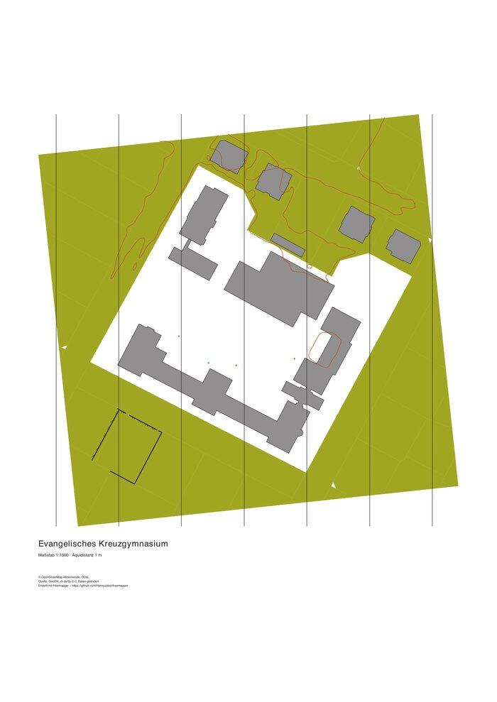

# freemapper – User manual

[Deutsche Version](de.md) · [Glossary](../glossary.md) · [README](../../README.en.md)

This manual is for mappers and coaches who want to make an orienteering map without dealing with
geodata or the command line. It describes the current state, with Brandenburg, Berlin and Saxony.

## Contents

1. [What freemapper does](#1-what-freemapper-does)
2. [What you need](#2-what-you-need)
3. [Installation](#3-installation)
4. [Route A: with an AI assistant](#4-route-a-with-an-ai-assistant)
5. [Route B: without an assistant](#5-route-b-without-an-assistant)
6. [Choosing the map area in the browser](#6-choosing-the-map-area-in-the-browser)
7. [The result](#7-the-result)
8. [What the templates show](#8-what-the-templates-show)
9. [What to check in the terrain](#9-what-to-check-in-the-terrain)
10. [Quick training map (PDF)](#10-quick-training-map-pdf)
11. [OCAD](#11-ocad)
12. [Regions and border areas](#12-regions-and-border-areas)
13. [Working on later](#13-working-on-later)
14. [Messages and what to do](#14-messages-and-what-to-do)
15. [Attribution](#15-attribution)
16. [Help and bug reports](#16-help-and-bug-reports)

## 1. What freemapper does

freemapper fetches the official geodata of an area and builds the **starting point** for a schoolyard
map (1:1000) or sprint map (1:4000). The geodata includes the orthophoto, the terrain model, and the
buildings and land use from the cadastre (ALKIS). Data from OpenStreetMap (OSM) is added.

- **Drawn as finished map objects** is only what is reliable: buildings, water from the cadastre, and on
  sprint maps also paved areas (streets, squares) and unpaved paths with a known surface.
- **Given as templates** is everything you have to judge yourself: orthophoto, hillshade, slope, height
  above ground (nDSM), contours, fences, hedges, benches, playground equipment, out-of-bounds areas,
  ponds, streams, fountains and bridges.
- You still draw and check the map in the terrain, in **OpenOrienteering Mapper (OOM)** or **OCAD**.

On request freemapper also writes a **print-ready training map as a PDF** (chapter 10).

## 2. What you need

- A computer with Windows, macOS or Linux. No GIS or other programs are needed.
- [OpenOrienteering Mapper](https://www.openorienteering.org/apps/mapper/) (free) or OCAD 12 or newer.
- An internet connection for the first download.
- Free disk space:
  - The first time, freemapper downloads the OSM extract of the state: about 300 MB for Brandenburg
    and Berlin, about 270 MB for Saxony, about 180 MB for Saxony-Anhalt, about 55 MB for Hamburg, about 350 MB for Hesse, about 160 MB for Schleswig-Holstein (without Hamburg), about 130 MB for Mecklenburg-Vorpommern, about 510 MB for Lower Saxony (with Bremen), about 275 MB for Rhineland-Palatinate. In North Rhine-Westphalia these are the extracts of the Regierungsbezirke, 140 to 225 MB each, two of them for an area on a district border. The extract
    is reused by all projects.
  - On top of that, each map usually needs 10–100 MB.
  - Before each download freemapper checks the free space of the cache and the project folder. When
    they are on different drives, it checks each one. It keeps 1 GB free on every drive. If not
    everything fits, freemapper leaves out the surface model (the nDSM template) and, when an older
    OSM extract is cached, the update of that extract. It warns for each part it leaves out. Every map
    needs the map data, the terrain model and the orthophoto. If those do not fit, freemapper stops
    before it downloads anything.
- An area in **Brandenburg, Berlin, Saxony, Saxony-Anhalt, Hamburg, Hesse, Schleswig-Holstein, Mecklenburg-Vorpommern, North Rhine-Westphalia, Lower Saxony or Rhineland-Palatinate**. Bremen and more states will follow.
- Optionally an AI assistant such as Claude, so you do not have to type commands.

## 3. Installation

freemapper is a single program without an installer.

1. On the [release page](https://github.com/HenryJobst/freemapper/releases/latest), download the archive
   for your system:
   - **Windows:** `freemapper-…-windows-x86_64.zip`
   - **Mac with Apple chip** (M1 and newer): `freemapper-…-macos-arm64.tar.gz`
   - **Mac with Intel processor:** `freemapper-…-macos-x86_64.tar.gz`
   - **Linux:** `freemapper-…-linux-x86_64.tar.gz`
2. Unpack the archive with a double click. Put the folder in a fixed place, e.g. `Documents/freemapper`.
3. On the first start the system warns you, because the program is not signed:
   - **Windows:** "Windows protected your PC" → *More info* → *Run anyway*.
   - **macOS:** "cannot be opened …" → *System Settings › Privacy & Security* → *Open Anyway*.

Note the **full path** to the program, e.g. `C:\Users\Anna\Documents\freemapper\freemapper.exe` or
`/Users/anna/Documents/freemapper/freemapper`. The assistant needs it.

## 4. Route A: with an AI assistant

The assistant operates freemapper for you. For this freemapper is an "MCP server", a tool that AI
assistants can use.

### Set it up once

- **Claude Desktop:**
  1. Open *Settings › Developer › Edit Config*.
  2. Add this to the file `claude_desktop_config.json` (adjust the path; on Windows use double
     backslashes `\\`):

     ```json
     {
       "mcpServers": {
         "freemapper": { "command": "/Users/anna/Documents/freemapper/freemapper", "args": ["mcp"] }
       }
     }
     ```

  3. Restart Claude Desktop.
- **Claude Code:** in a terminal, enter `claude mcp add freemapper -- /path/to/freemapper mcp`.
- **Other assistants:** any MCP-capable assistant takes the same entry: the program with the argument
  `mcp`.

### Order a map

Simply tell the assistant what you need, for example:

> Use freemapper to make a schoolyard map of the Evangelisches Kreuzgymnasium in Dresden.
> Save the project in Documents/O-maps/kreuzgymnasium.

> Make me a sprint map of Strausberg's old town, with an OCAD file and a training map as PDF.

The assistant then goes through these steps:

1. It searches the place and shows you the results.
2. It creates the project.
3. It tells you how much will be downloaded and whether it fits on the disk.
4. It starts downloading and computing. The first time this takes a few minutes, later usually less
   than a minute.
5. It shows you previews of the templates.

If no search result fits, for example because the school grounds are two separate parts in OSM, ask
the assistant to **open the area selection in the browser**. There you draw the area yourself
(chapter 6).

## 5. Route B: without an assistant

It does not work entirely without the command line, but two commands are enough. Open a terminal
(on Windows, PowerShell) in the folder with freemapper.

1. Choose the area in the browser. This also creates the project folder:

   ```sh
   ./freemapper select kreuzgymnasium
   ```

   On Windows: `.\freemapper.exe select kreuzgymnasium`.
2. Download everything, compute it and write the map:

   ```sh
   ./freemapper run kreuzgymnasium
   ```

   `--ocad` also writes the OCAD file, `--pdf` the training map.

If you know the OSM object of the grounds, you can skip the browser:

```sh
./freemapper init kreuzgymnasium --osm way/23838018 --title "Evangelisches Kreuzgymnasium"
./freemapper run kreuzgymnasium
```

If the grounds are several separate areas in OSM (a multipolygon relation with several outer rings),
freemapper lists the parts with their sizes. `--part 1` takes the largest, `--part 2` the next one. The outer
ways of such a relation often carry no tags. Nominatim then does not know them, and `--osm way/…` finds
nothing. Use the relation (`--osm relation/…`) instead, or save the outline as GeoJSON and use `--geojson`.

## 6. Choosing the map area in the browser



*The area selection with the Kreuzgymnasium Dresden (German interface). Map data © OpenStreetMap
contributors.*

- **Search a place:** type a name, e.g. "Kreuzgymnasium Dresden", and pick a result with an area.
- **Draw it yourself:**
  - *Rectangle:* click two corners.
  - *Polygon:* click the corners one by one. To close it, click the first corner or double-click.
  - Esc cancels, Backspace removes the last corner.
- **Background:** at the top right, choose OpenStreetMap or the orthophoto (LGB for Brandenburg and
  Berlin, GeoSN for Saxony).
- **On the right** you see:
  - the size with buffer;
  - the data tiles that will be downloaded (thin lines on the map);
  - the estimated download;
  - the free disk space and how much of it the download needs. In the list "What is downloaded",
    anything that does not fit is marked "does not fit on the disk". Above it the page shows the
    messages from chapter 14 and whether freemapper leaves the part out or stops.
- Set **map kind, scale and title**, then click *Save* and *Done*.

The page runs only on your computer. With its buffer, an area may be at most 4 km × 4 km.

## 7. The result

Among other files, the project folder then holds:

| File | What it is |
|---|---|
| `<name>.omap` | the map for OpenOrienteering Mapper, georeferenced, with buildings, canopies, water and the peripheral information |
| `templates/` | the templates: orthophoto, hillshade, slope, nDSM and the candidates map, in Berlin also the K5 (chapter 12) |
| `ocad/` | with `--ocad`: the OCAD map and its templates |
| `<name>.pdf` | with `--pdf`: the training map |
| `ATTRIBUTION.txt` | the attribution of the data sources |
| `freemapper.toml` | the project's settings and data currency |

Open the `.omap` file in OOM. The templates are already linked; show and hide them in the *Templates*
menu. The **candidates** (`templates/candidates.omap`) are a separate map on top: fences, hedges,
benches, contours, out-of-bounds areas, water from OSM and bridges. Check them and take over what is
right: trace them, or open the candidates map and copy and paste the objects. Both maps have the same
georeferencing.

Point symbols such as trees, fountains or bollards keep the gap that ISSprOM asks for. Where two would touch
on paper, freemapper keeps the larger one. A dense group of trees becomes an area: paved area with scattered
trees, open land with scattered trees, or forest, which on the white base gets a dotted vegetation boundary.
Chapter 9 says what to check there.

freemapper draws **water** on both map kinds. Rivers, canals, lakes, ponds, harbour basins and sea from
the cadastre become uncrossable bodies of water: a blue area (301.1) with a black bank line (301.6). The
cadastre often splits a river into many separate areas. freemapper dissolves them into one, so no lines
run across the water. Where the water reaches beyond the map area and buffer, it gets no bank line on
that edge; islands keep theirs. Water with a mean width under 2 m goes into the candidates only. The
contours stop at the shore of this water, in the candidates and on the training map.

OSM adds more candidates:

- Ponds, basins, outdoor swimming pools and fountain basins as areas (301). If at least half of such an
  area lies in water from the cadastre, freemapper leaves it out.
- Streams and drains (`drain`) as lines: 305 if they carry water all year, otherwise 306. Ditches
  (`ditch`) are always 306. Culverted sections are left out.
- Fountains and wells (311) and springs (312) as points, and on schoolyard maps also drinking fountains
  (313). freemapper leaves out fountain points that stand in water, because they are mostly the jets in a
  basin.
- Bridges as paved areas (501.5), on sprint maps only. They lie over the water.

Sea that is not in the cadastre stays white. freemapper does not read the OSM coastline.

Below the map is the **peripheral information**: title, scale, contour interval, scale bar and the
attribution. Keep the attribution on printed maps (chapter 15). The **north lines** belong to the map and sit
in the map part "default part". Break them in OOM where they hide small objects, such as boulders, path ends
or wall corners.

The example projects in the repository show what the result looks like, one per state:
[`examples/`](../../examples/README.en.md). Each has the OOM map, the OCAD starting point and the PDF training map.

## 8. What the templates show

The examples show the Kreuzgymnasium Dresden. Orthophoto, terrain and surface model: Quelle: GeoSN,
dl-de/by-2-0, Daten geändert.

| Template | Picture |
|---|---|
| **Orthophoto:** top view, 20 cm per pixel. Good for paths, squares and vegetation, but trees hide the ground. |  |
| **nDSM (height above ground):** yellow 0.3–1 m (walls, benches, cars), orange 1–2.5 m (hedges, fences, playground equipment), light green 2.5–8 m (bushes, sheds), dark green above 8 m (trees, houses). Shows what stands, also under trees. |  |
| **Hillshade:** the terrain as if lit from the north-west. Shows banks, hollows and earth walls. |  |
| **Slope:** the darker, the steeper. Helps with banks and stairs. |  |

The candidates map also holds the **contours**: every 1 m on schoolyard maps, every 2 m on sprint maps,
every fifth one an index contour. They are computed from the terrain model and smoothed. For the map
they are a draft, not a finished result.

## 9. What to check in the terrain

freemapper saves you drawing the base, not the walk through the terrain. Check above all:

- **Buildings:**
  - Are outline and passages right?
  - Are new buildings missing, or demolished ones still there?
  - Each building's data currency is in its object tags.
- **Paved areas** (sprint): in Saxony, street areas include the grass and tree strips at their edges. In
  Berlin freemapper cuts out the surveyed green strips (chapter 12); tree pits and green that the street
  survey does not know stay inside. In both states squares are only candidates.
- **Canopies and passages:** in every state except Saxony and Saxony-Anhalt, canopies and carports from
  ALKIS are map objects (522), and building passages and arcades are candidates (chapter 12). Are the canopies
  still there? Is a passage open, or does it have a gate?
- **Fences, walls, hedges:** they come from OSM and the nDSM, in Berlin also from ALKIS and the street
  survey, in Brandenburg also from the full ALKIS. Can they be crossed? Are there gates?
- **Out-of-bounds areas:** private grounds, allotment gardens, railway land, and on schoolyard maps
  everything outside the school grounds.
- **Berlin** (chapter 12):
  - Canopies and carports from ALKIS are map objects (522). Are they still there? Where a canopy meets a
    building, freemapper cuts it at the wall. This can leave narrow slivers.
  - Building passages and arcades are only candidates. Is the passage open, or does it have a gate?
  - Stairs: the walking direction comes from the terrain model. If a stair rises less than 0.3 m in it,
    freemapper guesses. A stair at a building or monument leads up to it, any other one runs across its
    short side. These stairs carry the tag `freemapper:direction=guessed`. Check them first. Short stairs
    under about 2 m often look flat in the terrain model at 1 m resolution.
  - Wide stairs such as stadium stands come as several parallel 532.9 lines, one symbol width apart, tagged
    `freemapper:size=wide`. Keep a few, or draw an area.
  - Walls: where ALKIS has both edges and the centre line of a wall, the candidates show two or three
    parallel 515 lines. Take one and delete the others. ALKIS has no height. Whether a wall can be crossed
    is for you to decide in the terrain.
  - Trees: species and crown are in the tag `freemapper:baum`, e.g. `Tilia cordata, Krone 12 m`. The tree
    cadastre can be older than the trees on the ground. Trees on school grounds and private land are mostly
    not in it.
  - Street survey: it was recorded from 2014 to 2016, so it is about ten years old. Streets rebuilt since then
    are in it as they were. Check curbs, railings, walls, furniture and green strips in the terrain. If a green
    strip that freemapper cut out has been paved since, the paved area has a white spot. Fill it from the
    orthophoto.
  - Guessed survey dates: candidates with `freemapper:currency_guessed=yes` and paved areas with
    `freemapper:cut_currency_guessed=yes` have no readable survey date. freemapper then sets 2014-01-01.
    Check these places first.
  - Railings, traffic barriers and crash barriers are 518 candidates (impassable). Where people can climb
    over them, use 516.
  - Buildings: a Berlin building's data currency is its footprint date from the building heights of 2022,
    often years before the fetch. Buildings added since 2022 have no date.
- **Banks and bridges:**
  - The cadastre area of a body of water can include the bank slope. Move the bank line to the water's
    edge, using the orthophoto.
  - The bank line runs across bridges. Cut it there by hand.
  - The cadastre often records a road bridge as road area. The water then ends at the bridge, and a bank
    line runs across the river. Delete that line in OOM and extend the water area under the bridge.
  - Where two water areas almost meet, such as those of two states at the border in mid-Rhine, freemapper
    closes gaps under 0.5 m. A bank line in the middle of a river therefore stands for a wider gap in the
    cadastre. Check in the orthophoto whether there is land.
  - Water from the cadastre is always uncrossable (301), because the cadastre has no depth. Shallow
    water that you can wade through becomes a crossable body of water (302).
  - Water from OSM comes as candidates only. Are the pond and the fountain still there? Does the ditch
    carry water?
- **Brandenburg** (chapter 12):
  - The full ALKIS often records a wall as its two edges (`Mauerkante, links` and `Mauerkante, rechts`).
    Where both edges face each other, run nearly parallel and lie closer than 0.55 mm on paper (2.2 m at
    1:4000), freemapper draws one 515 line in the middle. It carries `freemapper:alkis=Mauer (Mauerkanten
    gepaart)` and names the other edge in `freemapper:also`. Thicker walls stay two lines: keep one, or
    draw the wall as an area. A gate in only one edge also breaks the middle line, so check gaps in the
    orthophoto.
  - The data currency of these candidates is the date the object version entered the cadastre, not a survey
    date. A fence can have changed since.
  - Potsdam trees are all 418, because the city data has no crown size. Mark large trees as 417 yourself. Each
    tree carries its own survey date, some of them from 1993.
- **Thinned points:** where two point symbols would come closer on paper than the norm allows, freemapper
  keeps the larger one. The kept point names the others in `freemapper:generalized`. Rows of street trees stay
  single tree symbols. Where they stand closer than the symbols allow, some of them are dropped. Check the
  gaps in the terrain, and move symbols apart where both objects matter.
- **Tree groups as areas:** three or more trees form a group when they stand closer than 2.5 mm on paper
  (10 m at 1:4000) or their crowns come within 0.5 mm of each other. A row stays points, such as the trees of
  an avenue or a street, also with trees on both sides. Each tree of the group claims a circle of 5 m radius,
  or its crown if that is larger. If half of that lies on paving, the group becomes paved area with scattered
  trees (501.3), provided it takes in at least 9 trees. Otherwise it becomes forest (405) when the crowns
  cover at least half of the area, else open land with scattered trees (402). On the white base a white
  forest would be invisible, so a forest that does not lie half on open land (401 to 404) gets a distinct
  vegetation boundary (416) as a dotted outline. Where the area ends at a building, water, an out-of-bounds
  area or paving, the boundary is left out, because the other object bounds it there. freemapper cuts roads
  and squares out of forest and 402. A strip only one row of trees wide falls out of the area and stays
  points. The area and its boundary carry `freemapper:source=generalization` and list the trees in
  `freemapper:source_id`. Their tag `freemapper:generalized` gives the number of trees and the crown cover.
  Large trees (417) stay points on a 402 area. Without a measured crown, freemapper assumes 12 m for 417 and
  5 m for 418, which is usually too small for park trees. Compare the outline with the orthophoto, draw
  lawns as open land (401), and delete the 416 where the forest borders yellow.
- **Hidden points in out-of-bounds areas:** ISSprOM allows no feature in an out-of-bounds area (520) except
  very prominent ones. A point candidate inside a 520 candidate stays in the candidates, tagged
  `freemapper:hidden=520`, but the training map leaves it out. On schoolyard maps this hides every point off
  the school grounds. If the area is not out of bounds after all, or a very large tree stands in it, take the
  point over from the candidates.
- **Furniture and playground equipment:** it comes from OSM, in Berlin on schoolyard maps also from the
  street survey and the lighting cadastre. It is often incomplete.
- **Contours:** small banks and steps show better in the hillshade or slope.

## 10. Quick training map (PDF)

With `--pdf` (or "with a training map" to the assistant), freemapper writes `<name>.pdf`: a fully
drawn map in A4 or A3, ready to print.



*The training map of the Kreuzgymnasium. Quelle: GeoSN, dl-de/by-2-0, Daten geändert; © OpenStreetMap
contributors.*

Unlike the starting point, **every candidate becomes a map object** here, also the uncertain ones. Only
points inside an out-of-bounds candidate are left out (chapter 9). The map is good for a quick training
session. Still check it in the terrain first.

The colours are CMYK values after the IOF Printing and Colour Definitions Rev. 4 (valid from 1 December
2024), the same as in the OOM and OCAD files. If your printer prints brown or green clearly differently,
compare with the IOF Print Test Sheet and adjust the colours.

## 11. OCAD

With `--ocad` (or "with an OCAD file"), freemapper writes the folder `ocad/`:

- `<name>.ocd`: the map in OCAD 12 format, with georeferencing, buildings and the templates as
  background maps;
- `<name>-candidates.ocd`: the candidates as a separate map;
- the template images with world files.

The symbols in the OCAD file are placeholders with the right number and colour, but simple graphics.
Load the official symbol set in OCAD:

1. Choose *Symbol › Load Colors and Symbols from …*.
2. Pick the set: ISSprOM 2019 for sprint maps, the IOF school set 2019 for schoolyard maps.

OCAD then replaces the placeholders by number. The OCAD output has not been checked in every OCAD
version yet; feedback is welcome (chapter 16).

## 12. Regions and border areas

| State | Data from | Particulars |
|---|---|---|
| Brandenburg | LGB (also the full ALKIS), Landeshauptstadt Potsdam (trees) | orthophoto, terrain and nDSM in 1 km tiles; the nDSM is a laser nDSM at 20 cm; canopies as map objects; fences, wall edges, hedges, monuments, fountains and ditches as candidates, on sprint maps also embankment tops and bridges; in Potsdam the trees of the city map (see below) |
| Berlin | LGB (rasters), Geoportal Berlin (ALKIS, tree cadastre, K5, street survey, lighting, fountains, building heights) | the nDSM is computed from the image-based surface model: a bit softer, without thin objects such as lamp posts, but with parked cars; also canopies as map objects, stairs, walls, fences, hedges and trees as candidates, and the K5 as a template; the surveyed green strips are cut out of the street areas, curbs, railings, furniture, lamps and fountains come as candidates, and buildings carry their footprint date (see below) |
| Saxony | GeoSN | orthophoto from the map service; the nDSM has only 1 m resolution, so hedges and narrow walls often show faintly; underground structures cannot be filtered out |
| Saxony-Anhalt | LVermGeo | the map is in UTM zone 32 (EPSG:25832), like all of the state's data; orthophoto from the map service, terrain and surface model at 1 m; the nDSM is as coarse as in Saxony |
| Hamburg | LGV | zone 32 like Saxony-Anhalt; orthophoto from 2026, but terrain and surface model from 2022: buildings of the last years are missing from the nDSM |
| Hesse | HVBG | zone 32; orthophoto flown in summer (2023 south-west, 2024 north, 2025 south); nDSM = DOM1 − DGM1 at 1 m from the laser scan (2019–2025 by region). In many areas the scan was flown in winter, without leaves, so the crowns of deciduous trees can come out lower than in summer. The scan can be from another year than the orthophoto (Frankfurt: scan 28.02.2023, orthophoto 19.08.2025). The height models come from the Downloadcenter, one zip per municipality; freemapper reads only the needed 1 km tiles. Squares without `bez` only as candidates; street areas include verges (no split); school grounds are called "Öffentliche Zwecke" |
| Schleswig-Holstein | LVermGeo SH | zone 32; the state was flown in two halves: 2024 (May/September, leaf-on) and 2025 (March–June: March/April leaf-off, May/June leaf-on); Norderstedt, for example, was flown leaf-off on 17.03.2025. The map service has no time choice. Terrain: DGM1 at 1 m from the laser scan (vintage 2005–2025 by tile; Norderstedt 10.03.2022). Surface model: image-based bDOM at 0.2 m (only the 2023 and 2024 vintages); the nDSM is bDOM − DGM1. freemapper downloads whole tiles of 105 MB for it (about 90 s each, no partial downloads), reduces them to 1 m and keeps only that copy. In the 2025 half the bDOM is two years older than the orthophoto: new buildings may be missing in the nDSM (freemapper warns). The Downloadportal sends an incomplete certificate chain; freemapper ships the missing D-TRUST certificate and uses it for that one server only. Squares without `bez` only as candidates; street areas partly without a verge split; school grounds are called "Öffentliche Zwecke"; the LGB's ALKIS spellings apply. At the Hamburg border freemapper reads the ALKIS and OSM extract of both sides; the rasters come from the state where the centre of the map area lies, and the Schleswig-Holstein tiles reach into Hamburg |
| Mecklenburg-Vorpommern | LAiV M-V | zone 33 (EPSG:25833) like Brandenburg. The orthophoto comes from the WCS service "DOP" (the map service carries a watermark) as JPEG and is a 256-colour palette image: slightly grainy, but good enough for tracing. Flown 2021–2025, March to October, mostly leaf-on (about 23 % in March/April, then leaf-off); Rostock, for example, on 14.08.2024. Terrain and surface: DGM1 and DOM1 at 1 m from the WCS; the nDSM is DOM1 − DGM1. The two models can come from different years (Rostock: DGM1 March 2024, DOM1 August 2024). The height models carry no NoData: freemapper keeps only the cells of the state's 2 km tiles. Areas beyond them (Brandenburg south of the tile edge, open sea outside the tiles) stay empty; sea and Bodden inside the tiles are 0 m. ALKIS comes from the LGB's OGC API (as in Brandenburg), with the WFS as fallback; the LGB's ALKIS spellings apply, school parcels are called "Bildung und Wissenschaft". At the Brandenburg border freemapper reads the ALKIS and OSM extract of both sides; the rasters come from the state where the centre of the map area lies |
| North Rhine-Westphalia | Geobasis NRW (Bezirksregierung Köln) | Zone 32 (EPSG:25832) for the whole state; the state reaches far west, but the map never uses zone 33. The orthophoto comes from the WMS service, because the tiles exist only as JPEG 2000. Flown in 2022 and 2024 to 2026, partly leaf-off, partly leaf-on; the flight date is per tile. Terrain and surface: DGM1 and DOM1 at 1 m from 1 km laser tiles, both from the same flight; names and dates come from the tile list, not from the directory. The laser survey is paused until winter 2026/27, the newest data is from February 2025; the nDSM is DOM1 − DGM1. ALKIS from the WFS with the LGB spellings and a more detailed land-use value, school buildings are called "Allgemein bildende Schule". OSM from the extracts of the five Regierungsbezirke (Arnsberg, Detmold, Düsseldorf, Köln, Münster) instead of the 917 MB statewide one; an area on a district border reads both. At the Hesse border freemapper reads the ALKIS of both states; the rasters come from the state holding the centre of the map area |
| Lower Saxony | LGLN | Zone 32 (EPSG:25832) for the whole state. The orthophoto comes from the map service (WMS), terrain and surface (DGM1 and DOM1 at 1 m) come from the WCS service. The WCS service delivers the height models in pieces of 2 km. A 4 km area therefore takes four requests per model and, with the orthophoto, a few minutes to fetch. The LGLN STAC search gives the data currency: the flight date of the newest orthophoto and the date of the newest height model at the centre of the map area. Flown 2024 to 2026, three quarters in spring (February to April, leaf-off), the rest from May to October (leaf-on). freemapper reports with the flight date whether the trees were in leaf; Hannover-Südstadt, for example, was flown leaf-off on 06.03.2025. The nDSM is DOM1 − DGM1 from the laser scan, both models from the same flight. The scan is mostly from 2016 or 2017 (2025 at the coast and along the Elbe and Weser), so it is often 5 to 9 years older than the orthophoto (Hannover-Südstadt: scan 18.04.2016). If the DOM1 is more than two years older, freemapper warns with both dates, because new buildings and young trees can be missing from the nDSM. ALKIS from the WFS with the LGB spellings; freemapper recognises underground garages by their position below ground; squares without `bez` only as candidates; school buildings are called "Allgemein bildende Schule", school parcels "Bildung und Wissenschaft". Bremen and Bremerhaven are not included yet. freemapper refuses an area whose centre lies in Bremen. If an area in Lower Saxony reaches into Bremen, the orthophoto is white there and ALKIS gives no buildings there; freemapper warns. The Lower Saxony OSM extract includes Bremen. At the Hamburg border freemapper reads the ALKIS and OSM extract of both sides; the rasters come from the state holding the centre of the map area |
| Rhineland-Palatinate | LVermGeo RP | Zone 32 (EPSG:25832) for the whole state. The orthophoto comes from the map service (WMS), because the tiles exist only as JPEG 2000 of 105 to 155 MB per 2 km block. The service ends at the state border, and beyond it the orthophoto is white. The service gives no flight date, only a date of creation per block. freemapper takes it as the flight date, because all these dates fall between May and September, mostly on consecutive days, and the images show trees in leaf. So the project entry labels the date "Aktualität (Erstellung)", and the messages say `date of creation`. Flown 2022 to 2025, every two years, always in summer and so leaf-on; the Görres-Gymnasium in Koblenz, for example, on 25.08.2025. Terrain and surface: DGM1 and DOM1 at 1 m from 1 km laser tiles, both from the same flight. The scans are from 2022 to 2025, each flown from February to April, leaf-off. The file name of each tile contains the year of the scan. freemapper reads it from the LVermGeo RP laser-scan flight index `Laserbefliegung`, which gives the flight days per tile; the last flight day is the date in the project entry (Koblenz: 06.04.2024). 14 tiles north of Trier have no flight year there (as of November 2026). For them freemapper reads the state's Metalink file (about 11 MB per model), but only if the area contains such a tile. freemapper keeps the file and reuses it online for 30 days, then downloads it again. Offline it uses the kept file at any age. A tile that stays without a name stays empty, and freemapper says why. If the server answers 404 for a tile of the index, freemapper reports it as missing and asks again only after 30 days. The size estimate counts 1.5 MB per DGM1 tile and 3 MB per DOM1 tile, plus the Metalink file when it is needed. The nDSM is DOM1 − DGM1. Scan and orthophoto are at most three years apart, and in a quarter of the tiles the scan is the newer one. Because the scan was flown without leaves, the crowns of deciduous trees can come out lower in the nDSM than in the orthophoto. ALKIS from the WFS with the LGB spellings; the land use has finer subtypes, for example Wohnbaufläche "Offen" and "Geschlossen". freemapper recognises underground garages by their position below ground; squares without `bez` only as candidates; a building with several names has them joined by `;` in one field. School buildings are called "Allgemein bildende Schule", school parcels "Bildung und Wissenschaft". At the Hesse border (Mainz and Wiesbaden) freemapper reads the ALKIS and OSM extract of both states; Wiesbaden and Mainz-Kastel belong to Hesse and are not in the Rhineland-Palatinate OSM extract. The rasters come from the state holding the centre of the map area. If it lies in Mainz, the orthophoto is white across the Rhine, but the height models reach over |

**Canopies and passages in every state.** ALKIS records canopies and carports as structures next to the
buildings, and building passages and arcades as building parts. freemapper reads them from the buildings it
already fetches, with no extra download. Canopies and carports become map objects (522) on both map kinds, cut
at the buildings as in Berlin. Building passages and arcades become 522 candidates, and the building stays
whole. Underground ones are left out. The data currency is the date of the ALKIS object. Saxony and
Saxony-Anhalt record no canopies or passages in this data, so maps there get none. Berlin takes them from its
own layers (below). An existing map gets the canopies only with `run --force`.

**Brandenburg: full ALKIS and Potsdam trees.** In Brandenburg freemapper also reads the full ALKIS from the
LGB's NAS service (dl-de/by-2-0). It holds what the simplified ALKIS lacks: surveyed walls and wall edges,
fences, hedges, monuments, fountains, ditches and brooks, and on sprint maps also embankment tops and bridges.
They become candidates: walls 515, fences 518, hedges 410.1, monuments 526, fountains 311, ditches 306, brooks
305, embankment tops 104 and bridges 501.5. The code in the cadastre picks the symbol, never the height. The
layers are stored in `data/alkis-nas/`, about 1 MB per km². At Park Sanssouci (0.74 km² with the buffer) the
six layers hold 780, 146, 315, 4, 1 and 0 objects in 0.6 MB. Each candidate carries
`freemapper:source=alkis-nas/<layer>` and `freemapper:alkis` with the cadastre's name, e.g. `Mauerkante,
rechts`. Its data currency is the date the object version entered the cadastre (`beginnt`). Two edges of one
wall closer than 0.55 mm on paper become a single 515 line in the middle (chapter 9). freemapper takes
canopies and building parts from the simplified ALKIS only, so they are not drawn twice. Brandenburg records no
stairs, retaining walls or single trees in the full ALKIS. If the service sends more objects than it allows in
one answer, freemapper splits the area into quarters, at most four levels deep.

If an OSM line (fence, wall, hedge, brook or ditch) lies with at least 80 % of its length within 1.5 m of a
full ALKIS line with the same symbol, freemapper drops the OSM line, as in Berlin. The order is the same in every state:
register before ALKIS before the street survey before OSM.

In and around Potsdam freemapper fetches the trees of the Potsdam city map (Bäume der Stadtkarte,
dl-de/zero-2-0). They are stored in `data/trees/`; the size estimate counts 1 MB per km². The data has no crown size, so
every tree becomes a 418 candidate. Stumps are left out. Each tree carries its own survey date as data
currency, from 1993 to 2026, and its kind in `freemapper:baum`, e.g. `Laubbaum`. An OSM tree less than 2 m from
a Potsdam tree is dropped. A Berlin area makes no request there, even inside the Potsdam data's extent. At Park
Sanssouci freemapper fetches 1964 trees; 1646 of them lie in the map area with its buffer, and 1267 stay points
after the thinning. If the disk has too little room, freemapper leaves out the full ALKIS and the trees together.
The stored ones then stay. An answer larger than 256 MB is stopped while it is read.

**Berlin: structures, trees and the K5.** When a map area touches Berlin, freemapper fetches six more layers
from Geoportal Berlin (dl-de/zero-2-0): the ALKIS structures as areas and as lines, the embankment edges (for
sprint maps only), the hedges, and the street and park trees. They are stored in `data/berlin/`. From them come:

- Canopies and carports as map objects (522) on both map kinds. A canopy with 90 % or more of its area inside
  a building is left out. An existing map gets the canopies only with `run --force`.
- Candidates: stairs (532.6 to 532.9) with the walking direction from the terrain model, walls (515),
  retaining walls (513.2), fences (518), hedges (410.1), building passages and arcades (522) and monuments
  (526); on sprint maps also bridges (501.5) and embankment tops (104). The ALKIS name alone picks the
  symbol.
- Trees from the tree cadastre: 417 for a crown of 10 m or more, otherwise 418. If an OSM tree stands less
  than 2 m from a cadastre tree, freemapper drops the OSM tree.
- Fences, walls, retaining walls and hedges are often in both ALKIS and OSM. If at least 80 % of an OSM line
  lies within 1.5 m of an ALKIS line with the same symbol, freemapper drops the OSM line. The ALKIS line names
  it in the tag `freemapper:also`, e.g. `osm/way/123`.

freemapper picks the stair symbol by the stair's width on paper. On sprint maps a stair 3.5 m wide or more
becomes 532.9, on schoolyard maps one from about 1.1 m. So nearly every schoolyard stair is 532.9. A stair
wider than three times 532.9 (12 m on sprint maps) becomes parallel 532.9 lines.

The `Freitreppe` lines of the ALKIS structures are step edges. freemapper joins parallel edges up to 2 m apart
that overlap along their length into one stair. A doubled edge counts once. The stair runs across the edges,
as wide as the edges are long and as long as the whole flight. A single edge gives no stair.

Each candidate names its origin in the object tags: `freemapper:source=geoportal-berlin/<layer>`,
`freemapper:alkis` with the ALKIS name (e.g. `Mauerkante, rechts`), and for trees `freemapper:baum` with
species and crown. The layers have no date of their own, so the data currency (`freemapper:currency`) is the
date of the fetch. freemapper does not take curb lines from ALKIS, but it takes those of the street survey.

**Berlin: street survey, registers and building dates.** freemapper also fetches the street survey
(Straßenbefahrung), the lighting cadastre, the registers of ornamental fountains and of drinking fountains, and
the building heights of 2022 from the Umweltatlas, all under dl-de/zero-2-0. In the city centre that adds about
6 MB per km² (5.9 MB at Viktoriapark). The street survey recorded Berlin's public street space from 2014 to
2016. There is no newer one, so the data is about ten years old. That is why it never replaces ALKIS. Apart
from the green cut-out, it gives only candidates. From these layers come:

- On sprint maps: freemapper cuts the surveyed green strips out of the paved areas (501.5) where the overlap is
  at least 1 mm wide on paper, but at most 2 m in the terrain. Tree pits stay. Each green strip is also a 401
  candidate, except where it lies on paving that freemapper did not cut. Surveyed sidewalks, carriageways,
  cycle paths, parking areas and squares outside the drawn ALKIS areas become 501.5 candidates, such as park
  paths and forecourts. Here too, narrow pieces from 2 m wide stay. Curbs become 501.1 candidates, advertising
  columns 531.
- On both map kinds: stairs (532.6 to 532.9, like the ALKIS stairs; the field `trs`, probably the number of
  steps, comes as `berlin:trs`), walls (515), railings, traffic barriers and crash barriers (518, like fences),
  bus shelters (522) and fountains (311) from the street survey and the ornamental fountain register.
- On schoolyard maps: benches (543), hydrants (321), bollards, masts and flag poles (544), play equipment
  (541), drinking fountains (313) and the lamps of the lighting cadastre (545), only those in operation. Sprint
  maps get none of this furniture: around the Helene-Haeusler-Schule one km² holds 2 392 bollards.
- Buildings: each ALKIS building that the building heights of 2022 know gets its Grundrissaktualität
  (footprint date) as data currency (`freemapper:currency`). It is the state of the outline in that data, not a
  survey date. A building without a match keeps no date.

When an object comes from several sources, the register wins over ALKIS, ALKIS over the street survey, and the
survey over OSM. A lamp of the lighting cadastre replaces OSM lamps up to 5 m away and surveyed masts up to 2 m
away. Surveyed masts further off are mostly sign and signal masts. A fountain of a register replaces the OSM and
surveyed fountains up to 3 m away. On schoolyard maps a surveyed hydrant, bench, mast, flag pole or play item
replaces the OSM one up to 2 m away. freemapper drops a surveyed line with at least 80 % of its length within
1.5 m of an ALKIS line with the same symbol, and a surveyed stair that overlaps an ALKIS stair by at least half.
It also drops a surveyed bus shelter that lies at least half under an ALKIS canopy, because the canopy is
already on the map. A surveyed wall next to an ALKIS retaining wall stays, because the symbols differ. The
object that stays names the dropped ones in `freemapper:also`, a surveyed one e.g. as
`geoportal-berlin/sb-gelaender/Li_2015-05-02_1`. freemapper also leaves out a fountain of the register or of the
street survey inside drawn water, as it does the OSM fountains.

ALKIS and the street survey often split a wall or a railing into short pieces. Where pieces with the same symbol
meet end to end, freemapper joins them into one line. Only then does freemapper drop lines under 1 mm on paper
(4 m at 1:4000). The joined line names the other pieces in `freemapper:also`. A surveyed one carries the oldest
survey date of its pieces.

Each Berlin candidate carries `berlin:layer`. For the street survey and the registers it holds the object type
(e.g. `bd_bordstein`, `beleuchtung`), otherwise the layer name (e.g. `bauwerke-linien`). The street survey codes
(`material`, `hms`, `pot`, `bor`, `gws`, `sre`, `hdt`, `trs`) come as `berlin:<code>`. What they mean is not
published. A surveyed candidate has its survey date from the `gis_id` as data currency. If that is unreadable,
it says 2014-01-01 with `freemapper:currency_guessed=yes`. A paved area that was cut keeps its ALKIS origin and
names the green strips at its edge: `freemapper:cut=geoportal-berlin/sb-gruenflaeche`, `freemapper:cut_ids` and
`freemapper:cut_currency`. The last one is the oldest real survey date. If there are only guessed ones,
freemapper adds `freemapper:cut_currency_guessed=yes`. An existing map gets the green cut-out and the building dates
only with `run --force`.

The **K5** (Karte von Berlin 1:5000, the Berlin map in colour, dated 02.01.2026) comes as the template
`templates/k5.png` with a world file, at 0.25 m per pixel. If the area with its buffer is longer than 1.5 km,
the image gets coarser. It shows park paths, stairs, walls, fences, embankments and monuments, which makes it
good for comparing. OOM has it linked but hidden; in OCAD it is a background map. If the disk has too little
room, freemapper leaves it out, as it does the surface model. The same goes for the Berlin layers; the stored
ones then stay.

The export needs the terrain model for the walking direction of the stairs. When the Berlin layers hold a stair,
`derive` therefore keeps the terrain mosaic in the project as `data/terrain.tif` (about 4 MB per km²);
otherwise it deletes the file. The disk check before a fetch counts the file with the Berlin layers. This way `export` works without internet and without the cache.

**Allotment gardens** are out-of-bounds candidates (520) in every state: the ALKIS land use "Sport-, Freizeit-
und Erholungsfläche" with `bez` "Kleingarten". Parks, sports grounds and playgrounds of the same land use stay
open.

**Coordinate system:** Brandenburg, Berlin, Saxony and Mecklenburg-Vorpommern deliver in UTM zone 33, Saxony-Anhalt, Hamburg,
Hesse, Schleswig-Holstein, North Rhine-Westphalia, Lower Saxony and Rhineland-Palatinate in zone 32. Each map gets the zone of the state holding its centre; OOM and OCAD show it in the
georeferencing. If you move a map area across the zone line or into another state, freemapper fetches
everything again.

**At a state border** freemapper queries the cadastre of both states and reads both OSM extracts. The
orthophoto and terrain come from the state holding the centre of the map area. If the area reaches far
across the border, the templates on the other side stay empty where that state's orthophoto and height
models end. Some services reach further: the LGLN orthophoto and height models also cover the Hamburg
corner at Harburg, and the LVermGeo RP height models reach across the Rhine at Mainz. freemapper tells you when an area crosses a border.

## 13. Working on later

- **Your map is safe:** running `run` again (or "please fetch again") leaves an existing map unchanged.
  It only updates the templates and candidates. If buildings or canopies are missing from the map,
  freemapper tells you.
- **Write it again:** `--force` replaces the map. The old one is kept as `.omap.bak`.
- **Water in an older map:** a map made before this version has no water yet. Running `run` again does
  not add it. Only `run --force` writes the map again, with water, as for all other map objects. The old
  map is kept as `.omap.bak`, the OCAD map as `.ocd.bak`. Every `run` renews the candidates and the
  training map (`--pdf`). So the training map shows the water without `--force`, and the candidates show
  the water from OSM and the narrow water from the cadastre.
- **Change the area:** run `select` on the existing folder, then `run` again.
- **Without internet:** `--offline` works with the data downloaded before.
- **Data currency:** freemapper only downloads what was republished. If a provider changes a tile, you
  get a "changed upstream" warning.

## 14. Messages and what to do

| Message (start) | Meaning | What to do |
|---|---|---|
| `the map area lies outside the supported states` | The area is not in Brandenburg, Berlin, Saxony, Saxony-Anhalt, Hamburg, Hesse, Schleswig-Holstein, Mecklenburg-Vorpommern, North Rhine-Westphalia, Lower Saxony or Rhineland-Palatinate. Bremen is not included yet. | Choose another area; more states will follow. |
| `map area plus buffer is … more than 4000 m per side` | The area is too large. | Draw it smaller or split it into several maps. |
| `no area found for …` | The place was not found, or its grounds are several parts in OSM. | Spell it differently, draw the area in the browser, or pick a part with `--osm <id> --part <n>`. |
| `… is an area of … separate parts (…)` | The OSM object is several separate areas. The brackets give their sizes, largest first. | Pick one with `--part <n>` (1 is the largest), or with `part` over MCP. Or save the outline as GeoJSON and use `--geojson`. |
| `… has … parts; there is no part …` | The number given to `--part` is larger than the number of parts. | Pick a smaller number. |
| `… not found. Nominatim lists only tagged OSM objects …` | Nominatim does not know the OSM object. Often it is an outer way of a multipolygon relation without tags of its own. | Use the relation (`--osm relation/…`), or save the outline as GeoJSON and use `--geojson`. |
| `--part picks a part of an OSM area and needs --osm` | `--part` only works with `--osm`. | Look up the OSM id and give `--osm <id> --part <n>`. |
| `MultiPolygon with … parts` | The chosen grounds consist of several parts. | Draw one connected area in the browser. |
| `warning: no ALKIS buildings found in the map area` | There are no buildings in the area, e.g. in a forest. | Nothing, if that is right. Otherwise fetch again later. |
| `the map area reaches beyond the state border` | Part of the area lies in the neighbouring state. The orthophoto and height models come from the state holding the centre, ALKIS and OSM from both states. | The templates stay empty where that state's orthophoto and height models end. Draw that part by hand. |
| `warning: part of the map area lies outside the supported states` | Part of the area lies outside every supported state: abroad, at sea or in a German state freemapper does not support yet. Those states are Bremen, Thuringia, Bavaria, Baden-Württemberg and Saarland. The sea includes the Baltic off Schleswig-Holstein and Mecklenburg-Vorpommern and the Schleswig-Holstein Wadden Sea, for example between Föhr and Dagebüll. The boundaries of these two states leave that water out. There are no state data there, the orthophoto can be white, and ALKIS gives no buildings or land use. freemapper reports this when it fetches, not in the size estimate. A strip of up to 50 m beyond the border does not trigger the warning. | Draw that part by hand or move the area. |
| `download of … failed` or `invalid ALKIS data` | A server was unreachable or sent nonsense. | Try again later. Data fetched before is kept. |
| `… refused the request (HTTP 400)` | A service refuses the request. | Try again. If it persists, report a bug. |
| `… ignored the byte range` | The server (height models of Hamburg or Hesse) sends the whole archive instead of the tile; freemapper stops rather than download over 1 GB. | Try again later, otherwise report a bug. |
| `download of … is larger than … MB; stopped` | A server (the OSM extract, the Downloadportal of Schleswig-Holstein, the full ALKIS or the Potsdam tree cadastre) sends far more than the file can be; freemapper stops and removes the partial download. For the trees it stands in the brackets of `warning: potsdam tree cadastre unavailable`. | Try again later, otherwise report a bug. |
| `no tile of the … covers the map area` | Hamburg: the statewide archive has no tile for the area; it was probably renamed. Hesse: the Downloadcenter may have changed. Schleswig-Holstein and Mecklenburg-Vorpommern: the Downloadportal may have changed. North Rhine-Westphalia: the tile list of Geobasis NRW names no tile for the area. Rhineland-Palatinate: after the colon follows the reason for each tile, for example `not on the server (404)`, `not in LVermGeo RP's tile list` or `no flight year in LVermGeo RP's tile list (Laserbefliegung)`. | Report a bug. |
| `warning: the … has no tile(s) … inside Hamburg` | Single tiles are missing from the archive. | The templates stay empty there. |
| `warning: the … has no tile(s) … inside Hesse` | Single tiles are missing from the municipality's Downloadcenter archive. | The templates stay empty there. |
| `warning: the Downloadcenter has no file for "…"` | The Downloadcenter has no file for the place (e.g. an unincorporated area). The tiles it names after `;` (if any) stayed empty because no other municipality's file holds them. | Tiles taken from neighbouring municipalities need no action; the named tiles stay empty. |
| `warning: the metadata list has no readable Bildflugdatum for tile …` | The HVBG metadata list has no flight date for these tiles. | Only the date in the project record is missing. |
| `warning: the new HVBG metadata list … could not be read …` | The newly published list could not be read; the older kept list is used. | Update freemapper if it persists. |
| `warning: the … has no tile(s) … inside Schleswig-Holstein` | Single tiles are missing from the Downloadportal. | The templates stay empty there. |
| `the Downloadportal lists at most … tiles per request` | (Schleswig-Holstein, Mecklenburg-Vorpommern) The area needs more tiles than the Downloadportal lists per request. | Choose a smaller area. |
| `the Downloadportal answered with an error page` | The Downloadportal (Schleswig-Holstein) sends an error page instead of the tile. | Try again later; freemapper retries the tile once itself. |
| `warning: DGM1 tile … is not in the INSPIRE ATOM directory` / `… does not read (…); used its XYZ from the Downloadportal` | The GeoTIFF of the terrain tile is missing in the INSPIRE ATOM directory or does not read (error page, another grid, server error); freemapper took the same tile as XYZ from the Downloadportal. If that fails too, the error names both reasons. | Nothing; the heights are the same. |
| `the Downloadportal's tile list … could not be read` | (Schleswig-Holstein, Mecklenburg-Vorpommern) The tile list could not be read; the one from an earlier run is used. | Nothing, as long as the data is the same. |
| `warning: the surface model (bDOM …) is older than the orthophoto (…)` | The bDOM is at least a year older than the orthophoto (in Schleswig-Holstein from the 2025 half on). | Check new buildings in the nDSM by hand if needed. |
| `warning: surface model (LVermGeo SH bDOM) unavailable` | The bDOM could not be fetched; an error there is only a warning. With `…; kept the surface model fetched on …` the surface model of an earlier fetch of the same area is kept and the nDSM still comes from it (also for the HVBG DOM1). | With `no nDSM template` the nDSM template is missing; try again later. |
| `downloading bDOM tile … (105 MB, … of …)` | Progress message: freemapper downloads a whole tile, which takes about 90 s. | Wait. |
| `geodaten.schleswig-holstein.de answered with a redirect (HTTP …) to …` | The Downloadportal forwards to another address. freemapper does not follow it, because it checks this server against its own certificates only. | Report a bug. |
| `… certificate …` (server `geodaten.schleswig-holstein.de`) | The certificate check for the Downloadportal failed, for example because its certificate authority changed. | Update freemapper, otherwise report a bug. |
| `warning: the … has no tile(s) … inside Mecklenburg-Vorpommern` | Single tiles are missing from the state survey's Downloadportal (only inside the state). | The templates stay empty there. |
| `… cells inside the Mecklenburg-Vorpommern tiles have no height` | Single cells inside the state tiles have no value in the height model. | The templates stay empty there. |
| `… no date for the centre tile …` | The Downloadportal names no date for the tile at the centre of the map area (border map, centre beyond the state tiles). | Only the date in the project record is missing. |
| `no TIFF in the WCS answer: …` | The WCS service of the Mecklenburg-Vorpommern or Lower Saxony height models sent an error message instead of the image; its text follows. In Lower Saxony this can be an HTML page "MapServer Message". freemapper tries three times before it gives up. | Try again later, report a bug if it persists. |
| `the WCS answered with an error: …` / `not a JPEG (…): …` | The WCS service of the Mecklenburg-Vorpommern orthophoto sent an error message or something other than a JPEG instead of the image; the cleaned start of the answer follows. | Try again later, report a bug if it persists. |
| `…; the stored model keeps its recorded date` | Offline: the tile list could not be read; the stored height model is used and keeps the date of its record. | Fetch once online. |
| `no … stored for this map area` | Offline (Mecklenburg-Vorpommern, Lower Saxony): no stored height model covers the whole area. The message names the file freemapper looked for. | Fetch once online. |
| `warning: … unavailable (…); no nDSM template` (LAiV M-V, LGLN and LVermGeo RP DOM1) | The DOM1 could not be fetched; an error there is only a warning. | The nDSM template is missing; try again later. |
| `warning: the … has no tile(s) … inside North Rhine-Westphalia` | Single tiles of the area are missing (only inside the state): either the Geobasis NRW tile list does not name them, or it names them and the server has no file (HTTP 404). A 404 is noted, so later runs do not ask again until the list has a new release. | The templates stay empty there. |
| `… tile …: … cells of the map area have no height` | Single cells of a Geobasis NRW or LVermGeo RP tile have no height value. | The templates stay empty there. |
| `the tile list gives no date for the …` / `the … tile … has no date: LVermGeo RP's tile list (Laserbefliegung) …` / `the tile list names no … tile … at the centre of the map area, so there is no date` / `the … tile … at the centre of the map area is missing, so there is no date` | The Geobasis NRW tile list or the LVermGeo RP flight index has no date, or no tile, for the tile at the centre of the map area, or that tile is missing. | Only the date in the project entry is missing. |
| `… rows of the … tile list have no usable tile name; skipped` / `… have no readable date` | Single rows of the Geobasis NRW tile list could not be read. | Nothing; the other rows apply. |
| `the tile list of the … could not be read (…); used the one kept from an earlier run` | The Geobasis NRW tile list could not be read; the one from an earlier run is used. | Nothing, as long as the data is the same. |
| `the server's tile list of the … dates from …, older than the kept one` | The server returns an older tile list than the stored one (a mirror behind the origin); freemapper keeps the newer. | Nothing. |
| `warning: no North Rhine-Westphalia district extract within 100 m of the area; reading the nearest, …` | The area lies more than 100 m from all five Regierungsbezirke, for example just beyond the state border. freemapper reads the nearest extract. | Nothing; features beyond it do not come from OSM. |
| `download of … is not a complete OSM extract: …` | An OSM extract (for example a Regierungsbezirk one) is incomplete or damaged. freemapper discards it. | Try again; the extract is fetched anew. |
| `the orthophoto was flown on …, with the trees bare` / `…, with the trees in leaf; their crowns hide what lies below them` | Lower Saxony: a progress message with the flight date of the orthophoto. From May to October the trees count as in leaf, otherwise as bare. | With a leaf-on orthophoto, check paths, fences and small features under the crowns in the terrain. |
| `warning: the surface model (LGLN DOM1) is from …, the orthophoto from …` | The DOM1 is more than 24 months older than the orthophoto, in Lower Saxony usually 5 to 9 years. New buildings and young trees can be missing from the nDSM, and demolished buildings can still be in it. | Compare the nDSM with the orthophoto and check differences in the terrain. |
| `warning: orthophoto (LGLN WMS): no flight date, …` / `warning: orthophoto (LGLN WMS): the STAC …; kept the stored orthophoto and its flight date …` | The LGLN STAC search lists no orthophoto at the centre of the map area (`the STAC lists no image …`), or it failed (`the STAC search failed (…)`, with the reason in brackets). A stored orthophoto is kept with its flight date; otherwise freemapper fetches the orthophoto without a date. Without a flight date there is no comparison with the DOM1. | Fetch again later. If it persists, report a bug. |
| `warning: terrain model (LGLN DGM1): no date …` / `warning: surface model (LGLN DOM1): no date …` | The STAC search lists no height model at the centre of the map area, or it failed (the reason follows in brackets, for example `not a STAC search answer: …`). The model itself was fetched. | Nothing; only the date in the project entry is missing. Without a DOM1 date there is no comparison with the orthophoto. |
| `the terrain model (LGLN DGM1) has no height in the map area` / `the surface model (LGLN DOM1) has no height …` | The LGLN WCS service returned only cells without a height for the whole area. freemapper writes no file. For the DGM1 the fetch stops; for the DOM1 the nDSM template is missing. | Try again later. If the area lies in Lower Saxony and it persists, report a bug. |
| `warning: the … has no tile(s) … inside the map area` | Single tiles of the area are missing. Either the `Laserbefliegung` flight index does not name them (reported only for tiles whose centre lies in the state), or it gives no flight year and the Metalink file names no file, or the server answers 404. freemapper notes a 404 and asks again only after 30 days. | The templates stay empty there. |
| `warning: … tile …: this 1 km square has no heights in the map` | Rhineland-Palatinate: the flight index gives this tile no flight year, or no flight days that read and agree, so the file name is not known. If the message ends with `and its Metalink names no file for it either`, the Metalink file does not know the tile either. | The templates stay empty there. If it persists, report a bug. |
| `the LVermGeo RP tile list could not be read (…); used the one kept from an earlier run` | The flight index could not be fetched; freemapper uses the one from an earlier run for the same area. | Nothing, as long as the data is the same. |
| `… features of the tile list have no usable tile key; skipped` | Single entries of the flight index could not be read. | Nothing; the other entries apply. |
| `the LVermGeo RP Metalink of the … could not be read (…); used the one kept from an earlier run` / `…, so the tiles its tile list gives no flight year for stay without heights` | The Metalink file could not be fetched. With the first message freemapper uses the kept one; with the second the tiles without a flight year stay empty. | Fetch again later. |
| `… not a tile list (Laserbefliegung): …` / `… not a GeoTIFF: …` / `… not a Metalink: …` / `the tile list holds … of the … tiles it matched` | An LVermGeo RP server sent something other than the flight index, the tile or the Metalink file, usually an HTML error page; the cleaned start of the answer follows. The last message means the index arrived incomplete. | Try again later, report a bug if it persists. |
| `orthophoto unchanged (date of creation …)` | Rhineland-Palatinate: freemapper keeps the stored orthophoto, because the map service gives the same date of creation (or none just now, and the image is less than 30 days old). That date counts as the flight date. | Nothing. |
| `downloading Berlin ALKIS structures, tree cadastre, street survey and point layers` | Progress message: freemapper fetches the Berlin layers, about 10 MB per km² in the city centre (9.8 MB at Viktoriapark). | Wait. |
| `warning: Berlin … unavailable (…); keeping the stored layer` / `…; layer skipped` | A Geoportal Berlin layer (e.g. `bauwerke-linien` or `sb-moebel`) could not be fetched. A layer that holds several object types, as `sb-moebel` holds the benches, bollards and hydrants, is missing as a whole when one of them fails. With `keeping the stored layer` the stored layer, which still covers the area, stays. With `layer skipped` its candidates are missing. The fetch goes on. | Fetch again later. |
| ``no Berlin ALKIS structures stored; run `freemapper fetch` online …`` | Offline: no structures, trees or canopies are stored for the Berlin area. | Fetch once online. |
| `removing the stored Berlin layers: the map area is no longer near Berlin` | The area is no longer near Berlin. freemapper deletes the stored Berlin layers. | Nothing. |
| `warning: freemapper.toml: ignored the Berlin layer entry` / `… the NAS layer entry` / `… the tree layer entry` | The project file records a Berlin layer, a full ALKIS layer or a tree cadastre under a name freemapper does not know, or under a name that would point to another folder (`../`, `/`, `\`, a drive letter, control characters). The file was edited by hand or comes from someone else. freemapper ignores the entry, deletes no file for it and leaves it out when it saves the project file. | Nothing. If you did not edit the file yourself, check where the project came from. |
| `warning: Berlin … unavailable (data/berlin leads out of the project folder)` | The folder `data/berlin` in the project is a link to a place outside the project folder. freemapper writes and deletes no Berlin layer there, so the Berlin candidates are missing. | Replace the link with a normal folder and fetch again. |
| `…: a link leads out of the project folder, so freemapper writes nothing there` | The named folder (`data`, `templates` or `ocad`) or the folder of the named file is a link to a place outside the project folder. This happens with project folders from someone else. freemapper stops before it writes anything there. If only a single file in the project is a link, freemapper replaces it with a normal file and goes on. | Replace the link with a normal folder and run the command again. |
| `…: a link or outside the project folder, so freemapper does not copy it` | A file freemapper would copy is a link or lies outside the project folder. As a warning (`…; the OCAD map gets no background from it`), it concerns a template image or its world file: the OCAD map lacks that background, the rest is written. As an error, it concerns the map file before its backup `.omap.bak` or `.ocd.bak`. | Replace the link with the real file and run the command again. |
| `downloading the full ALKIS structures (NAS)` | Progress message: in Brandenburg freemapper fetches the full ALKIS, about 1 MB per km². Then each layer gives its count, e.g. `780 ALKIS NAS sonstiges-bauwerk features` at Park Sanssouci. | Wait. |
| `warning: ALKIS NAS … unavailable (…); keeping the stored layer` / `…; layer skipped` | A full ALKIS layer (e.g. `sonstiges-bauwerk`) could not be fetched. The brackets give the reason, e.g. `LGB ALKIS (NAS) answered adv:AX_… with an exception report: …`. With `keeping the stored layer` the stored layer, which still covers the area, stays. With `layer skipped` its candidates are missing. The fetch goes on. | Fetch again later. |
| `… returned … of … features; choose a smaller area` | Stands in the brackets of the warning above. The area holds more objects than the service sends in one answer, even after freemapper split it into quarters four levels deep. | Draw the area smaller or split it into several maps. |
| `skipped … ALKIS NAS … features: …` | Single objects of a full ALKIS layer have a geometry freemapper cannot read, e.g. `unsupported GML element Clothoid` or `no geometry`. freemapper names them and leaves them out. | Nothing. If many are missing, report a bug. |
| ``no full ALKIS structures stored; run `freemapper fetch` online …`` | Offline: no full ALKIS layers are stored for the Brandenburg area. | Fetch once online. |
| `removing the stored full ALKIS layers: the map area is no longer in a state with a NAS service` | The area no longer lies in Brandenburg. freemapper deletes the stored full ALKIS layers. | Nothing. |
| `warning: full ALKIS layers skipped (data/alkis-nas leads out of the project folder)` | The folder `data/alkis-nas` in the project is a link to a place outside the project folder. freemapper writes and deletes no layer there, so the full ALKIS candidates are missing. The same reason can stand in the brackets of `warning: ALKIS NAS … unavailable`. | Replace the link with a normal folder and fetch again. |
| `downloading the city tree cadastres` | Progress message: freemapper fetches the Potsdam trees. Then `… potsdam trees` gives their number, e.g. `1964 potsdam trees` at Park Sanssouci. | Wait. |
| `warning: potsdam tree cadastre unavailable (…); keeping the stored one` / `…; trees skipped` | The Potsdam trees could not be fetched. One of the three datasets failing is enough. With `keeping the stored one` the stored trees, which still cover the area, stay. With `trees skipped` the tree candidates are missing. With `data/trees leads out of the project folder` in the brackets, that folder is a link to a place outside the project. | Fetch again later. Replace a linked folder with a normal one first. |
| `skipped … potsdam trees: …` | Single trees could not be read, e.g. `no point`. freemapper names them and leaves them out. | Nothing. |
| ``no city tree cadastre stored; run `freemapper fetch` online …`` | Offline: no Potsdam trees are stored for the area. | Fetch once online. |
| `removing the stored tree cadastres: the map area is no longer in a city with one` | The area no longer lies in Potsdam. freemapper deletes the stored trees. | Nothing. |
| `warning: the K5 map template is unavailable (…); skipped` | The K5 could not be fetched. The template is missing, the fetch goes on. | Fetch again later. |
| `k5 is not made yet; run freemapper fetch or run …` | The assistant or the preview asks for the K5 template, but there is none: the area is not in Berlin, it was not fetched yet, or the fetch failed. | In Berlin, run `fetch` or `run`. |
| `warning: the map area now lies in another state's data` | The area now lies with another provider. | Nothing; freemapper fetches everything again. |
| `offline and not cached` / `no OSM extract cached` | Data is missing for `--offline`. | Fetch once with internet. |
| `no tiles fetched yet` / `the map area needs tiles … that were not fetched` | Nothing was fetched yet, or the area changed. | Run `run` or `fetch`. |
| `map already exists (it may contain your work)` | A map exists already. | Use `--force` only if it should be replaced. |
| `The map lacks the ALKIS canopies and carports (522) that are now map objects` | The map dates from before the ALKIS canopies. freemapper kept the map, and the canopies are not in it. | Write it again with `run --force`. The old map stays as `.omap.bak`. Or copy the canopies over by hand. |
| `warning: … changed upstream` | The provider published new data. | Nothing; the templates are current now. |
| `warning: freemapper skips the … for lack of disk space` | The disk has no room for this part (the surface model, the update of the OSM extract, the Berlin layers with structures, trees, street survey and registers, the Berlin K5, or the full ALKIS structures and the tree cadastres in Brandenburg) once 1 GB stays free. freemapper leaves it out. A stored surface model of the same area stays, and so do the older OSM extract and the stored Berlin, full ALKIS and tree layers. The message says how much the part needs and how much is free. | Free some space and run `freemapper fetch` again. |
| `freemapper keeps the surface model fetched on … for the nDSM template` / `freemapper keeps the cached surface model of tile(s) … for the nDSM template` | Follows the message above: the surface model of an earlier fetch (or the named tiles in the cache) still covers the area, and the nDSM template keeps coming from it. | Nothing. |
| `not enough disk space for the …` | There is no room for the map data, the terrain model or the orthophoto. Without them there is no map, so freemapper stops before it downloads anything. | Free some space, or put the cache on another drive with `--cache-dir`, then start again. |
| `the disk is full, so freemapper could not write …` | The disk filled up while freemapper wrote a file, for example because another program used space at the same time. freemapper deletes the half-written file, so nothing broken stays in the cache. | Free some space and try again. |
| `warning: the disk is full, so freemapper uses the cached OSM extract from …` | The new OSM extract no longer fitted on the disk. freemapper uses the older one. | Free some space and fetch again later. |
| `warning: cannot read the free disk space of …` | The system does not report the free space, as with some network drives. freemapper downloads without the check. | Nothing. If the disk fills up, freemapper reports `the disk is full`. |

## 15. Attribution

The geodata is under open licences, but they require attribution. freemapper writes it into the
peripheral information, the map notes and `ATTRIBUTION.txt`, for example:

- `© OpenStreetMap contributors, ODbL`
- `© GeoBasis-DE/LGB <year>, dl-de/by-2-0, Daten geändert` (Brandenburg; in Berlin with
  `© Geoportal Berlin, dl-de/zero-2-0` added)
- `© Geoportal Berlin / ALKIS Berlin, dl-de/zero-2-0, Daten geändert` (Berlin, with ALKIS data); also
  `Geoportal Berlin / Karte 1:5000 von Berlin (K5), dl-de/zero-2-0` when the K5 was fetched, and
  `Geoportal Berlin / Baumbestand Berlin, dl-de/zero-2-0` when trees came from the cadastre; further
  `Geoportal Berlin / Straßenbefahrung 2014, dl-de/zero-2-0, Daten geändert` when street survey objects were
  fetched, `Geoportal Berlin / Öffentliche Beleuchtung, Zierbrunnen, Trinkwasserbrunnen, dl-de/zero-2-0`
  naming only the registers that gave objects in the map or the candidates (on a sprint map e.g.
  `Geoportal Berlin / Zierbrunnen, dl-de/zero-2-0`), and
  `Geoportal Berlin / Gebäudehöhen (Umweltatlas), dl-de/zero-2-0` when building heights were fetched
- `Landeshauptstadt Potsdam / Bäume der Stadtkarte, dl-de/zero-2-0` (Potsdam, when its trees are among the
  candidates or in a tree group drawn as an area). The full ALKIS of Brandenburg needs no line of its own: the
  LGB line covers it.
- `Quelle: GeoSN, dl-de/by-2-0, Daten geändert` (Saxony)
- `© GeoBasis-DE / LVermGeo ST <year>, dl-de/by-2-0, Daten geändert` (Saxony-Anhalt)
- `Freie und Hansestadt Hamburg, Landesbetrieb Geoinformation und Vermessung (LGV) <year>, dl-de/by-2-0, Daten geändert` (Hamburg)
- `Geobasisdaten © Hessische Verwaltung für Bodenmanagement und Geoinformation (HVBG) <year>, dl-de/zero-2-0, verändert` (Hesse)
- `© GeoBasis-DE/LVermGeo SH/CC BY 4.0 (Quelle verändert)` and the licence link https://creativecommons.org/licenses/by/4.0/ (Schleswig-Holstein)
- `©GeoBasis-DE/MV/CC BY 4.0 (Quelle verändert)` and the licence link https://creativecommons.org/licenses/by/4.0/ (Mecklenburg-Vorpommern)
- `Geobasisdaten © Geobasis NRW (Bezirksregierung Köln) <year>, dl-de/zero-2-0` (North Rhine-Westphalia; the licence requires neither attribution nor a change note, freemapper names the source anyway)
- `© GeoBasis-DE/LGLN <year>, Daten geändert, CC BY 4.0` and the licence link https://creativecommons.org/licenses/by/4.0/ (Lower Saxony; `<year>` is the download year)
- `©GeoBasis-DE / LVermGeoRP<year>, dl-de/by-2-0, www.lvermgeo.rlp.de [Daten bearbeitet]` and the licence note `Lizenz dl-de/by-2-0 (Datenlizenz Deutschland – Namensnennung – Version 2.0): https://www.govdata.de/dl-de/by-2-0` (Rhineland-Palatinate; `<year>` is the download year, and the licence note goes only into the map notes and `ATTRIBUTION.txt`)
- `Created with freemapper – https://github.com/HenryJobst/freemapper`

Keep these lines on printed and published maps.

## 16. Help and bug reports

Please report questions, bugs and wishes as an
[issue on GitHub](https://github.com/HenryJobst/freemapper/issues). It helps to include:

- the message;
- the place (name or coordinates);
- the project's `freemapper.toml`.
