# Example projects

[Deutsch](README.md)

The preview and the PDF of each example show the training map, ready to print and run on. **Map objects** are on the OOM map, **candidates** are what stays uncertain, **symbols** counts the different symbols.

## Sprint maps

Sprint maps (ISSprOM 2019) at 1:4000, one area per state from which freemapper can derive a lot.

| Preview | State | Area | Map objects | Candidates | Symbols |
|---|---|---|---:|---:|---:|
| <a href="brandenburg-sanssouci/preview.webp">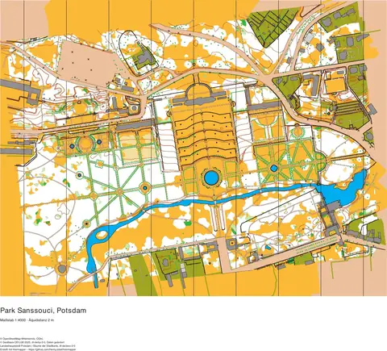</a> <a href="brandenburg-sanssouci/brandenburg-sanssouci-training.pdf">PDF</a> · <a href="brandenburg-sanssouci/brandenburg-sanssouci-candidates.pdf">check print</a> | Brandenburg | [Park Sanssouci, Potsdam](brandenburg-sanssouci/): vineyard terraces, parterres and hedges, palace | 2282 | 1038 | 38 |
| <a href="berlin-viktoriapark/preview.webp">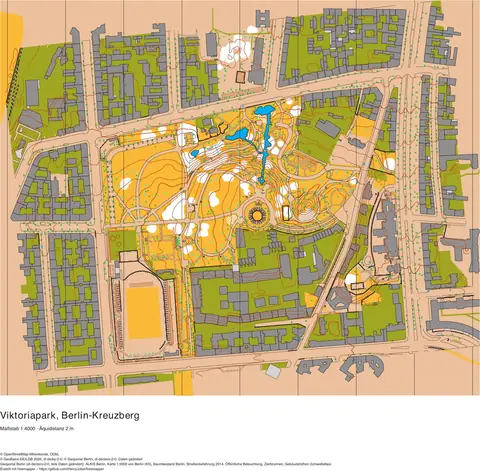</a> <a href="berlin-viktoriapark/berlin-viktoriapark-training.pdf">PDF</a> · <a href="berlin-viktoriapark/berlin-viktoriapark-candidates.pdf">check print</a> | Berlin | [Viktoriapark, Kreuzberg](berlin-viktoriapark/): the Kreuzberg hill with its waterfall, 19th-century blocks | 3081 | 829 | 47 |
| <a href="sachsen-bautzen/preview.webp">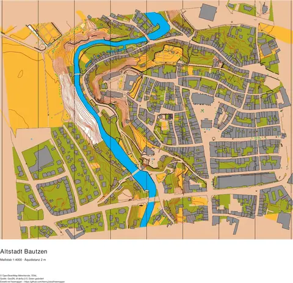</a> <a href="sachsen-bautzen/sachsen-bautzen-training.pdf">PDF</a> · <a href="sachsen-bautzen/sachsen-bautzen-candidates.pdf">check print</a> | Saxony | [Bautzen old town](sachsen-bautzen/): the old town on the rock above the Spree, steep valley sides | 2238 | 1144 | 39 |
| <a href="sachsen-anhalt-quedlinburg/preview.webp">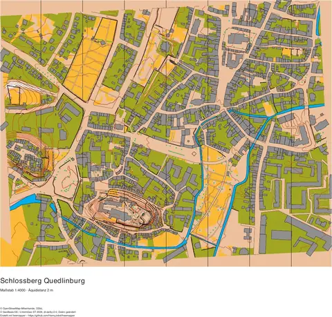</a> <a href="sachsen-anhalt-quedlinburg/sachsen-anhalt-quedlinburg-training.pdf">PDF</a> · <a href="sachsen-anhalt-quedlinburg/sachsen-anhalt-quedlinburg-candidates.pdf">check print</a> | Saxony-Anhalt | [Schlossberg Quedlinburg](sachsen-anhalt-quedlinburg/): World Heritage old town, castle hill, narrow lanes | 2689 | 714 | 39 |
| <a href="hamburg-blankenese/preview.webp">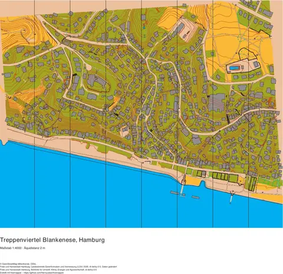</a> <a href="hamburg-blankenese/hamburg-blankenese-training.pdf">PDF</a> · <a href="hamburg-blankenese/hamburg-blankenese-candidates.pdf">check print</a> | Hamburg | [Treppenviertel Blankenese](hamburg-blankenese/): the steep Elbe bank, stairs and lanes | 2141 | 1456 | 38 |
| <a href="hessen-marburg/preview.webp">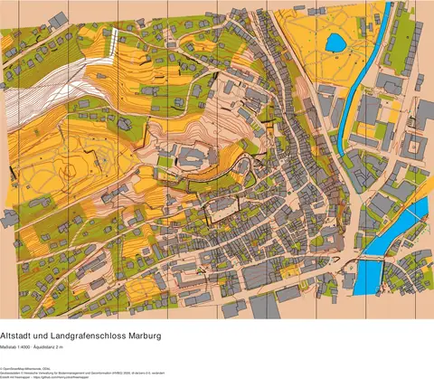</a> <a href="hessen-marburg/hessen-marburg-training.pdf">PDF</a> · <a href="hessen-marburg/hessen-marburg-candidates.pdf">check print</a> | Hesse | [Marburg old town and castle](hessen-marburg/): the steep upper town with stepped lanes, castle hill | 2723 | 1220 | 39 |
| <a href="schleswig-holstein-luebeck/preview.webp">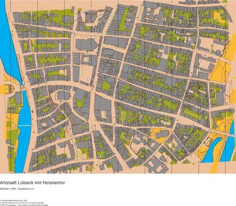</a> <a href="schleswig-holstein-luebeck/schleswig-holstein-luebeck-training.pdf">PDF</a> · <a href="schleswig-holstein-luebeck/schleswig-holstein-luebeck-candidates.pdf">check print</a> | Schleswig-Holstein | [Lübeck old town and Holstentor](schleswig-holstein-luebeck/): the medieval old-town island with its passages and courtyards | 3464 | 1894 | 35 |
| <a href="mecklenburg-vorpommern-wismar/preview.webp">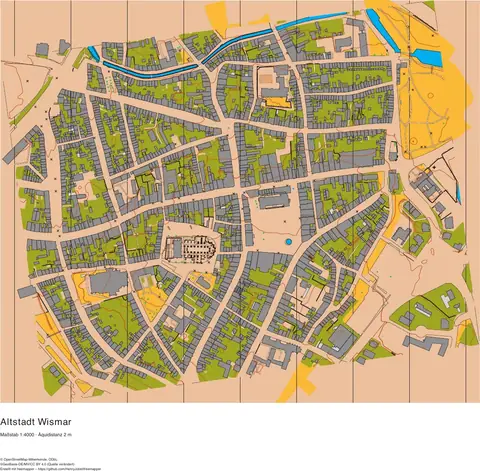</a> <a href="mecklenburg-vorpommern-wismar/mecklenburg-vorpommern-wismar-training.pdf">PDF</a> · <a href="mecklenburg-vorpommern-wismar/mecklenburg-vorpommern-wismar-candidates.pdf">check print</a> | Mecklenburg-Vorpommern | [Wismar old town](mecklenburg-vorpommern-wismar/): World Heritage old town with St. George's church and the market square | 3369 | 2293 | 39 |
| <a href="nordrhein-westfalen-monschau/preview.webp">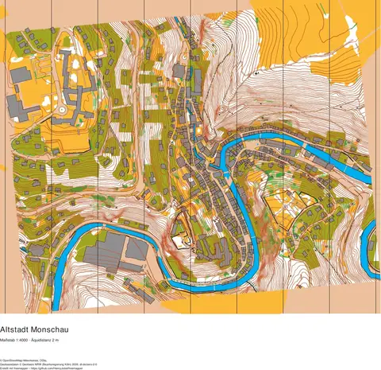</a> <a href="nordrhein-westfalen-monschau/nordrhein-westfalen-monschau-training.pdf">PDF</a> · <a href="nordrhein-westfalen-monschau/nordrhein-westfalen-monschau-candidates.pdf">check print</a> | North Rhine-Westphalia | [Monschau old town](nordrhein-westfalen-monschau/): half-timbered old town in the deep Rur valley | 1992 | 1786 | 42 |
| <a href="niedersachsen-herrenhausen/preview.webp">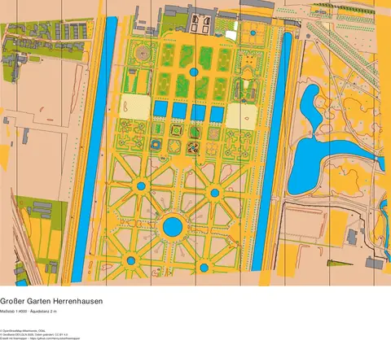</a> <a href="niedersachsen-herrenhausen/niedersachsen-herrenhausen-training.pdf">PDF</a> · <a href="niedersachsen-herrenhausen/niedersachsen-herrenhausen-candidates.pdf">check print</a> | Lower Saxony | [Großer Garten Herrenhausen, Hanover](niedersachsen-herrenhausen/): baroque garden with hedges, parterres and fountain basins, next to the Georgengarten | 2239 | 545 | 38 |
| <a href="rheinland-pfalz-cochem/preview.webp">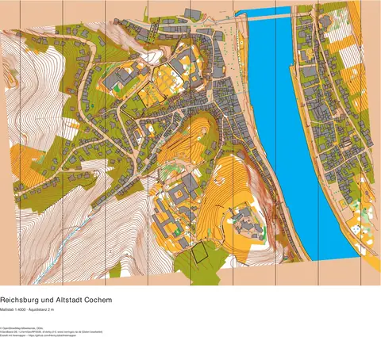</a> <a href="rheinland-pfalz-cochem/rheinland-pfalz-cochem-training.pdf">PDF</a> · <a href="rheinland-pfalz-cochem/rheinland-pfalz-cochem-candidates.pdf">check print</a> | Rhineland-Palatinate | [Reichsburg and Cochem old town](rheinland-pfalz-cochem/): the castle hill with the Reichsburg, the old town on the steep Moselle bank, Cond across the river | 2355 | 1150 | 44 |
| <a href="saarland-saarlouis/preview.webp">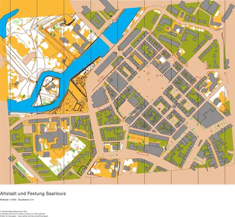</a> <a href="saarland-saarlouis/saarland-saarlouis-training.pdf">PDF</a> · <a href="saarland-saarlouis/saarland-saarlouis-candidates.pdf">check print</a> | Saarland | [Saarlouis old town and fortress](saarland-saarlouis/): Vauban's hexagonal fortress town, the old arm of the Saar with the Vauban island, ramparts in the Stadtgarten | 1569 | 744 | 40 |
| <a href="baden-wuerttemberg-heidelberg/preview.webp">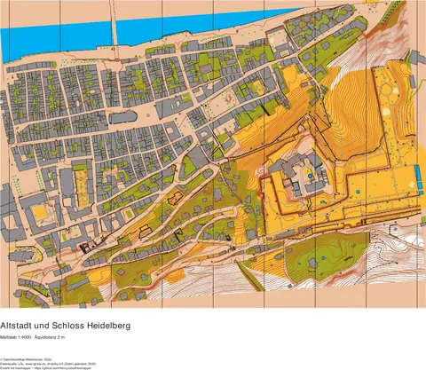</a> <a href="baden-wuerttemberg-heidelberg/baden-wuerttemberg-heidelberg-training.pdf">PDF</a> · <a href="baden-wuerttemberg-heidelberg/baden-wuerttemberg-heidelberg-candidates.pdf">check print</a> | Baden-Württemberg | [Heidelberg old town and castle](baden-wuerttemberg-heidelberg/): the old town on the Neckar with the Old Bridge, the castle and its garden on the steep slope of the Königstuhl | 2304 | 1121 | 43 |
| <a href="bremen-altstadt/preview.webp">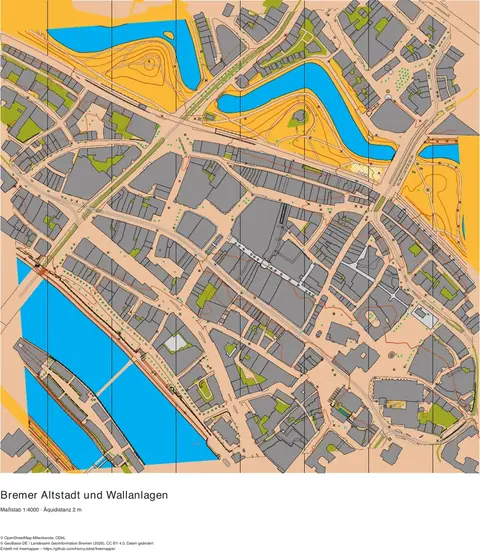</a> <a href="bremen-altstadt/bremen-altstadt-training.pdf">PDF</a> · <a href="bremen-altstadt/bremen-altstadt-candidates.pdf">check print</a> | Bremen | [Old town of Bremen and Wallanlagen](bremen-altstadt/): the old town between the Weser and the town moat with the market square and the Schlachte, the Wallanlagen with the mill on the rampart, and the Teerhof across the river | 2248 | 650 | 39 |
| <a href="bayern-regensburg/preview.webp">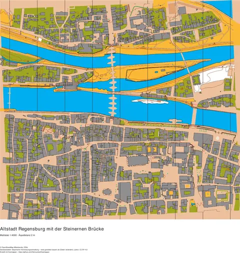</a> <a href="bayern-regensburg/bayern-regensburg-training.pdf">PDF</a> · <a href="bayern-regensburg/bayern-regensburg-candidates.pdf">check print</a> | Bavaria | [Old town of Regensburg with the Stone Bridge](bayern-regensburg/): the World Heritage old town on the Danube with the cathedral and its lanes, the Stone Bridge, the river islands and Stadtamhof on the other bank | 2770 | 498 | 39 |

## Forest maps

Forest maps (ISOM 2017-2) at 1:10 000 for a quick training in a forest, one area per state.

| Preview | State | Area | Map objects | Candidates | Symbols |
|---|---|---|---:|---:|---:|
| <a href="brandenburg-rauener-berge/preview.webp">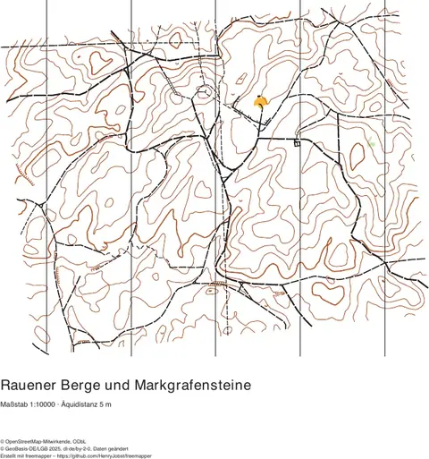</a> <a href="brandenburg-rauener-berge/brandenburg-rauener-berge-training.pdf">PDF</a> · <a href="brandenburg-rauener-berge/brandenburg-rauener-berge-candidates.pdf">check print</a> | Brandenburg | [Rauener Berge and Markgrafensteine](brandenburg-rauener-berge/): moraine hills above the Scharmützelsee with the Markgrafensteine, large erratic boulders | 189 | 39 | 21 |
| <a href="berlin-dammheide/preview.webp">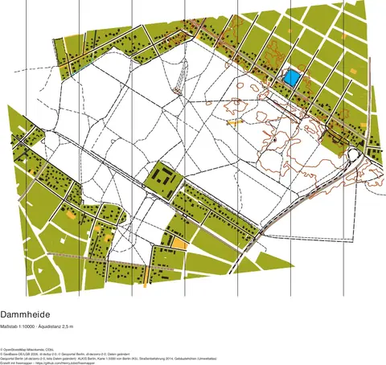</a> <a href="berlin-dammheide/berlin-dammheide-training.pdf">PDF</a> · <a href="berlin-dammheide/berlin-dammheide-candidates.pdf">check print</a> | Berlin | [Dammheide, Treptow-Köpenick](berlin-dammheide/): a small flat forest with a dense path network, settlements around it | 918 | 183 | 27 |
| <a href="sachsen-bastei/preview.webp">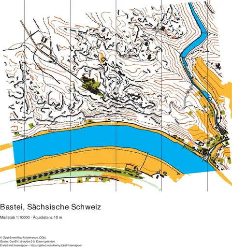</a> <a href="sachsen-bastei/sachsen-bastei-training.pdf">PDF</a> · <a href="sachsen-bastei/sachsen-bastei-candidates.pdf">check print</a> | Saxony | [Bastei, Saxon Switzerland](sachsen-bastei/): sandstone rocks above the Elbe, more than 2000 cliffs from OSM | 1052 | 3326 | 36 |
| <a href="sachsen-anhalt-bodetal/preview.webp">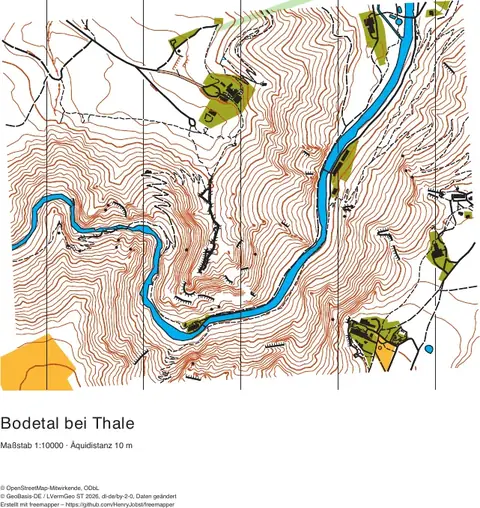</a> <a href="sachsen-anhalt-bodetal/sachsen-anhalt-bodetal-training.pdf">PDF</a> · <a href="sachsen-anhalt-bodetal/sachsen-anhalt-bodetal-candidates.pdf">check print</a> | Saxony-Anhalt | [Bode valley near Thale](sachsen-anhalt-bodetal/): the deep valley of the Bode in the Harz | 424 | 202 | 35 |
| <a href="hamburg-haake/preview.webp">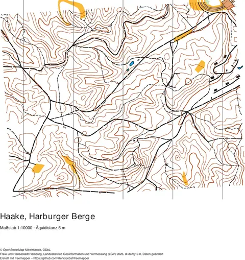</a> <a href="hamburg-haake/hamburg-haake-training.pdf">PDF</a> · <a href="hamburg-haake/hamburg-haake-candidates.pdf">check print</a> | Hamburg | [Haake, Harburger Berge](hamburg-haake/): a hilly forest with a dense path network | 218 | 38 | 23 |
| <a href="hessen-feldberg/preview.webp">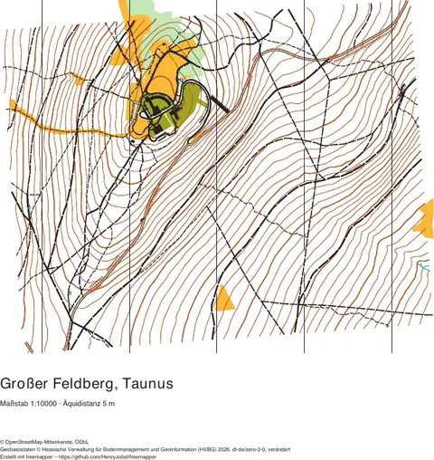</a> <a href="hessen-feldberg/hessen-feldberg-training.pdf">PDF</a> · <a href="hessen-feldberg/hessen-feldberg-candidates.pdf">check print</a> | Hesse | [Großer Feldberg, Taunus](hessen-feldberg/): the summit and slopes of the highest mountain of the Taunus | 235 | 47 | 29 |
| <a href="schleswig-holstein-huettener-berge/preview.webp">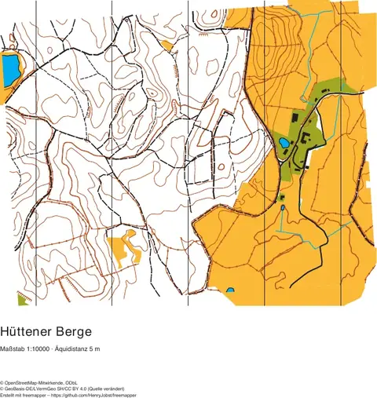</a> <a href="schleswig-holstein-huettener-berge/schleswig-holstein-huettener-berge-training.pdf">PDF</a> · <a href="schleswig-holstein-huettener-berge/schleswig-holstein-huettener-berge-candidates.pdf">check print</a> | Schleswig-Holstein | [Hüttener Berge](schleswig-holstein-huettener-berge/): moraine hills with forest, open land and small lakes | 210 | 114 | 25 |
| <a href="mecklenburg-vorpommern-granitz/preview.webp">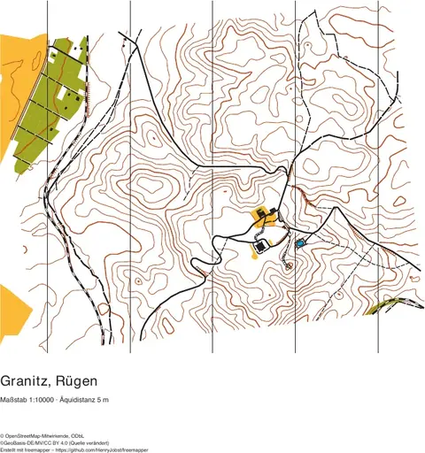</a> <a href="mecklenburg-vorpommern-granitz/mecklenburg-vorpommern-granitz-training.pdf">PDF</a> · <a href="mecklenburg-vorpommern-granitz/mecklenburg-vorpommern-granitz-candidates.pdf">check print</a> | Mecklenburg-Vorpommern | [Granitz, Rügen](mecklenburg-vorpommern-granitz/): beech forest around the Granitz hunting lodge | 163 | 104 | 24 |
| <a href="nordrhein-westfalen-siebengebirge/preview.webp">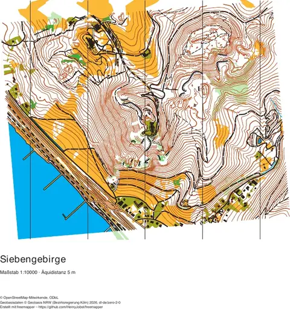</a> <a href="nordrhein-westfalen-siebengebirge/nordrhein-westfalen-siebengebirge-training.pdf">PDF</a> · <a href="nordrhein-westfalen-siebengebirge/nordrhein-westfalen-siebengebirge-candidates.pdf">check print</a> | North Rhine-Westphalia | [Drachenfels, Siebengebirge](nordrhein-westfalen-siebengebirge/): rocks, vineyards and forest above the Rhine | 845 | 516 | 40 |
| <a href="niedersachsen-bad-harzburg/preview.webp">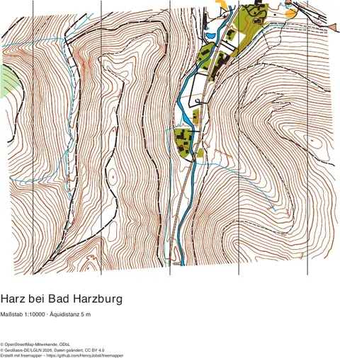</a> <a href="niedersachsen-bad-harzburg/niedersachsen-bad-harzburg-training.pdf">PDF</a> · <a href="niedersachsen-bad-harzburg/niedersachsen-bad-harzburg-candidates.pdf">check print</a> | Lower Saxony | [Harz near Bad Harzburg](niedersachsen-bad-harzburg/): steep slopes on both sides of a stream valley | 290 | 68 | 33 |
| <a href="rheinland-pfalz-dahn/preview.webp">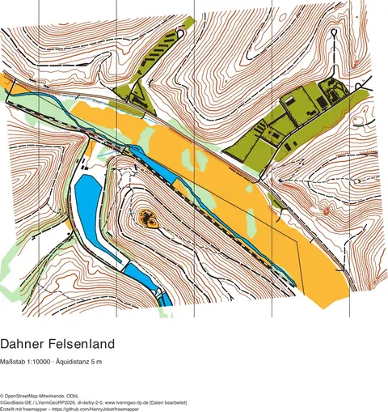</a> <a href="rheinland-pfalz-dahn/rheinland-pfalz-dahn-training.pdf">PDF</a> · <a href="rheinland-pfalz-dahn/rheinland-pfalz-dahn-candidates.pdf">check print</a> | Rhineland-Palatinate | [Dahner Felsenland](rheinland-pfalz-dahn/): red sandstone rocks in the Palatinate Forest | 396 | 150 | 34 |
| <a href="saarland-cloef/preview.webp">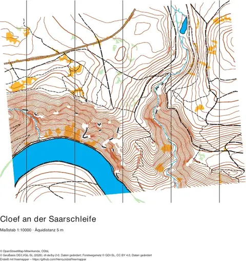</a> <a href="saarland-cloef/saarland-cloef-training.pdf">PDF</a> · <a href="saarland-cloef/saarland-cloef-candidates.pdf">check print</a> | Saarland | [Cloef at the Saarschleife](saarland-cloef/): a steep slope with rocks above the Saar loop | 367 | 134 | 26 |
| <a href="baden-wuerttemberg-koenigstuhl/preview.webp">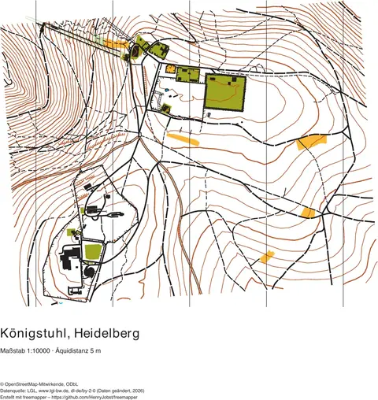</a> <a href="baden-wuerttemberg-koenigstuhl/baden-wuerttemberg-koenigstuhl-training.pdf">PDF</a> · <a href="baden-wuerttemberg-koenigstuhl/baden-wuerttemberg-koenigstuhl-candidates.pdf">check print</a> | Baden-Württemberg | [Königstuhl, Heidelberg](baden-wuerttemberg-koenigstuhl/): Heidelberg's own mountain, with an observatory and many paths | 363 | 75 | 28 |
| <a href="bremen-buergerpark/preview.webp">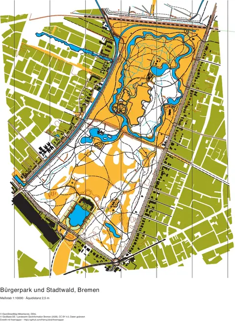</a> <a href="bremen-buergerpark/bremen-buergerpark-training.pdf">PDF</a> · <a href="bremen-buergerpark/bremen-buergerpark-candidates.pdf">check print</a> | Bremen | [Bürgerpark and Stadtwald](bremen-buergerpark/): a flat park and forest with ditches, lakes and a dense path network | 1182 | 690 | 32 |
| <a href="bayern-schmausenbuck/preview.webp">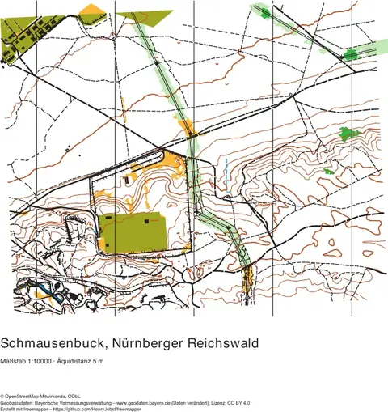</a> <a href="bayern-schmausenbuck/bayern-schmausenbuck-training.pdf">PDF</a> · <a href="bayern-schmausenbuck/bayern-schmausenbuck-candidates.pdf">check print</a> | Bavaria | [Schmausenbuck, Nürnberger Reichswald](bayern-schmausenbuck/): a sandstone hill in the Reichswald above the zoo of Nuremberg, slopes with a dense path network, two power lines | 372 | 165 | 37 |

## More

- [Background](background.en.md): how the examples were made, what the numbers mean, the files of an example, how the areas were chosen and the licences
- [Comparison](compare.en.md): the same area in the three content profiles

Created with freemapper – https://github.com/HenryJobst/freemapper
