# Example projects

[Deutsch](README.md)

Each supported state has an example: an area from which freemapper can derive a lot (an old town, a palace or a
park with relief, dense buildings, stairs, walls and hedges). All examples are sprint maps at 1:4000 (ISSprOM 2019),
made with `freemapper run --pdf --ocad`. The PDF shows only the map objects; two examples also come with the
training map that draws every candidate. How the two differ is on the [comparison page](compare.en.md).

| State | Area | Map objects | Candidates | Symbols | Preview |
|---|---|---:|---:|---:|---|
| Brandenburg | [Park Sanssouci, Potsdam](brandenburg-sanssouci/): vineyard terraces, parterres and hedges, palace | 443 | 1981 | 30 | <a href="brandenburg-sanssouci/brandenburg-sanssouci.pdf">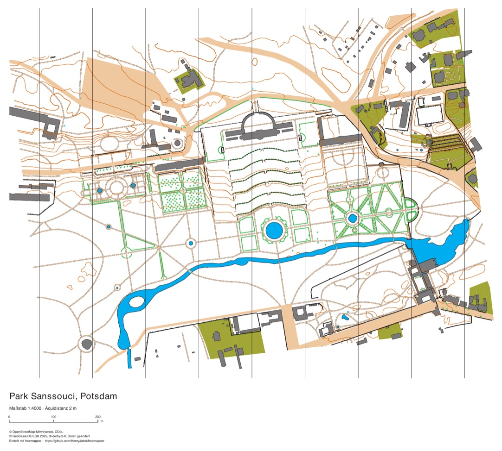</a> |
| Berlin | [Viktoriapark, Kreuzberg](berlin-viktoriapark/): the Kreuzberg hill with its waterfall, 19th-century blocks | 766 | 2235 | 35 | <a href="berlin-viktoriapark/berlin-viktoriapark.pdf">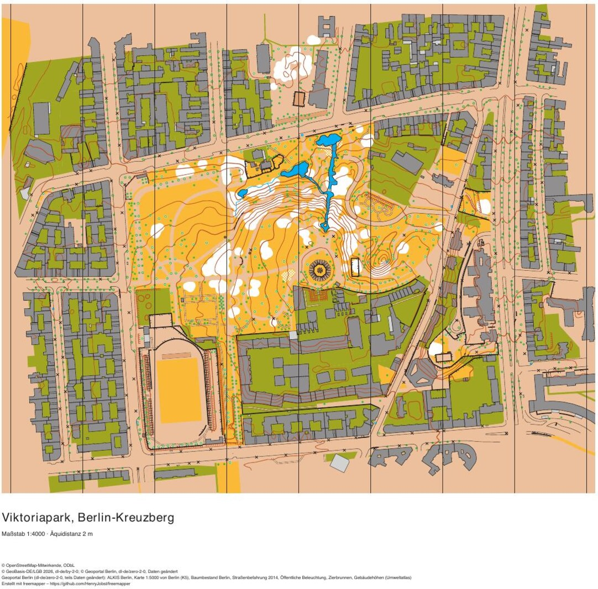</a> |
| Saxony | [Bautzen old town](sachsen-bautzen/): the old town on the rock above the Spree, steep valley sides | 1226 | 1376 | 35 | <a href="sachsen-bautzen/sachsen-bautzen.pdf">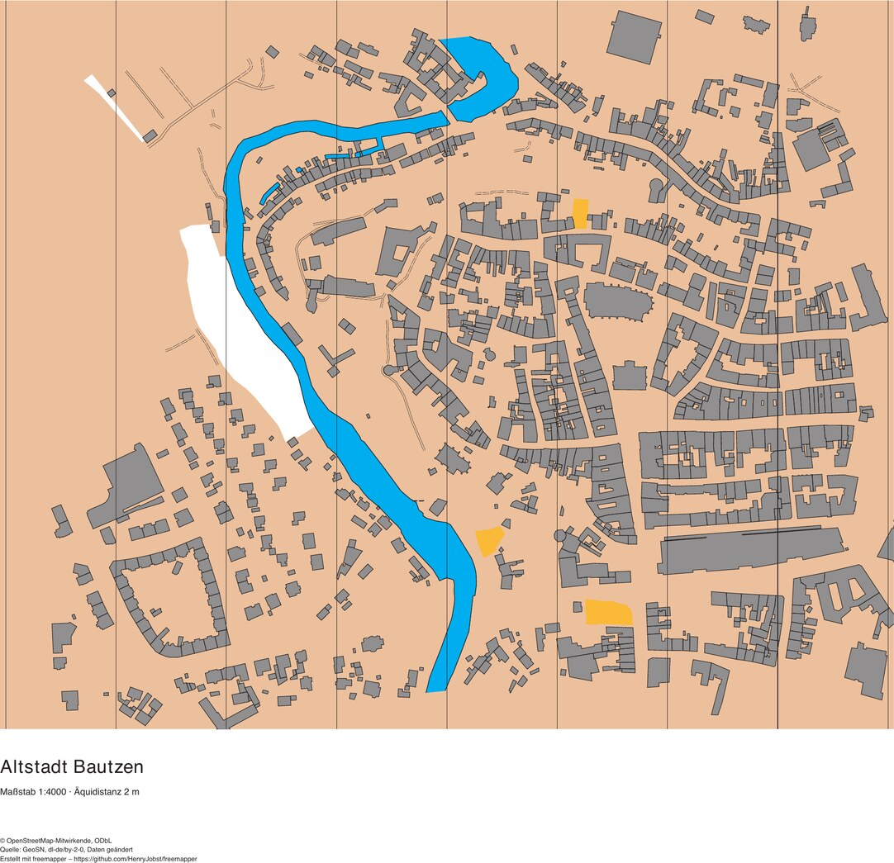</a> |
| Saxony-Anhalt | [Schlossberg Quedlinburg](sachsen-anhalt-quedlinburg/): World Heritage old town, castle hill, narrow lanes | 1642 | 1110 | 32 | <a href="sachsen-anhalt-quedlinburg/sachsen-anhalt-quedlinburg.pdf">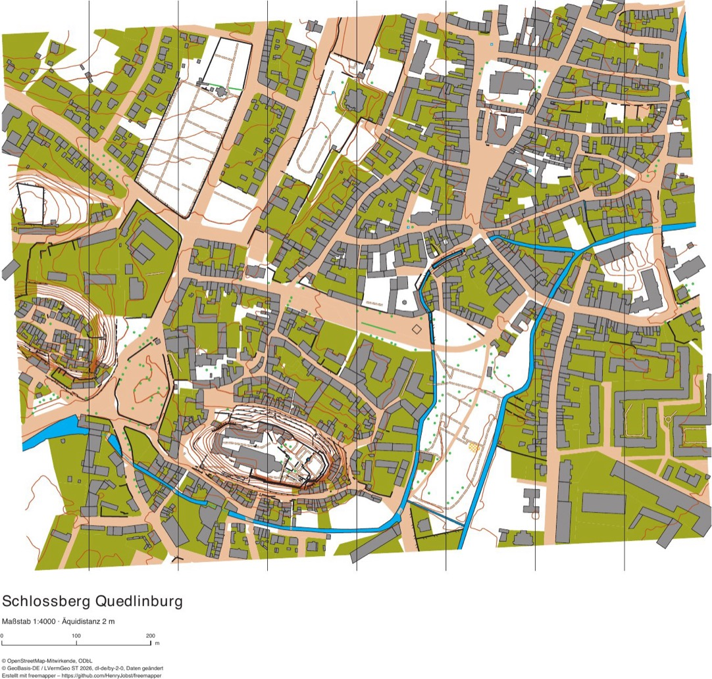</a> |
| Hamburg | [Treppenviertel Blankenese](hamburg-blankenese/): the steep Elbe bank, stairs and lanes | 969 | 979 | 27 | <a href="hamburg-blankenese/hamburg-blankenese.pdf">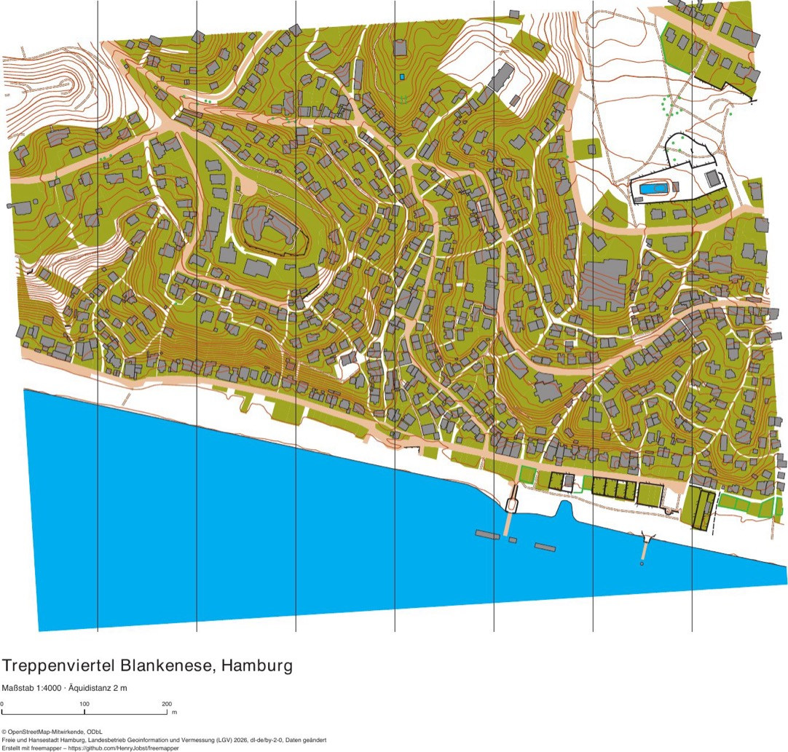</a> |
| Hesse | [Marburg old town and castle](hessen-marburg/): the steep upper town with stepped lanes, castle hill | 1541 | 1065 | 31 | <a href="hessen-marburg/hessen-marburg.pdf">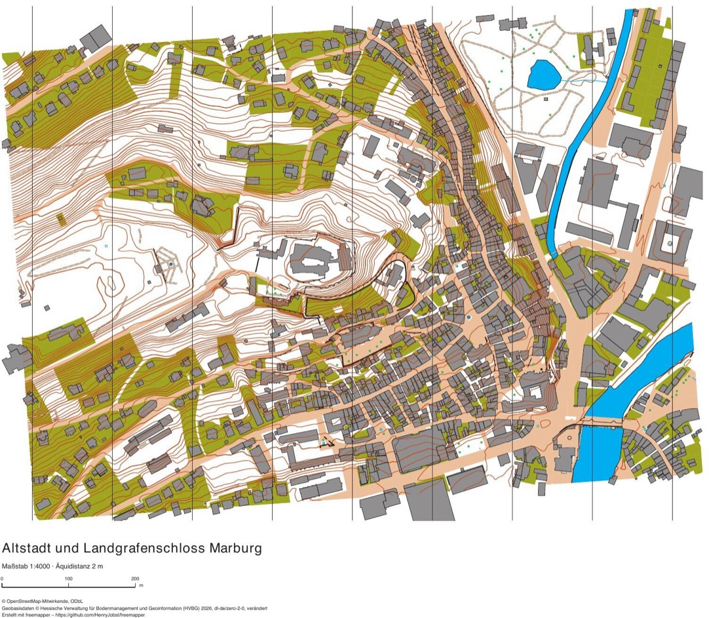</a> |
| Schleswig-Holstein | [Lübeck old town and Holstentor](schleswig-holstein-luebeck/): the medieval old-town island with its passages and courtyards | 2292 | 1766 | 32 | <a href="schleswig-holstein-luebeck/schleswig-holstein-luebeck.pdf">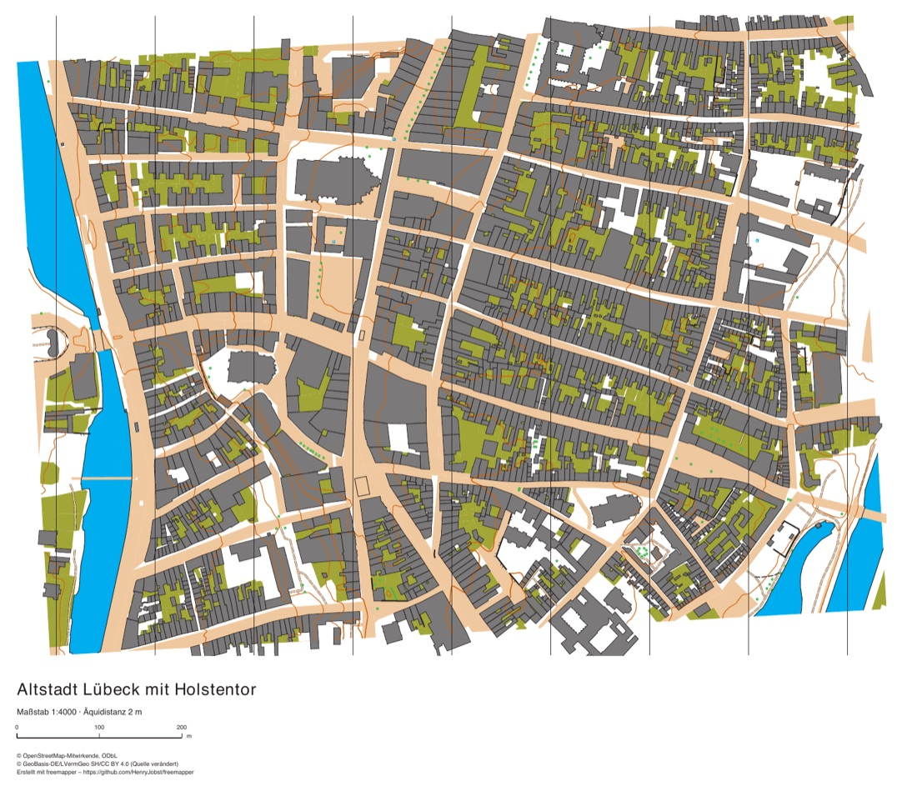</a> |
| Mecklenburg-Vorpommern | [Wismar old town](mecklenburg-vorpommern-wismar/): World Heritage old town with St. George's church and the market square | 2486 | 1756 | 29 | <a href="mecklenburg-vorpommern-wismar/mecklenburg-vorpommern-wismar.pdf">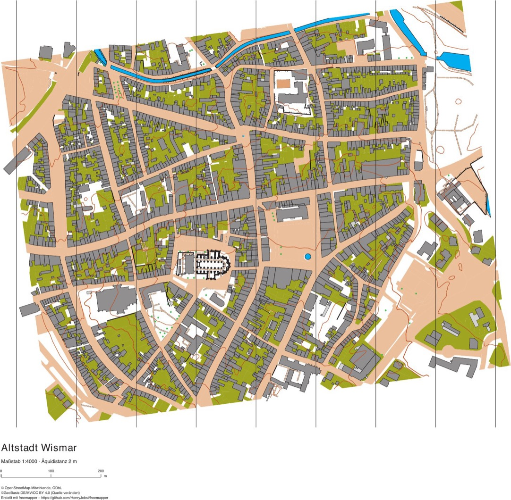</a> |
| North Rhine-Westphalia | [Monschau old town](nordrhein-westfalen-monschau/): half-timbered old town in the deep Rur valley | 993 | 850 | 31 | <a href="nordrhein-westfalen-monschau/nordrhein-westfalen-monschau.pdf">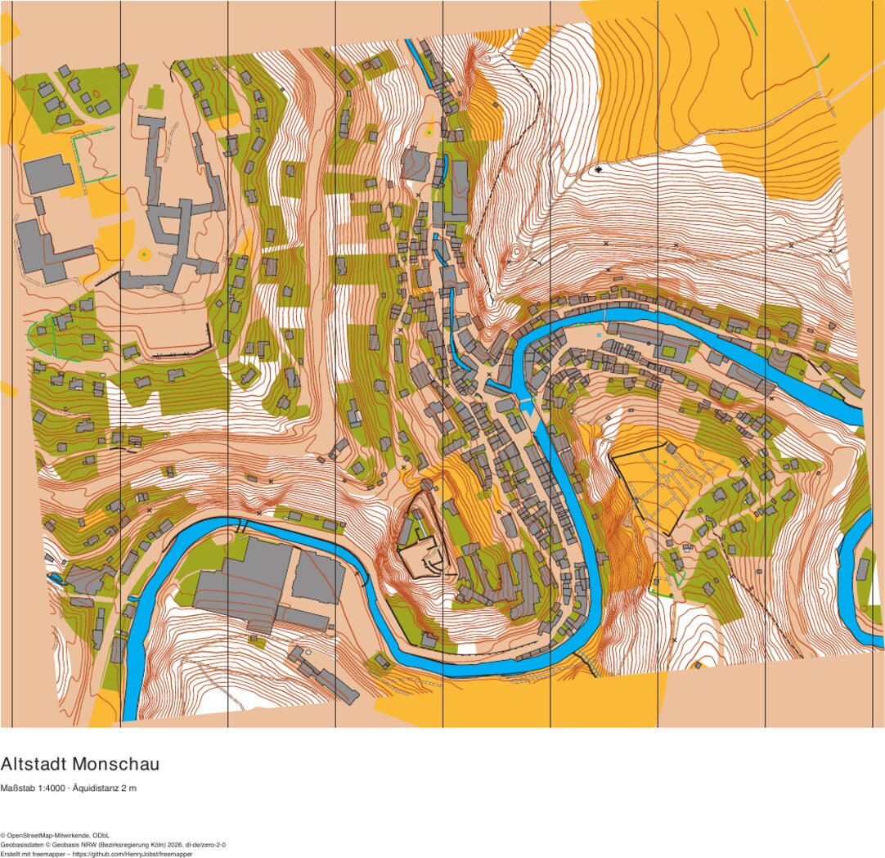</a> |
| Lower Saxony | [Großer Garten Herrenhausen, Hanover](niedersachsen-herrenhausen/): baroque garden with hedges, parterres and fountain basins, next to the Georgengarten | 275 | 2142 | 32 | <a href="niedersachsen-herrenhausen/niedersachsen-herrenhausen.pdf">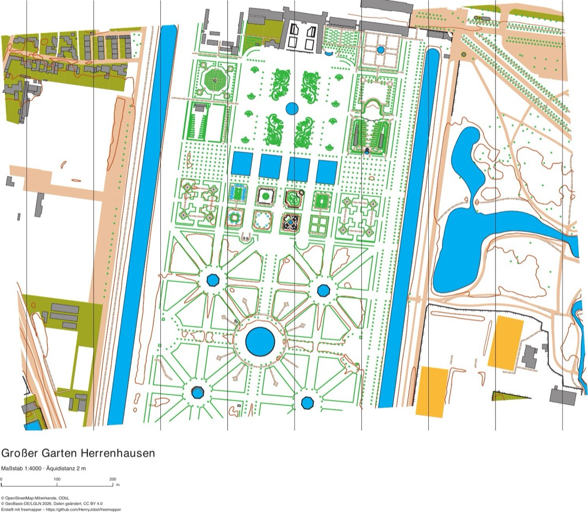</a> |
| Rhineland-Palatinate | [Reichsburg and Cochem old town](rheinland-pfalz-cochem/): the castle hill with the Reichsburg, the old town on the steep Moselle bank, Cond across the river | 1315 | 894 | 33 | <a href="rheinland-pfalz-cochem/rheinland-pfalz-cochem.pdf">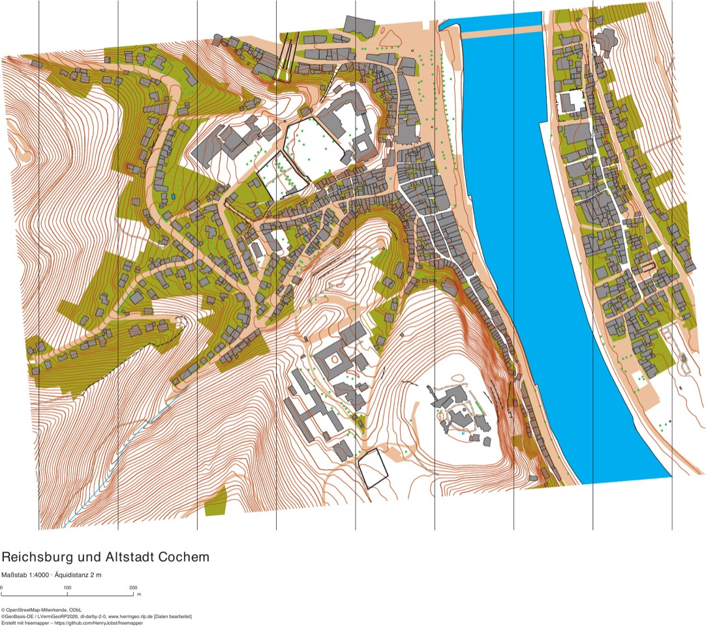</a> |

**Map objects** are the reliable objects of the OOM map (ALKIS buildings, areas and water, canopies and carports).
**Candidates** come as a separate template (`templates/candidates.omap`); the PDF `<name>.pdf` does not draw them; `--pdf-candidates` adds `<name>-candidates.pdf`, which does. They come from OSM,
from ALKIS and from the terrain model, in Berlin also from the Geoportal Berlin, and in Potsdam from the city map tree
points (Bäume der Stadtkarte). **Symbols** counts the distinct symbols in both together.

Rivers, canals, ponds and harbour basins from ALKIS are on the map as uncrossable water (301.1) with a bank line
(301.6). Ponds, fountains, springs, streams and bridges from OSM are candidates. The water has no contours and no
fountain points, which would mostly be the jets in a basin. Where ALKIS records a bridge as road
area, the water ends at the bridge with a bank line across the river; delete that line in OOM.

Canopies and carports from ALKIS are on the map as 522 in every state. Passages and arcades through buildings are 522
candidates. Lübeck has 93 canopies and 221 passages and arcades, Wismar 113 canopies and carports. In Saxony and
Saxony-Anhalt ALKIS has neither canopies nor passages, so those two examples have none.

In Brandenburg freemapper also loads the full ALKIS (NAS) from the LGB. In Sanssouci that gives 281 wall lines (515),
123 fences (518), 149 hedges (410.1) and 125 embankment tops (104), all as candidates. ALKIS often
records both edges of a wall. Where they face each other and lie closer than 0.55 mm on paper, freemapper draws one
line in the middle; Sanssouci has 14 of these. Thicker walls and edges that face the same way stay double; delete the
second line in OOM. Where OSM has the same wall, hedge or fence, only the ALKIS line stays, and it names the OSM line
in `freemapper:also`. Where a line with another symbol runs parallel and too close, such as an OSM retaining wall on
a terrace wall or a fence beside a wall, the weaker line loses that stretch. Wall stretches along a building outline
and trees within 1 m of a hedge, wall or fence are dropped. In Sanssouci this brings the parallel line pairs closer
than 1 m down from 162 to 4. The Potsdam city map tree points are a tree cadastre as in Berlin. Of them, 774 stay
points and 676 lie in tree group areas, and OSM trees closer than 2 m to a cadastre tree are dropped.

In Berlin, freemapper loads more layers from the Geoportal Berlin. Stairs, walls, fences, embankment edges, monuments
and passages are candidates, and so are the trees from the tree cadastre, 1926 of them in the Viktoriapark. The Berlin
1:5000 map (K5) comes as the template `templates/k5.png`.

Berlin projects also get the street survey (Straßenbefahrung, recorded 2014 to 2016), the registers of street
lamps, ornamental fountains and drinking fountains, and the building heights from the Umweltatlas. The map itself
barely changes. In the Viktoriapark freemapper cuts only five small green strips along the curb out of one ALKIS
street area. The candidates gain 77 curbs (501.1) and 80 surveyed paved areas (501.5). Nearly all of them are
sidewalks and the paved paths in the park, which only the PDF with candidates shows. Also new are traffic barriers (518), walls (515),
bus shelters (522), advertising columns (531), and street pumps and ornamental fountains (311). Where a survey barrier
lies on an OSM fence, only the barrier stays, and it names the fence in `freemapper:also`. Of the 602 buildings, 599
carry the footprint date from the 2022 building heights as `freemapper:currency`.

Allotment gardens (Kleingärten) are out-of-bounds candidates (520) in every state. In Sanssouci this covers one
garden colony on the northern edge, in Wismar and Herrenhausen one more area each.

Point symbols must not touch. Two points keep at least 0.15 mm apart; otherwise the larger one stays and names the
other in the tag `freemapper:generalized`. Where three or more trees stand closer than 2.5 mm (10 m) or their crowns
almost touch, freemapper turns them into an area: forest (405) at 50 % crown cover or more, otherwise open land with
scattered trees (402), and 501.3 on paving from 9 trees. These areas leave paths and paving clear. Rows of trees
along streets and avenues stay points. Sanssouci gets 38 areas 402 this way, because the Potsdam trees have no crown
and 5 m crowns do not cover half of a group. The Viktoriapark, with measured crowns, gets 41 forests 405 and 3 areas
402. Of its 1926 cadastre trees, 1128 stay points and 634 lie in tree group areas.

Parks are yellow open land (401). ALKIS parks, green spaces and grassland are map objects, in Sanssouci 27 areas,
in the Viktoriapark 5. ALKIS woods become forest (405), in Monschau 153 areas. Under everything lies the walkable
area, one brown area over the whole sheet (symbol 990, map part `base`). It fills whatever nothing else shows. The PDF with candidates leaves out points inside a 520 candidate; in the
template they carry `freemapper:hidden=520`.

In the Viktoriapark the stairs on the plinth of the Nationaldenkmal lead up to the monument. Wide stairs such as the
stands at the stadium come as parallel 532.9 lines tagged `freemapper:size=wide`. Fences and walls that both ALKIS and
OSM have appear once in the candidates, as the ALKIS line, which names the OSM line in the tag `freemapper:also`.

## What an example contains

| File | Content |
|---|---|
| `<name>.omap` | the OOM starter project (OpenOrienteering Mapper) |
| `templates/candidates.omap` | the OSM candidates as a template |
| `ocad/<name>.ocd`, `ocad/<name>-candidates.ocd` | the OCAD starting point (OCAD 12) |
| `<name>.pdf` | the print-ready map: the map objects only, without candidates and without a scale bar |
| `preview.jpg` | preview of this PDF |
| `<name>-candidates.pdf`, `preview-candidates.jpg` | only in Cochem and Blankenese: the training map with every candidate and its preview, see the [comparison page](compare.en.md) |
| `freemapper.toml` | the project: area, scale and the fetched data versions |
| `ATTRIBUTION.txt` | the attribution of the data sources |

The raster templates (orthophoto, hillshade, slope, nDSM, in Berlin the K5) and the raw data (`data/`) are not in the
repository, because they take over 20 MB per example. To get them back:

```sh
freemapper run --ocad --pdf examples/sachsen-anhalt-quedlinburg
```

freemapper fetches the data again, computes the templates and keeps the existing maps (`.omap`, `.ocd`) unchanged.
The map then opens in OOM and OCAD with all templates. `--pdf-candidates` also writes the training map.

## How the areas were chosen

For each state, five to six candidates were made as sprint maps, among them parks, schools, old towns and palace
grounds. The distinct symbols and the objects were counted; the best two or three areas of each state were then
compared on the training map. The areas that show the most won: varied buildings, relief and many OSM candidates.

In Lower Saxony the Großer Garten won, although its map has only 275 map objects. Its hedges, parterres,
rows of trees and fountains give 2142 candidates, 7.8 per map object, more than in any other example.

In Rhineland-Palatinate eight rectangles ran: Koblenz at the Deutsches Eck, Trier, Speyer, Mainz, Bad Kreuznach and
Cochem. Bad Kreuznach and Cochem ran twice, because the first rectangle in Bad Kreuznach missed the Nahe and the one
in Cochem missed the Reichsburg. Speyer and Cochem both reached 24 symbols. Cochem won because only this area has
strong relief: dense contours on the castle hill and the valley sides, plus the Moselle and the narrow old town.
Speyer is flat. Koblenz shows the Rhine and the Moselle at the Deutsches Eck, but it reached only 23 symbols and has
little relief.

## Licences

The maps contain derived official geodata and OpenStreetMap data. The attribution is in each `ATTRIBUTION.txt`, in
the PDFs' peripheral information and in the map notes:

- OpenStreetMap: © OpenStreetMap contributors, ODbL;
- Brandenburg: © GeoBasis-DE/LGB, dl-de/by-2-0; Potsdam: Landeshauptstadt Potsdam / Bäume der Stadtkarte, dl-de/zero-2-0; Berlin: © Geoportal Berlin, dl-de/zero-2-0;
- Saxony: GeoSN, dl-de/by-2-0; Saxony-Anhalt: © GeoBasis-DE / LVermGeo ST, dl-de/by-2-0;
- Hamburg: Freie und Hansestadt Hamburg, LGV, dl-de/by-2-0; Hesse: © HVBG, dl-de/zero-2-0; Schleswig-Holstein: © GeoBasis-DE/LVermGeo SH, CC BY 4.0; Mecklenburg-Vorpommern: ©GeoBasis-DE/MV/CC BY 4.0 (Quelle verändert); North Rhine-Westphalia: © Geobasis NRW, dl-de/zero-2-0; Lower Saxony: © GeoBasis-DE/LGLN, Daten geändert, CC BY 4.0; Rhineland-Palatinate: ©GeoBasis-DE / LVermGeoRP, dl-de/by-2-0, [Daten bearbeitet].

Created with freemapper – https://github.com/HenryJobst/freemapper
