# Beispielprojekte

[English](README.en.md)

Vorschau und PDF jedes Beispiels zeigen die Trainingskarte, die man so drucken und laufen kann. **Kartenobjekte** stehen in der OOM-Karte, **Kandidaten** sind, was unsicher bleibt, **Symbole** zählt die verschiedenen Symbole.

## Sprintkarten

Sprintkarten (ISSprOM 2019) im Maßstab 1:4000, für jedes Bundesland ein Gebiet, aus dem freemapper besonders viel ableiten kann.

| Vorschau | Bundesland | Gebiet | Kartenobjekte | Kandidaten | Symbole |
|---|---|---|---:|---:|---:|
|  <a href="brandenburg-sanssouci/brandenburg-sanssouci-training.pdf">PDF</a> · <a href="brandenburg-sanssouci/brandenburg-sanssouci-candidates.pdf">Prüfausdruck</a> | Brandenburg | [Park Sanssouci, Potsdam](brandenburg-sanssouci/): Weinbergterrassen, Parterres und Hecken, Schloss | 2282 | 1038 | 38 |
| <a href="berlin-viktoriapark/preview.webp">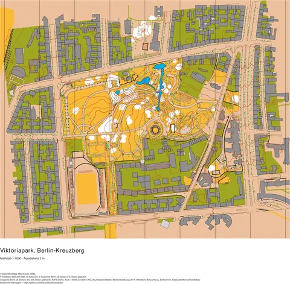</a> <a href="berlin-viktoriapark/berlin-viktoriapark-training.pdf">PDF</a> · <a href="berlin-viktoriapark/berlin-viktoriapark-candidates.pdf">Prüfausdruck</a> | Berlin | [Viktoriapark, Kreuzberg](berlin-viktoriapark/): Kreuzberg mit Wasserfall, Gründerzeitblöcke | 3081 | 829 | 47 |
| <a href="sachsen-bautzen/preview.webp">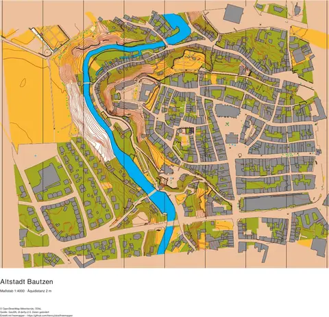</a> <a href="sachsen-bautzen/sachsen-bautzen-training.pdf">PDF</a> · <a href="sachsen-bautzen/sachsen-bautzen-candidates.pdf">Prüfausdruck</a> | Sachsen | [Altstadt Bautzen](sachsen-bautzen/): Altstadt auf dem Felsen über der Spree, steile Talhänge | 2238 | 1144 | 39 |
| <a href="sachsen-anhalt-quedlinburg/preview.webp">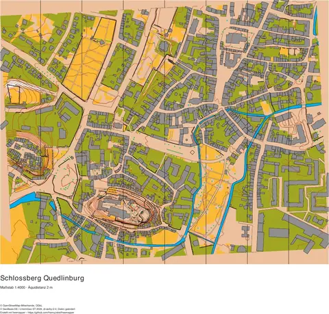</a> <a href="sachsen-anhalt-quedlinburg/sachsen-anhalt-quedlinburg-training.pdf">PDF</a> · <a href="sachsen-anhalt-quedlinburg/sachsen-anhalt-quedlinburg-candidates.pdf">Prüfausdruck</a> | Sachsen-Anhalt | [Schlossberg Quedlinburg](sachsen-anhalt-quedlinburg/): Welterbe-Altstadt, Schlossberg, enge Gassen | 2689 | 714 | 39 |
|  <a href="hamburg-blankenese/hamburg-blankenese-training.pdf">PDF</a> · <a href="hamburg-blankenese/hamburg-blankenese-candidates.pdf">Prüfausdruck</a> | Hamburg | [Treppenviertel Blankenese](hamburg-blankenese/): steiler Elbhang, Treppen und Gassen | 2141 | 1456 | 38 |
| <a href="hessen-marburg/preview.webp">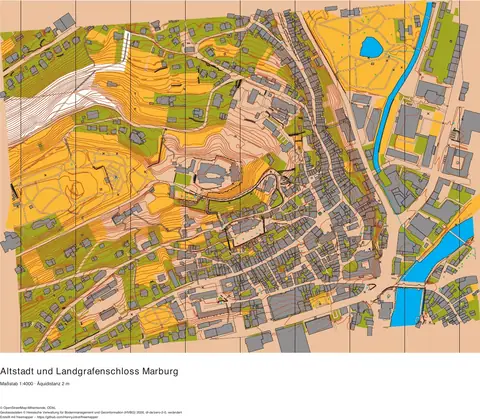</a> <a href="hessen-marburg/hessen-marburg-training.pdf">PDF</a> · <a href="hessen-marburg/hessen-marburg-candidates.pdf">Prüfausdruck</a> | Hessen | [Altstadt und Landgrafenschloss Marburg](hessen-marburg/): steile Oberstadt mit Treppengassen, Schlossberg | 2723 | 1220 | 39 |
| <a href="schleswig-holstein-luebeck/preview.webp">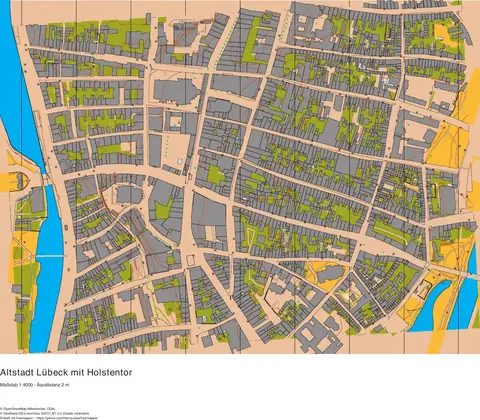</a> <a href="schleswig-holstein-luebeck/schleswig-holstein-luebeck-training.pdf">PDF</a> · <a href="schleswig-holstein-luebeck/schleswig-holstein-luebeck-candidates.pdf">Prüfausdruck</a> | Schleswig-Holstein | [Altstadt Lübeck mit Holstentor](schleswig-holstein-luebeck/): mittelalterliche Altstadtinsel mit Gängen und Höfen | 3464 | 1894 | 35 |
| <a href="mecklenburg-vorpommern-wismar/preview.webp">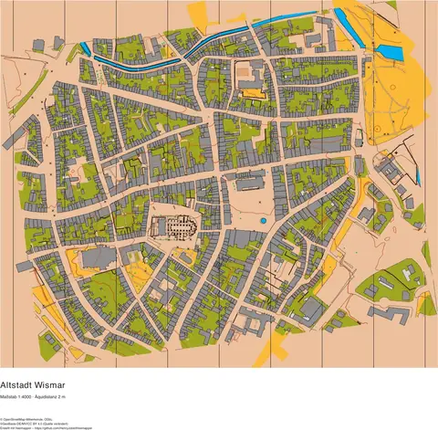</a> <a href="mecklenburg-vorpommern-wismar/mecklenburg-vorpommern-wismar-training.pdf">PDF</a> · <a href="mecklenburg-vorpommern-wismar/mecklenburg-vorpommern-wismar-candidates.pdf">Prüfausdruck</a> | Mecklenburg-Vorpommern | [Altstadt Wismar](mecklenburg-vorpommern-wismar/): Welterbe-Altstadt mit Georgenkirche und Marktplatz | 3369 | 2293 | 39 |
| <a href="nordrhein-westfalen-monschau/preview.webp">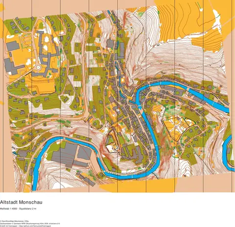</a> <a href="nordrhein-westfalen-monschau/nordrhein-westfalen-monschau-training.pdf">PDF</a> · <a href="nordrhein-westfalen-monschau/nordrhein-westfalen-monschau-candidates.pdf">Prüfausdruck</a> | Nordrhein-Westfalen | [Altstadt Monschau](nordrhein-westfalen-monschau/): Fachwerk-Altstadt im tief eingeschnittenen Rurtal | 1992 | 1786 | 42 |
| <a href="niedersachsen-herrenhausen/preview.webp">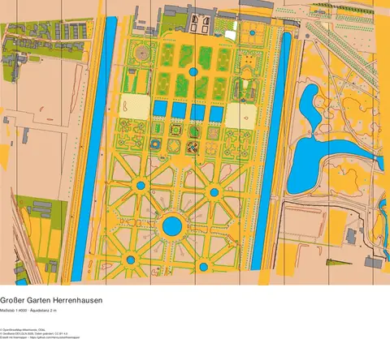</a> <a href="niedersachsen-herrenhausen/niedersachsen-herrenhausen-training.pdf">PDF</a> · <a href="niedersachsen-herrenhausen/niedersachsen-herrenhausen-candidates.pdf">Prüfausdruck</a> | Niedersachsen | [Großer Garten Herrenhausen, Hannover](niedersachsen-herrenhausen/): Barockgarten mit Hecken, Parterres und Brunnenbecken, daneben der Georgengarten | 2239 | 545 | 38 |
|  <a href="rheinland-pfalz-cochem/rheinland-pfalz-cochem-training.pdf">PDF</a> · <a href="rheinland-pfalz-cochem/rheinland-pfalz-cochem-candidates.pdf">Prüfausdruck</a> | Rheinland-Pfalz | [Reichsburg und Altstadt Cochem](rheinland-pfalz-cochem/): Burgberg mit der Reichsburg, Altstadt am steilen Moselufer, gegenüber Cond | 2355 | 1150 | 44 |
| <a href="saarland-saarlouis/preview.webp">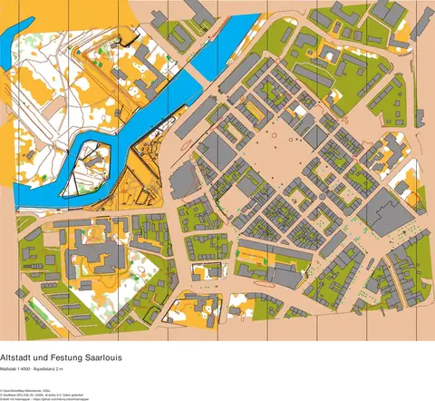</a> <a href="saarland-saarlouis/saarland-saarlouis-training.pdf">PDF</a> · <a href="saarland-saarlouis/saarland-saarlouis-candidates.pdf">Prüfausdruck</a> | Saarland | [Altstadt und Festung Saarlouis](saarland-saarlouis/): die sechseckige Festungsstadt Vaubans, Saar-Altarm mit der Vauban-Insel, Wälle im Stadtgarten | 1569 | 744 | 40 |
|  <a href="baden-wuerttemberg-heidelberg/baden-wuerttemberg-heidelberg-training.pdf">PDF</a> · <a href="baden-wuerttemberg-heidelberg/baden-wuerttemberg-heidelberg-candidates.pdf">Prüfausdruck</a> | Baden-Württemberg | [Altstadt und Schloss Heidelberg](baden-wuerttemberg-heidelberg/): Altstadt am Neckar mit der Alten Brücke, das Schloss mit seinem Garten am steilen Hang des Königstuhls | 2304 | 1121 | 43 |
| <a href="bremen-altstadt/preview.webp">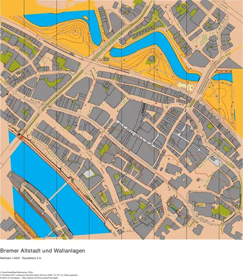</a> <a href="bremen-altstadt/bremen-altstadt-training.pdf">PDF</a> · <a href="bremen-altstadt/bremen-altstadt-candidates.pdf">Prüfausdruck</a> | Bremen | [Bremer Altstadt und Wallanlagen](bremen-altstadt/): die Altstadt zwischen Weser und Stadtgraben mit Marktplatz und Schlachte, die Wallanlagen mit der Mühle am Wall, gegenüber der Teerhof | 2248 | 650 | 39 |
| <a href="bayern-regensburg/preview.webp">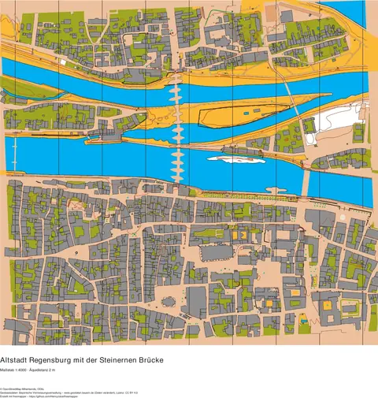</a> <a href="bayern-regensburg/bayern-regensburg-training.pdf">PDF</a> · <a href="bayern-regensburg/bayern-regensburg-candidates.pdf">Prüfausdruck</a> | Bayern | [Altstadt Regensburg mit der Steinernen Brücke](bayern-regensburg/): die Welterbe-Altstadt an der Donau mit Dom und Gassen, die Steinerne Brücke, die Wöhrde und Stadtamhof am anderen Ufer | 2770 | 498 | 39 |

## Waldkarten

Waldkarten (ISOM 2017-2) im Maßstab 1:10 000 für ein schnelles Training im Wald, für jedes Bundesland ein Gebiet.

| Vorschau | Bundesland | Gebiet | Kartenobjekte | Kandidaten | Symbole |
|---|---|---|---:|---:|---:|
|  <a href="brandenburg-rauener-berge/brandenburg-rauener-berge-training.pdf">PDF</a> · <a href="brandenburg-rauener-berge/brandenburg-rauener-berge-candidates.pdf">Prüfausdruck</a> | Brandenburg | [Rauener Berge und Markgrafensteine](brandenburg-rauener-berge/): Endmoränenhügel über dem Scharmützelsee mit den Markgrafensteinen, großen Findlingen | 189 | 39 | 21 |
| <a href="berlin-dammheide/preview.webp">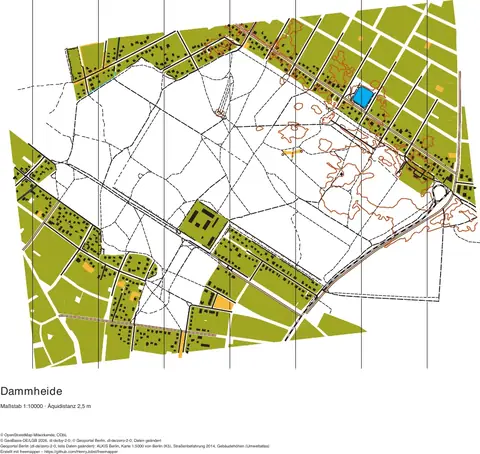</a> <a href="berlin-dammheide/berlin-dammheide-training.pdf">PDF</a> · <a href="berlin-dammheide/berlin-dammheide-candidates.pdf">Prüfausdruck</a> | Berlin | [Dammheide, Treptow-Köpenick](berlin-dammheide/): kleiner flacher Wald mit dichtem Wegenetz, Siedlungen rundherum | 918 | 183 | 27 |
| <a href="sachsen-bastei/preview.webp">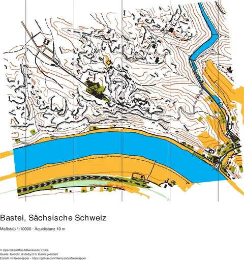</a> <a href="sachsen-bastei/sachsen-bastei-training.pdf">PDF</a> · <a href="sachsen-bastei/sachsen-bastei-candidates.pdf">Prüfausdruck</a> | Sachsen | [Bastei, Sächsische Schweiz](sachsen-bastei/): Sandsteinfelsen über der Elbe, mehr als 2000 Felswände aus OSM | 1052 | 3326 | 36 |
| <a href="sachsen-anhalt-bodetal/preview.webp">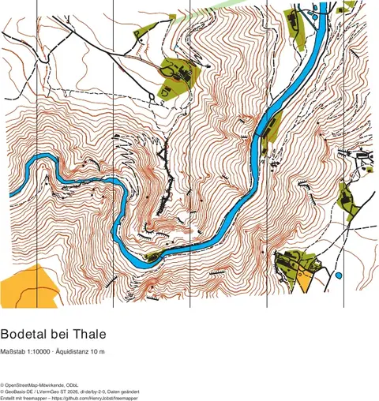</a> <a href="sachsen-anhalt-bodetal/sachsen-anhalt-bodetal-training.pdf">PDF</a> · <a href="sachsen-anhalt-bodetal/sachsen-anhalt-bodetal-candidates.pdf">Prüfausdruck</a> | Sachsen-Anhalt | [Bodetal bei Thale](sachsen-anhalt-bodetal/): das tief eingeschnittene Tal der Bode im Harz | 424 | 202 | 35 |
| <a href="hamburg-haake/preview.webp">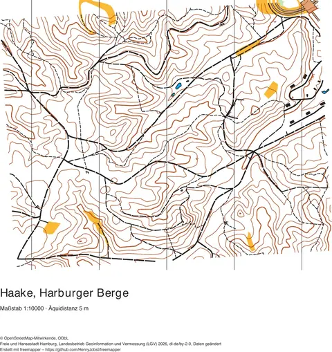</a> <a href="hamburg-haake/hamburg-haake-training.pdf">PDF</a> · <a href="hamburg-haake/hamburg-haake-candidates.pdf">Prüfausdruck</a> | Hamburg | [Haake, Harburger Berge](hamburg-haake/): hügeliger Wald mit dichtem Wegenetz | 218 | 38 | 23 |
| <a href="hessen-feldberg/preview.webp">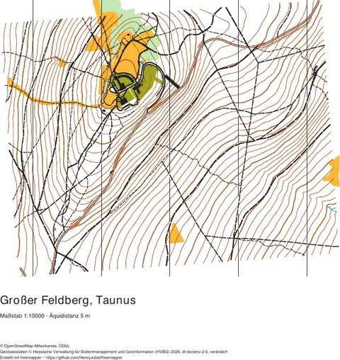</a> <a href="hessen-feldberg/hessen-feldberg-training.pdf">PDF</a> · <a href="hessen-feldberg/hessen-feldberg-candidates.pdf">Prüfausdruck</a> | Hessen | [Großer Feldberg, Taunus](hessen-feldberg/): Gipfel und Hänge des höchsten Taunusbergs | 235 | 47 | 29 |
|  <a href="schleswig-holstein-huettener-berge/schleswig-holstein-huettener-berge-training.pdf">PDF</a> · <a href="schleswig-holstein-huettener-berge/schleswig-holstein-huettener-berge-candidates.pdf">Prüfausdruck</a> | Schleswig-Holstein | [Hüttener Berge](schleswig-holstein-huettener-berge/): Endmoränenhügel mit Wald, offenem Land und kleinen Seen | 210 | 114 | 25 |
|  <a href="mecklenburg-vorpommern-granitz/mecklenburg-vorpommern-granitz-training.pdf">PDF</a> · <a href="mecklenburg-vorpommern-granitz/mecklenburg-vorpommern-granitz-candidates.pdf">Prüfausdruck</a> | Mecklenburg-Vorpommern | [Granitz, Rügen](mecklenburg-vorpommern-granitz/): Buchenwald um das Jagdschloss Granitz | 163 | 104 | 24 |
| <a href="nordrhein-westfalen-siebengebirge/preview.webp">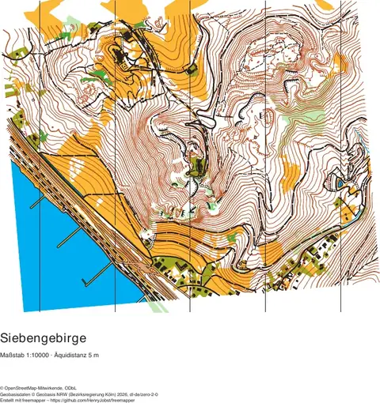</a> <a href="nordrhein-westfalen-siebengebirge/nordrhein-westfalen-siebengebirge-training.pdf">PDF</a> · <a href="nordrhein-westfalen-siebengebirge/nordrhein-westfalen-siebengebirge-candidates.pdf">Prüfausdruck</a> | Nordrhein-Westfalen | [Drachenfels, Siebengebirge](nordrhein-westfalen-siebengebirge/): Felsen, Weinberge und Wald am Rhein | 845 | 516 | 40 |
| <a href="niedersachsen-bad-harzburg/preview.webp">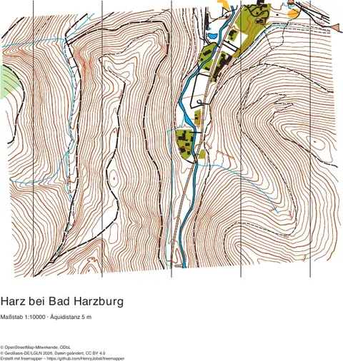</a> <a href="niedersachsen-bad-harzburg/niedersachsen-bad-harzburg-training.pdf">PDF</a> · <a href="niedersachsen-bad-harzburg/niedersachsen-bad-harzburg-candidates.pdf">Prüfausdruck</a> | Niedersachsen | [Harz bei Bad Harzburg](niedersachsen-bad-harzburg/): steile Hänge zu beiden Seiten eines Bachtals | 290 | 68 | 33 |
| <a href="rheinland-pfalz-dahn/preview.webp">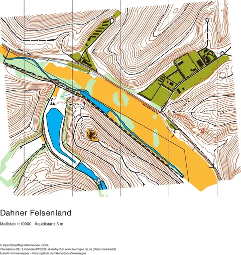</a> <a href="rheinland-pfalz-dahn/rheinland-pfalz-dahn-training.pdf">PDF</a> · <a href="rheinland-pfalz-dahn/rheinland-pfalz-dahn-candidates.pdf">Prüfausdruck</a> | Rheinland-Pfalz | [Dahner Felsenland](rheinland-pfalz-dahn/): Buntsandsteinfelsen im Pfälzerwald | 396 | 150 | 34 |
|  <a href="saarland-cloef/saarland-cloef-training.pdf">PDF</a> · <a href="saarland-cloef/saarland-cloef-candidates.pdf">Prüfausdruck</a> | Saarland | [Cloef an der Saarschleife](saarland-cloef/): Steilhang mit Felsen über der Saarschleife | 367 | 134 | 26 |
| <a href="baden-wuerttemberg-koenigstuhl/preview.webp">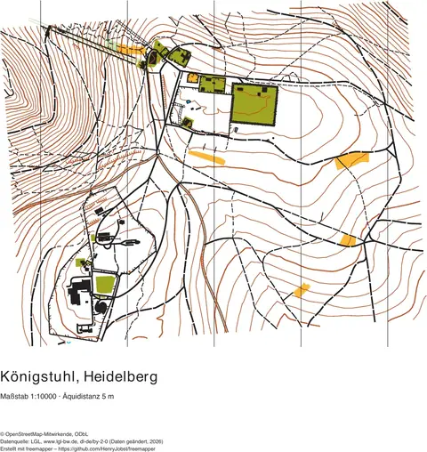</a> <a href="baden-wuerttemberg-koenigstuhl/baden-wuerttemberg-koenigstuhl-training.pdf">PDF</a> · <a href="baden-wuerttemberg-koenigstuhl/baden-wuerttemberg-koenigstuhl-candidates.pdf">Prüfausdruck</a> | Baden-Württemberg | [Königstuhl, Heidelberg](baden-wuerttemberg-koenigstuhl/): Hausberg von Heidelberg mit Sternwarte und vielen Wegen | 363 | 75 | 28 |
| <a href="bremen-buergerpark/preview.webp">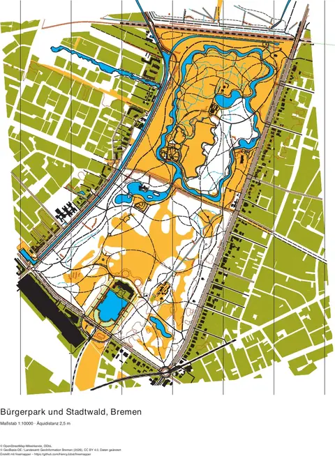</a> <a href="bremen-buergerpark/bremen-buergerpark-training.pdf">PDF</a> · <a href="bremen-buergerpark/bremen-buergerpark-candidates.pdf">Prüfausdruck</a> | Bremen | [Bürgerpark und Stadtwald](bremen-buergerpark/): flacher Park und Wald mit Gräben, Seen und dichtem Wegenetz | 1182 | 690 | 32 |
| <a href="bayern-schmausenbuck/preview.webp">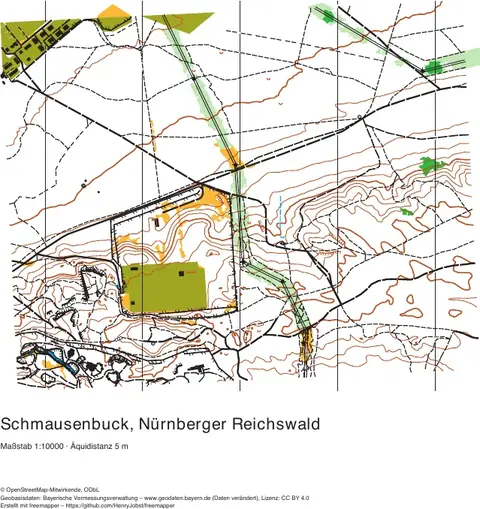</a> <a href="bayern-schmausenbuck/bayern-schmausenbuck-training.pdf">PDF</a> · <a href="bayern-schmausenbuck/bayern-schmausenbuck-candidates.pdf">Prüfausdruck</a> | Bayern | [Schmausenbuck, Nürnberger Reichswald](bayern-schmausenbuck/): Sandsteinhügel im Reichswald über dem Tiergarten, Hänge mit dichtem Wegenetz, zwei Stromtrassen | 372 | 165 | 37 |

## Mehr

- [Hintergrund](hintergrund.md): wie die Beispiele erzeugt wurden, was die Zahlen bedeuten, Dateien eines Beispiels, Auswahl der Gebiete und Lizenzen
- [Gegenüberstellung](vergleich.md): dasselbe Gebiet in den drei Inhaltsprofilen
- [Außerhalb Deutschlands](international.md): eine Sprint- und eine Waldkarte in Polen

Erstellt mit freemapper – https://github.com/HenryJobst/freemapper
