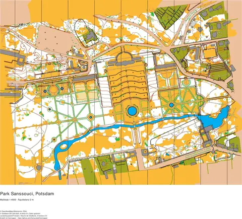
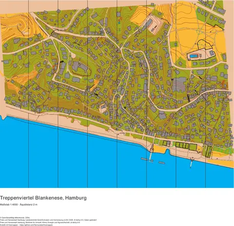
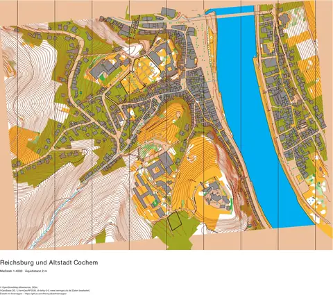
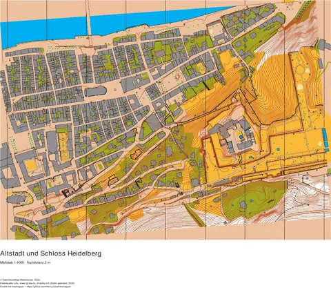
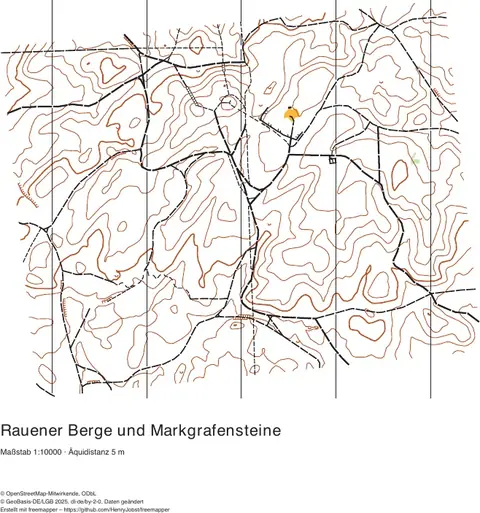
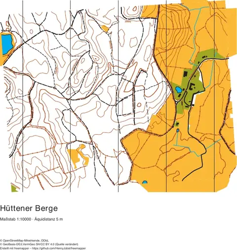
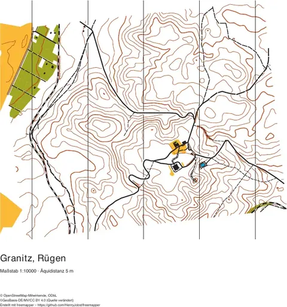
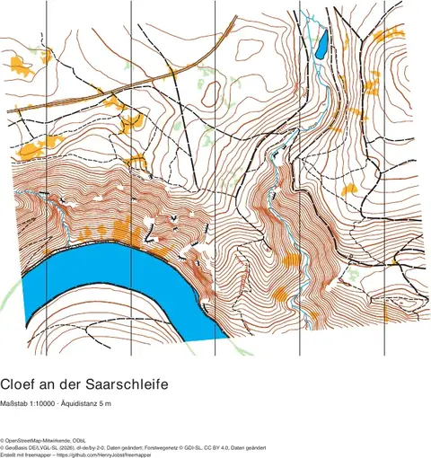

# Beispielprojekte

[English](README.en.md)

Für jedes unterstützte Bundesland gibt es ein Beispiel: ein Gebiet, aus dem freemapper besonders viel ableiten kann
(Altstadt, Schloss oder Park mit Relief, dichte Bebauung, Treppen, Mauern und Hecken). Alle Beispiele sind
Sprintkarten im Maßstab 1:4000 (ISSprOM 2019), erzeugt mit `freemapper run --pdf --pdf-candidates --ocad` und dem
Standard-Inhaltsprofil `balanced`; Sanssouci, Viktoriapark, Monschau, Cochem und Saarlouis zusätzlich mit
`--content-set vegetation=candidates`. Das PDF jedes Beispiels ist der Prüfausdruck mit allen Kandidaten, denn er zeigt,
was freemapper ableiten kann. Beim Viktoriapark zeigen Vorschau und PDF schon die Trainingskarte
(`--training`), daneben steht der Prüfausdruck; die übrigen Beispiele folgen. Die Karte allein zeigt weniger; dasselbe Gebiet in den drei Inhaltsprofilen zeigt die
[Gegenüberstellung](vergleich.md).

| Vorschau | Bundesland | Gebiet | Kartenobjekte | Kandidaten | Symbole |
|---|---|---|---:|---:|---:|
| <a href="brandenburg-sanssouci/preview.webp"></a><br><a href="brandenburg-sanssouci/brandenburg-sanssouci-candidates.pdf">PDF</a> | Brandenburg | [Park Sanssouci, Potsdam](brandenburg-sanssouci/): Weinbergterrassen, Parterres und Hecken, Schloss | 2493 | 773 | 38 |
| <a href="berlin-viktoriapark/preview.webp"></a><br><a href="berlin-viktoriapark/berlin-viktoriapark-training.pdf">PDF</a> · <a href="berlin-viktoriapark/berlin-viktoriapark-candidates.pdf">Prüfausdruck</a> | Berlin | [Viktoriapark, Kreuzberg](berlin-viktoriapark/): Kreuzberg mit Wasserfall, Gründerzeitblöcke | 3208 | 692 | 46 |
| <a href="sachsen-bautzen/preview.webp"></a><br><a href="sachsen-bautzen/sachsen-bautzen-candidates.pdf">PDF</a> | Sachsen | [Altstadt Bautzen](sachsen-bautzen/): Altstadt auf dem Felsen über der Spree, steile Talhänge | 2385 | 1049 | 39 |
| <a href="sachsen-anhalt-quedlinburg/preview.webp"></a><br><a href="sachsen-anhalt-quedlinburg/sachsen-anhalt-quedlinburg-candidates.pdf">PDF</a> | Sachsen-Anhalt | [Schlossberg Quedlinburg](sachsen-anhalt-quedlinburg/): Welterbe-Altstadt, Schlossberg, enge Gassen | 2812 | 638 | 39 |
| <a href="hamburg-blankenese/preview.webp"></a><br><a href="hamburg-blankenese/hamburg-blankenese-candidates.pdf">PDF</a> | Hamburg | [Treppenviertel Blankenese](hamburg-blankenese/): steiler Elbhang, Treppen und Gassen | 2480 | 1143 | 38 |
| <a href="hessen-marburg/preview.webp"></a><br><a href="hessen-marburg/hessen-marburg-candidates.pdf">PDF</a> | Hessen | [Altstadt und Landgrafenschloss Marburg](hessen-marburg/): steile Oberstadt mit Treppengassen, Schlossberg | 2883 | 1122 | 39 |
| <a href="schleswig-holstein-luebeck/preview.webp"></a><br><a href="schleswig-holstein-luebeck/schleswig-holstein-luebeck-candidates.pdf">PDF</a> | Schleswig-Holstein | [Altstadt Lübeck mit Holstentor](schleswig-holstein-luebeck/): mittelalterliche Altstadtinsel mit Gängen und Höfen | 3518 | 1868 | 35 |
| <a href="mecklenburg-vorpommern-wismar/preview.webp"></a><br><a href="mecklenburg-vorpommern-wismar/mecklenburg-vorpommern-wismar-candidates.pdf">PDF</a> | Mecklenburg-Vorpommern | [Altstadt Wismar](mecklenburg-vorpommern-wismar/): Welterbe-Altstadt mit Georgenkirche und Marktplatz | 4068 | 1659 | 39 |
| <a href="nordrhein-westfalen-monschau/preview.webp"></a><br><a href="nordrhein-westfalen-monschau/nordrhein-westfalen-monschau-candidates.pdf">PDF</a> | Nordrhein-Westfalen | [Altstadt Monschau](nordrhein-westfalen-monschau/): Fachwerk-Altstadt im tief eingeschnittenen Rurtal | 2042 | 1651 | 42 |
| <a href="niedersachsen-herrenhausen/preview.webp"></a><br><a href="niedersachsen-herrenhausen/niedersachsen-herrenhausen-candidates.pdf">PDF</a> | Niedersachsen | [Großer Garten Herrenhausen, Hannover](niedersachsen-herrenhausen/): Barockgarten mit Hecken, Parterres und Brunnenbecken, daneben der Georgengarten | 2350 | 336 | 38 |
| <a href="rheinland-pfalz-cochem/preview.webp"></a><br><a href="rheinland-pfalz-cochem/rheinland-pfalz-cochem-candidates.pdf">PDF</a> | Rheinland-Pfalz | [Reichsburg und Altstadt Cochem](rheinland-pfalz-cochem/): Burgberg mit der Reichsburg, Altstadt am steilen Moselufer, gegenüber Cond | 2435 | 1128 | 44 |
| <a href="saarland-saarlouis/preview.webp"></a><br><a href="saarland-saarlouis/saarland-saarlouis-candidates.pdf">PDF</a> | Saarland | [Altstadt und Festung Saarlouis](saarland-saarlouis/): die sechseckige Festungsstadt Vaubans, Saar-Altarm mit der Vauban-Insel, Wälle im Stadtgarten | 1627 | 721 | 40 |
| <a href="baden-wuerttemberg-heidelberg/preview.webp"></a><br><a href="baden-wuerttemberg-heidelberg/baden-wuerttemberg-heidelberg-candidates.pdf">PDF</a> | Baden-Württemberg | [Altstadt und Schloss Heidelberg](baden-wuerttemberg-heidelberg/): Altstadt am Neckar mit der Alten Brücke, das Schloss mit seinem Garten am steilen Hang des Königstuhls | 2473 | 1019 | 43 |
| <a href="bremen-altstadt/preview.webp"></a><br><a href="bremen-altstadt/bremen-altstadt-candidates.pdf">PDF</a> | Bremen | [Bremer Altstadt und Wallanlagen](bremen-altstadt/): die Altstadt zwischen Weser und Stadtgraben mit Marktplatz und Schlachte, die Wallanlagen mit der Mühle am Wall, gegenüber der Teerhof | 2399 | 551 | 39 |
| <a href="bayern-regensburg/preview.webp"></a><br><a href="bayern-regensburg/bayern-regensburg-candidates.pdf">PDF</a> | Bayern | [Altstadt Regensburg mit der Steinernen Brücke](bayern-regensburg/): die Welterbe-Altstadt an der Donau mit Dom und Gassen, die Steinerne Brücke, die Wöhrde und Stadtamhof am anderen Ufer | 2828 | 461 | 39 |

**Kartenobjekte** sind die Objekte der OOM-Karte. Mit `balanced` sind das die Objekte aus Kataster, Registern und
Straßenbefahrung (Gebäude, Straßen mit Bordsteinen, Gewässer, Parks, Wald, Überdachungen und Durchfahrten), dazu
Mauern, Zäune, Hecken, Bäume, Treppen und Wege auch aus OSM und die Höhenlinien. **Kandidaten** sind, was unsicher
bleibt, vor allem Sperrflächen (520) und Kontrollstandorte (531), dazu Böschungen, Felswände und Kuppen aus dem
Geländemodell (Gruppe `landforms`). Sie liegen als eigene Vorlage bei (`templates/candidates.omap`). Das PDF
`<name>-candidates.pdf` zeichnet sie mit; `<name>.pdf` aus `--pdf` zeigt nur die Kartenobjekte. Beide kommen aus OSM,
aus ALKIS und aus dem Geländemodell, in Berlin zusätzlich aus dem Geoportal Berlin, in Potsdam aus den Bäumen der
Stadtkarte. **Symbole** zählt die verschiedenen Symbole in beiden zusammen. Höhenlinien laufen wie in der ISSprOM
(101) durch Wege und befestigte Flächen und enden nur an Treppen, kleinen Geländeformen und unter Felsen;
Nordlinien enden an Wegen und zählen deshalb in Stücken.

Die Gruppe `vegetation` ist in jedem Profil aus, denn die Punktwolken sind groß. Fünf Beispiele schalten sie als
Kandidaten ein: Sanssouci, Viktoriapark, Monschau, Cochem und Saarlouis. Dort zeigt der Prüfausdruck, was die
Laserpunkte über den Bewuchs sagen: gut belaufbaren Wald (405) unter den Baumkronen, offenes Gelände (401) und die
Grünabstufungen 406, 408 und 410. In Sanssouci sind das 173 Waldflächen, 75 Flächen offenes Gelände und 205 grüne
Flächen, in Monschau 184, 196 und 638, in Cochem 126, 73 und 404, in Saarlouis 201, 71 und 125, im Viktoriapark 63,
50 und 107. Der Park wird dadurch weiß, wo Bäume stehen, und bleibt gelb, wo Wiese ist. Alle Befliegungen fanden
ohne Laub statt; die Grünabstufungen folgen dem, was zwischen 0,8 und 3 m steht (ADR 0138). In Sperrflächen (520) gibt es
keine Vegetation: Die Flächen enden an ihnen, ebenso an Gebäuden, Wasser und Pflasterflächen. Die Kartenobjekte
ändern sich durch die Gruppe nicht. Sachsen bietet zurzeit keine Punktwolken an, für die übrigen Bundesländer liest
freemapper noch keine.

Flüsse, Kanäle, Teiche und Hafenbecken aus ALKIS stehen als unpassierbares Gewässer (301.1) mit Uferlinie (301.6) in
der Karte. Teiche, Brunnen, Quellen und Bäche aus OSM kommen mit `balanced` ebenfalls in die Karte, Brücken aus OSM
bleiben Kandidaten. Im Wasser gibt es keine Höhenlinien und keine Brunnenpunkte, denn die wären meist Fontänen in
einem Becken. Wo ALKIS eine Brücke als Straßenfläche führt, endet das Gewässer an der Brücke mit einer Uferlinie
quer zum Fluss; diese Linie entfernen Sie in OOM.

Überdachungen und Carports aus ALKIS stehen in jedem Bundesland als 522 in der Karte, mit `balanced` auch die
Durchfahrten und Arkaden in Gebäuden. Nur Durchgänge, die niemand erreicht, bleiben Kandidaten. Lübeck hat 93
Überdachungen und 185 Durchfahrten und Arkaden aus ALKIS, Wismar 113 Überdachungen und Carports. In Sachsen und
Sachsen-Anhalt führt ALKIS weder Überdachungen noch Durchfahrten. Die Überdachungen dort kommen nur aus OSM, in
Bautzen 26, in Quedlinburg 15.

In Brandenburg lädt freemapper zusätzlich das vollständige ALKIS (NAS) der LGB. In Sanssouci ergibt das 270 Mauerlinien
(515), 107 Zäune (518), 133 Hecken (410.1) und 125 Böschungsoberkanten (104), mit `balanced` alle in der Karte.
ALKIS führt oft beide Kanten einer Mauer. Liegen sie näher als 0,55 mm auf dem Papier und einander zugewandt, macht
freemapper daraus eine Linie in der Mitte; in Sanssouci sind das 14 Mittellinien. Dickere Mauern und Kanten, die in
dieselbe Richtung schauen, bleiben doppelt; die zweite Linie löschen Sie in OOM. Hat OSM dieselbe Mauer, Hecke oder
denselben Zaun, bleibt nur die ALKIS-Linie und nennt die OSM-Linie in `freemapper:also`. Läuft eine Linie mit anderem
Symbol parallel und zu nah daneben, etwa eine OSM-Stützmauer auf einer Terrassenmauer oder ein Zaun neben einer Mauer,
verliert die schwächere Linie dieses Stück. Mauerstücke am Gebäudeumriss und Bäume bis 1 m neben einer Hecke, Mauer
oder einem Zaun fallen weg. So bleiben in Sanssouci nur wenige parallele Linienpaare unter 1 m Abstand. Die
Bäume der Stadtkarte Potsdam sind ein Baumkataster wie in Berlin. Von ihnen bleiben 773 als Punkt: 658 stehen in der
Karte, 115 liegen in Sperrflächen (520) und bleiben Kandidaten. Die übrigen liegen in Baumgruppenflächen oder fallen
beim Ausdünnen weg. OSM-Bäume näher als 2 m an einem Katasterbaum fallen weg.

In Berlin lädt freemapper weitere Ebenen aus dem Geoportal Berlin. Treppen, Mauern, Zäune, Böschungskanten, Denkmäler
und Durchfahrten kommen mit `balanced` in die Karte, ebenso die Bäume aus dem Baumkataster, im Viktoriapark 1926
Stück. Dazu kommt die Karte von Berlin 1:5000 (K5) als Vorlage `templates/k5.png`.

Dazu kommen die Straßenbefahrung (aufgenommen 2014 bis 2016), die Register für Beleuchtung, Zierbrunnen und
Trinkwasserbrunnen und die Gebäudehöhen aus dem Umweltatlas. Mit `balanced` stehen ihre Objekte in der Karte. Im
Viktoriapark sind das 76 Bordsteine (501.1), 75 vermessene befestigte Flächen (501.5) und fünf kleine Grünstreifen am
Bordstein, die freemapper aus einer ALKIS-Straßenfläche ausschneidet. Die Flächen sind fast alles Gehwege und die
befestigten Wege im Park. Dazu kommen Schutzgitter (518), Mauern (515), Wartehallen (522) sowie Straßenbrunnen und
Zierbrunnen (311). Litfaßsäulen und Laternen bleiben als Kontrollstandorte (531) Kandidaten. Liegt ein Schutzgitter der
Befahrung auf einem OSM-Zaun, bleibt nur das Gitter und nennt den Zaun in `freemapper:also`. Von den 602 Gebäuden
tragen 599 die Grundrissaktualität aus den Gebäudehöhen von 2022 als `freemapper:currency`.

Kleingärten sind in allen Bundesländern Kandidaten für verbotenes Gebiet (520). In Sanssouci betrifft das eine Anlage am
Nordrand, in Wismar und Herrenhausen je eine weitere Fläche.

Punktsymbole dürfen sich nicht berühren. Zwischen zwei Punkten bleiben mindestens 0,15 mm frei, sonst bleibt der
größere und nennt den anderen im Tag `freemapper:generalized`. Stehen drei oder mehr Bäume näher als 2,5 mm (10 m)
beieinander oder berühren sich ihre Kronen fast, macht freemapper daraus eine Fläche: Wald (405) ab 50 %
Kronendeckung, sonst offenes Gelände mit einzelnen Bäumen (402), auf Pflaster ab 9 Bäumen 501.3. Wege und Pflaster
bleiben frei. Baumreihen an Straßen und Alleen bleiben Punkte. In Sanssouci werden so 38 Flächen 402, denn die
Potsdamer Bäume kennen keine Krone, und 5 m Krone decken die Gruppen nicht zur Hälfte. Im Viktoriapark mit seinen
gemessenen Kronen werden es 42 Wälder 405 und 3 Flächen 402. Von den 1926 Katasterbäumen bleiben dort 1179 als
Punkt, die übrigen liegen in Baumgruppenflächen oder fallen beim Ausdünnen weg.

Parks sind gelbes offenes Gelände (401). Parks, Grünanlagen und Grünland aus ALKIS sind Kartenobjekte, in Sanssouci
27 Flächen, im Viktoriapark 5. Wald aus ALKIS wird 405, in Monschau 164 Flächen. Unter allem liegt die belaufbare
Fläche, eine braune Fläche über das ganze Blatt (Symbol 990, Kartenteil `base`). Sie füllt alles, was sonst nichts
zeigt. Punkte in einer Kandidatenfläche 520 zeichnet das PDF mit Kandidaten nicht, in der Vorlage tragen sie
`freemapper:hidden=520`.

Im Viktoriapark führen die Treppen am Sockel des Nationaldenkmals auf das Denkmal zu. Breite Treppen wie die
Tribünen am Stadion erscheinen als parallele Linien 532.9 mit dem Tag `freemapper:size=wide`. Zäune und Mauern, die
ALKIS und OSM beide haben, stehen nur einmal in der Karte: als ALKIS-Linie, die die OSM-Linie im Tag
`freemapper:also` nennt.

## Waldkarten

Für jedes Bundesland ein Beispiel der Kartenart `forest` (ISOM 2017-2) bei 1:10 000, für ein schnelles Training im
Wald:

| Vorschau | Bundesland | Gebiet | Kartenobjekte | Kandidaten | Symbole |
|---|---|---|---:|---:|---:|
| <a href="brandenburg-rauener-berge/preview.webp"></a><br><a href="brandenburg-rauener-berge/brandenburg-rauener-berge-candidates.pdf">PDF</a> | Brandenburg | [Rauener Berge und Markgrafensteine](brandenburg-rauener-berge/): Endmoränenhügel über dem Scharmützelsee mit den Markgrafensteinen, großen Findlingen | 241 | 38 | 21 |
| <a href="berlin-dammheide/preview.webp"></a><br><a href="berlin-dammheide/berlin-dammheide-candidates.pdf">PDF</a> | Berlin | [Dammheide, Treptow-Köpenick](berlin-dammheide/): kleiner flacher Wald mit dichtem Wegenetz, Siedlungen rundherum | 1093 | 166 | 27 |
| <a href="sachsen-bastei/preview.webp"></a><br><a href="sachsen-bastei/sachsen-bastei-candidates.pdf">PDF</a> | Sachsen | [Bastei, Sächsische Schweiz](sachsen-bastei/): Sandsteinfelsen über der Elbe, mehr als 2000 Felswände aus OSM | 1331 | 3158 | 36 |
| <a href="sachsen-anhalt-bodetal/preview.webp"></a><br><a href="sachsen-anhalt-bodetal/sachsen-anhalt-bodetal-candidates.pdf">PDF</a> | Sachsen-Anhalt | [Bodetal bei Thale](sachsen-anhalt-bodetal/): das tief eingeschnittene Tal der Bode im Harz | 536 | 168 | 35 |
| <a href="hamburg-haake/preview.webp"></a><br><a href="hamburg-haake/hamburg-haake-candidates.pdf">PDF</a> | Hamburg | [Haake, Harburger Berge](hamburg-haake/): hügeliger Wald mit dichtem Wegenetz | 254 | 33 | 23 |
| <a href="hessen-feldberg/preview.webp"></a><br><a href="hessen-feldberg/hessen-feldberg-candidates.pdf">PDF</a> | Hessen | [Großer Feldberg, Taunus](hessen-feldberg/): Gipfel und Hänge des höchsten Taunusbergs | 302 | 43 | 29 |
| <a href="schleswig-holstein-huettener-berge/preview.webp"></a><br><a href="schleswig-holstein-huettener-berge/schleswig-holstein-huettener-berge-candidates.pdf">PDF</a> | Schleswig-Holstein | [Hüttener Berge](schleswig-holstein-huettener-berge/): Endmoränenhügel mit Wald, offenem Land und kleinen Seen | 225 | 112 | 25 |
| <a href="mecklenburg-vorpommern-granitz/preview.webp"></a><br><a href="mecklenburg-vorpommern-granitz/mecklenburg-vorpommern-granitz-candidates.pdf">PDF</a> | Mecklenburg-Vorpommern | [Granitz, Rügen](mecklenburg-vorpommern-granitz/): Buchenwald um das Jagdschloss Granitz | 188 | 101 | 24 |
| <a href="nordrhein-westfalen-siebengebirge/preview.webp"></a><br><a href="nordrhein-westfalen-siebengebirge/nordrhein-westfalen-siebengebirge-candidates.pdf">PDF</a> | Nordrhein-Westfalen | [Drachenfels, Siebengebirge](nordrhein-westfalen-siebengebirge/): Felsen, Weinberge und Wald am Rhein | 1041 | 328 | 40 |
| <a href="niedersachsen-bad-harzburg/preview.webp"></a><br><a href="niedersachsen-bad-harzburg/niedersachsen-bad-harzburg-candidates.pdf">PDF</a> | Niedersachsen | [Harz bei Bad Harzburg](niedersachsen-bad-harzburg/): steile Hänge zu beiden Seiten eines Bachtals | 398 | 51 | 33 |
| <a href="rheinland-pfalz-dahn/preview.webp"></a><br><a href="rheinland-pfalz-dahn/rheinland-pfalz-dahn-candidates.pdf">PDF</a> | Rheinland-Pfalz | [Dahner Felsenland](rheinland-pfalz-dahn/): Buntsandsteinfelsen im Pfälzerwald | 484 | 124 | 34 |
| <a href="saarland-cloef/preview.webp"></a><br><a href="saarland-cloef/saarland-cloef-candidates.pdf">PDF</a> | Saarland | [Cloef an der Saarschleife](saarland-cloef/): Steilhang mit Felsen über der Saarschleife | 393 | 132 | 26 |
| <a href="baden-wuerttemberg-koenigstuhl/preview.webp"></a><br><a href="baden-wuerttemberg-koenigstuhl/baden-wuerttemberg-koenigstuhl-candidates.pdf">PDF</a> | Baden-Württemberg | [Königstuhl, Heidelberg](baden-wuerttemberg-koenigstuhl/): Hausberg von Heidelberg mit Sternwarte und vielen Wegen | 499 | 47 | 28 |
| <a href="bremen-buergerpark/preview.webp"></a><br><a href="bremen-buergerpark/bremen-buergerpark-candidates.pdf">PDF</a> | Bremen | [Bürgerpark und Stadtwald](bremen-buergerpark/): flacher Park und Wald mit Gräben, Seen und dichtem Wegenetz | 1792 | 420 | 32 |
| <a href="bayern-schmausenbuck/preview.webp"></a><br><a href="bayern-schmausenbuck/bayern-schmausenbuck-candidates.pdf">PDF</a> | Bayern | [Schmausenbuck, Nürnberger Reichswald](bayern-schmausenbuck/): Sandsteinhügel im Reichswald über dem Tiergarten, Hänge mit dichtem Wegenetz, zwei Stromtrassen | 437 | 140 | 37 |

Die Gebiete sind etwa 1,2 × 0,9 km groß und nach Relief und Wegenetz ausgewählt.
Erzeugt mit `freemapper init <ordner> --geojson <rechteck> --kind forest --scale 10000 --title "<Titel>"` und
`run --pdf-candidates --ocad`. Berlin und Bremen nehmen den Umriss aus OSM (`--osm relation/4513841` für die
Dammheide, `--osm way/664446849` für den Bürgerpark). In Brandenburg, Nordrhein-Westfalen, im Saarland und in
Bayern kam `--content-set vegetation=candidates` dazu: Die Vegetation aus Laserpunktwolken liegt dort in der
Kandidatenkarte. In Rheinland-Pfalz fehlt sie, weil die Metalink-Datei des Landesamts für die Kacheln bei Dahn
andere Größen und Prüfsummen nennt als die Dateien auf dem Server (Stand November 2026). Am Schmausenbuck lädt
freemapper dafür vier Kacheln mit zusammen 1,2 GB. Der Flug vom 20.12.2021 war ohne Laub. Der Streifen unter den
Stromtrassen erscheint überwiegend als offenes Gelände, seine Ränder als 406. Es bleiben 29 Vegetationskandidaten,
19 davon offenes Gelände (401), je 4 Flächen 406 und 410 und 2 Flächen 405.

Die Wege kommen aus OSM und stehen in den Wegklassen 502 bis 507 in der Karte; der Wald ist weißes Papier.
Siedlungen und Gärten sind olivgrün (520, nicht zu betreten). Felsen, Böschungen und Kuppen aus dem Geländemodell
sind Kandidaten; Felswände aus OSM (`natural=cliff`) stehen in der Karte, generalisiert und geglättet nach der ISOM
(ADR 0126): An der Bastei bleiben von 2144 Wänden 256 mit Zacken, 23 Oberkanten (201.3) und 26 Felstürme und -rippen
(206); die übrigen sind Kandidaten, die der Prüfausdruck alle zeichnet. Die Trainingskarte (`--training`) generalisiert sie stärker. In den flachen Gebieten in Berlin und Bremen liegen
die Höhenlinien alle 2,5 m, im steilen Bodetal und an der Bastei alle 10 m (`--contour-interval 10`, mehr als die 5
m der ISOM, damit die Hänge lesbar bleiben), sonst alle 5 m; die `freemapper.toml` nennt das als `[contours]
interval_m`.

## Inhalt eines Beispiels

| Datei | Inhalt |
|---|---|
| `<name>.omap` | das OOM-Startprojekt (OpenOrienteering Mapper) |
| `templates/candidates.omap` | die Kandidaten als Vorlage |
| `ocad/<name>.ocd`, `ocad/<name>-candidates.ocd` | der OCAD-Ausgangsstand (OCAD 12) |
| `<name>-candidates.pdf` | der Prüfausdruck: Kartenobjekte und alle Kandidaten, lagetreu, ohne Maßstabsleiste |
| `preview.webp` | Vorschau dieses PDFs |
| `preview-thumb.webp` | kleine Fassung der Vorschau für diese Übersicht, erzeugt mit `scripts/thumbnails.sh` |
| `<name>.pdf`, `<name>-safe.pdf`, `<name>-full.pdf`, `preview-safe.webp`, `preview-balanced.webp`, `preview-full.webp` | nur in Cochem: dasselbe Gebiet in den drei Inhaltsprofilen, ohne Kandidaten, und die Vorschauen, siehe [Gegenüberstellung](vergleich.md) |
| `freemapper.toml` | das Projekt: Gebiet, Maßstab und die abgerufenen Datenstände |
| `ATTRIBUTION.txt` | die Namensnennung der Datenquellen |
| `permits.md`, `permits.json` | die Hinweise zu Genehmigungen: Verwaltung, Schutzgebiete, Betreiber, klassifizierte Straßen und, wo das Bundesland eigene Dienste hat, Bezirk, Forstverwaltung, Wasserschutzgebiete und Waldfunktionen (erzeugt mit `freemapper permits` am 14. November 2026; ein Hinweis, keine Rechtsauskunft) |

Die Raster-Vorlagen (Luftbild, Schummerung, Hangneigung, nDOM, in Berlin die K5) und die Rohdaten (`data/`) sind
nicht im Repository, weil sie pro Beispiel über 20 MB groß sind. So holen Sie sie zurück:

```sh
freemapper run --ocad --pdf --pdf-candidates examples/sachsen-anhalt-quedlinburg
```

freemapper lädt die Daten erneut, berechnet die Vorlagen und behält die vorhandenen Karten (`.omap`, `.ocd`)
unverändert. Danach öffnet sich die Karte in OOM und OCAD mit allen Vorlagen. `--pdf` schreibt zusätzlich die Karte ohne Kandidaten.

## Wie die Gebiete ausgewählt wurden

Für jedes Bundesland wurden fünf bis sechs Kandidaten als Sprintkarte erzeugt, darunter Parks, Schulen, Altstädte und
Schlossanlagen. Gezählt wurden die verschiedenen Symbole und die Objekte; die besten zwei bis drei Gebiete jedes
Bundeslandes wurden dann am PDF mit allen Kandidaten verglichen. Gewonnen haben die Gebiete, die das meiste zeigen:
abwechslungsreiche Bebauung, Relief und viele OSM-Kandidaten.

In Niedersachsen hat der Große Garten gewonnen, obwohl seine Karte vor den Inhaltsprofilen die wenigsten
Kartenobjekte hatte. Seine Hecken, Parterres, Baumreihen und Fontänen ergaben die meisten Kandidaten je Kartenobjekt.
Mit `balanced` stehen sie in der Karte, darunter 368 Hecken (410.1), 1124 Bäume (418) und 17 Brunnen (311), und es
bleiben 336 Kandidaten.

In Rheinland-Pfalz liefen acht Rechtecke: Koblenz am Deutschen Eck, Trier, Speyer, Mainz, Bad Kreuznach und Cochem.
Bad Kreuznach und Cochem liefen zweimal, denn das erste Rechteck in Bad Kreuznach verfehlte die Nahe, das in Cochem
die Reichsburg. Speyer und Cochem kamen auf je 24 Symbole. Cochem hat gewonnen, weil nur dieses Gebiet starkes Relief
zeigt: dichte Höhenlinien am Burgberg und an den Talhängen, dazu die Mosel und die enge Altstadt. Speyer ist flach.
Koblenz zeigt Rhein und Mosel am Deutschen Eck, kam aber nur auf 23 Symbole und hat kaum Relief.

Im Saarland liefen zwei Rechtecke, beide in Saarlouis. Das zweite liegt 180 m weiter westlich und nimmt die
Vauban-Insel im Saar-Altarm und die Wälle im Stadtgarten mit. Saarlouis war das erste Beispiel mit dem
Inhaltsprofil `balanced`, das die Objekte aus Kataster und Registern gleich in die Karte zeichnet. Seine Karte hat
31 Symbole, darunter 21 Treppen aus OpenStreetMap, und es bleiben 721 Kandidaten, die meisten davon Vegetation.
Seit die Nutzungsarten des Saarlands in beiden Schreibweisen gelesen werden, stehen 118 Straßenflächen und die Saar
aus ALKIS in der Karte. Inzwischen sind alle Beispiele mit diesem Profil neu gebaut.

In Baden-Württemberg liefen drei Rechtecke: Heidelberg, die Freiburger Altstadt mit dem Schlossberg und die Tübinger
Altstadt mit Schloss und Neckarinsel. Tübingen hatte die meisten Kartenobjekte (3910), Heidelberg die meisten Symbole
in der Karte (40) und die meisten Kandidaten (903). Heidelberg hat gewonnen, weil sein Gebiet am meisten Verschiedenes
zeigt: das Schloss mit Terrassen und Garten am steilen Hang, darunter die dichte Altstadt und der Neckar.

In Bremen liefen vier Rechtecke: die Altstadt mit den Wallanlagen, die Universität, der Bürgerpark und die
Havenwelten in Bremerhaven. Die Universität hatte die meisten Symbole (44 mit den Kandidaten), die Altstadt die
meisten Kartenobjekte (2498) und Kandidaten (534). Die Altstadt hat gewonnen: Stadtgraben und Weser, der Wall als
Park mit Höhenlinien und die dichte Bebauung stehen auf einem Blatt, und 64 Treppen, 13 Stützmauern und
16 Böschungsoberkanten kommen aus dem vollständigen ALKIS, das sonst nur Brandenburg hat.

In Bayern lief für die Sprintkarte ein Rechteck, die Regensburger Altstadt. Donauarme und Wöhrde, die Steinerne
Brücke und die dichte Bebauung stehen auf einem Blatt. Bayern hat keinen Dienst für sein Kataster; die 1821 Gebäude
und 144 Überdachungen kommen aus den LoD2-Kacheln, die Nutzung aus der Datei der Stadt Regensburg. Das Gebiet liegt
östlich von 12° O und steht wie ganz Bayern in der UTM-Zone 32. Für die Waldkarte liefen zwei Rechtecke am
Schmausenbuck; das südliche bestand zur Hälfte aus dem Tiergarten. Aus dem Landschaftsmodell der
Vermessungsverwaltung (ATKIS Basis-DLM) kommen in Regensburg 8 Kandidaten dazu: 3 Brunnen, ein Denkmal, 2 benannte
Bäume und 2 Wasserläufe; 2 weitere Brunnen stehen in Becken, die OpenStreetMap schon zeichnet. Am Schmausenbuck sind es 14: Zäune und 6 Wege, die OpenStreetMap fehlen. An den
Stoßstellen verbunden, sind die Wege des Modells 61 Linien; die übrigen 55 hat OpenStreetMap schon.

## Lizenzen

Die Karten enthalten abgeleitete amtliche Geodaten und OpenStreetMap-Daten. Die Namensnennung steht in jeder
`ATTRIBUTION.txt`, in den Randangaben der PDFs und in den Kartennotizen:

- OpenStreetMap: © OpenStreetMap-Mitwirkende, ODbL;
- Brandenburg: © GeoBasis-DE/LGB, dl-de/by-2-0; Potsdam: Landeshauptstadt Potsdam / Bäume der Stadtkarte, dl-de/zero-2-0; Berlin: © Geoportal Berlin, dl-de/zero-2-0;
- Sachsen: GeoSN, dl-de/by-2-0; Sachsen-Anhalt: © GeoBasis-DE / LVermGeo ST, dl-de/by-2-0;
- Hamburg: Freie und Hansestadt Hamburg, LGV, dl-de/by-2-0; Hessen: © HVBG, dl-de/zero-2-0; Schleswig-Holstein: © GeoBasis-DE/LVermGeo SH, CC BY 4.0; Mecklenburg-Vorpommern: ©GeoBasis-DE/MV/CC BY 4.0 (Quelle verändert); Nordrhein-Westfalen: © Geobasis NRW, dl-de/zero-2-0; Niedersachsen: © GeoBasis-DE/LGLN, Daten geändert, CC BY 4.0; Rheinland-Pfalz: ©GeoBasis-DE / LVermGeoRP, dl-de/by-2-0, [Daten bearbeitet]; Saarland: © GeoBasis DE/LVGL-SL, dl-de/by-2-0, Daten geändert; Baden-Württemberg: Datenquelle: LGL, www.lgl-bw.de, dl-de/by-2-0, Daten geändert; Bremen: © GeoBasis-DE / Landesamt GeoInformation Bremen, CC BY 4.0, Daten geändert; Bayern: Geobasisdaten: Bayerische Vermessungsverwaltung – www.geodaten.bayern.de (Daten verändert), Lizenz: CC BY 4.0.

Erstellt mit freemapper – https://github.com/HenryJobst/freemapper
