# Beispielprojekte

[English](README.en.md)

Für jedes unterstützte Bundesland gibt es ein Beispiel: ein Gebiet, aus dem freemapper besonders viel ableiten kann
(Altstadt, Schloss oder Park mit Relief, dichte Bebauung, Treppen, Mauern und Hecken). Alle Beispiele sind
Sprintkarten im Maßstab 1:4000 (ISSprOM 2019), erzeugt mit `freemapper run --pdf --ocad`.

| Land | Gebiet | Kartenobjekte | Kandidaten | Symbole | Vorschau |
|---|---|---:|---:|---:|---|
| Brandenburg | [Park Sanssouci, Potsdam](brandenburg-sanssouci/): Weinbergterrassen, Parterres und Hecken, Schloss | 435 | 805 | 22 | <a href="brandenburg-sanssouci/brandenburg-sanssouci.pdf">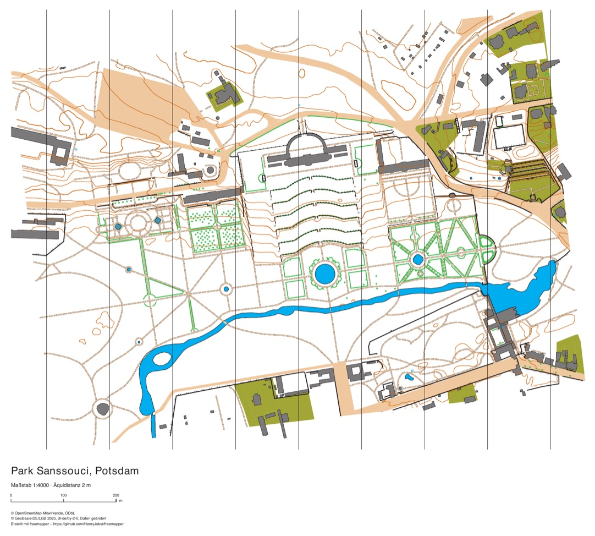</a> |
| Berlin | [Viktoriapark, Kreuzberg](berlin-viktoriapark/): Kreuzberg mit Wasserfall, Gründerzeitblöcke | 783 | 2851 | 31 | <a href="berlin-viktoriapark/berlin-viktoriapark.pdf">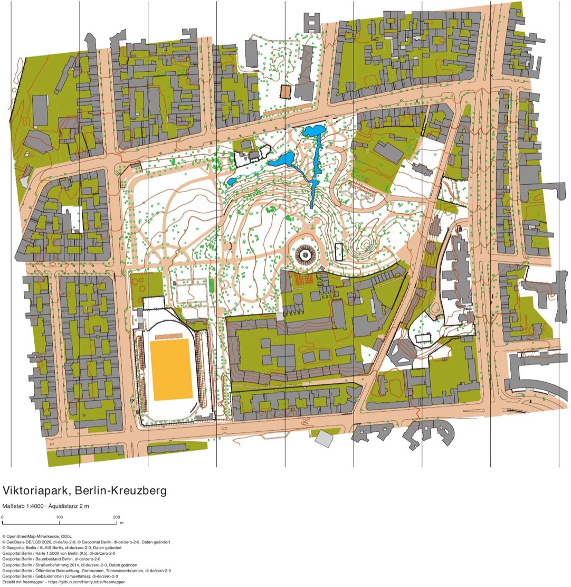</a> |
| Sachsen | [Altstadt Bautzen](sachsen-bautzen/): Altstadt auf dem Felsen über der Spree, steile Talhänge | 1219 | 1220 | 25 | <a href="sachsen-bautzen/sachsen-bautzen.pdf">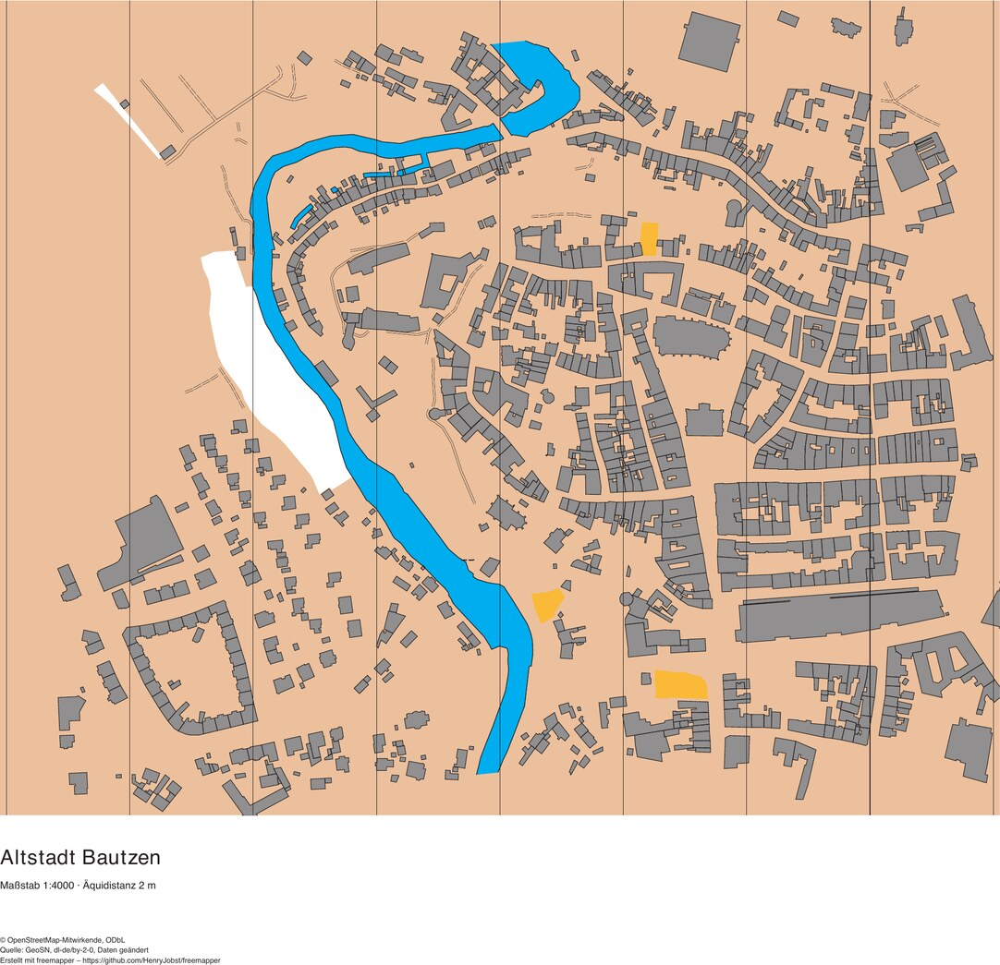</a> |
| Sachsen-Anhalt | [Schlossberg Quedlinburg](sachsen-anhalt-quedlinburg/): Welterbe-Altstadt, Schlossberg, enge Gassen | 1605 | 1006 | 25 | <a href="sachsen-anhalt-quedlinburg/sachsen-anhalt-quedlinburg.pdf">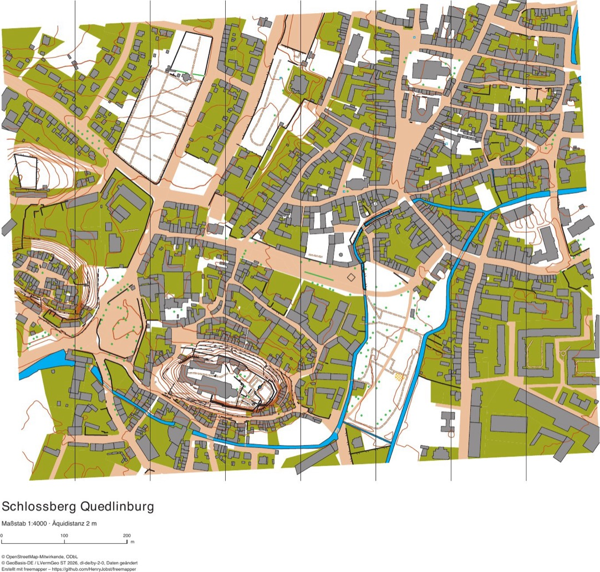</a> |
| Hamburg | [Treppenviertel Blankenese](hamburg-blankenese/): steiler Elbhang, Treppen und Gassen | 946 | 930 | 21 | <a href="hamburg-blankenese/hamburg-blankenese.pdf">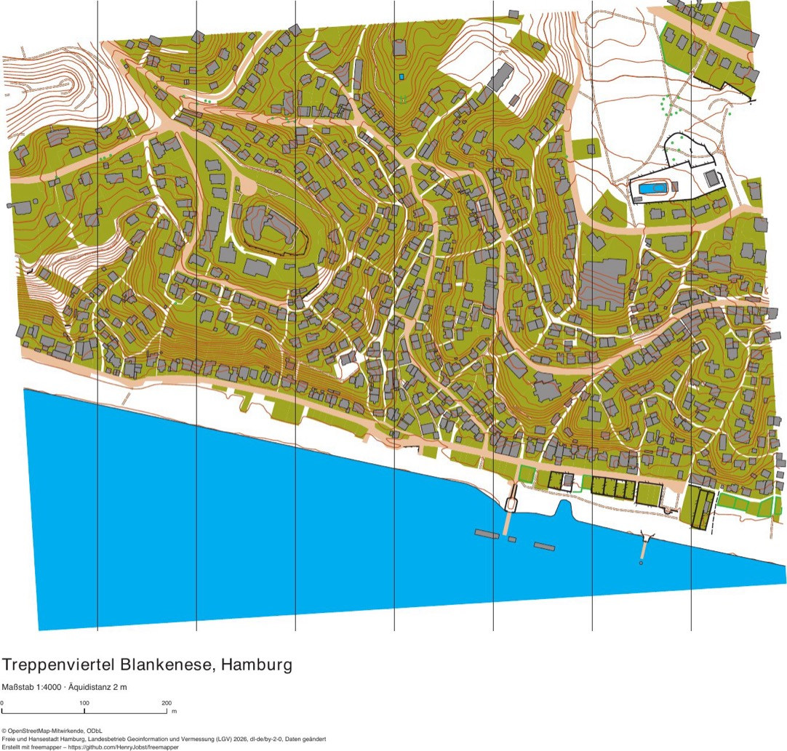</a> |
| Hessen | [Altstadt und Landgrafenschloss Marburg](hessen-marburg/): steile Oberstadt mit Treppengassen, Schlossberg | 1520 | 858 | 24 | <a href="hessen-marburg/hessen-marburg.pdf">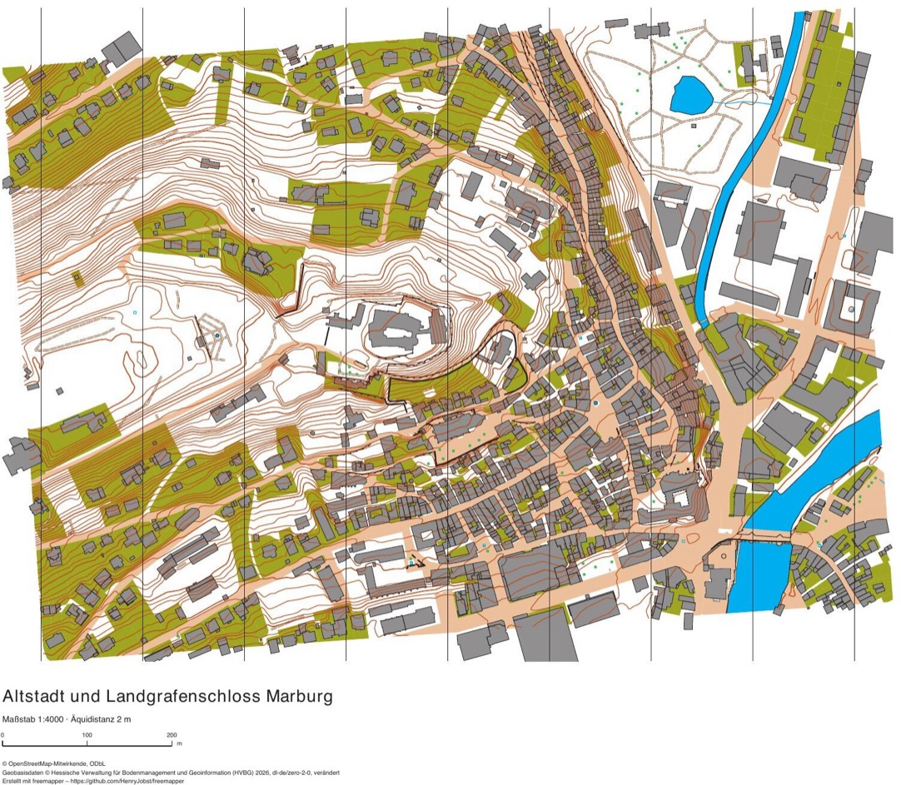</a> |
| Schleswig-Holstein | [Altstadt Lübeck mit Holstentor](schleswig-holstein-luebeck/): mittelalterliche Altstadtinsel mit Gängen und Höfen | 2173 | 1358 | 24 | <a href="schleswig-holstein-luebeck/schleswig-holstein-luebeck.pdf">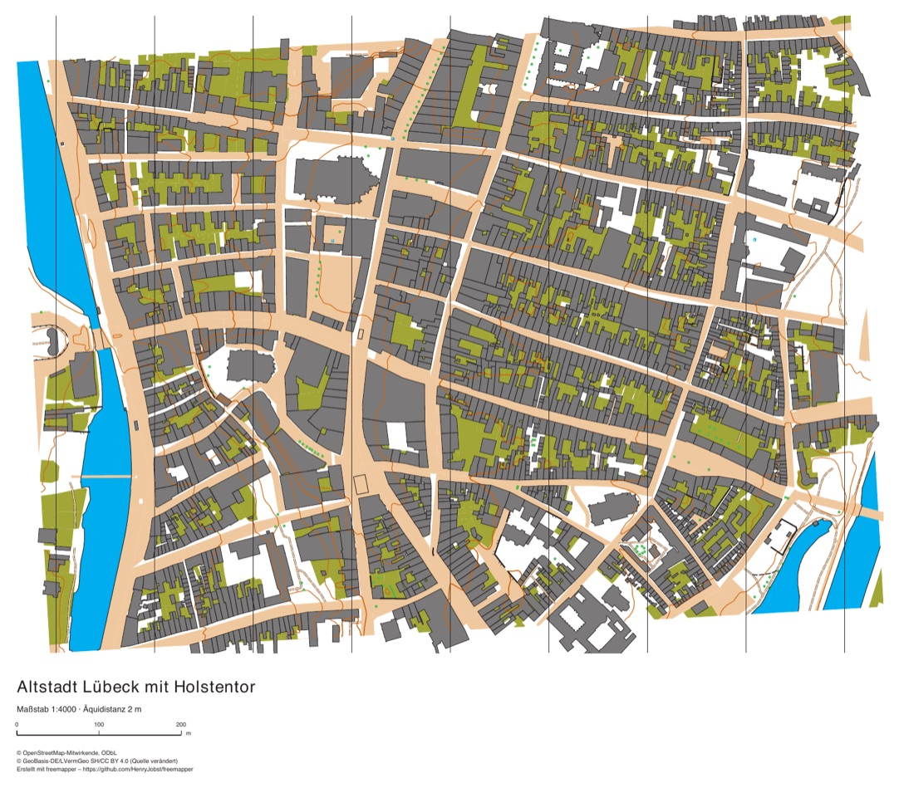</a> |
| Mecklenburg-Vorpommern | [Altstadt Wismar](mecklenburg-vorpommern-wismar/): Welterbe-Altstadt mit Georgenkirche und Marktplatz | 2342 | 1563 | 22 | <a href="mecklenburg-vorpommern-wismar/mecklenburg-vorpommern-wismar.pdf">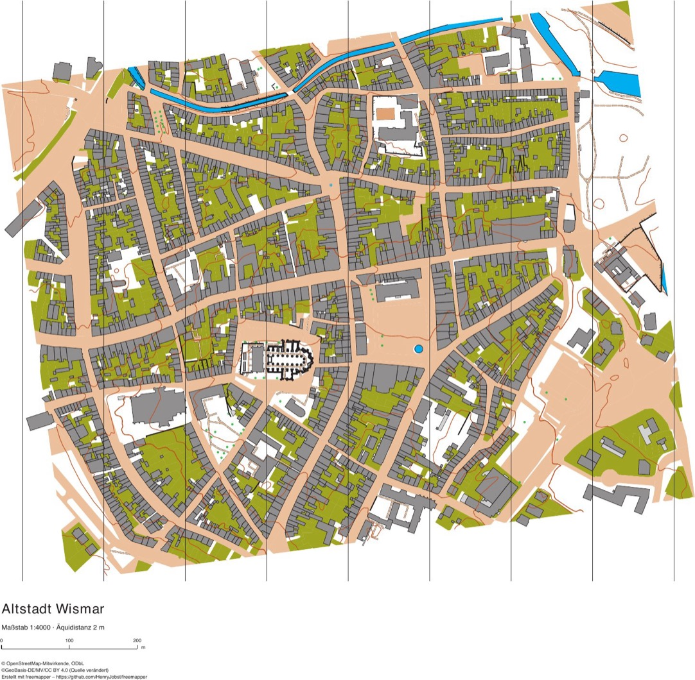</a> |
| Nordrhein-Westfalen | [Altstadt Monschau](nordrhein-westfalen-monschau/): Fachwerk-Altstadt im tief eingeschnittenen Rurtal | 761 | 802 | 24 | <a href="nordrhein-westfalen-monschau/nordrhein-westfalen-monschau.pdf">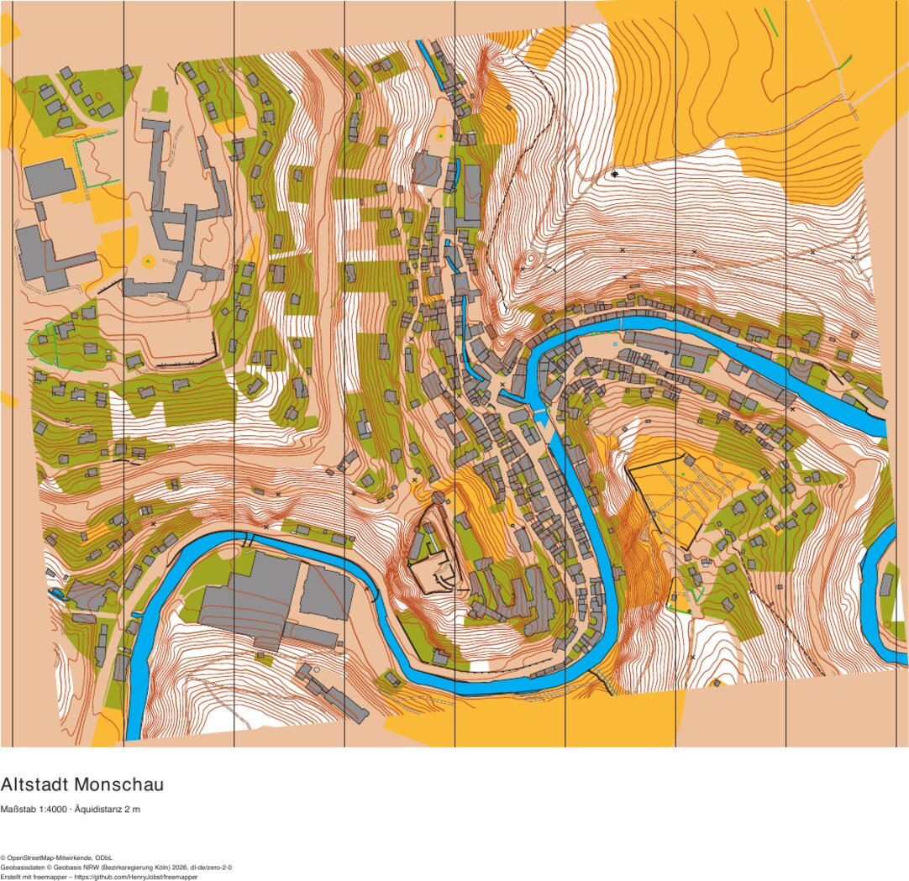</a> |
| Niedersachsen | [Großer Garten Herrenhausen, Hannover](niedersachsen-herrenhausen/): Barockgarten mit Hecken, Parterres und Brunnenbecken, daneben der Georgengarten | 222 | 2252 | 24 | <a href="niedersachsen-herrenhausen/niedersachsen-herrenhausen.pdf">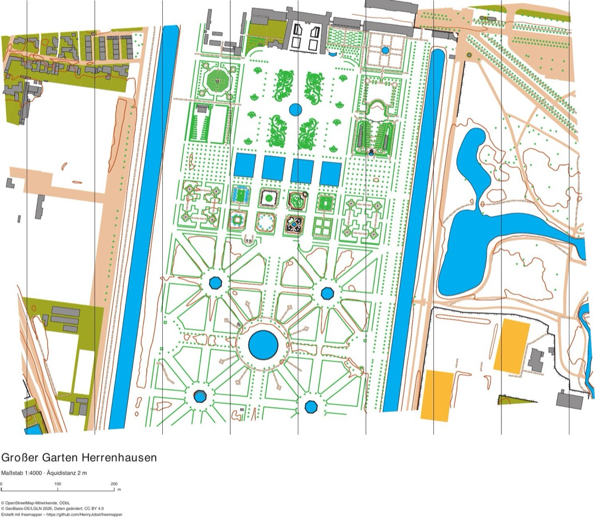</a> |
| Rheinland-Pfalz | [Reichsburg und Altstadt Cochem](rheinland-pfalz-cochem/): Burgberg mit der Reichsburg, Altstadt am steilen Moselufer, gegenüber Cond | 1233 | 751 | 24 | <a href="rheinland-pfalz-cochem/rheinland-pfalz-cochem.pdf">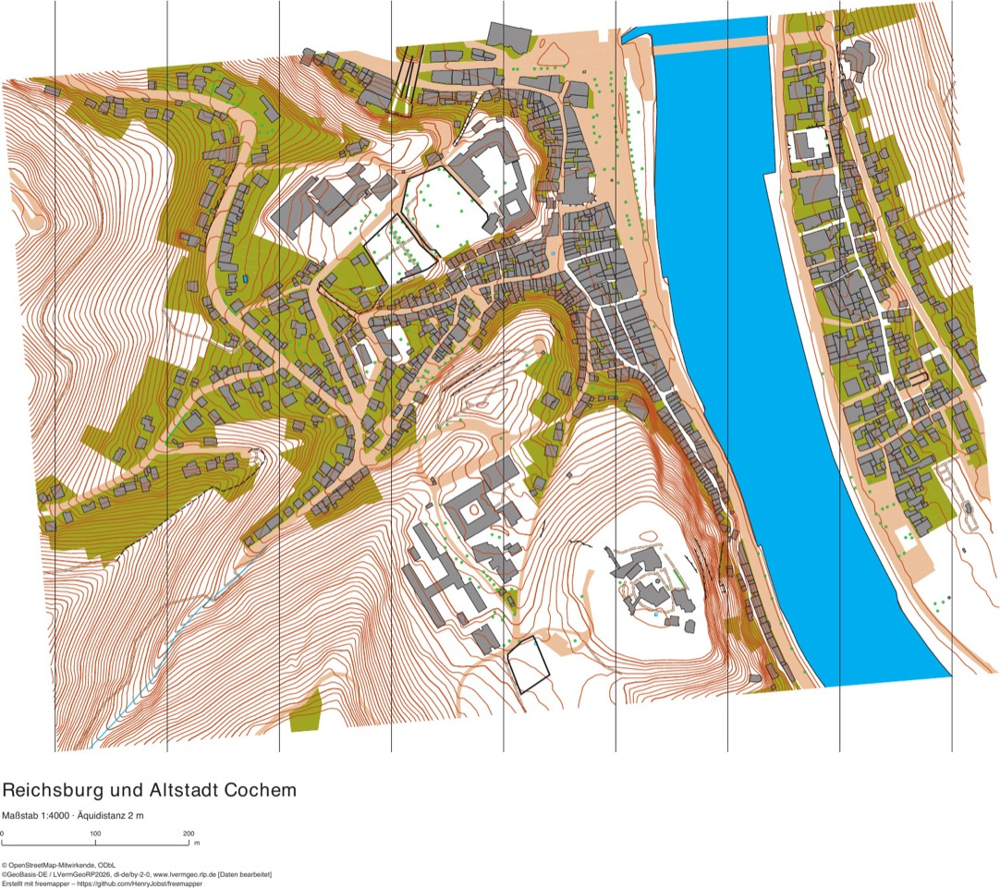</a> |

**Kartenobjekte** sind die sicheren Objekte der OOM-Karte (ALKIS-Gebäude, -Flächen und -Gewässer, in Berlin auch die
Überdachungen). **Kandidaten** liegen als eigene Vorlage bei (`templates/candidates.omap`); im PDF sind sie
mitgezeichnet. Sie kommen aus OSM, aus ALKIS und aus dem Geländemodell, in Berlin zusätzlich aus dem Geoportal Berlin.
**Symbole** zählt die verschiedenen Symbole in beiden zusammen.

Flüsse, Kanäle, Teiche und Hafenbecken aus ALKIS stehen als unpassierbares Gewässer (301.1) mit Uferlinie (301.6) in
der Karte. Teiche, Brunnen, Quellen, Bäche und Brücken aus OSM sind Kandidaten. Im Wasser gibt es keine Höhenlinien
und keine Brunnenpunkte, denn die wären meist Fontänen in einem Becken. Wo ALKIS eine Brücke als
Straßenfläche führt, endet das Gewässer an der Brücke mit einer Uferlinie quer zum Fluss; diese Linie entfernen Sie
in OOM.

In Berlin lädt freemapper weitere Ebenen aus dem Geoportal Berlin. Überdachungen und Carports aus ALKIS stehen als 522
in der Karte. Treppen, Mauern, Zäune, Böschungskanten, Denkmäler und Durchfahrten sind Kandidaten, ebenso die Bäume
aus dem Baumkataster. Im Viktoriapark sind das allein 1926 Bäume. Dazu kommt die Karte von Berlin 1:5000 (K5) als
Vorlage `templates/k5.png`.

Dazu kommen die Straßenbefahrung (aufgenommen 2014 bis 2016), die Register für Beleuchtung, Zierbrunnen und
Trinkwasserbrunnen und die Gebäudehöhen aus dem Umweltatlas. Die Karte selbst ändert sich dadurch kaum. Im
Viktoriapark schneidet freemapper nur fünf kleine Grünstreifen am Bordstein aus einer ALKIS-Straßenfläche aus. Bei den
Kandidaten kommen 81 Bordsteine (501.1) und 73 vermessene befestigte Flächen (501.5) hinzu. Das sind fast alles Gehwege
und die befestigten Wege im Park, die das PDF jetzt zeigt. Neu sind außerdem Schutzgitter (518), Mauern (515),
Wartehallen (522), Litfaßsäulen (531) sowie Straßenbrunnen und Zierbrunnen (311). Liegt ein Schutzgitter der
Befahrung auf einem OSM-Zaun, bleibt nur das Gitter und nennt den Zaun in `freemapper:also`. Von den 602 Gebäuden
tragen 599 die Grundrissaktualität aus den Gebäudehöhen von 2022 als `freemapper:currency`.

Kleingärten sind in allen Ländern Kandidaten für verbotenes Gebiet (520). In Sanssouci betrifft das eine Anlage am
Nordrand, in Wismar und Herrenhausen je eine weitere Fläche.

Im Viktoriapark führen die Treppen am Sockel des Nationaldenkmals auf das Denkmal zu. Breite Treppen wie die
Tribünen am Stadion erscheinen als parallele Linien 532.9 mit dem Tag `freemapper:size=wide`. Zäune und Mauern, die
ALKIS und OSM beide haben, stehen nur einmal in den Kandidaten: als ALKIS-Linie, die die OSM-Linie im Tag
`freemapper:also` nennt.

## Inhalt eines Beispiels

| Datei | Inhalt |
|---|---|
| `<name>.omap` | das OOM-Startprojekt (OpenOrienteering Mapper) |
| `templates/candidates.omap` | die OSM-Kandidaten als Vorlage |
| `ocad/<name>.ocd`, `ocad/<name>-candidates.ocd` | der OCAD-Ausgangsstand (OCAD 12) |
| `<name>.pdf` | die fertig erzeugte Trainingskarte |
| `preview.jpg` | eine Vorschau der Trainingskarte |
| `freemapper.toml` | das Projekt: Gebiet, Maßstab und die abgerufenen Datenstände |
| `ATTRIBUTION.txt` | die Namensnennung der Datenquellen |

Die Raster-Vorlagen (Luftbild, Schummerung, Hangneigung, nDOM, in Berlin die K5) und die Rohdaten (`data/`) sind
nicht im Repository, weil sie pro Beispiel über 20 MB groß sind. So holen Sie sie zurück:

```sh
freemapper run --ocad --pdf examples/sachsen-anhalt-quedlinburg
```

freemapper lädt die Daten erneut, berechnet die Vorlagen und behält die vorhandenen Karten (`.omap`, `.ocd`)
unverändert. Danach öffnet sich die Karte in OOM und OCAD mit allen Vorlagen.

## Wie die Gebiete ausgewählt wurden

Für jedes Land wurden fünf bis sechs Kandidaten als Sprintkarte erzeugt, darunter Parks, Schulen, Altstädte und
Schlossanlagen. Gezählt wurden die verschiedenen Symbole und die Objekte; die besten zwei bis drei Gebiete jedes
Landes wurden dann an der Trainingskarte verglichen. Gewonnen haben die Gebiete, die das meiste zeigen:
abwechslungsreiche Bebauung, Relief und viele OSM-Kandidaten.

In Niedersachsen hat der Große Garten gewonnen, obwohl die Karte nur 222 sichere Objekte hat. Seine Hecken,
Parterres, Baumreihen und Fontänen ergeben 2252 Kandidaten, 2109 davon aus OSM. Kein anderes Beispiel hat so viele
OSM-Kandidaten.

In Rheinland-Pfalz liefen acht Rechtecke: Koblenz am Deutschen Eck, Trier, Speyer, Mainz, Bad Kreuznach und Cochem.
Bad Kreuznach und Cochem liefen zweimal, denn das erste Rechteck in Bad Kreuznach verfehlte die Nahe, das in Cochem
die Reichsburg. Speyer und Cochem kamen auf je 24 Symbole. Cochem hat gewonnen, weil nur dieses Gebiet starkes Relief
zeigt: dichte Höhenlinien am Burgberg und an den Talhängen, dazu die Mosel und die enge Altstadt. Speyer ist flach.
Koblenz zeigt Rhein und Mosel am Deutschen Eck, kam aber nur auf 23 Symbole und hat kaum Relief.

## Lizenzen

Die Karten enthalten abgeleitete amtliche Geodaten und OpenStreetMap-Daten. Die Namensnennung steht in jeder
`ATTRIBUTION.txt`, in den Randangaben des PDF und in den Kartennotizen:

- OpenStreetMap: © OpenStreetMap-Mitwirkende, ODbL;
- Brandenburg: © GeoBasis-DE/LGB, dl-de/by-2-0; Berlin: © Geoportal Berlin, dl-de/zero-2-0;
- Sachsen: GeoSN, dl-de/by-2-0; Sachsen-Anhalt: © GeoBasis-DE / LVermGeo ST, dl-de/by-2-0;
- Hamburg: Freie und Hansestadt Hamburg, LGV, dl-de/by-2-0; Hessen: © HVBG, dl-de/zero-2-0; Schleswig-Holstein: © GeoBasis-DE/LVermGeo SH, CC BY 4.0; Mecklenburg-Vorpommern: ©GeoBasis-DE/MV/CC BY 4.0 (Quelle verändert); Nordrhein-Westfalen: © Geobasis NRW, dl-de/zero-2-0; Niedersachsen: © GeoBasis-DE/LGLN, Daten geändert, CC BY 4.0; Rheinland-Pfalz: ©GeoBasis-DE / LVermGeoRP, dl-de/by-2-0, [Daten bearbeitet].

Erstellt mit freemapper – https://github.com/HenryJobst/freemapper
