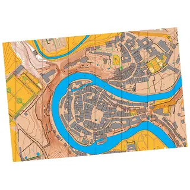
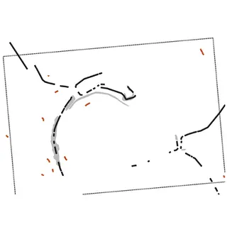
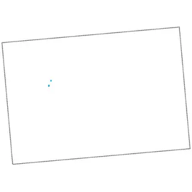
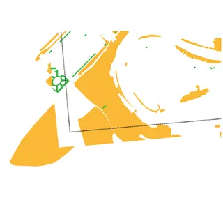
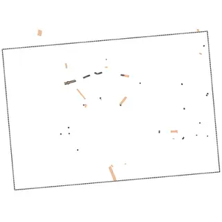
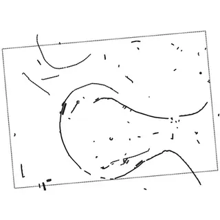
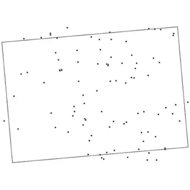
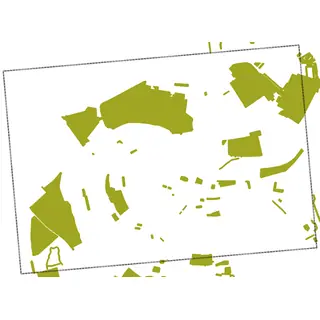

# The layers: Old town of Český Krumlov

[Examples overview](../README.en.md) · [Deutsch](layers.md)

Next to the map (the base map below), freemapper writes seven candidate layers and the templates you check them against. The layers are `templates/candidates-<layer>.omap` in the project and start hidden in OOM. A click on an image shows the layer at full size.

## Base map

<table align="center">
<tr><td width="170" align="center" valign="top"> Base map (without candidates)</td></tr>
</table>

## Candidate layers

<table align="center">
<tr><td width="170" align="center" valign="top"> Terrain</td><td width="170" align="center" valign="top"> Water</td><td width="170" align="center" valign="top"> Vegetation</td><td width="170" align="center" valign="top"> Paths</td></tr>
<tr><td width="170" align="center" valign="top"> Barriers</td><td width="170" align="center" valign="top"> Features</td><td width="170" align="center" valign="top"> Out of bounds</td></tr>
</table>

## Templates behind the map

The example has no raster templates for this area.
