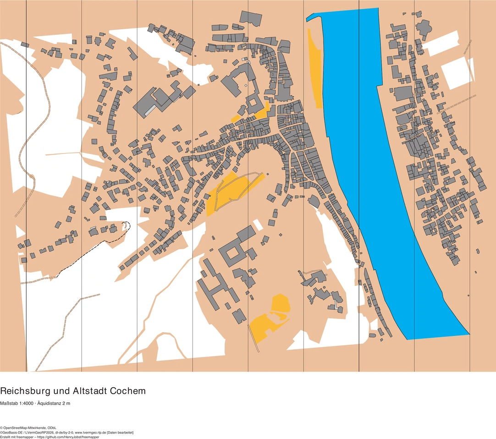
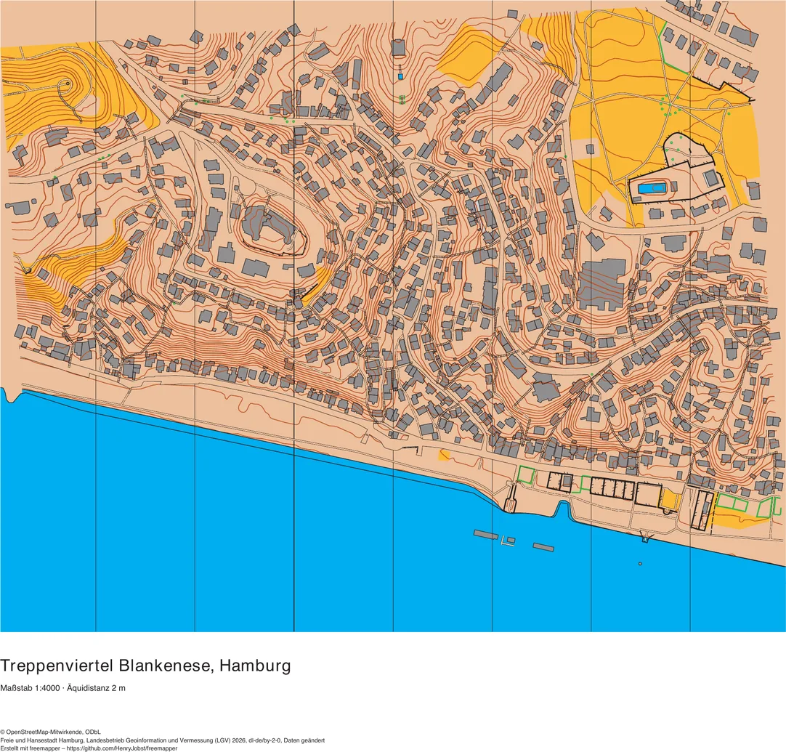
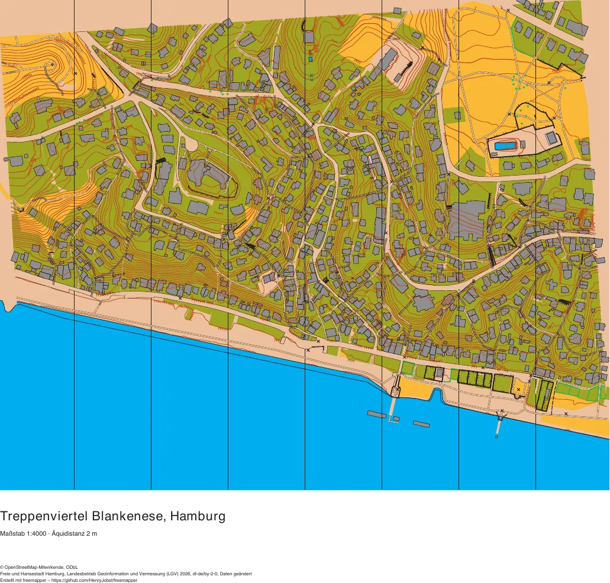

# Map and training map side by side

[Deutsch](vergleich.md) · [Examples overview](README.en.md)

freemapper writes two PDFs on request. `--pdf` writes `<name>.pdf`, the map with exactly the objects of the OOM file,
so no candidates. `--pdf-candidates` writes `<name>-candidates.pdf`, the training map: the map plus every candidate
drawn as a map object. Candidates are objects freemapper derives with less certainty, such as contours, trees, private
plots or stairs. The manual explains [what to check in the terrain](../docs/manual/en.md#9-what-to-check-in-the-terrain)
and describes the [PDF switches](../docs/manual/en.md#10-map-as-pdf).

All eleven examples have the training map as a PDF. Two of them, Cochem and Blankenese, also come with the map alone;
for the others, `freemapper run --pdf <project folder>` writes it. The images are previews. The links under them open
the PDFs.

## Why the map alone is so plain

freemapper puts only reliable register data on the map: buildings, streets, water, forest, open land and the walkable
area. Whatever is derived automatically or is uncertain stays a candidate, so that a mapper checks it. That includes
contours, trees, fences and walls, hedges, out-of-bounds areas and control sites. In Cochem, 1315 map objects (1156 of
them buildings) face 894 candidates: 234 bushes and small trees (418), 205 out-of-bounds areas (520), 151 contours
(101), 78 control sites (531) and 46 unpaved paths (505.1). The map alone is therefore safe but thin. The training map
shows what freemapper can derive, and you check each of those objects in the terrain before you keep it.

## Cochem

| Map (default) | with candidates |
|---|---|
|  |  |
| [rheinland-pfalz-cochem.pdf](rheinland-pfalz-cochem/rheinland-pfalz-cochem.pdf) | [rheinland-pfalz-cochem-candidates.pdf](rheinland-pfalz-cochem/rheinland-pfalz-cochem-candidates.pdf) |

The map has 1315 objects, mostly buildings (1156), plus water, canopies and the walkable area. There are 894
candidates on top, 0.7 per map object. 463 come from OSM, 221 from the ALKIS land use, 193 from the terrain model and
17 from ALKIS.

The five most frequent candidate symbols:

| Symbol | Count |
|---|---:|
| 418 prominent bush or small tree | 234 |
| 520 area that shall not be entered | 205 |
| 101 contour | 151 |
| 531 control site | 78 |
| 505.1 unpaved footpath | 46 |

There are also 42 index contours (102). Together the contours change the picture most: they cover the castle hill and
the valley sides across the whole sheet. The trees and the out-of-bounds areas fill the rest.

The map alone shows only the town; the candidates show where the ground gets steep. You keep the contours if they
match the terrain and check every 520 area on site before it counts as out of bounds. Of the trees you keep the
prominent ones. The control sites (531) are suggestions for course setting and do not belong on the map.

## Blankenese

| Map (default) | with candidates |
|---|---|
|  |  |
| [hamburg-blankenese.pdf](hamburg-blankenese/hamburg-blankenese.pdf) | [hamburg-blankenese-candidates.pdf](hamburg-blankenese/hamburg-blankenese-candidates.pdf) |

The map has 969 objects, 880 of them buildings. There are 979 candidates on top, 1.0 per map object. 690 come from the
ALKIS land use, 187 from OSM, 95 from the terrain model and 7 from ALKIS.

The five most frequent candidate symbols:

| Symbol | Count |
|---|---:|
| 520 area that shall not be entered | 696 |
| 101 contour | 76 |
| 505.1 unpaved footpath | 48 |
| 418 prominent bush or small tree | 39 |
| 531 control site | 32 |

Almost three quarters of the candidates are out-of-bounds areas. 657 of them are residential areas and 21 are mixed-use
areas from the ALKIS land use, that is, the plots between the stepped lanes. They turn the training map olive green.
Which plots are really off limits is for you to decide on site. The 76 contours show the Elbe bank; Cochem has 151.

## How the two examples were chosen

The choice follows a measurement on all eleven examples. Each was rendered as a map and as a training map (A3, 120 dpi).
The mean pixel difference is the average colour deviation over the whole sheet, in percent of the value range. The last
column gives the share of pixels that differ visibly (a deviation above 24 of 255 in one colour channel). The sheet
includes the white title block, so the absolute values are small; the order is what counts. The table is sorted by the
pixel difference.

| Example | Map objects | Candidates | Candidates per map object | Mean pixel difference | Changed pixels |
|---|---:|---:|---:|---:|---:|
| [Cochem](rheinland-pfalz-cochem/) | 1315 | 894 | 0.7 | 4.9 % | 16.8 % |
| [Blankenese](hamburg-blankenese/) | 969 | 979 | 1.0 | 4.9 % | 16.3 % |
| [Monschau](nordrhein-westfalen-monschau/) | 993 | 851 | 0.9 | 4.6 % | 16.1 % |
| [Marburg](hessen-marburg/) | 1541 | 1065 | 0.7 | 3.9 % | 14.9 % |
| [Bautzen](sachsen-bautzen/) | 1226 | 1376 | 1.1 | 3.9 % | 14.9 % |
| [Viktoriapark](berlin-viktoriapark/) | 766 | 2263 | 3.0 | 3.7 % | 13.9 % |
| [Quedlinburg](sachsen-anhalt-quedlinburg/) | 1642 | 1111 | 0.7 | 3.7 % | 13.2 % |
| [Sanssouci](brandenburg-sanssouci/) | 443 | 1981 | 4.5 | 3.5 % | 15.2 % |
| [Wismar](mecklenburg-vorpommern-wismar/) | 2486 | 1757 | 0.7 | 2.5 % | 9.4 % |
| [Herrenhausen](niedersachsen-herrenhausen/) | 275 | 2142 | 7.8 | 2.1 % | 9.3 % |
| [Lübeck](schleswig-holstein-luebeck/) | 2292 | 1766 | 0.8 | 1.8 % | 6.9 % |

The counts suggested a different pair: Sanssouci and Herrenhausen have the most candidates per map object, 4.5 and
7.8. But their maps are small, and many of their candidates are trees, small points that change little area. In
Cochem and Blankenese, contours and out-of-bounds areas change large parts of the sheet. Monschau follows closely at
4.6 %, so the gap to the first two is small. The first three places stayed the same at 60 dpi and 120 dpi.

The symbol counts come from the `templates/candidates.omap` of each example. The training map leaves out points under a
520 area and passages nobody can reach (`freemapper:hidden`), so the picture does not match these counts in every
detail.

Made with freemapper – https://github.com/HenryJobst/freemapper
