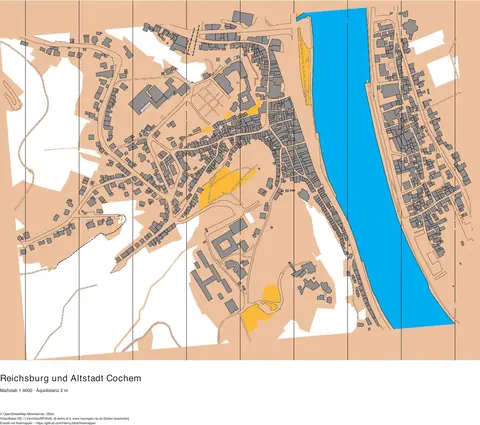
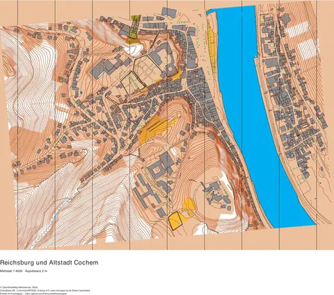
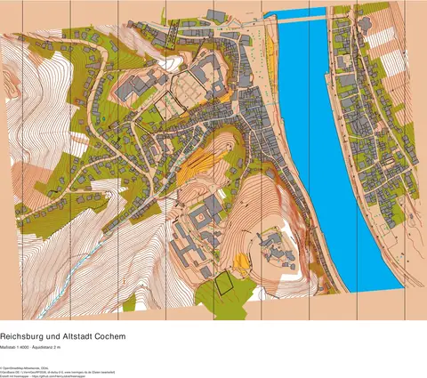

# The three content profiles compared

[Deutsch](vergleich.md) · [Examples overview](README.en.md)

What freemapper puts straight onto the map and what stays a candidate in the template `templates/candidates.omap`
is decided by the [content profile](../docs/manual/en.md#what-goes-straight-onto-the-map): `safe`, `balanced` (the
default) or `full`. Candidates are uncertain derived objects that a mapper checks before taking them over. The
manual explains [what to check in the terrain](../docs/manual/en.md#9-what-to-check-in-the-terrain).

This page shows one area, Reichsburg and Cochem old town, in all three profiles. The pictures show the map alone,
exactly the objects of the OOM file (`--pdf`); the link below opens the PDF. All examples are built with
`balanced`; the other two versions were made from the same data with `freemapper export --force --content safe`
and `--content full`.

## Cochem in three profiles

| `safe` | `balanced` (default) | `full` |
|---|---|---|
|  |  |  |
| [rheinland-pfalz-cochem-safe.pdf](rheinland-pfalz-cochem/rheinland-pfalz-cochem-safe.pdf) | [rheinland-pfalz-cochem.pdf](rheinland-pfalz-cochem/rheinland-pfalz-cochem.pdf) | [rheinland-pfalz-cochem-full.pdf](rheinland-pfalz-cochem/rheinland-pfalz-cochem-full.pdf) |

| Profile | Map objects | Candidates |
|---|---:|---:|
| `safe` | 1663 | 1278 |
| `balanced` | 2435 | 523 |
| `full` | 2879 | 38 |

All three versions have the same 1156 buildings (521), the forest (405), the Moselle and the railway. The
difference lies in everything that does not come from the cadastre.

## From `safe` to `balanced`

With `safe` the map shows the town but not the terrain. The castle hills and valley sides are white, because the
contours stay candidates, and so do paths of unknown surface, walls, stairs and trees.

With `balanced` these objects go onto the map, because OpenStreetMap and the terrain model are often their only
source:

| Symbol | `safe`: candidates | `balanced`: map |
|---|---:|---:|
| 101 contour | 282 | 282 |
| 102 index contour | 74 | 74 |
| 418 bush or small tree | 233 | 187 |
| 532.6 stairway | 51 | 51 |
| 505.1 unpaved footpath | 46 | 51 |
| 513.2 passable retaining wall | 29 | 29 |
| 515 impassable wall | 30 | 11 |

523 objects stay candidates, most of them estimates: 199 out-of-bounds areas (520) from the ALKIS land use, 113
earth banks (104) from the terrain model, 77 control sites (531), 46 trees, 24 areas of open land (401), 19 walls,
19 monuments (526) and 10 cliffs (201).

## From `balanced` to `full`

`full` puts everything onto the map, as the training map (`--pdf-candidates`) draws it. In Cochem 199
out-of-bounds areas, 113 earth banks, 70 control sites, the other 19 walls and the 10 cliffs come in; of the cliffs,
5 stretches and a top line (201.3) are drawn, and 12 low stretches stay candidates. The plots between
the houses turn olive green. Some points that were candidates in `balanced` are missing from `full` altogether,
among them 46 trees and 7 control sites: as map objects they are subject to the ISSprOM minimum distance, and
freemapper leaves out those that stand too close. 38 objects stay candidates: 24 areas of open land (401), the 12 low cliff stretches, a curb and a canopy.

## Which profile for what

- `safe` fits when you survey the terrain yourself and want only the surveyed base.
- `balanced` is the default. Contours, paths, stairs and walls are on the map already; you still check them. What
  is an estimate, above all the out-of-bounds areas, stays a candidate.
- `full` gives a quick training map without going into the terrain. It does not tell whether a 520 area is really
  forbidden; before a competition you check each one.

The training map of each example draws the map with all candidates, for Cochem
[rheinland-pfalz-cochem-candidates.pdf](rheinland-pfalz-cochem/rheinland-pfalz-cochem-candidates.pdf). It leaves
out points under a 520 area and passages that cannot be reached (`freemapper:hidden`), so its picture does not
match the counts above in every point. The counts come from `rheinland-pfalz-cochem.omap` and
`templates/candidates.omap` of each version.

Made with freemapper – https://github.com/HenryJobst/freemapper
