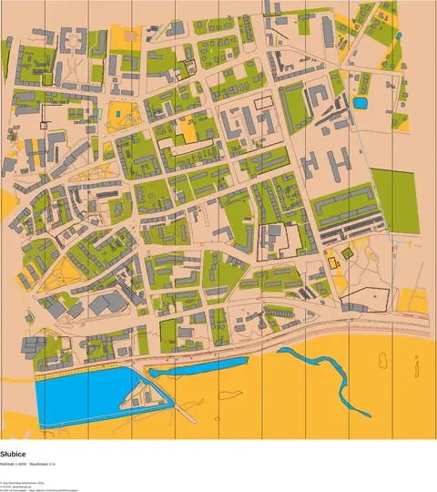
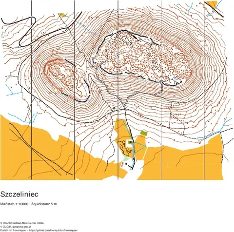

# Examples outside Germany

[Deutsch](international.md) · [Examples overview](README.en.md) · [Background](background.en.md)

One sprint map and one forest map per country show that freemapper makes maps there. The preview and the PDF show the training map; the columns mean the same as in the [examples overview](README.en.md).

## Poland

Terrain, orthophoto, buildings and land use come from GUGiK (the cadastre EGiB), paths and water from OpenStreetMap.

| Preview | Kind | Area | Map objects | Candidates | Symbols |
|---|---|---|---:|---:|---:|
|  <a href="polska-slubice-sprint/polska-slubice-sprint-training.pdf">PDF</a> · <a href="polska-slubice-sprint/polska-slubice-sprint-candidates.pdf">check print</a> | Sprint 1:4000 | [Town centre of Słubice](polska-slubice-sprint/): town centre at the German border, 1 × 1 km: blocks of flats and a street grid, lakes in the south | 2407 | 183 | 38 |
|  <a href="polska-szczeliniec-forest/polska-szczeliniec-forest-training.pdf">PDF</a> · <a href="polska-szczeliniec-forest/polska-szczeliniec-forest-candidates.pdf">check print</a> | Forest 1:10 000 | [Szczeliniec Wielki, Stołowe Mountains](polska-szczeliniec-forest/): table mountain with rock walls, steep slopes, streams and many hiking paths, 1.3 × 0.9 km | 565 | 1122 | 28 |

Created with freemapper – https://github.com/HenryJobst/freemapper
