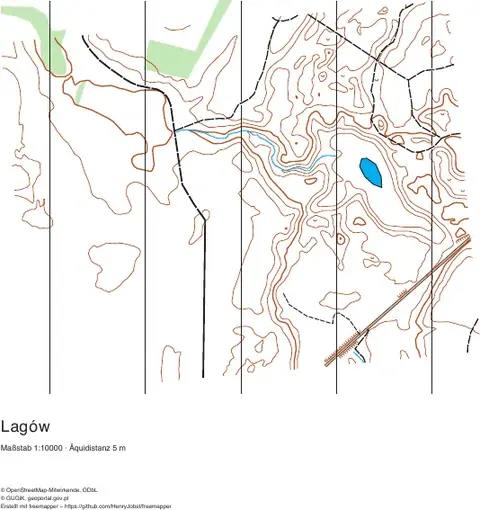

# Beispiele außerhalb Deutschlands

[English](international.en.md) · [Beispielübersicht](README.md) · [Hintergrund](hintergrund.md)

Je eine Sprintkarte und eine Waldkarte pro Land zeigen, dass freemapper dort Karten erzeugt. Vorschau und PDF zeigen die Trainingskarte; die Spalten bedeuten dasselbe wie in der [Beispielübersicht](README.md).

## Polen

Gelände, Luftbild, Gebäude und Landnutzung kommen von GUGiK (Kataster EGiB), Wege und Gewässer aus OpenStreetMap. Hinweise zu Genehmigungen gibt es für Polen noch nicht.

| Vorschau | Kartenart | Gebiet | Kartenobjekte | Kandidaten | Symbole |
|---|---|---|---:|---:|---:|
|  <a href="polska-slubice-sprint/polska-slubice-sprint-training.pdf">PDF</a> · <a href="polska-slubice-sprint/polska-slubice-sprint-candidates.pdf">Prüfausdruck</a> | Sprint 1:4000 | [Innenstadt Słubice](polska-slubice-sprint/): Stadtkern an der deutschen Grenze, 1 × 1 km: Wohnblöcke und Straßenraster, Seen im Süden | 2407 | 183 | 38 |
|  <a href="polska-lagow-forest/polska-lagow-forest-training.pdf">PDF</a> · <a href="polska-lagow-forest/polska-lagow-forest-candidates.pdf">Prüfausdruck</a> | Wald 1:10 000 | [Wald bei Łagów](polska-lagow-forest/): Moränenhügel mit Bach, Teich und Wegen, 1,2 × 0,9 km | 101 | 31 | 20 |

Erstellt mit freemapper – https://github.com/HenryJobst/freemapper
