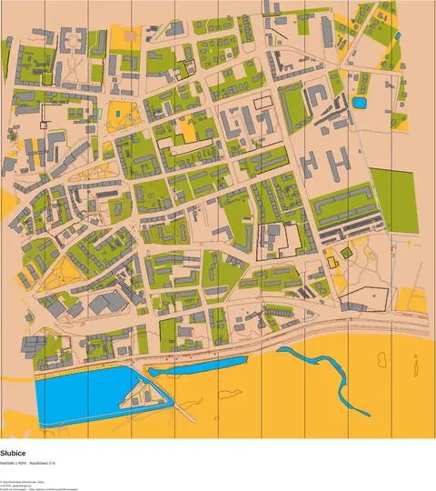
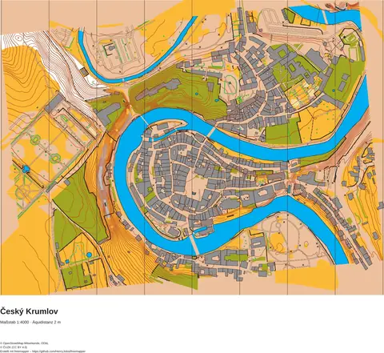
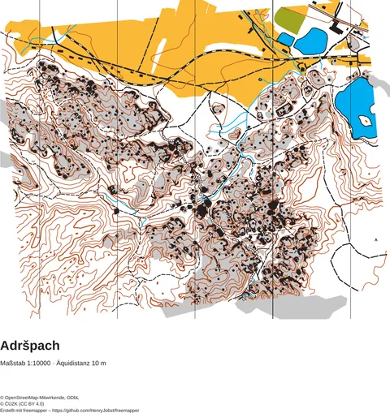

# Beispiele außerhalb Deutschlands

[English](international.en.md) · [Beispielübersicht](README.md) · [Hintergrund](hintergrund.md)

Je eine Sprintkarte und eine Waldkarte pro Land zeigen, dass freemapper dort Karten erzeugt. Vorschau und PDF zeigen die Trainingskarte; die Spalten bedeuten dasselbe wie in der [Beispielübersicht](README.md).

## Polen

Gelände, Luftbild, Gebäude und Landnutzung kommen von GUGiK (Kataster EGiB), Wege und Gewässer aus OpenStreetMap.

| Vorschau | Kartenart | Gebiet | Kartenobjekte | Kandidaten | Symbole |
|---|---|---|---:|---:|---:|
|  <a href="polska-slubice-sprint/polska-slubice-sprint-training.pdf">PDF</a> · <a href="polska-slubice-sprint/polska-slubice-sprint-candidates.pdf">Prüfausdruck</a> · <a href="polska-slubice-sprint/layers.md">Ebenen</a> | Sprint 1:4000 | [Innenstadt Słubice](polska-slubice-sprint/): Stadtkern an der deutschen Grenze, 1 × 1 km: Wohnblöcke und Straßenraster, Seen im Süden | 2599 | 2039 | 38 |
|  <a href="polska-szczeliniec-forest/polska-szczeliniec-forest-training.pdf">PDF</a> · <a href="polska-szczeliniec-forest/polska-szczeliniec-forest-candidates.pdf">Prüfausdruck</a> · <a href="polska-szczeliniec-forest/layers.md">Ebenen</a> | Wald 1:10 000 | [Szczeliniec Wielki, Góry Stołowe](polska-szczeliniec-forest/): Tafelberg mit Felswänden, steilen Hängen, Bächen und vielen Wanderwegen, 1,3 × 0,9 km | 575 | 1143 | 28 |

## Tschechien

Gelände, Oberflächenmodell und Luftbild kommen vom ČÚZK, Gebäude aus dem Register RÚIAN, die Landnutzung aus ZABAGED, Wege und Gewässer aus OpenStreetMap.

| Vorschau | Kartenart | Gebiet | Kartenobjekte | Kandidaten | Symbole |
|---|---|---|---:|---:|---:|
|  <a href="cesko-cesky-krumlov-sprint/cesko-cesky-krumlov-sprint-training.pdf">PDF</a> · <a href="cesko-cesky-krumlov-sprint/cesko-cesky-krumlov-sprint-candidates.pdf">Prüfausdruck</a> · <a href="cesko-cesky-krumlov-sprint/layers.md">Ebenen</a> | Sprint 1:4000 | [Altstadt Český Krumlov](cesko-cesky-krumlov-sprint/): Altstadt in der Moldauschleife, Schlossberg, enge Gassen, 0,8 × 0,55 km | 1670 | 1109 | 51 |
|  <a href="cesko-adrspach-forest/cesko-adrspach-forest-training.pdf">PDF</a> · <a href="cesko-adrspach-forest/cesko-adrspach-forest-candidates.pdf">Prüfausdruck</a> · <a href="cesko-adrspach-forest/layers.md">Ebenen</a> | Wald 1:10 000 | [Felsenstadt Adršpach](cesko-adrspach-forest/): Sandsteintürme und Schluchten, 1,2 × 0,9 km | 968 | 1801 | 38 |

Erstellt mit freemapper – https://github.com/HenryJobst/freemapper
