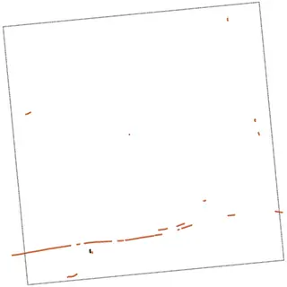
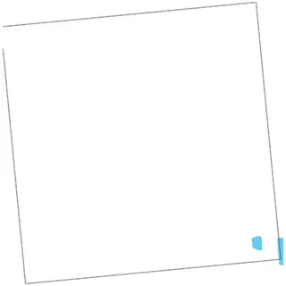
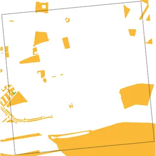
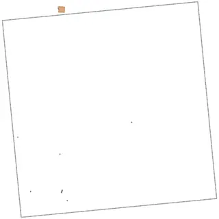
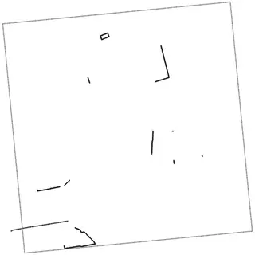
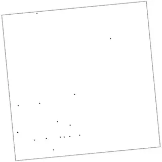
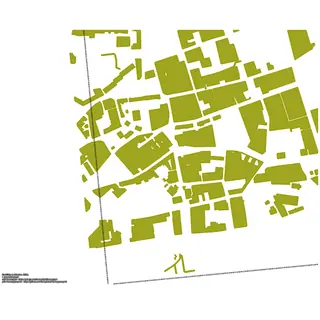

# Die Ebenen: Innenstadt Słubice

[Beispielübersicht](../README.md) · [English](layers.en.md)

freemapper schreibt zur Karte sieben Kandidaten-Layer und die Vorlagen, nach denen man sie prüft. Die Layer liegen als `templates/candidates-<Layer>.omap` im Projekt und starten in OOM ausgeblendet. Ein Klick auf ein Bild zeigt die Ebene in voller Größe.

## Kandidaten-Layer

<table align="center">
<tr><td width="170" align="center" valign="top"> Gelände</td><td width="170" align="center" valign="top"> Gewässer</td><td width="170" align="center" valign="top"> Vegetation</td><td width="170" align="center" valign="top"> Wege</td></tr>
<tr><td width="170" align="center" valign="top"> Barrieren</td><td width="170" align="center" valign="top"> Objekte</td><td width="170" align="center" valign="top"> Sperrgebiete</td></tr>
</table>

## Vorlagen hinter der Karte

Für dieses Gebiet gibt es keine Raster-Vorlagen im Beispiel.
