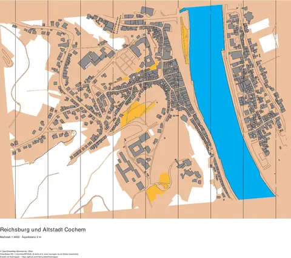
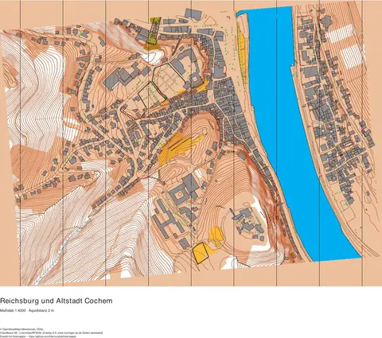
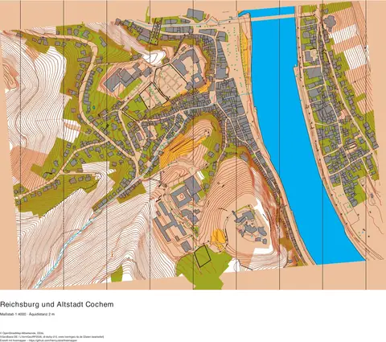
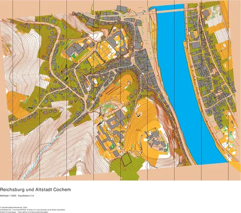

# Die drei Inhaltsprofile im Vergleich

[English](compare.en.md) · [Beispielübersicht](README.md)

Was freemapper direkt in die Karte legt und was als Kandidat in den Kandidaten-Layern
`templates/candidates-<layer>.omap` bleibt, bestimmt das
[Inhaltsprofil](../docs/manual/de.md#was-direkt-auf-die-karte-kommt): `safe`, `balanced` (Standard) oder `full`.
Kandidaten sind unsicher abgeleitete Objekte, die ein Kartierer prüft, bevor er sie übernimmt. Das Handbuch
erklärt, [was im Gelände zu prüfen ist](../docs/manual/de.md#9-was-im-gelände-zu-prüfen-ist).

Diese Seite zeigt dasselbe Gebiet, Reichsburg und Altstadt Cochem, in allen drei Profilen. Die Bilder zeigen die
Karte allein, also genau die Objekte der OOM-Datei (`--pdf`); der Link darunter öffnet das PDF. Die Kandidaten liegen
in sieben Layern nach Art (ADR 0156), die OOM beim Öffnen der Karte ausgeblendet zeigt. In jedem Profil nimmt die
leichte Bereinigung verdeckte Linien und Objekte unter der Mindestgröße von der Karte und legt sie zu den Kandidaten
(ADR 0157). Alle Beispiele sind mit `balanced` gebaut; die beiden anderen Fassungen sind mit
`freemapper export --force --content safe` und `--content full` aus denselben Daten entstanden.

## Cochem in drei Profilen

| `safe` | `balanced` (Standard) | `full` |
|---|---|---|
|  |  |  |
| [rheinland-pfalz-cochem-safe.pdf](rheinland-pfalz-cochem/rheinland-pfalz-cochem-safe.pdf) | [rheinland-pfalz-cochem.pdf](rheinland-pfalz-cochem/rheinland-pfalz-cochem.pdf) | [rheinland-pfalz-cochem-full.pdf](rheinland-pfalz-cochem/rheinland-pfalz-cochem-full.pdf) |

| Profil | Kartenobjekte | Kandidaten |
|---|---:|---:|
| `safe` | 1649 | 1278 |
| `balanced` | 2355 | 545 |
| `full` | 2817 | 117 |

In allen drei Fassungen gleich sind die 1156 Gebäude (521), der Wald (405), die Mosel und die Bahn. Der
Unterschied liegt in allem, was nicht aus dem Kataster kommt.

## Von `safe` zu `balanced`

Mit `safe` zeigt die Karte die Stadt, aber nicht das Gelände. Die Burgberge und Talhänge sind weiß, denn die
Höhenlinien bleiben Kandidaten, ebenso Wege ohne bekannte Oberfläche, Mauern, Treppen und Bäume.

Mit `balanced` kommen diese Objekte in die Karte, weil OpenStreetMap und das Geländemodell für sie oft die einzige
Quelle sind:

| Symbol | `safe`: Kandidaten | `balanced`: Karte |
|---|---:|---:|
| 101 Höhenlinie | 282 | 248 |
| 102 Zählkurve | 74 | 65 |
| 418 Busch oder kleiner Baum | 233 | 187 |
| 532.6 Treppe | 51 | 38 |
| 505.1 unbefestigter Weg | 46 | 46 |
| 513.2 überwindbare Stützmauer | 29 | 26 |
| 515 unüberwindbare Mauer | 30 | 13 |

Bei Höhenlinien und Treppen stehen weniger Objekte in der Karte, als in `safe` Kandidaten waren: Die leichte
Bereinigung verbindet Höhenlinien, die Ende an Ende liegen, und legt Treppen an einem Gebäude oder unter der
Mindestgröße zu den Kandidaten. Die Mauern aus dem Geländemodell bleiben auch mit `balanced` Kandidaten.

Kandidaten bleiben 545 Objekte, vor allem Schätzungen: 199 Sperrflächen (520) aus der ALKIS-Nutzung, 113
Böschungen (104) aus dem Geländemodell, 77 Kontrollstandorte (531), 46 Bäume, 24 Flächen offenen Landes (401),
19 Mauern aus dem Geländemodell, 19 Denkmäler (526) und 10 Felswände (201). 22 weitere hat die leichte Bereinigung
von der Karte genommen: 15 Treppen (9 an einem Gebäude, 6 unter der Mindestgröße), 3 Mauern und je 2 Hecken und
Stützmauern.

## Von `balanced` zu `full`

`full` legt alles in die Karte, wie der Prüfausdruck (`--pdf-candidates`) es zeichnet. In Cochem kommen 199
Sperrflächen, die Böschungen, 70 Kontrollstandorte, die Mauern aus dem Geländemodell, 16 Denkmäler und die 10
Felswände dazu; von den Felswänden werden 5 Stücke und eine Oberkante (201.3) gezeichnet, 12 Stücke bleiben
Kandidaten, weil sie zu niedrig, zu kurz oder zu nah an einer anderen Wand sind. Die Grundstücke zwischen den
Häusern werden dadurch olivgrün. Einige Punkte, die in `balanced` Kandidaten waren, fehlen in `full` ganz, darunter
46 Bäume, 7 Kontrollstandorte und 3 Denkmäler: Als Kartenobjekte gilt für sie der Mindestabstand der ISSprOM, und
freemapper lässt die zu dicht stehenden weg.

Kandidaten bleiben 117 Objekte. Die 24 Flächen offenen Landes (401), die 12 Felsstücke, ein nicht erreichbarer
Durchgang (522) und der Umriss des Kartengebiets kommen auch mit `full` nicht in die Karte. Die übrigen 79 nimmt die
leichte Bereinigung von der Karte, weil in `full` mehr Linien aufeinanderliegen: 37 Stücke von Höhenlinien auf einer Böschung, 13 Stücke
von Böschungen auf einem Weg, einem Gebäude oder einer anderen Böschung, die 15 Treppen, 8 Mauern und je 2 Hecken,
Stützmauern und kleine Bäche (305).

## Welches Profil wofür

- `safe` passt, wenn Sie das Gelände selbst aufnehmen und nur die vermessene Grundlage wollen.
- `balanced` ist der Standard. Höhenlinien, Wege, Treppen und Mauern stehen schon in der Karte; prüfen müssen Sie
  sie trotzdem. Was eine Schätzung ist, vor allem die Sperrflächen, bleibt Kandidat.
- `full` gibt eine schnelle Karte ohne Gang ins Gelände. Ob eine 520-Fläche wirklich verboten ist, sagt sie nicht;
  vor einem Wettkampf prüfen Sie jede.

## Grundkarte, Prüfausdruck und Trainingskarte

Aus demselben Lauf mit `balanced` entstehen drei Karten. Die Grundkarte zeigt die sicheren Objekte lagetreu; die
Kandidaten liegen ausgeblendet in den Layern. Der Prüfausdruck zeichnet die Grundkarte mit allen Kandidaten,
ebenfalls lagetreu, zum Prüfen im Gelände. Die Trainingskarte nimmt Karte und Kandidaten und bereinigt sie zum
Drucken und Laufen: Sie verbindet, verschiebt und lässt weg, was sich sonst überdecken würde.

| Grundkarte | Prüfausdruck | Trainingskarte |
|---|---|---|
|  |  |  |
| [rheinland-pfalz-cochem.pdf](rheinland-pfalz-cochem/rheinland-pfalz-cochem.pdf) | [rheinland-pfalz-cochem-candidates.pdf](rheinland-pfalz-cochem/rheinland-pfalz-cochem-candidates.pdf) | [rheinland-pfalz-cochem-training.pdf](rheinland-pfalz-cochem/rheinland-pfalz-cochem-training.pdf) |

Der Prüfausdruck dieses Beispiels zeichnet auch die Vegetation aus den Laserpunkten, die die Zählungen oben
auslassen. Er lässt Punkte unter einer 520-Fläche und nicht erreichbare Durchgänge weg (`freemapper:hidden`),
deshalb deckt sich sein Bild nicht in jedem Punkt mit den Zählungen. Die Zählungen stammen aus
`rheinland-pfalz-cochem.omap` und den sieben Kandidaten-Layern der jeweiligen Fassung; den Umriss, den jeder Layer
hat, zählen sie einmal.

Erstellt mit freemapper – https://github.com/HenryJobst/freemapper
