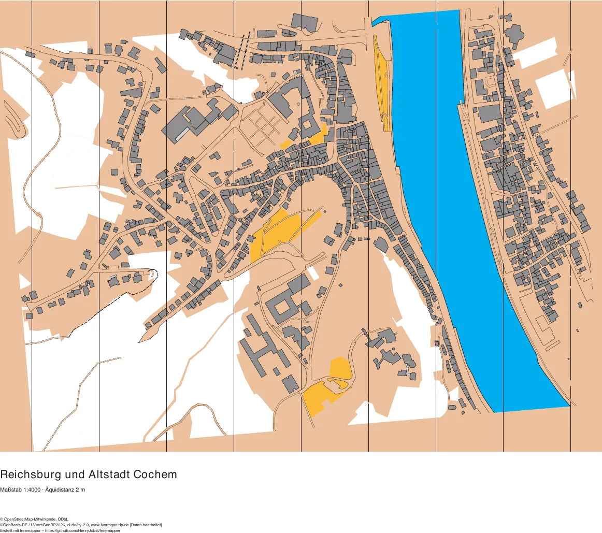
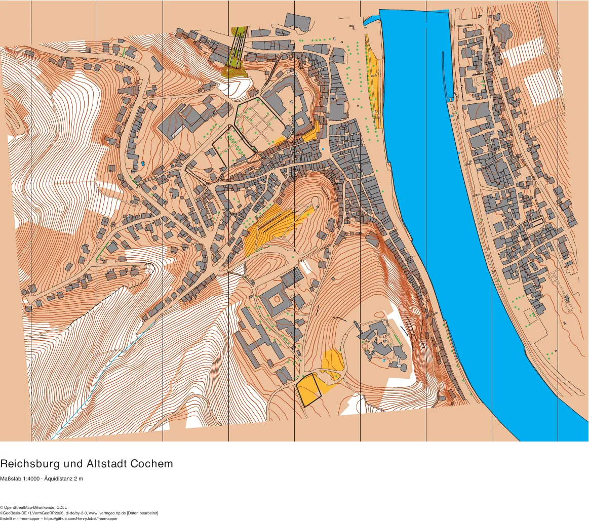
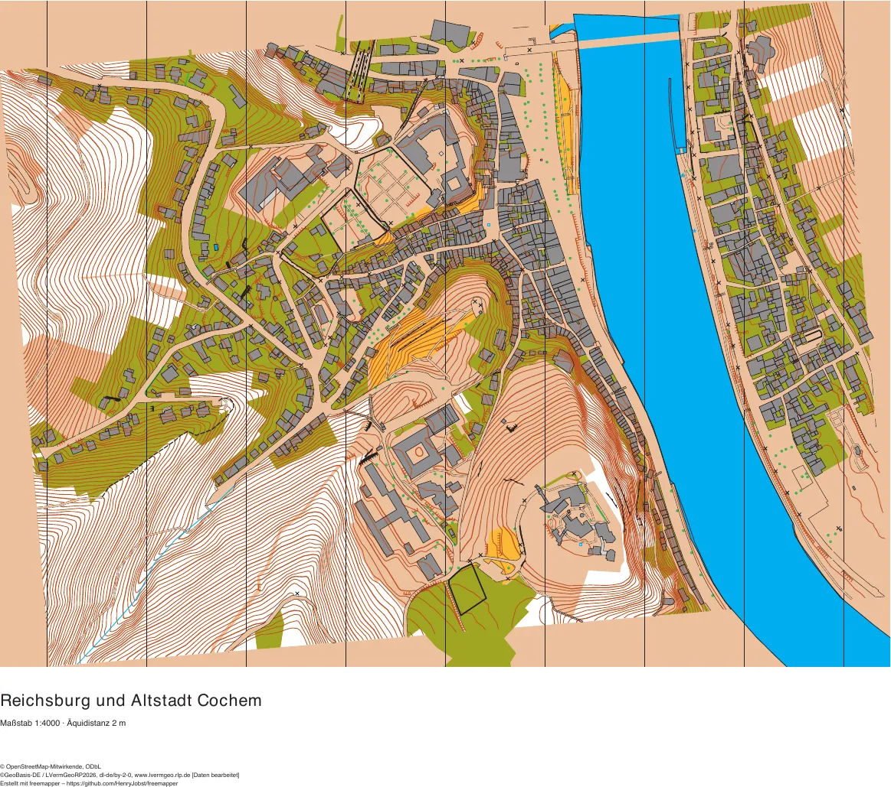

# Die drei Inhaltsprofile im Vergleich

[English](compare.en.md) · [Beispielübersicht](README.md)

Was freemapper direkt in die Karte legt und was als Kandidat in der Vorlage `templates/candidates.omap` bleibt,
bestimmt das [Inhaltsprofil](../docs/manual/de.md#was-direkt-auf-die-karte-kommt): `safe`, `balanced` (Standard) oder
`full`. Kandidaten sind unsicher abgeleitete Objekte, die ein Kartierer prüft, bevor er sie übernimmt. Das Handbuch
erklärt, [was im Gelände zu prüfen ist](../docs/manual/de.md#9-was-im-gelände-zu-prüfen-ist).

Diese Seite zeigt dasselbe Gebiet, Reichsburg und Altstadt Cochem, in allen drei Profilen. Die Bilder zeigen die
Karte allein, also genau die Objekte der OOM-Datei (`--pdf`); der Link darunter öffnet das PDF. Alle Beispiele sind
mit `balanced` gebaut; die beiden anderen Fassungen sind mit `freemapper export --force --content safe` und
`--content full` aus denselben Daten entstanden.

## Cochem in drei Profilen

| `safe` | `balanced` (Standard) | `full` |
|---|---|---|
|  |  |  |
| [rheinland-pfalz-cochem-safe.pdf](rheinland-pfalz-cochem/rheinland-pfalz-cochem-safe.pdf) | [rheinland-pfalz-cochem.pdf](rheinland-pfalz-cochem/rheinland-pfalz-cochem.pdf) | [rheinland-pfalz-cochem-full.pdf](rheinland-pfalz-cochem/rheinland-pfalz-cochem-full.pdf) |

| Profil | Kartenobjekte | Kandidaten |
|---|---:|---:|
| `safe` | 1664 | 1691 |
| `balanced` | 2866 | 506 |
| `full` | 3285 | 25 |

In allen drei Fassungen gleich sind die 1156 Gebäude (521), der Wald (405), die Mosel und die Bahn. Der
Unterschied liegt in allem, was nicht aus dem Kataster kommt.

## Von `safe` zu `balanced`

Mit `safe` zeigt die Karte die Stadt, aber nicht das Gelände. Die Burgberge und Talhänge sind weiß, denn die
Höhenlinien bleiben Kandidaten, ebenso Wege ohne bekannte Oberfläche, Mauern, Treppen und Bäume.

Mit `balanced` kommen diese Objekte in die Karte, weil OpenStreetMap und das Geländemodell für sie oft die einzige
Quelle sind:

| Symbol | `safe`: Kandidaten | `balanced`: Karte |
|---|---:|---:|
| 101 Höhenlinie | 627 | 627 |
| 102 Zählkurve | 155 | 155 |
| 418 Busch oder kleiner Baum | 234 | 188 |
| 532.6 Treppe | 51 | 51 |
| 505.1 unbefestigter Weg | 46 | 51 |
| 513.2 überwindbare Stützmauer | 29 | 29 |
| 515 unüberwindbare Mauer | 30 | 11 |

Kandidaten bleiben 506 Objekte, vor allem Schätzungen: 203 Sperrflächen (520) aus der ALKIS-Nutzung, 114
Böschungen (104) aus dem Geländemodell, 78 Kontrollstandorte (531), 46 Bäume, 24 Flächen offenen Landes (401),
19 Mauern und 10 Felswände (201).

## Von `balanced` zu `full`

`full` legt alles in die Karte, wie die Trainingskarte (`--pdf-candidates`) es zeichnet. In Cochem kommen 203
Sperrflächen, 114 Böschungen, 71 Kontrollstandorte, die übrigen 19 Mauern und 10 Felswände dazu. Die Grundstücke zwischen den
Häusern werden dadurch olivgrün. Einige Punkte, die in `balanced` Kandidaten waren, fehlen in `full` ganz, darunter
46 Bäume und 7 Kontrollstandorte: Als Kartenobjekte gilt für sie der Mindestabstand der ISSprOM, und freemapper lässt
die zu dicht stehenden weg. Kandidaten bleiben 25 Objekte, 24 davon offenes Land (401).

## Welches Profil wofür

- `safe` passt, wenn Sie das Gelände selbst aufnehmen und nur die vermessene Grundlage wollen.
- `balanced` ist der Standard. Höhenlinien, Wege, Treppen und Mauern stehen schon in der Karte; prüfen müssen Sie
  sie trotzdem. Was eine Schätzung ist, vor allem die Sperrflächen, bleibt Kandidat.
- `full` gibt eine schnelle Trainingskarte ohne Gang ins Gelände. Ob eine 520-Fläche wirklich verboten ist, sagt
  sie nicht; vor einem Wettkampf prüfen Sie jede.

Die Trainingskarte jedes Beispiels zeichnet die Karte mit allen Kandidaten, für Cochem
[rheinland-pfalz-cochem-candidates.pdf](rheinland-pfalz-cochem/rheinland-pfalz-cochem-candidates.pdf). Sie lässt
Punkte unter einer 520-Fläche und nicht erreichbare Durchgänge weg (`freemapper:hidden`), deshalb deckt sich ihr
Bild nicht in jedem Punkt mit den Zählungen oben. Die Zählungen stammen aus `rheinland-pfalz-cochem.omap` und
`templates/candidates.omap` der jeweiligen Fassung.

Erstellt mit freemapper – https://github.com/HenryJobst/freemapper
